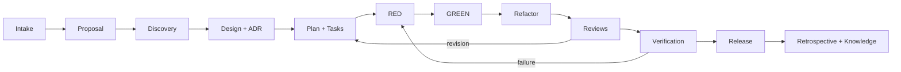

# Agentic Development Scaffold

A public-safe, monorepo-ready software delivery scaffold for humans, GitHub Copilot, and other coding agents. It turns an idea into traceable evidence through proposal, discovery, design, ADRs, bite-sized tasks, strict TDD, independent reviews, verification, release, and knowledge write-back.

## What this repository provides

- `AGENTS.md`: repository-wide operating contract for humans and agents.
- `.github/copilot-instructions.md`: comprehensive repository, lifecycle, evidence, safety, and handoff contract.
- `.github/agents/`: [15 specialist profiles](.github/agents/README.md) with least-privilege tools and explicit role boundaries.
- `.github/prompts/`: [18 reusable lifecycle prompts](.github/prompts/README.md) from intake through retrospective.
- `.github/instructions/`: [10 path-specific contracts](.github/instructions/README.md) for apps, packages, wiki, tests, workflows, and customization files.
- `.github/workflows/` and `.github/dependabot.yml`: least-privilege validation plus bounded dependency maintenance.
- `apps/`: independently deployable applications such as web, API, and workers.
- `packages/`: shared libraries, schemas, components, SDKs, and tool configuration.
- `wiki/`: the consolidated product knowledge control plane and its [canonical index](wiki/index.md).
- `workflows/`: the complete delivery lifecycle, with entry/exit gates and evidence.
- `scripts/validate_scaffold.py`: zero-dependency structural and safety validator.

## Local Vibe-Code Platform POC

This repository now includes a runnable local POC under `apps/portal` and `apps/control-plane`:

- React + Vite + TypeScript portal with Login, My Projects, Create Project, and Project Detail screens.
- NestJS + Fastify + TypeScript control plane with JWT-backed local demo identity, owner-scoped projects, idempotent creation, lifecycle state, request IDs, and health checks.
- PostgreSQL 16 metadata store with automatic schema bootstrap and two named users plus the golden template.
- Per-project workspace persistence with a generated FastAPI + SQLite request tracker, Git initialization, authenticated preview routes, and stop/start continuation.
- Generated app source is React/Vite/TypeScript plus FastAPI/SQLAlchemy/SQLite; the pinned code-server workspace image includes Node 20, Python, Git, the prebuilt frontend, and an approved run command.
- Seeded local named-user JWT login, a Coder provider adapter, and a pinned code-server workspace template under `workspace-template/`.
- SSO/OIDC and AI model gateway integrations are intentionally outside this POC.
- Kubernetes/K3s-native Coder template with one persistent workspace Deployment/PVC per project, owner-only code-server/generated-app Apps, resource limits, an explicit generated-app run action, and optional `CODER_GIT_REMOTE_URL` / `CODER_TEMPLATE_VERSION_ID` mapping.
- Docker Compose for the database, API, real code-server browser IDE, and static portal.

Run it with Docker:

```text
cp .env.example .env
docker compose up --build
```

Then open [http://localhost:5173](http://localhost:5173) and choose either seeded POC user. Creating or opening a project launches the real code-server IDE at [http://localhost:8080](http://localhost:8080), focused on that project's persistent source folder. The image includes the pinned Cline extension; configure a model provider inside the IDE if you want to use it. No SSO/OIDC or LiteLLM service is included. The second user is included so the ownership boundary can be demonstrated. Stop the stack with `docker compose down`; keep the named database volume to preserve projects, or use `docker compose down -v` when you intentionally want a clean bootstrap.

The local named-user login and local workspace adapter are the supported POC path. To exercise the cluster path, configure the Coder variables in `.env`, supply the approved workspace image and Git-provider variables to `workspace-template/main.tf`, and apply it to a reviewed Coder/K3s deployment. Live Git-provider recovery, Kubernetes operations, and production migrations remain human-owned integration work. See the [POC feature package](wiki/delivery/features/FTR-001-poc-platform/feature.md) and [ADR-0001](wiki/architecture/decisions/ADR-0001-local-poc-stack.md).

## Start a project

1. Use this repository as a template or copy it into a new repository.
2. Create deployable units under `apps/` and shared code under `packages/` only when it has real consumers.
3. Replace the example feature with your first real feature package.
4. Add immutable source material to `wiki/raw/` and register it in `wiki/raw/index.md`.
5. Start with `.github/prompts/00-intake.prompt.md` or the `orchestrator` agent.
6. Do not implement until proposal, design, plan, acceptance criteria, and required ADRs pass their gates.
7. Use strict RED-GREEN-REFACTOR and preserve command output as verification evidence.
8. Run `uv run --frozen --extra test python scripts/validate_scaffold.py` and `uv run --frozen --extra test pytest` before every PR.

## Lifecycle



## Human authority

Agents may analyze, propose, edit, test, and review within an approved task. Humans retain authority over scope, risk acceptance, architecture decisions, credentials, production deployment, destructive actions, and merge approval.

## Copilot surface compatibility

GitHub Copilot cloud agent consumes repository instructions and `.github/agents/*.agent.md` profiles. VS Code local agents additionally discover `.github/prompts/*.prompt.md` as explicit slash commands; current Agent Host cloud runs do not consume prompt files. The Markdown lifecycle under `workflows/` remains the vendor-neutral source, so a workflow is not lost when a Copilot surface lacks prompt-file support.

The design rationale and commit-pinned public repository comparison are recorded in [GitHub Copilot customization research](wiki/knowledge-base/copilot-customization-research.md).

Official references:

- [GitHub: repository custom instructions](https://docs.github.com/en/copilot/how-tos/copilot-on-github/customize-copilot/add-custom-instructions/add-repository-instructions)
- [GitHub: custom agents for Copilot cloud agent](https://docs.github.com/en/copilot/how-tos/copilot-on-github/customize-copilot/customize-cloud-agent/create-custom-agents)
- [VS Code: prompt files](https://code.visualstudio.com/docs/agent-customization/prompt-files)

## Public repository safety

This template contains no organization-specific domains, credentials, account IDs, host paths, or infrastructure details. Keep project secrets in approved secret stores, never Markdown or Git history.

## License

MIT. See `LICENSE`.
