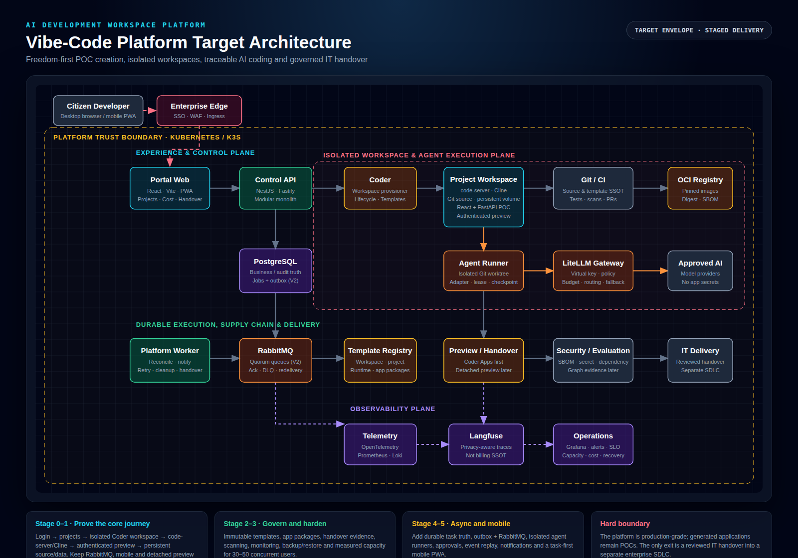

# Vibe-Code Platform Target Architecture and Delivery Plan

## Status and scope

This page records the target design envelope derived from [`wiki/raw/vibe-code-platform-plan.md`](../../raw/vibe-code-platform-plan.md). It is a planning baseline, not a claim that every component is deployed today. The accepted current implementation remains the [local POC baseline](README.md) and [ADR-0001](../decisions/ADR-0001-local-poc-stack.md).

**Scope boundary:** the platform is intended to become production-grade, but applications generated inside it remain proof-of-concepts. The supported exit is a reviewed IT handover package into a separate enterprise SDLC; there is no direct POC-to-production promotion path.

## Architecture decision summary

- Use **Coder** as the workspace lifecycle foundation rather than building a browser IDE or scheduler from scratch.
- Use **code-server** with a pinned coding-agent extension only after browser compatibility is proven with a real workflow.
- Build a thin **React/Vite portal** and a **NestJS/Fastify modular-monolith control plane** for company-specific projects, templates, audit, cost, lifecycle and handover.
- Keep **PostgreSQL** as platform truth. Add **RabbitMQ quorum queues** only when server-side asynchronous agent execution becomes a product requirement.
- Route approved models through **LiteLLM** using scoped virtual keys, budgets, routing and revocation. Keep provider credentials out of generated source and workspace images.
- Treat **Git plus an OCI registry** as the source of truth for versioned source, templates and pinned artifacts.
- Start preview with authenticated **Coder Apps**. Add detached preview only when adoption proves that sharing after workspace shutdown is required.
- Keep workspaces isolated, non-root and resource-limited. Never expose a shared host Docker socket to generated code.
- Use **Langfuse** for privacy-aware LLM traces, not as billing truth; use provider reconciliation for cost accuracy.

## Target architecture diagram

[Open the editable HTML diagram](../diagrams/vibe-code-platform-target-architecture.html) or [view the PNG export](../diagrams/vibe-code-platform-target-architecture.png).

## Plane responsibilities

| Plane | Responsibilities | Earliest stage |
|---|---|---|
| Experience | Portal, project journey, workspace links, cost and handover surfaces | Stage 0–1 |
| Control | Identity boundary, ownership, project/template/workspace lifecycle, audit and policy | Stage 0–1 |
| Workspace | Isolated code-server/Cline environment, source, persistent volume and authenticated preview | Stage 0–1 |
| AI | Scoped model gateway, usage, budget, routing, fallback and privacy-aware traces | Stage 0–2 |
| Supply chain | Git/CI, immutable template versions, OCI digests, SBOM and scans | Stage 1–2 |
| Durable execution | Job truth, outbox, RabbitMQ, leases, retries, reconciliation and agent runners | Stage 4 |
| Delivery | POC preview, evidence collection and reviewed IT handover | Stage 1–3 |
| Observability | Traces, metrics, logs, SLOs, capacity, cost and recovery evidence | Stage 2–3 |

## Delivery roadmap

| Stage | Indicative duration | Primary outcome | Deliberate exclusions / gate |
|---|---:|---|---|
| 0 — Feasibility spike | 4–6 weeks | Prove Coder lifecycle, code-server/Cline compatibility, LiteLLM model flow, golden app preview, persistence and isolation for 2–5 users | No mobile, RabbitMQ, arbitrary Compose, detached preview, DR or 50-user load |
| 1 — V0 usable pilot | +4–6 weeks | 5–10 users complete login → project → workspace → preview → handover journey | Thin portal; no custom scheduler; PostgreSQL is sufficient |
| 2 — V1 internal platform | +6–8 weeks | Immutable templates, app-package composition, scans, usage, backup/restore and one-click handover evidence for 10–20 users | Still no server-side async agent or mobile PWA |
| 3 — V1.5 scale and hardening | +4–8 weeks | Capacity admission, node pools, failure drills, WAF/network controls, SLO and measured 30–50 concurrent-user operation | Fund capacity only after earlier adoption evidence |
| 4 — V2 asynchronous agents | +8–12 weeks | Durable task state, outbox + RabbitMQ, isolated agent runners, approvals, checkpoints, replay and PR review | RabbitMQ first becomes necessary here |
| 5 — V2.5 mobile agent UX | +4–6 weeks | Task-first PWA, approval, timeline, stop/follow-up, mobile review and notifications | Mobile is a client for durable agent tasks, not a browser IDE clone |
| 6 — V3 adoption-driven | Evidence-led | Detached previews, stronger sandboxes, richer packages, graph evaluation, advanced passport/time machine and DR | Add only where real usage, cost and risk justify it |

A complete north-star programme spans several product streams. Plan for a dedicated 6–9 person team and roughly 9–18 months only if all stages are funded; do not represent the full target envelope as an MVP commitment.

## Stage 0 go/no-go evidence

Stage 0 should finish with reproducible evidence for all of the following:

1. Create, start, stop and recreate a Coder workspace on the intended test infrastructure.
2. Complete a real browser workflow with the pinned code-server and coding-agent extension: activation, file edits, diff, terminal approval, checkpoint, attachment and visible failure/retry.
3. Stream approved model calls through LiteLLM with scoped-key creation and revocation.
4. Run a React/Vite + FastAPI golden POC through authenticated frontend and API previews.
5. Preserve committed source, persistent data and workspace isolation across stop/start/recreate.
6. Record pinned versions, edition/licensing limits, startup and resource measurements, browser evidence and failure logs.

Progress to Stage 1 only if the core user journey is repeatable without a platform engineer manually repairing workspaces or data.

## Security and trust boundaries

Mandatory controls from the first shared pilot:

- backend-enforced project ownership and cross-user negative tests;
- short-lived identity/session handling and explicit logout/revocation;
- per-user or per-workspace AI credentials through an approved gateway;
- non-root workspaces, dropped capabilities, resource limits and no host mounts;
- authenticated previews with no direct host-port exposure;
- secrets supplied by a secret store, never committed to source, templates or images;
- auditable administrative actions and stable user-visible error/correlation IDs;
- Git checkpoints and protected branches for package updates and agent tasks;
- explicit data-retention mode, with metadata-only prompt audit as the default.

## Operational model

- Use a modular monolith plus durable workers; split services only for independent scaling, security, release cadence or ownership.
- PostgreSQL owns user-visible business and job state. Event streams and WebSockets are projections, not truth.
- Every asynchronous job requires an idempotency key, bounded retry, lease/heartbeat, stable error code, checkpoint and reconciliation path.
- A preview crash must not destroy the IDE, source or recovery path. A failed workspace image should allow a rescue workspace against the same persistent volume.
- Capacity admission must return a queue/status experience rather than an opaque 500 error.
- Backup, restore, node failure, control-plane upgrade and persistent-volume recovery must be exercised, not only documented.

## Key risks and owners to assign

| Risk | Required decision or evidence |
|---|---|
| Browser IDE / agent compatibility | Real pinned-version workflow; do not infer compatibility from marketplace listings |
| Coder edition boundaries | Feature-by-feature OSS/commercial matrix for SSO, RBAC, audit and HA |
| Arbitrary Docker Compose | Sandbox or remote-build decision; shared host Docker access remains prohibited |
| Prompt privacy | Retention mode, encryption, RBAC, redaction and deletion policy |
| Template upgrade conflicts | Upgrade branch/PR or codemod; never silently overwrite user code |
| Cost accuracy | Reconcile LiteLLM/Langfuse events with provider invoices |
| App-package supply chain | Digest, signature, SBOM, permissions, owner, canary and kill switch |
| Generated-code assurance | Clear POC label, test/scan evidence, known gaps and mandatory IT re-engineering |
| Broker operations | Managed or owned RabbitMQ with confirm, redelivery, partition, disk and DLQ drills |
| Scope inflation | Stage funding gates based on adoption, failures, cost, security and support evidence |

## Immediate planning actions

1. Approve only the five Stage 0 feasibility questions, not the entire north-star build.
2. Confirm managed Kubernetes versus a small K3s spike environment.
3. Pin and record Coder, code-server, extension, LiteLLM and model versions plus licence/edition limits.
4. Prepare one golden React/Vite + FastAPI/SQLAlchemy/SQLite project template.
5. Run browser, lifecycle, Git recovery, persistent-volume, isolation and egress tests.
6. Measure startup time, idle/active memory, build peak, image pull and AI latency/cost.
7. Produce a go/no-go report and Stage 1 pilot backlog for 5–10 users.

## Related artifacts

- [Architecture and planning Word report](../reports/vibe-code-platform-architecture-and-plan.docx)
- [Editable architecture diagram](../diagrams/vibe-code-platform-target-architecture.html)
- [PNG architecture diagram](../diagrams/vibe-code-platform-target-architecture.png)
- [Raw platform plan](../../raw/vibe-code-platform-plan.md)
- [Current local POC baseline](README.md)
- [Local POC ADR](../decisions/ADR-0001-local-poc-stack.md)
