<!-- Generated by scripts/report_generation/export_vibe_reports_to_markdown.py; do not edit. -->
# Vibe-Code No-Code POC — PRD and Delivery Plan

- Source: `vibe-code-no-code-poc-prd-and-delivery-plan.docx`
- Source SHA-256: `ba43e71db849138589cbc503cbdc9615e4d1b25b430d4f5119f9a78c8e988b97`
- Purpose: deterministic text companion for fast diff, search and AI review; Office remains the visual authority.

## Canonical Use Case Flow Diagrams

### UC-01 — Sign in and view projects

- Actors: ACT-01
- Module: M01 — Identity, organization placement and owned projects
- Layer: Presentation + Application + Domain
- Business Rules: BR-01, BR-02, BR-17
- Security Guard: Secure session, CSRF, session rotation and object-level owner authorization.
- Story Trace: US-01, US-02, US-27

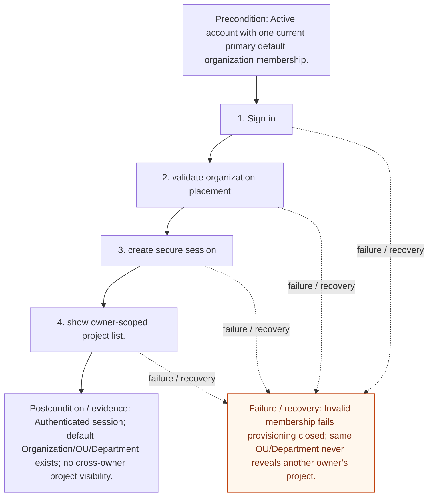

### UC-02 — Create and open project

- Actors: ACT-01
- Module: M02 — Project and immutable template registry
- Layer: Presentation + Application + Domain + Runtime
- Business Rules: BR-01, BR-03, BR-13, BR-17
- Security Guard: Owner command, idempotency uniqueness, template allowlist and path-safe initialization.
- Story Trace: US-03, US-04

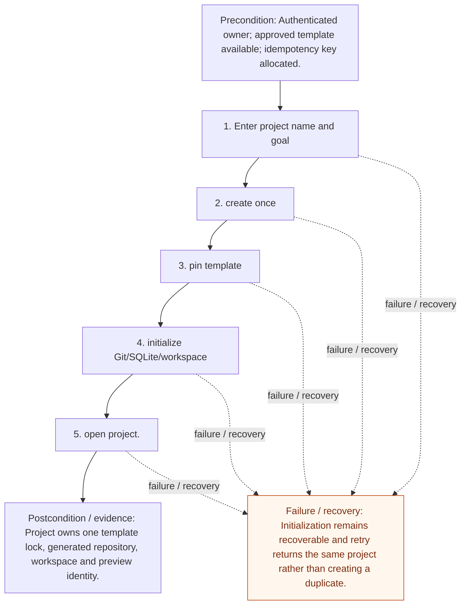

### UC-03 — Use and recover Vibe Code chatbot

- Actors: ACT-01
- Module: M03 — Conversation, Agent adapter and Agent Job
- Layer: Presentation + Application + Runtime
- Business Rules: BR-01, BR-04, BR-05, BR-06, BR-13, BR-17
- Security Guard: Owner/session checks, one mutation lease, admitted Job identity, heartbeat and UID-bound old-writer revocation.
- Story Trace: US-05–US-08, US-24–US-26

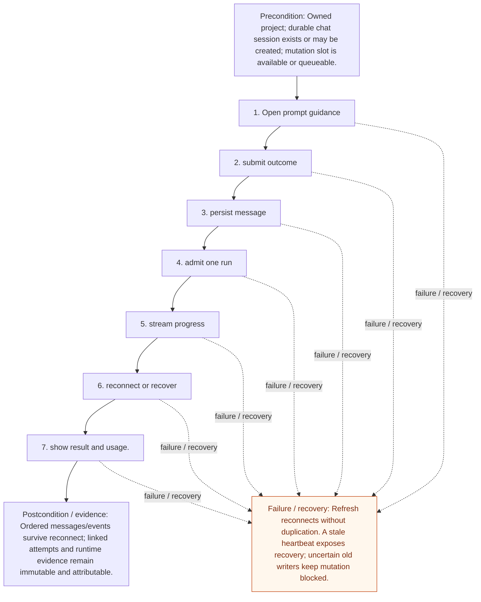

### UC-04 — Review and decide a change

- Actors: ACT-01
- Module: M04 — Change proposal, diff, approval and decision
- Layer: Presentation + Application + Domain
- Business Rules: BR-01, BR-04, BR-07, BR-09, BR-13, BR-17
- Security Guard: Owner authorization, safe path/diff redaction, explicit destructive approval and decision idempotency.
- Story Trace: US-09–US-11

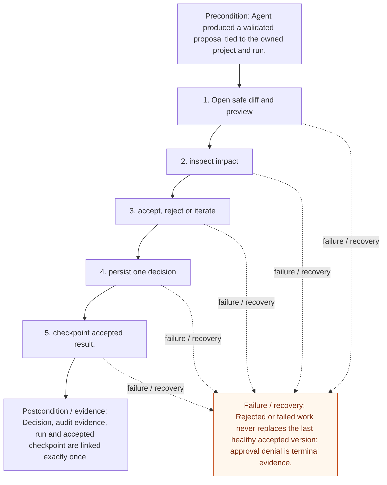

### UC-05 — Observe live preview update

- Actors: ACT-01
- Module: M05 — Preview Gateway, route and mutable Preview Pod
- Layer: Presentation + Gateway + Runtime
- Business Rules: BR-01, BR-08, BR-09, BR-13, BR-17
- Security Guard: Active kid/signature, exact JWT claims, hashed-jti CAS consume, host-only cookie and fixed-target routing.
- Story Trace: US-12–US-14, US-20

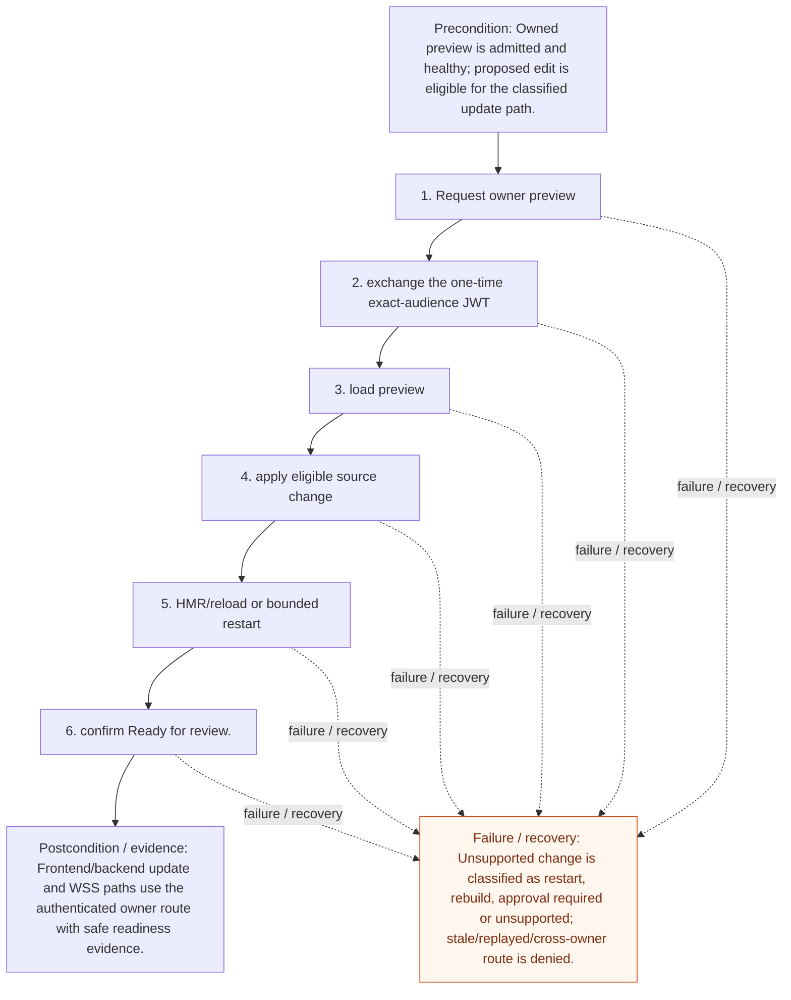

### UC-06 — Save and restore a whole-app version

- Actors: ACT-01
- Module: M06 — Git workspace, snapshot and Restore transaction
- Layer: Presentation + Application + Persistence + Runtime
- Business Rules: BR-01, BR-04, BR-10, BR-11, BR-12, BR-13, BR-17
- Security Guard: Owner-only idempotent command, project lease, path-safe Git, SQLite online backup, hashes, before-images and pointer CAS.
- Story Trace: US-15, US-16, US-28

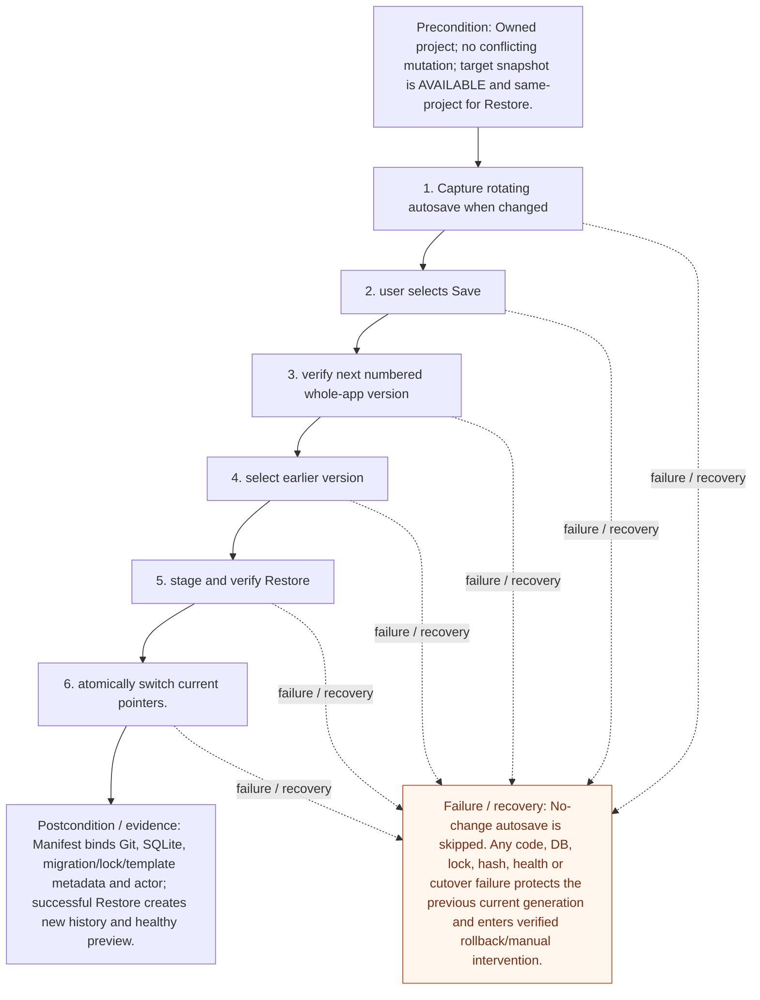

### UC-07 — Stop, idle-stop and resume

- Actors: ACT-01
- Module: M07 — Workspace lifecycle and capacity admission
- Layer: Presentation + Application + Runtime
- Business Rules: BR-01, BR-04, BR-13, BR-14, BR-15, BR-17
- Security Guard: Owner command, pool row lock, slot/reserve checks, durable fairness cursor, lease check and generation-safe route.
- Story Trace: US-17–US-19

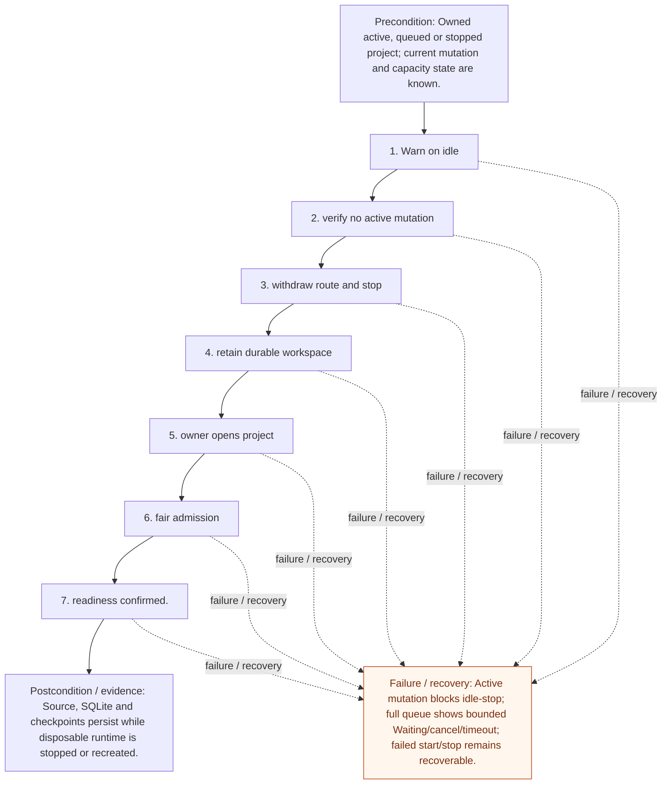

### UC-08 — Recover a failed operation

- Actors: ACT-01
ACT-02
- Module: M08 — Recovery controller, errors, evidence and audit
- Layer: Presentation + Application + Runtime + Operations
- Business Rules: BR-01, BR-04, BR-06, BR-12, BR-13, BR-16, BR-17
- Security Guard: Owner or explicit admin permission, idempotency, prior-attempt UID proof, mutation serialization and redacted audit.
- Story Trace: US-21, US-23, US-26

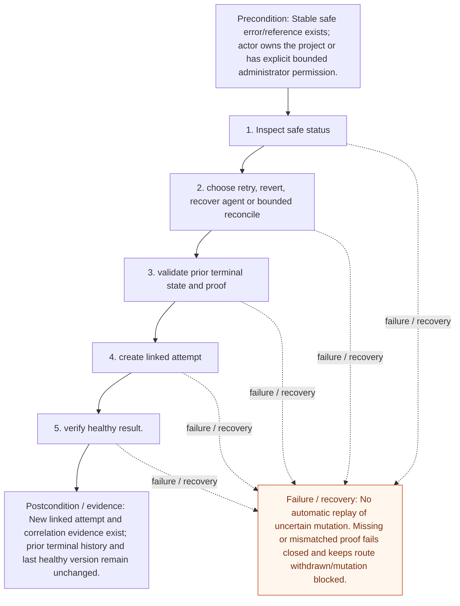

### UC-09 — Perform restricted administration

- Actors: ACT-02
- Module: M09 — Restricted administration and typed configuration
- Layer: Presentation + Application + Operations
- Business Rules: BR-01, BR-13, BR-16, BR-17
- Security Guard: Restricted AdminJS, explicit permission, last-admin protection, typed non-secret allowlist and atomic CAS plus command dedup.
- Story Trace: US-21, US-22

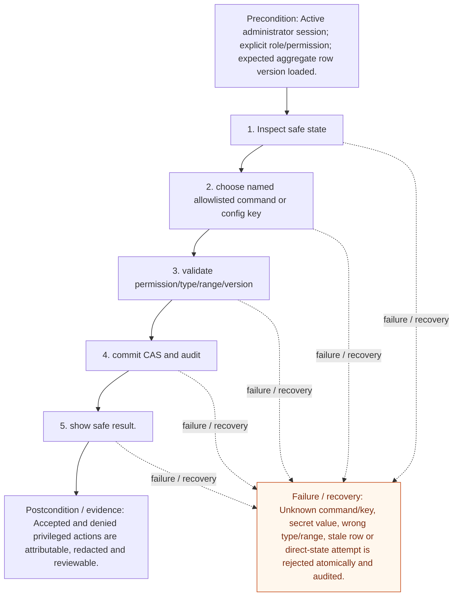

## Canonical State Model Diagrams

### PROJECT.lifecycle_status

- Owner: NestJS control plane
- Guard contract: Owner-authorized command; command-id dedup and aggregate row-version CAS commit atomically.

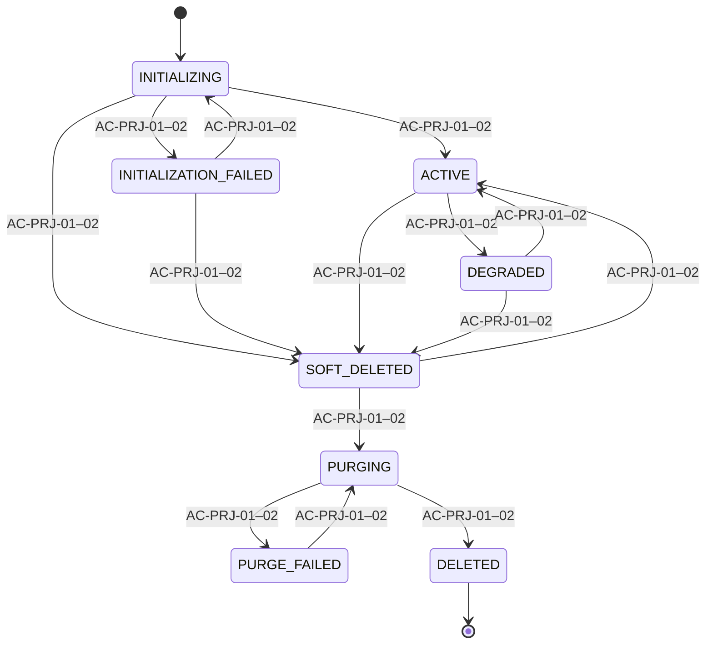

### WORKSPACE.desired_status

- Owner: NestJS command/policy
- Guard contract: Owner-authorized intent; mutation serialization and aggregate row-version CAS.

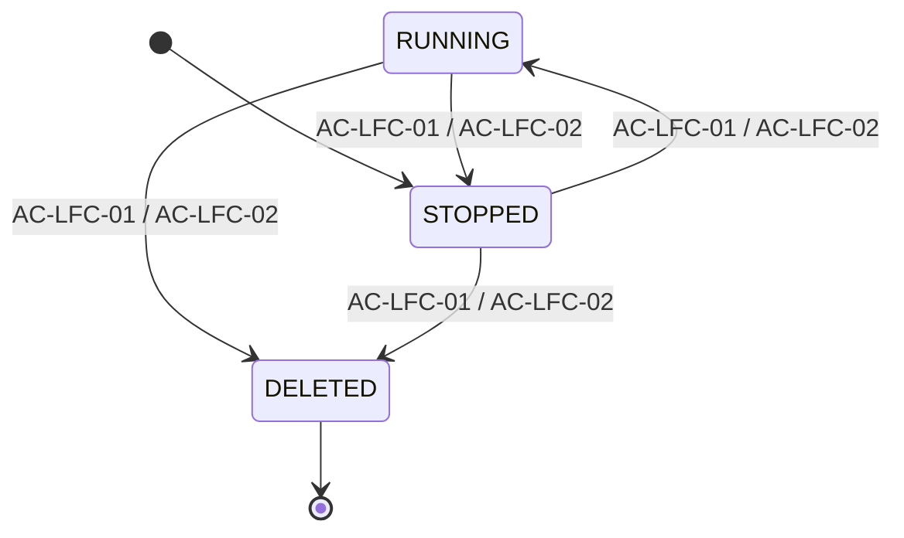

### WORKSPACE.observed_status

- Owner: Runtime Controller
- Guard contract: Runtime Controller observation; readiness, UID and generation evidence must match desired state.

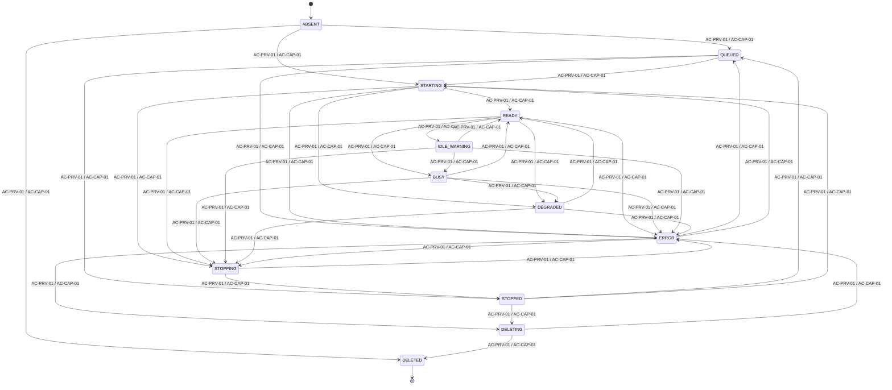

### AGENT_RUN.execution_status

- Owner: Agent orchestrator
- Guard contract: One project mutation lease; admitted Job identity, heartbeat and stop/fencing evidence.

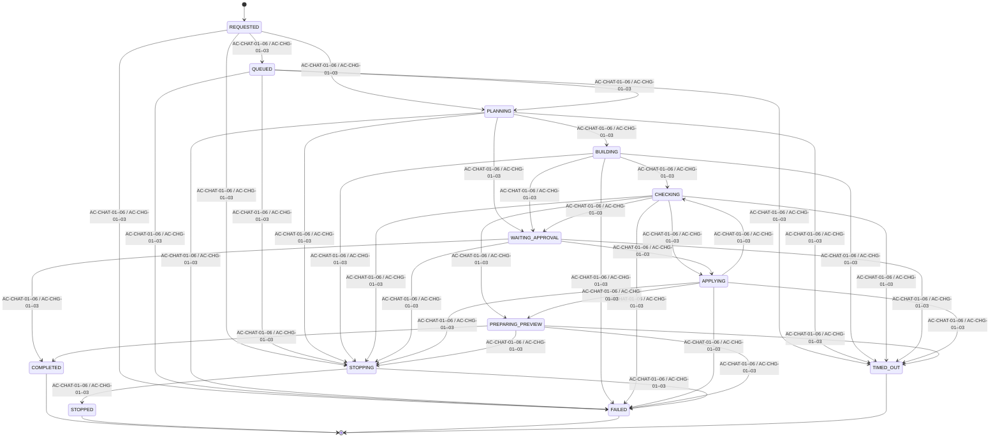

### AGENT_RUN.outcome_status

- Owner: Validation/approval service
- Guard contract: Validated proposal plus explicit accept/reject/abort decision; terminal attempts are immutable.

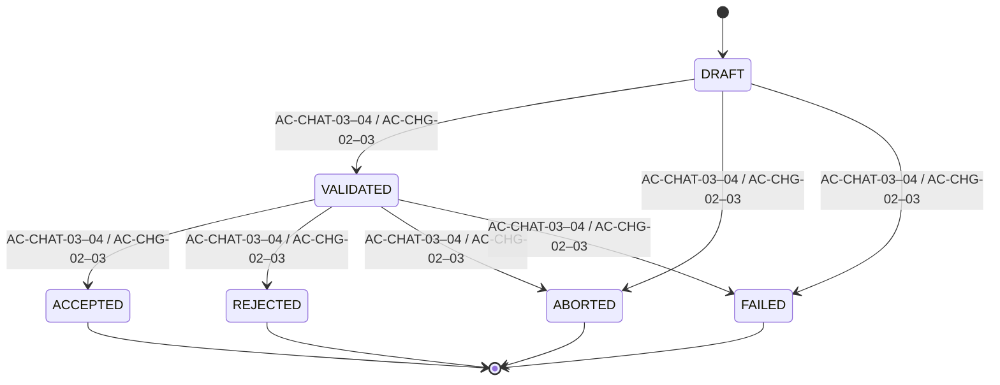

### PREVIEW_AUTH_GRANT.grant_status

- Owner: Preview Gateway
- Guard contract: Verify active kid/signature and exact JWT audience/owner/session/project/generation/expiry; CAS-consume hashed jti once, then bind the host-only preview cookie.

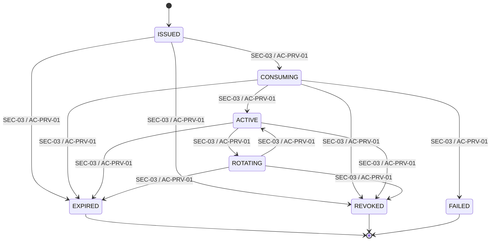

### SNAPSHOT.snapshot_status

- Owner: Snapshot service
- Guard contract: Git, SQLite online backup, migration/lock manifests and hashes verify as one whole-app snapshot.

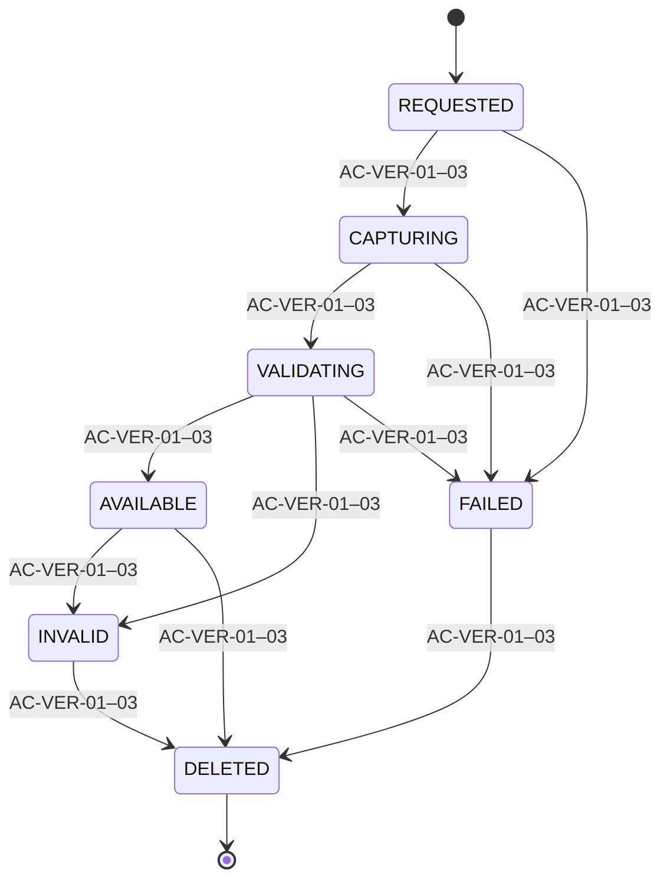

### RESTORE_JOB.restore_status

- Owner: Restore service
- Guard contract: Owner-only idempotent command; project lease, staged generation, before-images and journaled pointer CAS.

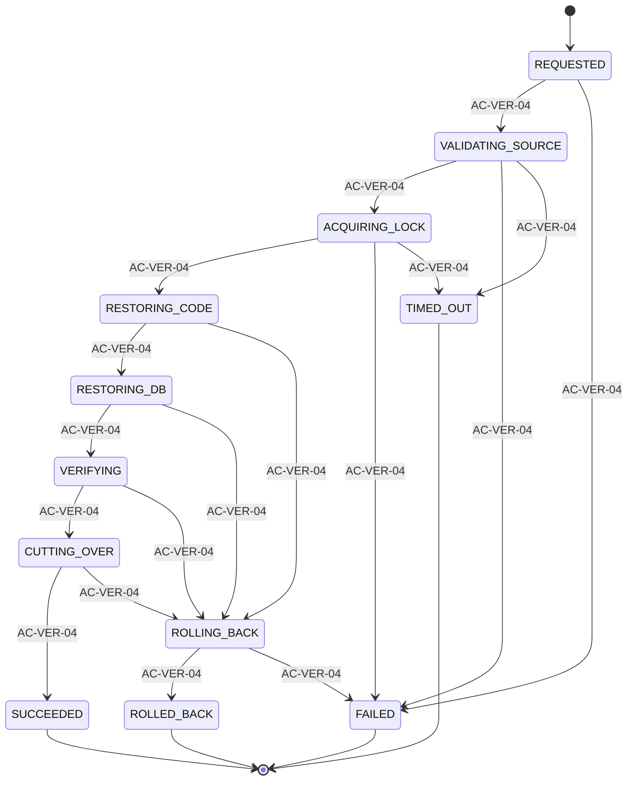

### PREVIEW_ROUTE.route_status

- Owner: Preview Gateway
- Guard contract: Owner/session/generation authorization plus workload and route readiness; stale routes fail closed.

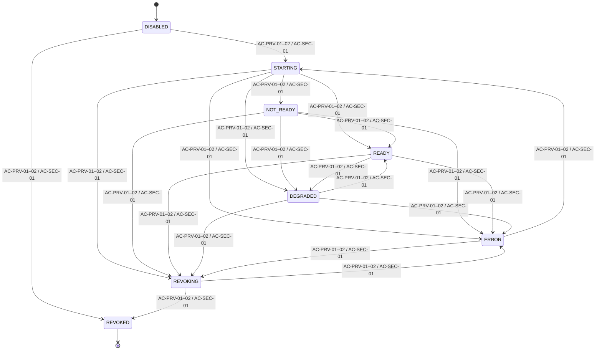

### JOB_RUN.run_status

- Owner: Platform scheduler
- Guard contract: Unique scheduled attempt; overlap guard, timeout and linked retry preserve immutable terminal history.

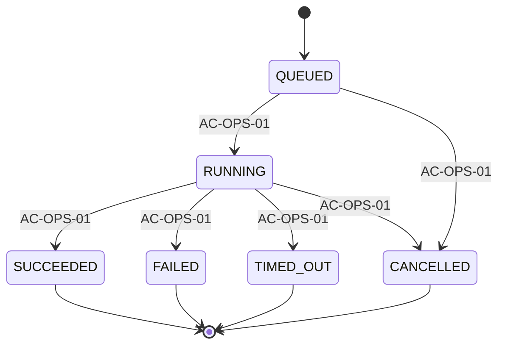

PRODUCT REQUIREMENTS DOCUMENT

Vibe-Code Platform No-Code POC PRD & Delivery Plan

A business-readable definition of the Stage 1 conversational application-builder POC. Technical implementation is specified separately.

#### Table 1

| Field | Value |
| --- | --- |
| Status | DRAFT |
| Boundary | Stage 1 POC |
| Version | 1.1 |
| POC deadline | 30 September 2026 |
| Tentative contingency | 9 October 2026 |
| Related technical document | vibe-code-poc-technical-design-and-runtime-architecture.docx |

## Contents

Static page index for the issued document. Section headings remain available in the Word navigation pane.

#### Table 2

| Section | Page |
| --- | --- |
| 1. Executive summary | 3 |
| 2. Scope and stage boundary | 4 |
| 3. Actors | 5 |
| 4. Feature list | 6 |
| 5. Epic table | 7 |
| 6. User Story table | 8 |
| 7. Use Case summary and details | 10 |
| 8. Security baseline | 16 |
| 9. Acceptance criteria | 17 |
| 10. Delivery Plan | 18 |
| 11. Risks and decisions | 19 |
| 12. Traceability and related artifacts | 20 |

## 1. Executive summary

Vibe Code lets a non-technical user create and improve a small application by describing business outcomes in a chatbot. The user reviews proposed changes, sees an authenticated live preview, accepts or rejects the result, saves numbered whole-app versions and can restore an earlier healthy version. Source code, runtime operations and infrastructure details remain behind the product boundary.

#### Table 3

| Stage 1 proves the complete create → chat → change → review → live preview → accept/reject → recover journey. It does not include a Deploy button or production release lifecycle. |
| --- |

### Product outcomes

#### Table 4

| Outcome | Evidence |
| --- | --- |
| Clear no-code journey | A user completes the primary journey without seeing an IDE, terminal or infrastructure configuration. |
| Controlled change | Every proposed change has visible progress, review, explicit decision and recoverable history. |
| Real live preview | Eligible frontend and backend source edits update automatically; unsupported changes are classified honestly. |
| Safe multi-user boundary | Project, chat, run, checkpoint and preview ownership tests fail closed. |
| Operational honesty | Single-node K3s is described as process-level recovery, not hardware high availability. |

Figure 1 — Stage 1 product journey and the boundary between mutable preview and Stage 2 deployment.

## 2. Scope and stage boundary

#### Table 5

| Stage | Included | Excluded / gate |
| --- | --- | --- |
| Stage 1 — POC | Chatbot, generated edits, diff/accept/reject, rolling autosave, numbered whole-app Save/Restore, owner-only live preview, automatic frontend/backend refresh, preview lifecycle, queue and idle stop. | Deploy button; immutable production release; stable published application URL; promotion/rollback; multi-node HA. |
| Stage 2 — release lifecycle | Deploy button, controlled immutable release, stable application route, health gate, promotion and rollback. | Only starts after separate scope, security, operating-model and capacity approval. |

### Stage 1 product principles

- Conversation is the primary interface; implementation detail is hidden from normal users.
- The fixed template reduces generation, preview, security and support variability.
- A mutable preview is not a deployed or published application.
- A saved version binds code and approved SQLite data as one recoverable whole; a running preview is disposable.
- Unknown, unsupported or unsafe changes fail closed with an actionable status.
- Platform restrictions are visible and explainable rather than silently enforced.
### Explicit Stage 1 non-goals

- No Deploy button, production release publication, stable application subdomain, promotion or rollback.
- No user-supplied infrastructure definition or privileged host access.
- No custom admin portal; restricted AdminJS is a developer/break-glass tool only.
- No multi-node high availability, service mesh, GitOps controller, custom operator or CRD.
- No simultaneous multi-user editing of one project and no multi-replica mutable preview.
## 3. Actors

#### Table 6

| ID | Actor | Goal / responsibility | Boundary |
| --- | --- | --- | --- |
| ACT-01 | Vibe user | Creates and continues owned projects through conversation, review and preview. | Own projects only; no infrastructure or privileged administration. |
| ACT-02 | Platform administrator | Supports users, reviews safe operational evidence and performs bounded recovery. | Restricted AdminJS; explicit permissions; break-glass actions are audited. |

### Normal product boundary

#### Table 7

| User sees | User does not see |
| --- | --- |
| Projects, chatbot, progress, diff, preview, checkpoints, statuses and recovery actions | Source editor, terminal, infrastructure objects, raw ports, hostnames, commands, stack traces, provider credentials |
| Plain-language restart/rebuild status | Runtime commands or infrastructure definitions |
| Usage/cost estimate and approval prompts | Provider master key or unrestricted model configuration |

### Vibe page layout

The Vibe page is a deliberate two-pane product experience: durable conversation and change control on the left, authenticated generated-application preview on the right, with project/version status above. The picture is an interaction contract, not a promise of final visual styling.

Figure 2 — Vibe page layout: metadata, conversation, progress and decisions beside the owner-only live preview.

#### Table 8

| Region | Required content | Forbidden content |
| --- | --- | --- |
| Project header | Project identity, owner-safe status, current numbered version, last Save, History and full-preview action. | Raw namespace, Pod, host, port, command or infrastructure state. |
| Conversation pane | Durable messages/events, prompt guidance, progress, Stop, safe diff decision, Save and Restore. | Source editor, terminal, unrestricted tool output or provider credential. |
| Preview pane | Owner-only generated UI, readiness/live-update state and fixed application/API routes. | Arbitrary upstream, platform session cookie or Deploy/publish control. |
| Status and recovery | Waiting, Recovering, Action required, autosave-versus-version distinction and correlation reference. | Generic success when a required verification is incomplete. |

## 4. Feature list

This is the Stage 1 product feature catalogue. Technical implementation references are intentionally kept in the separate Technical Design.

#### Table 9

| ID | Feature | User outcome |
| --- | --- | --- |
| F-01 | Authentication and project ownership | Sign in and access only owned projects. |
| F-02 | Project creation from fixed template | Start from one approved generated-application template. |
| F-03 | Chatbot sessions | Create, continue, archive and branch durable conversations. |
| F-04 | Streamed progress and Stop | See plain-language progress and stop an active run. |
| F-05 | Generated file changes | Agent proposes bounded project-file changes. |
| F-06 | Diff, accept and reject | Review changes before accepting, rejecting or iterating. |
| F-07 | Whole-app versions and recovery | Initialize each project with Version 1, autosave a rolling recovery state, save numbered code-and-data versions and restore either as one verified unit. |
| F-08 | Live frontend preview | Eligible frontend edits update automatically in the authenticated preview. |
| F-09 | Automatic backend refresh | Supported backend source edits reload automatically; the UI reconnects safely. |
| F-10 | Preview lifecycle | Start, stop, resume and idle-stop previews without losing durable work. |
| F-11 | Queue, limits and recovery | Show Waiting, Recovering and Action required rather than generic failure. |
| F-12 | Restricted operations | Permit only audited, bounded administrative recovery and configuration. |
| F-13 | Cline session continuity and recovery | Refreshing the web page reconnects to the same run; a stalled Cline session can be terminated and recovered safely. |
| F-14 | Future-ready organization placement | Assign each POC user to the default Organization, OU and Department without changing owner-only project access. |

## 5. Epic table

#### Table 10

| ID | Epic | Outcome | Features |
| --- | --- | --- | --- |
| EP-01 | Identity and owned projects | Users can sign in, receive a default organization placement, create projects and see only their own work. | F-01, F-02, F-14 |
| EP-02 | Conversational project sessions | Users can describe outcomes, retain context and control or recover an active run. | F-03, F-04, F-13 |
| EP-03 | Generate, review and accept changes | Users can inspect a proposal before accepting, rejecting or iterating. | F-05, F-06 |
| EP-04 | Mutable live preview | Accepted or proposed eligible source changes appear in an authenticated preview. | F-08, F-09 |
| EP-05 | Checkpoints and recovery | Accepted work is recoverable and failed/rejected work cannot silently replace it. | F-07 |
| EP-06 | Preview lifecycle and capacity | Preview resources start when needed, stop when idle and queue when capacity is full. | F-10, F-11 |
| EP-07 | Security and governance | Ownership, isolation, least privilege, secrets and audit controls fail closed. | F-12 |
| EP-08 | Guidance and operational clarity | Users understand status and recovery; administrators receive safe evidence. | F-11, F-12, F-13 |

#### Table 11

| Dependency direction: owned project → durable conversation → generated proposal → review/live preview → checkpoint/recovery → operational evidence. |
| --- |

## 6. User Story table

Stories are short, user-visible outcomes. Runtime resources, live-update configuration and command details are tracked in the Technical Design.

#### Table 12

| ID | Epic | Priority | User Story | Acceptance |
| --- | --- | --- | --- | --- |
| US-01 | EP-01 | Must | As a Vibe user, I can sign in and receive a secure session. | AC-ID-01 |
| US-02 | EP-01 | Must | As a Vibe user, I can see and open only projects I own. | AC-ID-02 |
| US-03 | EP-01 | Must | As a Vibe user, I can create a project from the approved fixed template. | AC-PRJ-01 |
| US-04 | EP-01 | Must | As a Vibe user, I can rename, stop, reopen and soft-delete my project. | AC-PRJ-02 |
| US-05 | EP-02 | Must | As a Vibe user, I can create, continue and archive a chatbot session. | AC-CHAT-01 |
| US-06 | EP-02 | Must | As a Vibe user, I see streamed plain-language progress and can stop the run. | AC-CHAT-02 |
| US-07 | EP-02 | Must | As a Vibe user, I can branch from an earlier message without overwriting history. | AC-CHAT-03 |
| US-08 | EP-02 | Must | As a Vibe user, I am warned before context compaction and can continue without silent loss. | AC-CHAT-04 |
| US-09 | EP-03 | Must | As a Vibe user, I can inspect a safe diff and preview before accepting a change. | AC-CHG-01 |
| US-10 | EP-03 | Must | As a Vibe user, I can accept, reject or request another iteration. | AC-CHG-02 |
| US-11 | EP-03 | Must | As a Vibe user, destructive changes require explicit approval. | AC-CHG-03 |
| US-12 | EP-04 | Must | As a Vibe user, eligible frontend edits appear automatically in the current preview. | AC-PRV-01 |
| US-13 | EP-04 | Must | As a Vibe user, supported backend source edits refresh automatically and reconnect safely. | AC-PRV-02 |
| US-14 | EP-04 | Must | As a Vibe user, I am told when a change requires restart, rebuild or approval. | AC-PRV-03 |
| US-15 | EP-05 | Must | As a Vibe user, a new project starts at Version 1 and Save creates the next numbered whole-app version. | AC-VER-01, AC-VER-02 |
| US-16 | EP-05 | Must | As a Vibe user, I can restore code and project data together from a healthy saved version without erasing history. | AC-VER-04 |
| US-17 | EP-06 | Must | As a Vibe user, opening a stopped project resumes its preview without losing source. | AC-LFC-01 |
| US-18 | EP-06 | Must | As a Vibe user, capacity exhaustion shows Waiting instead of an unexplained error. | AC-CAP-01 |
| US-19 | EP-06 | Should | As a Vibe user, an inactive preview stops automatically and resumes explicitly. | AC-LFC-02 |
| US-20 | EP-07 | Must | As a Vibe user, my preview and live-update channel cannot be opened by another owner. | AC-SEC-01 |
| US-21 | EP-07 | Must | As a Platform administrator, I can inspect audited lifecycle and recovery evidence. | AC-OPS-01 |
| US-22 | EP-07 | Must | As a Platform administrator, I can change only allowlisted non-secret configuration. | AC-OPS-02 |
| US-23 | EP-08 | Should | As a Vibe user, I see plain-language statuses and actionable recovery choices. | AC-UX-01 |
| US-24 | EP-08 | Should | As a first-time user, I receive concise guidance and prompt starters. | AC-UX-02 |
| US-25 | EP-02 | Must | As a Vibe user, refreshing the web page reconnects to the current Cline run without starting a duplicate session. | AC-CHAT-05 |
| US-26 | EP-02 | Must | As a Vibe user, I can recover an unresponsive Cline session while preserving the last healthy project state. | AC-CHAT-06 |
| US-27 | EP-01 | Must | As a provisioned POC user, I am assigned to the default Organization, OU and Department while my project list remains owner-only. | AC-ID-03 |
| US-28 | EP-05 | Must | As a Vibe user, my active project has a rolling whole-app autosave for crash recovery without creating a new visible version every interval. | AC-VER-03 |

## 7. Use Case summary

#### Table 13

| ID | Use Case | Actors | Stories |
| --- | --- | --- | --- |
| UC-01 | Sign in and view projects | ACT-01 | US-01, US-02, US-27 |
| UC-02 | Create and open project | ACT-01 | US-03, US-04 |
| UC-03 | Use and recover Vibe Code chatbot | ACT-01 | US-05–US-08, US-24–US-26 |
| UC-04 | Review and decide a change | ACT-01 | US-09–US-11 |
| UC-05 | Observe live preview update | ACT-01 | US-12–US-14, US-20 |
| UC-06 | Save and restore a whole-app version | ACT-01 | US-15, US-16, US-28 |
| UC-07 | Stop, idle-stop and resume | ACT-01 | US-17–US-19 |
| UC-08 | Recover a failed operation | ACT-01 ACT-02 | US-21, US-23, US-26 |
| UC-09 | Perform restricted administration | ACT-02 | US-21, US-22 |

#### Table 14

| Each detailed Use Case is a ten-field executable product contract. Business Rules are canonical BR references, not hidden prose in the flow. |
| --- |

### Detailed Use Cases

### UC-01 — Sign in and view projects

#### Table 15

| Field | Definition |
| --- | --- |
| Actors | ACT-01 |
| Module | M01 — Identity, organization placement and owned projects |
| Layer | Presentation + Application + Domain |
| Preconditions | Active account with one current primary default organization membership. |
| Main flow | Sign in → validate organization placement → create secure session → show owner-scoped project list. |
| Business Rules | BR-01, BR-02, BR-17 |
| Security Guard | Secure session, CSRF, session rotation and object-level owner authorization. |
| Failure / Recovery | Invalid membership fails provisioning closed; same OU/Department never reveals another owner’s project. |
| Acceptance evidence | Authenticated session; default Organization/OU/Department exists; no cross-owner project visibility. |
| Story trace | US-01, US-02, US-27 |

Figure UC-01 — Main, alternative/failure and evidence flow for Sign in and view projects.

### UC-02 — Create and open project

#### Table 16

| Field | Definition |
| --- | --- |
| Actors | ACT-01 |
| Module | M02 — Project and immutable template registry |
| Layer | Presentation + Application + Domain + Runtime |
| Preconditions | Authenticated owner; approved template available; idempotency key allocated. |
| Main flow | Enter project name and goal → create once → pin template → initialize Git/SQLite/workspace → open project. |
| Business Rules | BR-01, BR-03, BR-13, BR-17 |
| Security Guard | Owner command, idempotency uniqueness, template allowlist and path-safe initialization. |
| Failure / Recovery | Initialization remains recoverable and retry returns the same project rather than creating a duplicate. |
| Acceptance evidence | Project owns one template lock, generated repository, workspace and preview identity. |
| Story trace | US-03, US-04 |

Figure UC-02 — Main, alternative/failure and evidence flow for Create and open project.

### UC-03 — Use and recover Vibe Code chatbot

#### Table 17

| Field | Definition |
| --- | --- |
| Actors | ACT-01 |
| Module | M03 — Conversation, Agent adapter and Agent Job |
| Layer | Presentation + Application + Runtime |
| Preconditions | Owned project; durable chat session exists or may be created; mutation slot is available or queueable. |
| Main flow | Open prompt guidance → submit outcome → persist message → admit one run → stream progress → reconnect or recover → show result and usage. |
| Business Rules | BR-01, BR-04, BR-05, BR-06, BR-13, BR-17 |
| Security Guard | Owner/session checks, one mutation lease, admitted Job identity, heartbeat and UID-bound old-writer revocation. |
| Failure / Recovery | Refresh reconnects without duplication. A stale heartbeat exposes recovery; uncertain old writers keep mutation blocked. |
| Acceptance evidence | Ordered messages/events survive reconnect; linked attempts and runtime evidence remain immutable and attributable. |
| Story trace | US-05–US-08, US-24–US-26 |

Figure UC-03 — Main, alternative/failure and evidence flow for Use and recover Vibe Code chatbot.

### UC-04 — Review and decide a change

#### Table 18

| Field | Definition |
| --- | --- |
| Actors | ACT-01 |
| Module | M04 — Change proposal, diff, approval and decision |
| Layer | Presentation + Application + Domain |
| Preconditions | Agent produced a validated proposal tied to the owned project and run. |
| Main flow | Open safe diff and preview → inspect impact → accept, reject or iterate → persist one decision → checkpoint accepted result. |
| Business Rules | BR-01, BR-04, BR-07, BR-09, BR-13, BR-17 |
| Security Guard | Owner authorization, safe path/diff redaction, explicit destructive approval and decision idempotency. |
| Failure / Recovery | Rejected or failed work never replaces the last healthy accepted version; approval denial is terminal evidence. |
| Acceptance evidence | Decision, audit evidence, run and accepted checkpoint are linked exactly once. |
| Story trace | US-09–US-11 |

Figure UC-04 — Main, alternative/failure and evidence flow for Review and decide a change.

### UC-05 — Observe live preview update

#### Table 19

| Field | Definition |
| --- | --- |
| Actors | ACT-01 |
| Module | M05 — Preview Gateway, route and mutable Preview Pod |
| Layer | Presentation + Gateway + Runtime |
| Preconditions | Owned preview is admitted and healthy; proposed edit is eligible for the classified update path. |
| Main flow | Request owner preview → exchange the one-time exact-audience JWT → load preview → apply eligible source change → HMR/reload or bounded restart → confirm Ready for review. |
| Business Rules | BR-01, BR-04, BR-08, BR-09, BR-13, BR-17 |
| Security Guard | Active kid/signature, exact JWT claims, hashed-jti CAS consume, host-only cookie and fixed-target routing. |
| Failure / Recovery | Unsupported change is classified as restart, rebuild, approval required or unsupported; stale/replayed/cross-owner route is denied. |
| Acceptance evidence | Frontend/backend update and WSS paths use the authenticated owner route with safe readiness evidence. |
| Story trace | US-12–US-14, US-20 |

Figure UC-05 — Main, alternative/failure and evidence flow for Observe live preview update.

### UC-06 — Save and restore a whole-app version

#### Table 20

| Field | Definition |
| --- | --- |
| Actors | ACT-01 |
| Module | M06 — Git workspace, snapshot and Restore transaction |
| Layer | Presentation + Application + Persistence + Runtime |
| Preconditions | Owned project; no conflicting mutation; target snapshot is AVAILABLE and same-project for Restore. |
| Main flow | Capture rotating autosave when changed → user selects Save → verify next numbered whole-app version → select earlier version → stage and verify Restore → atomically switch current pointers. |
| Business Rules | BR-01, BR-04, BR-10, BR-11, BR-12, BR-13, BR-17 |
| Security Guard | Owner-only idempotent command, project lease, path-safe Git, SQLite online backup, hashes, before-images and pointer CAS. |
| Failure / Recovery | No-change autosave is skipped. Any code, DB, lock, hash, health or cutover failure protects the previous current generation and enters verified rollback/manual intervention. |
| Acceptance evidence | Manifest binds Git, SQLite, migration/lock/template metadata and actor; successful Restore creates new history and healthy preview. |
| Story trace | US-15, US-16, US-28 |

Figure UC-06 — Main, alternative/failure and evidence flow for Save and restore a whole-app version.

### UC-07 — Stop, idle-stop and resume

#### Table 21

| Field | Definition |
| --- | --- |
| Actors | ACT-01 |
| Module | M07 — Workspace lifecycle and capacity admission |
| Layer | Presentation + Application + Runtime |
| Preconditions | Owned active, queued or stopped project; current mutation and capacity state are known. |
| Main flow | Warn on idle → verify no active mutation → withdraw route and stop → retain durable workspace → owner opens project → fair admission → readiness confirmed. |
| Business Rules | BR-01, BR-04, BR-13, BR-14, BR-15, BR-17 |
| Security Guard | Owner command, pool row lock, slot/reserve checks, durable fairness cursor, lease check and generation-safe route. |
| Failure / Recovery | Active mutation blocks idle-stop; full queue shows bounded Waiting/cancel/timeout; failed start/stop remains recoverable. |
| Acceptance evidence | Source, SQLite and checkpoints persist while disposable runtime is stopped or recreated. |
| Story trace | US-17–US-19 |

Figure UC-07 — Main, alternative/failure and evidence flow for Stop, idle-stop and resume.

### UC-08 — Recover a failed operation

#### Table 22

| Field | Definition |
| --- | --- |
| Actors | ACT-01 ACT-02 |
| Module | M08 — Recovery controller, errors, evidence and audit |
| Layer | Presentation + Application + Runtime + Operations |
| Preconditions | Stable safe error/reference exists; actor owns the project or has explicit bounded administrator permission. |
| Main flow | Inspect safe status → choose retry, revert, recover agent or bounded reconcile → validate prior terminal state and proof → create linked attempt → verify healthy result. |
| Business Rules | BR-01, BR-04, BR-06, BR-12, BR-13, BR-16, BR-17 |
| Security Guard | Owner or explicit admin permission, idempotency, prior-attempt UID proof, mutation serialization and redacted audit. |
| Failure / Recovery | No automatic replay of uncertain mutation. Missing or mismatched proof fails closed and keeps route withdrawn/mutation blocked. |
| Acceptance evidence | New linked attempt and correlation evidence exist; prior terminal history and last healthy version remain unchanged. |
| Story trace | US-21, US-23, US-26 |

Figure UC-08 — Main, alternative/failure and evidence flow for Recover a failed operation.

### UC-09 — Perform restricted administration

#### Table 23

| Field | Definition |
| --- | --- |
| Actors | ACT-02 |
| Module | M09 — Restricted administration and typed configuration |
| Layer | Presentation + Application + Operations |
| Preconditions | Active administrator session; explicit role/permission; expected aggregate row version loaded. |
| Main flow | Inspect safe state → choose named allowlisted command or config key → validate permission/type/range/version → commit CAS and audit → show safe result. |
| Business Rules | BR-01, BR-13, BR-16, BR-17 |
| Security Guard | Restricted AdminJS, explicit permission, last-admin protection, typed non-secret allowlist and atomic CAS plus command dedup. |
| Failure / Recovery | Unknown command/key, secret value, wrong type/range, stale row or direct-state attempt is rejected atomically and audited. |
| Acceptance evidence | Accepted and denied privileged actions are attributable, redacted and reviewable. |
| Story trace | US-21, US-22 |

Figure UC-09 — Main, alternative/failure and evidence flow for Perform restricted administration.

## Business Rule Register

Business Rules constrain every Use Case independently of screen wording. A Use Case may reference only IDs in this register; Technical realization must trace the same IDs rather than redefine them.

#### Table 24

| ID | Rule | Applies to | Enforcement / evidence |
| --- | --- | --- | --- |
| BR-01 | Every project, conversation, run, snapshot, route and command is owner-scoped; direct-ID and cross-owner access fail closed. | UC-01, UC-02, UC-03, UC-04, UC-05, UC-06, UC-07, UC-08, UC-09 | Object authorization on every command/query plus cross-owner negative tests. |
| BR-02 | Organization, OU and Department placement is administrative metadata and never grants Stage 1 project access. | UC-01 | Provision one current primary membership; same-unit users still fail project access tests. |
| BR-03 | Project creation is idempotent and pins exactly one approved immutable template version. | UC-02 | Unique idempotency key, atomic project/workspace initialization and retry evidence. |
| BR-04 | Only one mutating operation may hold the project mutation lease; terminal attempts are immutable. | UC-03, UC-04, UC-05, UC-06, UC-07, UC-08 | Lease/CAS checks and linked retry rather than in-place history rewrite. |
| BR-05 | Browser refresh reconnects to the existing run and persisted event stream; it never creates a duplicate run, Job or lease. | UC-03 | Run identity and event cursor survive reconnect; duplicate-creation probes fail. |
| BR-06 | Stalled-agent recovery starts a linked retry only after prior Job/Pod deletion and failed write-probe evidence proves the old attempt cannot write. | UC-03, UC-08 | UID-bound runtime-resource evidence; metadata lease expiry alone is rejected. |
| BR-07 | A proposal becomes accepted only through one explicit durable decision; destructive changes require explicit approval. | UC-04 | Decision idempotency, approval gate and pre-change checkpoint evidence. |
| BR-08 | Mutable preview is owner-only and uses a one-time short-lived asymmetric JWT with exact-host audience, exchanged for a short-lived host-only cookie. | UC-05 | Active kid/signature, exact claims, hashed-jti CAS consume and replay/revocation tests. |
| BR-09 | Changes are classified honestly as hot update, reload, restart, rebuild, approval required or unsupported. | UC-04, UC-05 | Change matrix tests; unsupported changes never report Ready/HMR. |
| BR-10 | Project initialization creates Version 1; autosave is rotating recovery only; User Save and successful Restore create immutable numbered whole-app history. | UC-06 | Kind/number/idempotency checks across Git, SQLite and snapshot records. |
| BR-11 | A whole-app snapshot is AVAILABLE only when Git, SQLite online backup, migration/lock/template manifests and hashes verify together. | UC-06 | No raw live SQLite copy; partial or mismatched capture remains unavailable. |
| BR-12 | Restore is owner-only, serialized, idempotent and generation-staged; current pointers switch atomically only after code, DB, lock and health verification. | UC-06, UC-08 | Before-images, provisional result, journal decision and pointer CAS; failure protects prior current state. |
| BR-13 | Only transitions listed in the authoritative state contract are legal; unknown or unlisted transitions fail closed and are audited. | UC-02, UC-03, UC-04, UC-05, UC-06, UC-07, UC-08, UC-09 | State/edge equality against Data Specification plus illegal-edge mutation tests. |
| BR-14 | Capacity admission is durable, bounded and fair: owner round-robin across owners, FIFO within owner, explicit slot charges and deterministic timeout/cancel. | UC-07 | CAPACITY_POOL row lock, queue sequence, durable cursor and slot-sum tests. |
| BR-15 | Preview idle-stop never interrupts an active mutation and never deletes durable source, SQLite data or checkpoints. | UC-07 | Lease check, route withdrawal, scale-to-zero and resume evidence. |
| BR-16 | Administrative changes are restricted to named commands and typed allowlisted non-secret configuration; no shell or direct state forgery. | UC-08, UC-09 | Permission, type/range, stale-write, secret-canary and immutable audit tests. |
| BR-17 | Stage 1 has no Deploy button, published release, stable application URL, registry promotion or production rollback. | UC-01, UC-02, UC-03, UC-04, UC-05, UC-06, UC-07, UC-08, UC-09 | UI/content scan and route/runtime acceptance tests reject hidden release behavior. |

## Authoritative state diagrams

#### Table 25

| These diagrams are rendered from the repository state contract that must exactly match Data Specification sheets “Enum Catalogue” and “State Transitions”. Filled dots mark initial states; ringed dots mark terminal states. Every unlisted edge fails closed. |
| --- |

### PROJECT.lifecycle_status

Figure S-01 — PROJECT.lifecycle_status: 8 states and 14 legal directed transitions.

### WORKSPACE.desired_status

Figure S-02 — WORKSPACE.desired_status: 3 states and 4 legal directed transitions.

### WORKSPACE.observed_status

Figure S-03 — WORKSPACE.observed_status: 12 states and 37 legal directed transitions.

### AGENT_RUN.execution_status

Figure S-04 — AGENT_RUN.execution_status: 13 states and 39 legal directed transitions.

### AGENT_RUN.outcome_status

Figure S-05 — AGENT_RUN.outcome_status: 6 states and 7 legal directed transitions.

### PREVIEW_AUTH_GRANT.grant_status

Figure S-06 — PREVIEW_AUTH_GRANT.grant_status: 7 states and 13 legal directed transitions.

### SNAPSHOT.snapshot_status

Figure S-07 — SNAPSHOT.snapshot_status: 7 states and 11 legal directed transitions.

### RESTORE_JOB.restore_status

Figure S-08 — RESTORE_JOB.restore_status: 12 states and 18 legal directed transitions.

### PREVIEW_ROUTE.route_status

Figure S-09 — PREVIEW_ROUTE.route_status: 8 states and 21 legal directed transitions.

### JOB_RUN.run_status

Figure S-10 — JOB_RUN.run_status: 6 states and 6 legal directed transitions.

## 8. Security baseline

The baseline is written as observable controls. Detailed runtime, container and network implementation belongs in the Technical Design.

#### Table 26

| ID | Control area | Baseline requirement | Acceptance evidence |
| --- | --- | --- | --- |
| SEC-01 | Identity, organization and ownership | Every user has one current primary organization placement, while every project, chat, run, checkpoint and preview remains owner-scoped in Stage 1. | Default membership validation plus same/cross-Department negative tests for list, direct URL, API, preview and live update. |
| SEC-02 | Authenticated preview | Mutable previews are private and require the owner’s active session. | Anonymous, expired-session and wrong-owner requests fail closed. |
| SEC-03 | Project isolation | One project cannot read or change another project’s files, data or runtime. | Cross-project filesystem, service and route tests are denied, including absolute/parent paths, symlink ancestors/leaves, broken links, special nodes and concurrent path-swap probes before Git/snapshot/restore reads. |
| SEC-04 | Least privilege | Generated workloads run without privileged host access or unrestricted administration. | Isolation and privilege-escape negative tests pass. |
| SEC-05 | Resource protection | Each project has bounded CPU, memory, process and storage use; capacity is admitted. | Limit and exhaustion tests show Waiting or controlled failure. |
| SEC-06 | Network control | Preview routes expose only intended application traffic; internal services remain private. | No database/debug host exposure; blocked private/metadata destinations. |
| SEC-07 | Secret handling | Credentials never enter generated source, chat display, logs, exports or non-secret configuration. | Secret scans and redaction tests pass with synthetic canaries. |
| SEC-08 | Change and recovery safety | Destructive/unsupported changes require approval; stalled-session recovery cannot overlap two mutating Cline attempts; snapshot capture and restore run under one project mutation lock. | Approval, proven old-Pod write revocation, generation staging, journaled pointer cutover and crash recovery preserve the last healthy checkpoint; metadata lease fencing alone is insufficient. |
| SEC-09 | Audit and evidence | Privileged actions, security decisions and lifecycle changes have actor, action, result and correlation reference. | Accepted, denied and failed actions appear in immutable audit evidence. |
| SEC-10 | Retention and recovery | Project source, rolling autosave and numbered whole-app versions survive ordinary stop/restart; SQLite is captured through a consistent backup operation, not by copying a live database file. | Code+database restore drill passes; autosave/version retention remains an approved configurable policy. |

#### Table 27

| Any unknown route, ownership, quota, secret, startup or lifecycle condition fails closed. The platform must not guess a successful state. |
| --- |

### Product architecture boundary

#### Table 28

| Concern | Approved Stage 1 boundary |
| --- | --- |
| Platform control plane | NestJS + Prisma + PostgreSQL. This is the product platform, not generated-app code. |
| Restricted administration | AdminJS exposes only allowlisted properties and named NestJS commands behind the same RBAC/CSRF/owner checks; no unrestricted direct CRUD. |
| Browser identity | An opaque HttpOnly Secure session cookie references Redis server-side session state. Long-lived browser JWT/localStorage authentication is prohibited; Redis session loss requires fresh sign-in. |
| Preview/service exchange | Only short-lived, audience-bound asymmetric JWTs with kid/jti/replay/revocation controls may cross a service boundary; generated preview code never receives platform session/JWT credentials. |
| Generated application | React/Vite + FastAPI + SQLite in the project workspace. It cannot access platform PostgreSQL or Redis. |

## 9. Acceptance criteria

#### Table 29

| ID | Acceptance evidence |
| --- | --- |
| AC-ID-01 | Login/logout, secure session, CSRF and session rotation pass. |
| AC-ID-02 | User A cannot list, open, run, preview or delete User B’s project. |
| AC-PRJ-01 | A duplicate create request returns one project pinned to the approved template. |
| AC-PRJ-02 | Rename, stop, reopen and soft-delete show correct durable state. |
| AC-CHAT-01 | Chat sessions can be created, continued and archived without deleting history. |
| AC-CHAT-02 | Progress streams in plain language; Stop prevents new agent actions and reaches a safe terminal state. |
| AC-CHAT-03 | Editing a prior message creates traceable branch lineage. |
| AC-CHAT-04 | Pre-compaction notice and persisted summary prevent silent context loss. |
| AC-CHG-01 | Diff and preview are safe, owner-scoped and tied to the proposed run. |
| AC-CHG-02 | Accept, reject and iterate produce one explicit durable decision. |
| AC-CHG-03 | A destructive change cannot proceed without explicit user approval. |
| AC-PRV-01 | A React/TypeScript/CSS edit updates the current preview through live frontend hot reload without deployment. |
| AC-PRV-02 | A supported Python source edit reloads the backend preview and the product reconnects safely. |
| AC-PRV-03 | Dependency, environment, migration and runtime-contract changes show the correct restart/rebuild/approval state. |
| AC-VER-01 | Project creation initializes Git on main, creates an initial commit and exposes Version 1 only after a matching SQLite backup and manifest are verified. |
| AC-VER-02 | Each successful Save creates exactly one next numbered immutable version linked to a Git commit, private SQLite backup, hashes, locks and actor; an idempotent retry creates no duplicate version. |
| AC-VER-03 | While a project is active, the configured interval captures a rotating whole-app recovery autosave only when state changed; autosaves do not increment or clutter the user-visible version number. |
| AC-VER-04 | Before any code/DB mutation, idempotent Restore atomically captures PRE_RESTORE, prior generation/snapshot/route generation/exact route status, target generation and one provisional RESTORE_RESULT. Early or late rollback marks that result INVALID; cutover or verified rollback uses one PostgreSQL pointer transaction. Failure keeps route withdrawn and mutation blocked. |
| AC-LFC-01 | Stopping/recreating a preview does not lose Git source, checkpoints or approved persistent data. |
| AC-CAP-01 | Capacity exhaustion creates a durable bounded Waiting request with retry/cancel/timeout, owner-round-robin then FIFO order and separate Preview/Agent reservations; it never becomes login failure, generic 500 or silent oversubscription. |
| AC-LFC-02 | Idle stop does not interrupt an active mutation and requires explicit resume. |
| AC-SEC-01 | Owner, anonymous and cross-owner preview/live-update authorization tests pass. |
| AC-OPS-01 | Injected startup, agent, preview and restore failures produce safe recovery and correlation evidence. |
| AC-OPS-02 | Only typed allowlisted non-secret configuration can be changed; stale and invalid writes fail atomically. |
| AC-UX-01 | Normal users never see raw commands, ports, hostnames, stack traces, infrastructure manifests or credentials. |
| AC-UX-02 | Prompt starters and a concise first-run guide are available. |
| AC-CHAT-05 | Refreshing the browser during an active run reconnects to persisted messages/events and does not create a second AGENT_RUN, Agent Job or mutation lease. |
| AC-CHAT-06 | After the approved heartbeat threshold, Recover agent session persists one unique Agent Job resource reference whose agent_run_id equals the stopped/prior attempt, plus old Job/Pod UID, deletion observation and failed-closed write probe. STOPPED/retry reject missing, duplicate or other-attempt proof; lease expiry never authorizes overlap. |
| AC-ID-03 | Account provisioning creates one current primary Default Organization → Default OU → Default Department membership; users in the same unit still see only projects they own. |

### Capacity acceptance assumptions

#### Table 30

| Measure | Planning target | Launch posture |
| --- | --- | --- |
| Registered users | 100 | Named accounts; not 100 simultaneous previews |
| Concurrent active users | 50 | Validate representative control-plane activity |
| Active previews | 25 planning target | Begin with 10 admitted previews |
| Concurrent agent runs | 8 planning target | Begin with 3 admitted runs |
| Peak platform API | 75 RPS | Load-test hypothesis, not production SLA |
| Idle stop | 60 minutes candidate | Confirm from usability and capacity evidence |

The planning targets are not procurement proof. Measured results must record host profile, test script, workload mix, duration, latency, error rate and resource use.

## 10. Delivery Plan

#### Table 31

| Week | Dates | Business-readable outcome |
| --- | --- | --- |
| W1 | 24–28 Aug | Runtime feasibility, Cline integration/recovery gate, authenticated preview route and security spike evidence. |
| W2 | 31 Aug–4 Sep | Authentication, project ownership, fixed template, durable project/workspace metadata and restricted administration foundation. |
| W3 | 7–11 Sep | Chat sessions, streamed events, mutation control, Agent Job and workspace persistence. |
| W4 | 14–18 Sep | Owner preview gateway, frontend hot reload, backend source reload and lifecycle reconciliation. |
| W5 | 21–25 Sep | Diff/review, accept/reject, Git workspace autosave, whole-app Save/Restore and failure recovery. |
| W6 | 28 Sep–2 Oct | Integrated beta by 30 Sep; security baseline, load evidence and remediation continue through 2 Oct. |
| W7 | 5–9 Oct | Contingency close: operational guidance, final evidence, traceability and POC acceptance. |

### Planning envelope

#### Table 32

| Item | Value | Meaning |
| --- | --- | --- |
| Team | 2 developers | Capacity assumption |
| Weekly capacity | 64 team SP | 32 SP per developer per week |
| 30 Sep capacity | 358.4 SP | Integrated beta target; not the full seven-week allocation |
| Full planning envelope | 448 SP | Seven team-weeks |
| Contingency date | 9 Oct 2026 | Used only if final planned week is required |

### Technical delivery enablers

#### Table 33

| ID | Enabler | Business exit evidence |
| --- | --- | --- |
| EN-01 | Cline SDK compatibility and recovery gate | Pinned integration supports progress, stop, page reconnect, heartbeat, stuck detection, bounded termination, isolation and file mutation. |
| EN-02 | Preview runtime foundation | Project preview and agent work can start, stop, recover and preserve durable work. |
| EN-03 | Authenticated preview gateway | Owner route supports application, progress and live-update traffic. |
| EN-04 | Live-update classification | Frontend refresh, backend refresh and restart/rebuild paths are demonstrably distinct. |
| EN-05 | Security baseline | Ownership, isolation, least privilege, network, secret and audit tests pass. |
| EN-06 | Load and recovery evidence | Admission, idle stop, Pod failure, restart and restore evidence is reproducible. |

#### Table 34

| Detailed runtime resources, commands, library versions and spike procedures are defined in the Technical Design, not duplicated here. |
| --- |

## 11. Risks and decisions

### Top risks

#### Table 35

| Risk | Likelihood / impact | Response |
| --- | --- | --- |
| Runtime details not proven | High / High | Time-box runtime, storage, live update, routing and isolation spikes before locking the implementation. |
| Cline SDK compatibility | High / High | Pin 0.0.79 and prove events, cancel, reconnect, isolation and file mutation early. |
| Cline session stalls | Medium / High | Persist events, monitor heartbeat/lease, expose bounded Recover agent session and prove no overlapping mutation. |
| Live update overstated | Medium / High | Use explicit classification; dependency, data and runtime changes must show restart/rebuild/approval honestly. |
| Single-node outage | Medium / High | State clearly: process recovery only; durable backup and restore evidence required. |
| Runtime isolation | Medium / Critical | Apply the Technical Design isolation baseline and verify cross-project/privilege-escape tests. |
| Mutable preview conflict | High / High | Keep each mutable preview at zero or one active instance. |
| Code/data version skew | High / High | Bind Git commit and SQLite online backup in one verified manifest; expose no version until all parts validate. |
| Deadline pressure | High / High | Prioritize the 30 Sep integrated beta; use 9 Oct only as contingency. |

### Decision register

#### Table 36

| ID | Decision area | Current decision | Status |
| --- | --- | --- | --- |
| DEC-01 | Stage 1 orchestration | Single-node K3s | CONFIRMED |
| DEC-02 | Stage 1 runtime detail | Single-node K3s; container/runtime mechanics are owned by the Technical Design | CONFIRMED |
| DEC-03 | Preview routing | Authenticated preview gateway; exact routing technology is owned by the Technical Design | CONFIRMED |
| DEC-04 | Generated-app template | One approved fixed generated-application template; exact stack is owned by the Technical Design | CONFIRMED |
| DEC-05 | Published deployment | Deploy button and release lifecycle start in Stage 2 | CONFIRMED |
| DEC-06 | Live update | Automatic eligible frontend/backend refresh and honest restart/rebuild classification are mandatory | CONFIRMED |
| DEC-07 | Cline SDK target | Pin @cline/sdk@0.0.79; compatibility evidence required | CONFIRMED TARGET |
| DEC-08 | Namespace/storage/network implementation | Defined by Technical Design spikes | DECISION REQUIRED |
| DEC-09 | Retention and backup policy | Per data class; no invented duration | DECISION REQUIRED |
| DEC-10 | Launch admission limits | Start conservatively; raise only after load evidence | PROVISIONAL |
| DEC-11 | Cline stuck-session recovery | Page refresh reconnects only; watchdog/owner cancels and proves the old Job/Pod can no longer write before an in-place linked retry. Lease fencing metadata alone is insufficient; generation-staged retries require controller-only CAS promotion. | CONFIRMED DIRECTION |
| DEC-12 | Organization hierarchy | Seed Default Organization → Default OU → Default Department; Stage 1 project access remains owner-only and organization placement grants no project access | CONFIRMED DIRECTION |
| DEC-13 | Whole-app version model | main mirrors the latest saved version; workspace/<project-id> holds active work; interval autosave is rotating recovery state; Save creates a numbered immutable code+SQLite version; Restore creates new history | CONFIRMED DIRECTION |

### Open product decisions

- Approved model gateway/provider, residency and hard cost cap.
- Project, chat, audit, checkpoint, workspace and backup retention durations.
- Exact launch admission limits after measured runtime load evidence.
- Any future Stage 2 sharing or delegated authorization model requires a separate product and security decision; Stage 1 remains owner-only.
- Future team workspace and project membership roles; OU/Department placement must never become an implicit sharing rule.
## 12. Traceability and related artifacts

#### Table 37

| Artifact | Authority |
| --- | --- |
| This PRD & Delivery Plan | Product scope, actors, features, Epics, Stories, Use Cases, security baseline and acceptance. |
| Technical Design & Runtime Architecture DOCX | K3s/runtime implementation, live-update mechanics, versions, networking, security implementation and spike evidence. |
| Data Specification XLSX | Entities, columns, relationships, enums, transitions, error registry and governance contract. |

### Traceability rule

Technical sections and tests reference Feature, Story, Use Case, Security and Acceptance IDs from this document. They do not redefine the product requirement independently.
