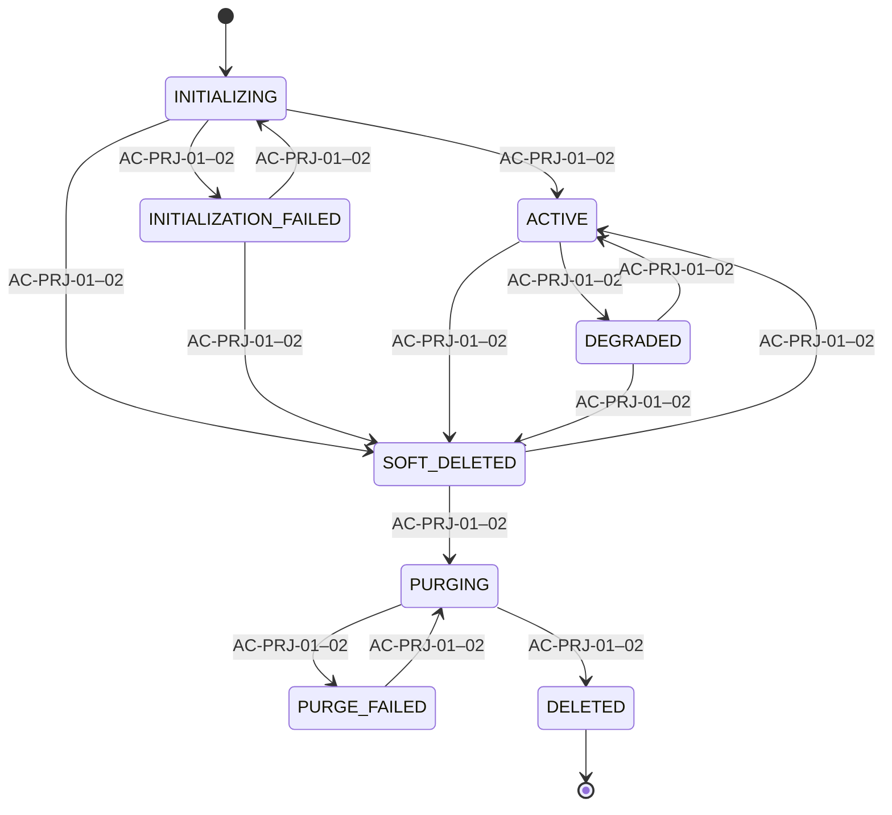
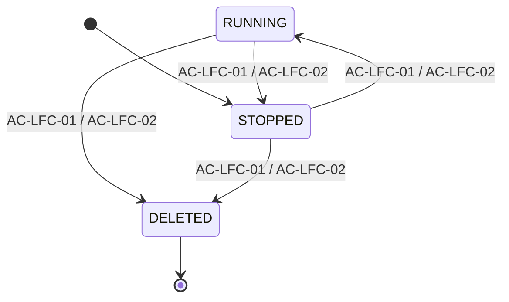
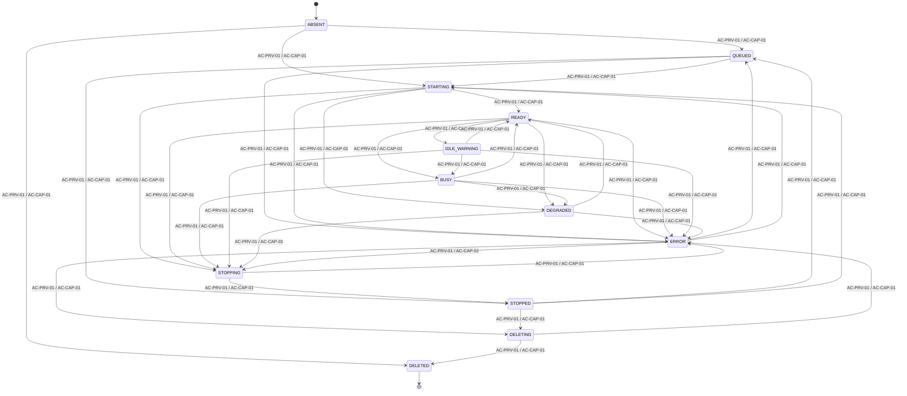
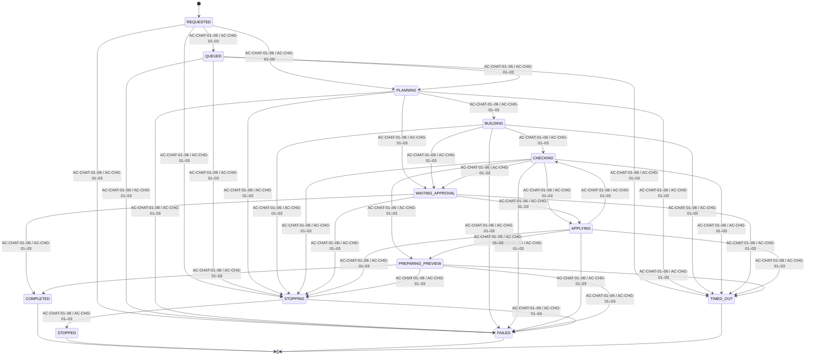
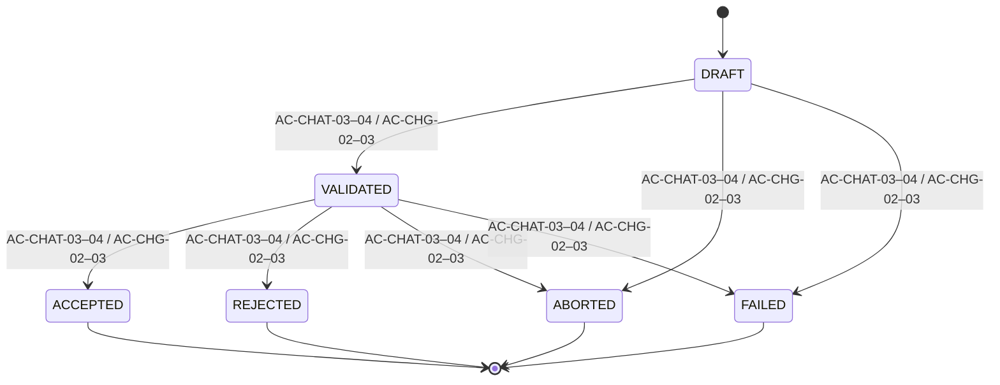
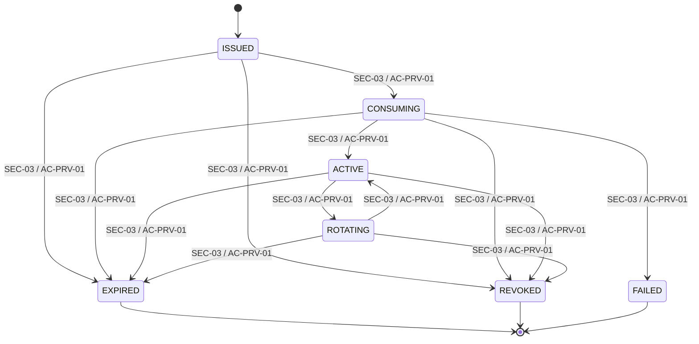
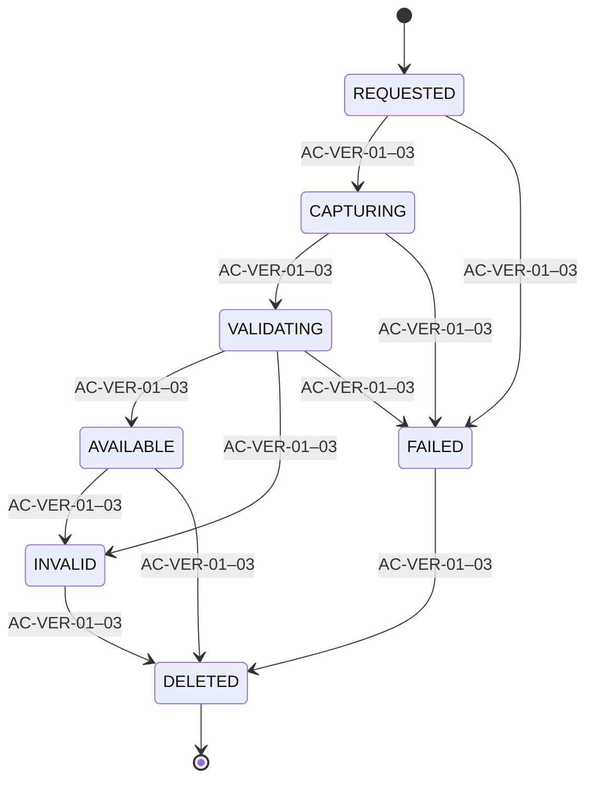
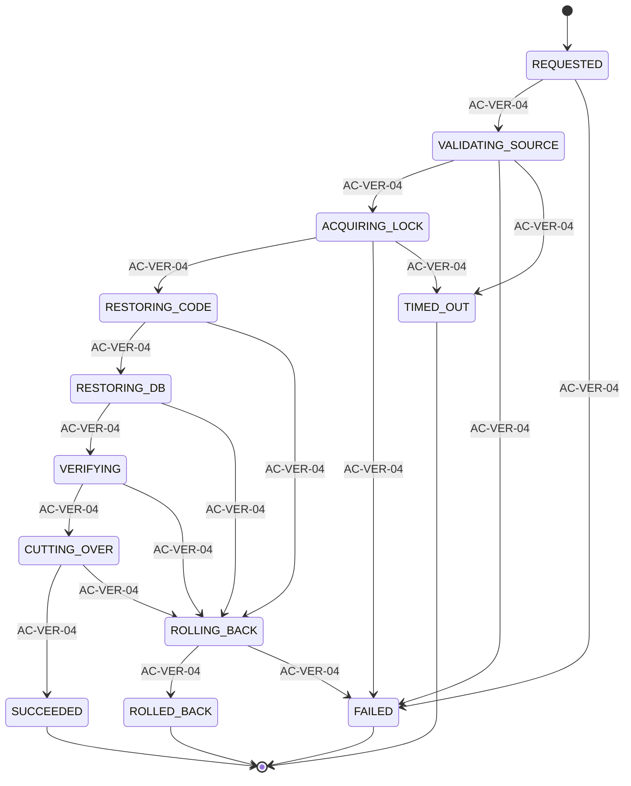
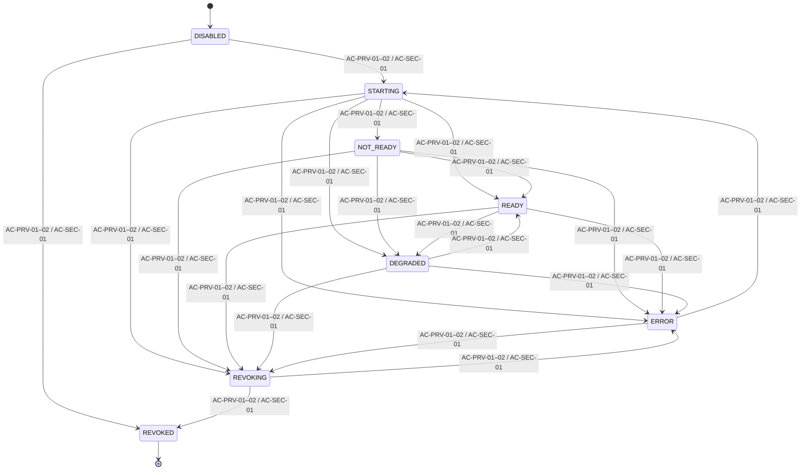
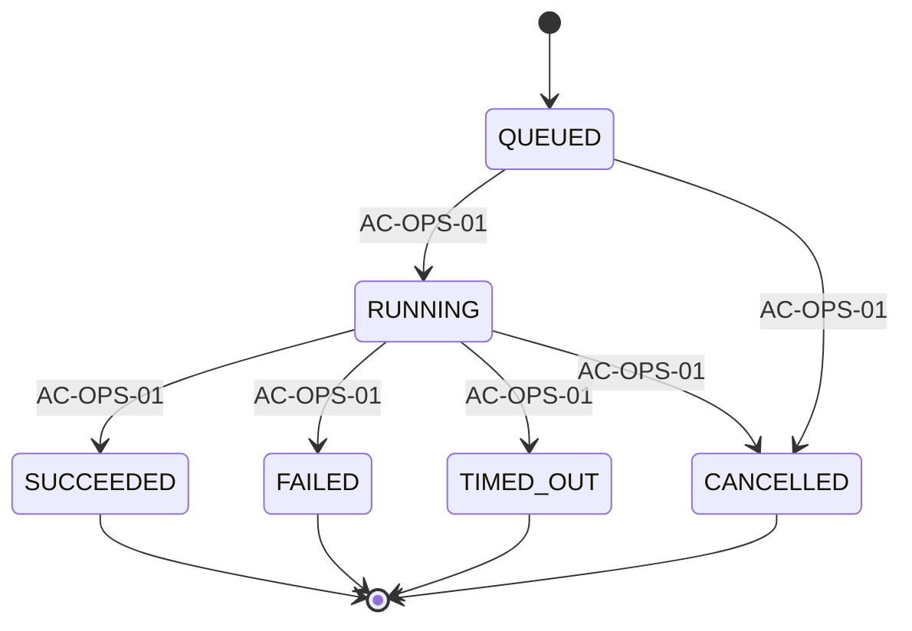

<!-- Generated by scripts/report_generation/export_vibe_reports_to_markdown.py; do not edit. -->
# Vibe-Code POC — Data Specification and Schema

- Source: `vibe-code-poc-data-specification-and-schema.xlsx`
- Source SHA-256: `6a507dcd5e93006db8fceeb5cf1f9d2846dedeab0d966f8c3798f35ad89da461`
- Purpose: deterministic text companion for fast diff, search and AI review; Office remains the visual authority.

## Canonical State Model Diagrams

### PROJECT.lifecycle_status

- Owner: NestJS control plane
- Guard contract: Owner-authorized command; command-id dedup and aggregate row-version CAS commit atomically.

### WORKSPACE.desired_status

- Owner: NestJS command/policy
- Guard contract: Owner-authorized intent; mutation serialization and aggregate row-version CAS.

### WORKSPACE.observed_status

- Owner: Runtime Controller
- Guard contract: Runtime Controller observation; readiness, UID and generation evidence must match desired state.

### AGENT_RUN.execution_status

- Owner: Agent orchestrator
- Guard contract: One project mutation lease; admitted Job identity, heartbeat and stop/fencing evidence.

### AGENT_RUN.outcome_status

- Owner: Validation/approval service
- Guard contract: Validated proposal plus explicit accept/reject/abort decision; terminal attempts are immutable.

### PREVIEW_AUTH_GRANT.grant_status

- Owner: Preview Gateway
- Guard contract: Verify active kid/signature and exact JWT audience/owner/session/project/generation/expiry; CAS-consume hashed jti once, then bind the host-only preview cookie.

### SNAPSHOT.snapshot_status

- Owner: Snapshot service
- Guard contract: Git, SQLite online backup, migration/lock manifests and hashes verify as one whole-app snapshot.

### RESTORE_JOB.restore_status

- Owner: Restore service
- Guard contract: Owner-only idempotent command; project lease, staged generation, before-images and journaled pointer CAS.

### PREVIEW_ROUTE.route_status

- Owner: Preview Gateway
- Guard contract: Owner/session/generation authorization plus workload and route readiness; stale routes fail closed.

### JOB_RUN.run_status

- Owner: Platform scheduler
- Guard contract: Unique scheduled attempt; overlap guard, timeout and linked retry preserve immutable terminal history.

## Sheet: Overview

| Row | Non-empty cells |
| ---: | --- |
| 1 | A1=Vibe-Code POC — Data Specification & Schema |
| 2 | A2=Approval-ready logical/physical schema workbook. It applies the IGS-LMS pattern beyond formatting: explicit user, role, permission, assignment, login-history and typed sys-config contracts, plus relationships, indexes, state graphs and governance. No credential, tenant secret, token, connection string or production data is included. |
| 4 | A4=Last update:; B4=2026-08-26 00:00:00 |
| 5 | A5=Source:; B5=wiki/product/reports/vibe-code-no-code-poc-prd-and-delivery-plan.docx · SHA-256 ba43e71db849138589cbc503cbdc9615e4d1b25b430d4f5119f9a78c8e988b97 \| wiki/product/reports/vibe-code-poc-technical-design-and-runtime-architecture.docx · SHA-256 63e80067a84c1ace418b7f09dc82d242fd5a1345a089ec22194a53778f167901 |
| 6 | A6=Section; B6=Value; C6=Notes |
| 7 | A7=Document status; B7=DRAFT — DIRECTION APPROVAL ONLY; C7=Supports engineering/database/test/approval alignment; does not authorize application coding. |
| 8 | A8=PRD frozen source; B8=PASS; C8=Source PRD and Technical Design SHA-256 values are recorded above. |
| 9 | A9=Generated-app boundary; B9=POC only; C9=Deploy/publish/promotion/rollback are Stage 2 and outside this Stage 1 POC. |
| 10 | A10=Database engines; B10=PostgreSQL control plane; SQLite per generated app; C10=Generated backend and SQLite are private; no network DB port. |
| 11 | A11=Reference workbook pattern; B11=IGS-LMS data specification; C11=Directly inspected user_mgt, custom_field, res, ext and workspace sheets: row-level field contracts, Calibri typography, compact grid and uncoloured worksheet tabs. |
| 12 | A12=Logical entities; B12==COUNTA('Entity Catalogue'!A7:A1000); C12=Formula-backed; includes explicit identity/RBAC/config entities. |
| 13 | A13=Schema columns; B13==SUM(COUNTA(platform_core!C7:C1000),COUNTA(runtime!C7:C1000),COUNTA(conversation!C7:C1000),COUNTA(versioning!C7:C1000),COUNTA(admission_auth!C7:C1000),COUNTA(operations!C7:C1000)); C13=Counts column definitions across six domain sheets. |
| 14 | A14=State fields; B14==COUNTIF('Enum Catalogue'!C7:C1000,"Yes"); C14=Formula-backed state-field count. |
| 15 | A15=Directed transitions; B15==COUNTA('State Transitions'!A7:A1000); C15=Only listed edges are legal; anything else fails closed. |
| 16 | A16=Legal AGENT_RUN pairs; B16==COUNTA('Run Pair Matrix'!A7:A1000); C16=Expected 16 reachable legal pairs. |
| 17 | A17=Editing guide; B17=Coloured headers and metadata; schema rows are specification; C17=Use filters on row 6. Update Spec Track Change Date for changed rows. |
| 18 | A18=Safe sample guide; B18=See Sample Data; C18=Examples are placeholders; never paste credentials or production PII. |
| 19 | A19=Approval boundary; B19=DIRECTION APPROVED ≠ IMPLEMENTATION AUTHORIZED; C19=PRD DEC-01–13, Technical TD-DEC-01–11, workbook DATA-DEC-01–14, DATA-01–04 and explicit implementation authorization remain separate namespaces/gates. |
| 20 | A20=Stage 1 operational controls; B20=Required; C20=CAPACITY_POOL, RESOURCE_LEASE and PREVIEW_AUTH_GRANT are required Stage 1 data contracts; capability installation remains outside Stage 1 scope. |

## Sheet: Entity Catalogue

| Row | Non-empty cells |
| ---: | --- |
| 1 | A1=Entity Catalogue |
| 2 | A2=Logical entity list with explicit Prisma/PostgreSQL mappings plus one Redis session contract. Identity, RBAC, key rotation, login history and typed configuration are application-owned and migration-reviewed. |
| 4 | A4=Last update:; B4=2026-08-26 00:00:00; D4=Source:; E4=wiki/product/reports/vibe-code-no-code-poc-prd-and-delivery-plan.docx · SHA-256 ba43e71db849138589cbc503cbdc9615e4d1b25b430d4f5119f9a78c8e988b97 \| wiki/product/reports/vibe-code-poc-technical-design-and-runtime-architecture.docx · SHA-256 63e80067a84c1ace418b7f09dc82d242fd5a1345a089ec22194a53778f167901 |
| 6 | A6=Entity; B6=Proposed Physical Table; C6=Domain Sheet; D6=Purpose; E6=Authoritative Owner; F6=Primary Data Store; G6=POC / Stage; H6=Notes |
| 7 | A7=AUTH_USER; B7=platform_user; C7=platform_core; D7=Prisma-managed platform identity and authorization account; E7=NestJS identity / Prisma; F7=PostgreSQL; G7=POC must-have; H7=Explicit Prisma model/table mapping; migration SQL and generated client are reviewed together. |
| 8 | A8=ORGANIZATIONAL_UNIT; B8=vibe_organizational_unit; C8=platform_core; D8=Future-ready Organization, OU and Department hierarchy; no implicit project authorization; E8=NestJS control plane / Prisma; F8=PostgreSQL; G8=POC must-have; H8=Explicit Prisma model/table mapping; migration SQL and generated client are reviewed together. |
| 9 | A9=AUTH_USER_ORG_MEMBERSHIP; B9=platform_user_org_membership; C9=platform_core; D9=Effective-dated user membership in an organizational unit; E9=NestJS control plane / Prisma; F9=PostgreSQL; G9=POC must-have; H9=Explicit Prisma model/table mapping; migration SQL and generated client are reviewed together. |
| 10 | A10=AUTH_SESSION; B10=session:{sid_hash}; C10=platform_core; D10=Opaque browser server-side session with bounded idle and absolute expiry; E10=Redis session service; F10=Redis; G10=POC must-have; H10=Logical Redis key contract; not a PostgreSQL table and not managed by Prisma migrations. |
| 11 | A11=AUTH_ROLE; B11=platform_role; C11=platform_core; D11=Named platform role; E11=NestJS RBAC / Prisma; F11=PostgreSQL; G11=POC must-have; H11=Explicit Prisma model/table mapping; migration SQL and generated client are reviewed together. |
| 12 | A12=AUTH_PERMISSION; B12=platform_permission; C12=platform_core; D12=Allowlisted resource/action platform permission; E12=NestJS RBAC / Prisma; F12=PostgreSQL; G12=POC must-have; H12=Explicit Prisma model/table mapping; migration SQL and generated client are reviewed together. |
| 13 | A13=AUTH_KEYSET; B13=platform_auth_keyset; C13=platform_core; D13=Public metadata and secret reference for asymmetric JWT signing-key rotation; E13=NestJS token service / Prisma; F13=PostgreSQL; G13=POC must-have; H13=Explicit Prisma model/table mapping; migration SQL and generated client are reviewed together. |
| 14 | A14=AUTH_USER_ROLE; B14=platform_user_role; C14=platform_core; D14=Explicit user-to-role assignment; E14=NestJS RBAC / Prisma; F14=PostgreSQL; G14=POC must-have; H14=Explicit Prisma model/table mapping; migration SQL and generated client are reviewed together. |
| 15 | A15=AUTH_ROLE_PERMISSION; B15=platform_role_permission; C15=platform_core; D15=Explicit role-to-permission assignment; E15=NestJS RBAC / Prisma; F15=PostgreSQL; G15=POC must-have; H15=Explicit Prisma model/table mapping; migration SQL and generated client are reviewed together. |
| 16 | A16=AUTH_LOGIN_HISTORY; B16=platform_login_history; C16=platform_core; D16=Append-only successful and denied authentication evidence; E16=NestJS identity / Audit; F16=PostgreSQL; G16=POC must-have; H16=Explicit Prisma model/table mapping; migration SQL and generated client are reviewed together. |
| 17 | A17=SYS_CONFIG; B17=vibe_sys_config; C17=platform_core; D17=Typed allowlisted non-secret platform configuration; E17=NestJS control plane / Prisma; F17=PostgreSQL; G17=POC must-have; H17=Explicit Prisma model/table mapping; migration SQL and generated client are reviewed together. |
| 18 | A18=PROJECT; B18=vibe_project; C18=platform_core; D18=User-owned no-code project and immutable artifact locks; E18=NestJS control plane; F18=PostgreSQL; G18=POC must-have; H18=Explicit Prisma model/table mapping; migration SQL and generated client are reviewed together. |
| 19 | A19=TEMPLATE_VERSION; B19=vibe_template_version; C19=platform_core; D19=Immutable approved generated-app template version; E19=Platform super admin; F19=PostgreSQL; G19=POC must-have; H19=Explicit Prisma model/table mapping; migration SQL and generated client are reviewed together. |
| 20 | A20=WORKSPACE; B20=vibe_workspace; C20=runtime; D20=Per-project K3s runtime intent, observation, heartbeat and quota metadata; E20=Runtime Controller + NestJS intent; F20=PostgreSQL; G20=POC must-have; H20=Explicit Prisma model/table mapping; migration SQL and generated client are reviewed together. |
| 21 | A21=RESOURCE_LEASE; B21=vibe_resource_lease; C21=runtime; D21=Bounded K3s admission-pool capacity reservation for a workspace; E21=Runtime Controller; F21=PostgreSQL; G21=Required Stage 1 global admission ledger; allocation serialized through CAPACITY_POOL; H21=Explicit Prisma model/table mapping; migration SQL and generated client are reviewed together. |
| 22 | A22=MUTATION_LEASE; B22=vibe_mutation_lease; C22=runtime; D22=Single-project mutation serialization lease; E22=NestJS control plane; F22=PostgreSQL; G22=POC must-have; H22=Explicit Prisma model/table mapping; migration SQL and generated client are reviewed together. |
| 23 | A23=PREVIEW_ROUTE; B23=vibe_preview_route; C23=runtime; D23=Authenticated owner-only mutable preview route; E23=Preview Gateway; F23=PostgreSQL; G23=POC must-have; H23=Explicit Prisma model/table mapping; migration SQL and generated client are reviewed together. |
| 24 | A24=RUNTIME_RESOURCE_REF; B24=vibe_runtime_resource_ref; C24=runtime; D24=Allowlisted K3s resource reference owned by a workspace generation; E24=Runtime Controller; F24=PostgreSQL; G24=Required K3s observed-resource reference; no arbitrary manifest content; H24=Explicit Prisma model/table mapping; migration SQL and generated client are reviewed together. |
| 25 | A25=WORKSPACE_USAGE_SAMPLE; B25=vibe_workspace_usage_sample; C25=runtime; D25=Measured CPU/RAM/disk/network evidence; E25=Metrics collector; F25=PostgreSQL; G25=Conditional evidence — metrics backend is acceptable if acceptance reports remain reproducible; H25=Explicit Prisma model/table mapping; migration SQL and generated client are reviewed together. |
| 26 | A26=CHAT_THREAD; B26=vibe_chat_thread; C26=conversation; D26=One user session and exactly one context window for a project; E26=NestJS control plane; F26=PostgreSQL; G26=POC must-have; H26=Explicit Prisma model/table mapping; migration SQL and generated client are reviewed together. |
| 27 | A27=CHAT_MESSAGE; B27=vibe_chat_message; C27=conversation; D27=Authoritative user-visible and rich-block message history; E27=NestJS control plane; F27=PostgreSQL; G27=POC must-have; H27=Explicit Prisma model/table mapping; migration SQL and generated client are reviewed together. |
| 28 | A28=AGENT_RUN; B28=vibe_agent_run; C28=conversation; D28=One immutable agent execution attempt and outcome; E28=Agent orchestrator; F28=PostgreSQL; G28=POC must-have; H28=Explicit Prisma model/table mapping; migration SQL and generated client are reviewed together. |
| 29 | A29=AGENT_EVENT; B29=vibe_agent_event; C29=conversation; D29=Ordered durable run event and usage stream; E29=Agent event bridge; F29=PostgreSQL; G29=POC must-have; H29=Explicit Prisma model/table mapping; migration SQL and generated client are reviewed together. |
| 30 | A30=SNAPSHOT; B30=vibe_snapshot; C30=versioning; D30=Reusable immutable code+SQLite+lock version asset; E30=Snapshot service; F30=PostgreSQL; G30=POC must-have; H30=Explicit Prisma model/table mapping; migration SQL and generated client are reviewed together. |
| 31 | A31=RESTORE_JOB; B31=vibe_restore_job; C31=versioning; D31=One restore attempt; source snapshot remains unchanged; E31=Restore service; F31=PostgreSQL; G31=POC must-have; H31=Explicit Prisma model/table mapping; migration SQL and generated client are reviewed together. |
| 32 | A32=CAPACITY_POOL; B32=vibe_capacity_pool; C32=admission_auth; D32=Versioned global admission pool and resource profile; E32=Admission controller; F32=PostgreSQL; G32=Required Stage 1 global capacity, resource-profile and bounded-queue contract; H32=Explicit Prisma model/table mapping; migration SQL and generated client are reviewed together. |
| 33 | A33=PREVIEW_AUTH_GRANT; B33=vibe_preview_auth_grant; C33=admission_auth; D33=Shared PostgreSQL-backed one-time preview credential grant; E33=Preview Gateway; F33=PostgreSQL; G33=Required Stage 1 shared one-time preview JWT/cookie replay and revocation state; H33=Explicit Prisma model/table mapping; migration SQL and generated client are reviewed together. |
| 34 | A34=ERROR_EVENT; B34=vibe_error_event; C34=operations; D34=Stable user-safe error plus redacted technical evidence; E34=Owning service / NestJS; F34=PostgreSQL; G34=POC must-have; H34=Explicit Prisma model/table mapping; migration SQL and generated client are reviewed together. |
| 35 | A35=JOB; B35=vibe_job; C35=operations; D35=Allowlisted recurring scheduler/reconciler job definition; E35=Platform scheduler; F35=PostgreSQL; G35=POC must-have; H35=Explicit Prisma model/table mapping; migration SQL and generated client are reviewed together. |
| 36 | A36=JOB_RUN; B36=vibe_job_run; C36=operations; D36=Immutable execution attempt for one JOB definition; E36=Platform scheduler; F36=PostgreSQL; G36=POC must-have; H36=Explicit Prisma model/table mapping; migration SQL and generated client are reviewed together. |
| 37 | A37=AUDIT_LOG; B37=vibe_audit_log; C37=operations; D37=Append-only privileged action, security decision and state-transition evidence; E37=Audit service; F37=PostgreSQL; G37=POC must-have; H37=Explicit Prisma model/table mapping; migration SQL and generated client are reviewed together. |

## Sheet: Redis Key Catalogue

| Row | Non-empty cells |
| ---: | --- |
| 1 | A1=Redis Key Catalogue |
| 2 | A2=Redis contains only revocable session, bounded cache, replay and rate-limit coordination state. PostgreSQL through Prisma remains authoritative for users, RBAC, projects, commands, grants and audit. |
| 4 | A4=Last update:; B4=2026-08-26 00:00:00; D4=Source:; E4=wiki/product/reports/vibe-code-no-code-poc-prd-and-delivery-plan.docx · SHA-256 ba43e71db849138589cbc503cbdc9615e4d1b25b430d4f5119f9a78c8e988b97 \| wiki/product/reports/vibe-code-poc-technical-design-and-runtime-architecture.docx · SHA-256 63e80067a84c1ace418b7f09dc82d242fd5a1345a089ec22194a53778f167901 |
| 6 | A6=Key Pattern; B6=Purpose; C6=Value Schema; D6=TTL / Bound; E6=Owner; F6=Invalidation / Failure |
| 7 | A7=session:{sid_hash}; B7=Current first-party browser session; C7={schema_version,user_id,session_version,csrf_hash,created_at,last_seen_at,absolute_expires_at,auth_strength,client_hashes}; D7=Idle TTL plus immutable absolute bound; exact values DECISION REQUIRED; E7=NestJS identity service; F7=Logout/account-disable/password-reset/role revoke deletes user-indexed sessions; missing Redis fails authentication closed. |
| 8 | A8=session-user:{user_id}; B8=Set of sid_hash values for bounded all-session revocation; C8=Redis SET of session hashes only; D8=No longer than longest member session; E8=NestJS identity service; F8=Updated atomically with session create/delete; missing index triggers session_version increment and lazy denial, never grants access. |
| 9 | A9=cache:project:{project_id}:v{row_version}; B9=Owner-scoped project/status read-through cache; C9=Versioned non-secret projection; no prompts, credentials or raw generated content; D9=Short bounded TTL; E9=NestJS project service; F9=Invalidate after committed Prisma transaction; miss/outage reads PostgreSQL; stale entry cannot authorize or mutate. |
| 10 | A10=cache:preview-route:{host}:g{generation}; B10=Read-through route projection after authoritative authorization; C10={owner_id,project_id,generation,target_ref,status,expires_at}; D10=Seconds, not longer than route/auth grant; E10=Preview Gateway; F10=Miss/outage reads PostgreSQL; generation/status mismatch denies; cache alone never grants. |
| 11 | A11=replay:service-jwt:{jti_hash}; B11=Single-use/non-idempotent internal JWT replay marker; C11=SETNX marker with issuer/audience hash; D11=JWT remaining lifetime only; E11=NestJS token guard; F11=Duplicate SETNX denies; Redis outage fails the protected non-idempotent endpoint closed. |
| 12 | A12=rate:login:{principal_hash}:{ip_prefix_hash}; B12=Bounded login abuse counter; C12=Integer counter; hashes are keyed and non-reversible; D12=Short security-policy window; exact values DECISION REQUIRED; E12=NestJS identity service; F12=Expiry resets bucket; Redis outage applies conservative fail-closed or explicitly approved local emergency policy, never unlimited login. |

## Sheet: ER 1 Identity Runtime

| Row | Non-empty cells |
| ---: | --- |
| 1 | A1=ER-1 — Identity, RBAC, Redis session and ownership |
| 2 | A2=NestJS/Prisma/PostgreSQL identity and RBAC contracts, Redis opaque sessions, asymmetric JWT key metadata and restricted AdminJS actions are explicit. |
| 39 | A39=Diagram is explanatory. Relationships sheet and Column Definitions remain the authoritative machine-readable FK contract. |

## Sheet: ER 2 Conversation

| Row | Non-empty cells |
| ---: | --- |
| 1 | A1=ER-2 — Conversation, agent execution and snapshots |
| 2 | A2=Conversation history, immutable run/event evidence and reusable accepted snapshots. |
| 39 | A39=Diagram is explanatory. Relationships sheet and Column Definitions remain the authoritative machine-readable FK contract. |

## Sheet: ER 3 Version Ops

| Row | Non-empty cells |
| ---: | --- |
| 1 | A1=ER-3 — Restore journal and preview authorization |
| 2 | A2=Restore captures prior generation, snapshot, route generation/status and a provisional result before mutation; shared preview auth supports cross-replica replay denial. |
| 39 | A39=Diagram is explanatory. Relationships sheet and Column Definitions remain the authoritative machine-readable FK contract. |

## Sheet: ER 4 Ops Audit

| Row | Non-empty cells |
| ---: | --- |
| 1 | A1=ER-4 — Admission, runtime proof and operations |
| 2 | A2=Durable Preview/Agent component queue rows serialize global admission; Agent write-revocation proof is uniquely bound to the exact run. |
| 39 | A39=Diagram is explanatory. Relationships sheet and Column Definitions remain the authoritative machine-readable FK contract. |

## Sheet: platform_core

| Row | Non-empty cells |
| ---: | --- |
| 1 | A1=Identity, RBAC, Config & Project Schema |
| 2 | A2=Reference-template structure: row 1 title, row 2 note, row 4 source/update, row 6 headers, row 7+ field definitions. Blank/unknown product decisions are marked DECISION REQUIRED rather than guessed. |
| 4 | A4=Last update:; B4=2026-08-26 00:00:00; D4=Source:; E4=wiki/product/reports/vibe-code-no-code-poc-prd-and-delivery-plan.docx · SHA-256 ba43e71db849138589cbc503cbdc9615e4d1b25b430d4f5119f9a78c8e988b97 \| wiki/product/reports/vibe-code-poc-technical-design-and-runtime-architecture.docx · SHA-256 63e80067a84c1ace418b7f09dc82d242fd5a1345a089ec22194a53778f167901 |
| 6 | A6=Spec Track Change Date; B6=Table Name; C6=Column Name; D6=UI Attribute Name; E6=Data Type; F6=Length; G6=Key; H6=NULL?; I6=Auto Increment; J6=Index / Unique Info; K6=Default Value; L6=Category / Module; M6=Description; N6=Additional Notes; O6=Validation / Constraints |
| 7 | A7=2026-08-26 00:00:00; B7=AUTH_USER; C7=id; E7=bigint; F7=N/A; G7=PK; H7=NOT NULL; I7=Yes; J7=PK / B-tree; L7=Identity; M7=Platform user identifier; N7=Prisma BigInt; never expose as an authorization substitute for object checks |
| 8 | A8=2026-08-26 00:00:00; B8=AUTH_USER; C8=username; E8=varchar; F8=150; G8=UK; H8=NOT NULL; J8=UNIQUE; L8=Identity; M8=Normalized local POC sign-in name; N8=NestJS identity validation; case-folded uniqueness |
| 9 | A9=2026-08-26 00:00:00; B9=AUTH_USER; C9=display_name; E9=varchar; F9=200; H9=NOT NULL; L9=Identity; M9=Administration and audit display name; N9=Never used as an authorization key |
| 10 | A10=2026-08-26 00:00:00; B10=AUTH_USER; C10=email; E10=varchar; F10=254; H10=NOT NULL; J10=INDEX; L10=Identity; M10=Administrative contact/login recovery address; N10=POC uniqueness policy is DECISION REQUIRED; do not infer identity from email alone |
| 11 | A11=2026-08-26 00:00:00; B11=AUTH_USER; C11=password_hash; E11=varchar; F11=255; H11=NOT NULL; L11=Identity; M11=Argon2id encoded password hash; N11=Never export raw credential or hash; parameters are security configuration |
| 12 | A12=2026-08-26 00:00:00; B12=AUTH_USER; C12=ctrl_is_active; E12=boolean; F12=N/A; H12=NOT NULL; K12=TRUE; L12=Identity; M12=Whether future login is permitted; N12=FALSE also triggers explicit Redis session revocation workflow |
| 13 | A13=2026-08-26 00:00:00; B13=AUTH_USER; C13=session_version; E13=integer; F13=N/A; H13=NOT NULL; K13=0; L13=Identity; M13=Global session invalidation counter; N13=Increment on password reset, role-sensitive revoke or account disable |
| 14 | A14=2026-08-26 00:00:00; B14=AUTH_USER; C14=ctrl_created_at; E14=timestamptz; F14=N/A; H14=NOT NULL; K14=CURRENT_TIMESTAMP; L14=Audit; M14=Account creation time |
| 15 | A15=2026-08-26 00:00:00; B15=AUTH_USER; C15=ctrl_updated_at; E15=timestamptz; F15=N/A; H15=NOT NULL; K15=CURRENT_TIMESTAMP; L15=Audit; M15=Last account metadata change |
| 16 | A16=2026-08-26 00:00:00; B16=AUTH_USER; C16=last_login_at; E16=timestamptz; F16=N/A; H16=NULL; L16=Identity; M16=Last successful login time |
| 17 | A17=2026-08-26 00:00:00; B17=AUTH_USER; C17=ctrl_row_version; E17=integer; F17=N/A; H17=NOT NULL; K17=0; L17=Concurrency; M17=Optimistic concurrency counter for AdminJS/NestJS commands |
| 18 | A18=2026-08-26 00:00:00; B18=ORGANIZATIONAL_UNIT; C18=id; E18=uuid; F18=N/A; G18=PK; H18=NOT NULL; J18=PK / B-tree; K18=gen_random_uuid(); L18=Organization; M18=Organizational unit identifier |
| 19 | A19=2026-08-26 00:00:00; B19=ORGANIZATIONAL_UNIT; C19=parent_id; E19=uuid; F19=N/A; G19=FK; H19=NULL; J19=INDEX; L19=Organization; M19=Parent organizational unit; N19=FK → ORGANIZATIONAL_UNIT.id; ORGANIZATION has no parent; OU parent is ORGANIZATION; DEPARTMENT parent is OU |
| 20 | A20=2026-08-26 00:00:00; B20=ORGANIZATIONAL_UNIT; C20=unit_type; E20=varchar; F20=16; H20=NOT NULL; J20=INDEX; L20=Organization; M20=ORGANIZATION / OU / DEPARTMENT; N20=Identity/policy scope only; never grants project access; O20=Enum ORGANIZATIONAL_UNIT.unit_type |
| 21 | A21=2026-08-26 00:00:00; B21=ORGANIZATIONAL_UNIT; C21=unit_code; E21=varchar; F21=64; H21=NOT NULL; J21=UNIQUE; L21=Organization; M21=Stable organization-controlled code; N21=POC seeds DEFAULT_ORG, DEFAULT_OU and DEFAULT_DEPT; O21=^[A-Z][A-Z0-9_-]{1,63}$ |
| 22 | A22=2026-08-26 00:00:00; B22=ORGANIZATIONAL_UNIT; C22=name; E22=varchar; F22=200; H22=NOT NULL; J22=INDEX; L22=Organization; M22=Display name |
| 23 | A23=2026-08-26 00:00:00; B23=ORGANIZATIONAL_UNIT; C23=status; E23=varchar; F23=16; H23=NOT NULL; J23=INDEX; K23='ACTIVE'; L23=Organization; M23=ACTIVE / INACTIVE; N23=Inactive units cannot receive new memberships |
| 24 | A24=2026-08-26 00:00:00; B24=ORGANIZATIONAL_UNIT; C24=ctrl_row_version; E24=integer; F24=N/A; H24=NOT NULL; K24=0; L24=Concurrency; M24=Optimistic concurrency counter |
| 25 | A25=2026-08-26 00:00:00; B25=ORGANIZATIONAL_UNIT; C25=ctrl_created_at; E25=timestamptz; F25=N/A; H25=NOT NULL; K25=CURRENT_TIMESTAMP; L25=Audit; M25=Creation time |
| 26 | A26=2026-08-26 00:00:00; B26=ORGANIZATIONAL_UNIT; C26=ctrl_updated_at; E26=timestamptz; F26=N/A; H26=NOT NULL; K26=CURRENT_TIMESTAMP; L26=Audit; M26=Last update time |
| 27 | A27=2026-08-26 00:00:00; B27=AUTH_USER_ORG_MEMBERSHIP; C27=id; E27=uuid; F27=N/A; G27=PK; H27=NOT NULL; J27=PK / B-tree; K27=gen_random_uuid(); L27=Organization membership; M27=Membership identifier |
| 28 | A28=2026-08-26 00:00:00; B28=AUTH_USER_ORG_MEMBERSHIP; C28=user_id; E28=bigint; F28=N/A; G28=FK; H28=NOT NULL; J28=INDEX; L28=Organization membership; M28=Assigned account; N28=FK → AUTH_USER.id |
| 29 | A29=2026-08-26 00:00:00; B29=AUTH_USER_ORG_MEMBERSHIP; C29=org_unit_id; E29=uuid; F29=N/A; G29=FK; H29=NOT NULL; J29=INDEX; L29=Organization membership; M29=Assigned Organization, OU or Department; N29=FK → ORGANIZATIONAL_UNIT.id |
| 30 | A30=2026-08-26 00:00:00; B30=AUTH_USER_ORG_MEMBERSHIP; C30=ctrl_is_primary; E30=boolean; F30=N/A; H30=NOT NULL; J30=INDEX; K30=TRUE; L30=Organization membership; M30=Primary current placement marker; N30=At most one active primary membership per user |
| 31 | A31=2026-08-26 00:00:00; B31=AUTH_USER_ORG_MEMBERSHIP; C31=effective_from; E31=date; F31=N/A; H31=NOT NULL; J31=INDEX; K31=CURRENT_DATE; L31=Organization membership; M31=Membership start date |
| 32 | A32=2026-08-26 00:00:00; B32=AUTH_USER_ORG_MEMBERSHIP; C32=effective_to; E32=date; F32=N/A; H32=NULL; J32=INDEX; L32=Organization membership; M32=Membership end date; N32=NULL means current; must be >= effective_from |
| 33 | A33=2026-08-26 00:00:00; B33=AUTH_USER_ORG_MEMBERSHIP; C33=ctrl_created_at; E33=timestamptz; F33=N/A; H33=NOT NULL; K33=CURRENT_TIMESTAMP; L33=Audit; M33=Creation time |
| 34 | A34=2026-08-26 00:00:00; B34=AUTH_USER_ORG_MEMBERSHIP; C34=ctrl_updated_at; E34=timestamptz; F34=N/A; H34=NOT NULL; K34=CURRENT_TIMESTAMP; L34=Audit; M34=Last update time |
| 35 | A35=2026-08-26 00:00:00; B35=AUTH_SESSION; C35=sid_hash; E35=char; F35=64; G35=PK; H35=NOT NULL; J35=PK / Redis key; L35=Identity; M35=SHA-256 hash of the opaque browser session identifier; N35=Redis key is session:{sid_hash}; raw session ID exists only in the __Host-vibe_session cookie |
| 36 | A36=2026-08-26 00:00:00; B36=AUTH_SESSION; C36=payload_json; E36=json; F36=N/A; H36=NOT NULL; L36=Identity; M36=Versioned Redis session payload; N36=Contains user_id, session_version, CSRF hash, created/last-seen/absolute expiry and hashed client evidence; never a self-contained authorization token |
| 37 | A37=2026-08-26 00:00:00; B37=AUTH_SESSION; C37=expires_at; E37=timestamptz; F37=N/A; H37=NOT NULL; J37=TTL; L37=Identity; M37=Logical idle expiry mirrored by Redis TTL; N37=Absolute expiry in payload cannot be extended; Redis outage fails current authentication closed |
| 38 | A38=2026-08-26 00:00:00; B38=AUTH_ROLE; C38=id; E38=bigint; F38=N/A; G38=PK; H38=NOT NULL; I38=Yes; J38=PK / B-tree; L38=RBAC; M38=Platform role identifier; N38=Prisma model AUTH_ROLE |
| 39 | A39=2026-08-26 00:00:00; B39=AUTH_ROLE; C39=name; E39=varchar; F39=150; G39=UK; H39=NOT NULL; J39=UNIQUE; L39=RBAC; M39=Stable role name; N39=Seed VIBE_USER and PLATFORM_ADMIN; names are code-reviewed |
| 40 | A40=2026-08-26 00:00:00; B40=AUTH_PERMISSION; C40=id; E40=bigint; F40=N/A; G40=PK; H40=NOT NULL; I40=Yes; J40=PK / B-tree; L40=RBAC; M40=Platform permission identifier; N40=Prisma model AUTH_PERMISSION |
| 41 | A41=2026-08-26 00:00:00; B41=AUTH_PERMISSION; C41=name; E41=varchar; F41=255; H41=NOT NULL; L41=RBAC; M41=Human-readable permission name |
| 42 | A42=2026-08-26 00:00:00; B42=AUTH_PERMISSION; C42=resource; E42=varchar; F42=100; H42=NOT NULL; J42=INDEX; L42=RBAC; M42=Allowlisted resource or command family; N42=Examples PROJECT, SYS_CONFIG, RECOVERY_COMMAND; no arbitrary model access |
| 43 | A43=2026-08-26 00:00:00; B43=AUTH_PERMISSION; C43=action; E43=varchar; F43=100; H43=NOT NULL; J43=UNIQUE(resource, action); L43=RBAC; M43=Stable allowlisted action; N43=Code-owned and enforced by NestJS guards; AdminJS visibility is not authorization |
| 44 | A44=2026-08-26 00:00:00; B44=AUTH_KEYSET; C44=kid; E44=varchar; F44=64; G44=PK; H44=NOT NULL; J44=PK / B-tree; L44=Token security; M44=Public signing-key identifier; N44=JWT header kid; immutable |
| 45 | A45=2026-08-26 00:00:00; B45=AUTH_KEYSET; C45=public_jwk; E45=jsonb; F45=N/A; H45=NOT NULL; L45=Token security; M45=Public JWK for verification; N45=Private material never enters PostgreSQL; secret_ref points to approved secret store |
| 46 | A46=2026-08-26 00:00:00; B46=AUTH_KEYSET; C46=metadata_json; E46=jsonb; F46=N/A; H46=NOT NULL; J46=INDEX; L46=Token security; M46=algorithm, purpose, status, secret_ref, not_before and not_after; N46=Asymmetric only; one active key per purpose; audited overlap/retirement |
| 47 | A47=2026-08-26 00:00:00; B47=AUTH_USER_ROLE; C47=id; E47=bigint; F47=N/A; G47=PK; H47=NOT NULL; I47=Yes; J47=PK / B-tree; L47=RBAC; M47=Assignment row identifier; N47=Prisma-managed join model |
| 48 | A48=2026-08-26 00:00:00; B48=AUTH_USER_ROLE; C48=user_id; E48=bigint; F48=N/A; G48=FK; H48=NOT NULL; J48=INDEX; L48=RBAC; M48=Assigned account; N48=FK → AUTH_USER.id |
| 49 | A49=2026-08-26 00:00:00; B49=AUTH_USER_ROLE; C49=role_id; E49=bigint; F49=N/A; G49=FK; H49=NOT NULL; J49=INDEX; L49=RBAC; M49=Assigned platform role; N49=FK → AUTH_ROLE.id; UNIQUE(user_id, role_id) |
| 50 | A50=2026-08-26 00:00:00; B50=AUTH_ROLE_PERMISSION; C50=id; E50=bigint; F50=N/A; G50=PK; H50=NOT NULL; I50=Yes; J50=PK / B-tree; L50=RBAC; M50=Role-permission row identifier; N50=Prisma-managed join model |
| 51 | A51=2026-08-26 00:00:00; B51=AUTH_ROLE_PERMISSION; C51=role_id; E51=bigint; F51=N/A; G51=FK; H51=NOT NULL; J51=INDEX; L51=RBAC; M51=Platform role; N51=FK → AUTH_ROLE.id |
| 52 | A52=2026-08-26 00:00:00; B52=AUTH_ROLE_PERMISSION; C52=permission_id; E52=bigint; F52=N/A; G52=FK; H52=NOT NULL; J52=INDEX; L52=RBAC; M52=Allowlisted permission; N52=FK → AUTH_PERMISSION.id; UNIQUE(role_id, permission_id) |
| 53 | A53=2026-08-26 00:00:00; B53=AUTH_LOGIN_HISTORY; C53=id; E53=bigint; F53=N/A; G53=PK; H53=NOT NULL; I53=Yes; J53=PK / B-tree; L53=Identity audit; M53=Authentication attempt identifier |
| 54 | A54=2026-08-26 00:00:00; B54=AUTH_LOGIN_HISTORY; C54=user_id; E54=bigint; F54=N/A; G54=FK; H54=NULL; J54=INDEX; L54=Identity audit; M54=Resolved account when safe to retain; N54=FK → AUTH_USER.id; NULL for unknown/invalid username |
| 55 | A55=2026-08-26 00:00:00; B55=AUTH_LOGIN_HISTORY; C55=result; E55=varchar; F55=16; H55=NOT NULL; J55=INDEX; L55=Identity audit; M55=SUCCEEDED / DENIED / FAILED |
| 56 | A56=2026-08-26 00:00:00; B56=AUTH_LOGIN_HISTORY; C56=auth_method; E56=varchar; F56=24; H56=NOT NULL; J56=INDEX; K56='PASSWORD'; L56=Identity audit; M56=PASSWORD for POC; future OIDC/SSO is Stage 2 |
| 57 | A57=2026-08-26 00:00:00; B57=AUTH_LOGIN_HISTORY; C57=failure_code; E57=varchar; F57=64; H57=NULL; J57=INDEX; L57=Identity audit; M57=Stable safe denial/failure code; N57=Must exist in Error Exception Map |
| 58 | A58=2026-08-26 00:00:00; B58=AUTH_LOGIN_HISTORY; C58=ip_address_hash; E58=char; F58=64; H58=NULL; L58=Privacy; M58=Keyed hash for abuse correlation; N58=No raw IP in this table; key stays in secret store |
| 59 | A59=2026-08-26 00:00:00; B59=AUTH_LOGIN_HISTORY; C59=user_agent_hash; E59=char; F59=64; H59=NULL; L59=Privacy; M59=Hash of normalized user-agent evidence; N59=No raw unrestricted header |
| 60 | A60=2026-08-26 00:00:00; B60=AUTH_LOGIN_HISTORY; C60=correlation_id; E60=varchar; F60=64; H60=NOT NULL; J60=INDEX; L60=Audit; M60=Trace identifier |
| 61 | A61=2026-08-26 00:00:00; B61=AUTH_LOGIN_HISTORY; C61=occurred_at; E61=timestamptz; F61=N/A; H61=NOT NULL; J61=INDEX; K61=CURRENT_TIMESTAMP; L61=Audit; M61=Attempt time |
| 62 | A62=2026-08-26 00:00:00; B62=SYS_CONFIG; C62=id; E62=bigint; F62=N/A; G62=PK; H62=NOT NULL; I62=Yes; J62=PK / B-tree; L62=Configuration; M62=Configuration row identifier |
| 63 | A63=2026-08-26 00:00:00; B63=SYS_CONFIG; C63=config_key; E63=varchar; F63=150; G63=UK; H63=NOT NULL; J63=UNIQUE; L63=Configuration; M63=Stable allowlisted key; N63=Examples: workspace.idle_timeout_seconds; preview.idle_timeout_seconds |
| 64 | A64=2026-08-26 00:00:00; B64=SYS_CONFIG; C64=category; E64=varchar; F64=50; H64=NOT NULL; J64=INDEX; L64=Configuration; M64=WORKSPACE / PREVIEW / SECURITY / RETENTION / SCHEDULER |
| 65 | A65=2026-08-26 00:00:00; B65=SYS_CONFIG; C65=value_type; E65=varchar; F65=16; H65=NOT NULL; J65=INDEX; L65=Configuration; M65=INTEGER / BOOLEAN / STRING / JSON |
| 66 | A66=2026-08-26 00:00:00; B66=SYS_CONFIG; C66=value_json; E66=jsonb; F66=N/A; H66=NOT NULL; K66={}; L66=Configuration; M66=Current typed non-secret value; N66=Validated against validation_schema_json before commit |
| 67 | A67=2026-08-26 00:00:00; B67=SYS_CONFIG; C67=default_value_json; E67=jsonb; F67=N/A; H67=NOT NULL; K67={}; L67=Configuration; M67=Code-reviewed safe default |
| 68 | A68=2026-08-26 00:00:00; B68=SYS_CONFIG; C68=validation_schema_json; E68=jsonb; F68=N/A; H68=NOT NULL; K68={}; L68=Configuration; M68=Bounded JSON Schema and range/enum constraints; N68=No executable expression, SQL or import path |
| 69 | A69=2026-08-26 00:00:00; B69=SYS_CONFIG; C69=ctrl_is_sensitive; E69=boolean; F69=N/A; H69=NOT NULL; K69=FALSE; L69=Security; M69=Sensitivity marker; N69=Must remain FALSE in POC; credentials belong in the approved secret store |
| 70 | A70=2026-08-26 00:00:00; B70=SYS_CONFIG; C70=ctrl_is_editable; E70=boolean; F70=N/A; H70=NOT NULL; K70=TRUE; L70=Configuration; M70=Whether restricted admin may edit through validated command |
| 71 | A71=2026-08-26 00:00:00; B71=SYS_CONFIG; C71=requires_restart; E71=boolean; F71=N/A; H71=NOT NULL; K71=FALSE; L71=Configuration; M71=Whether accepted change needs controlled service restart |
| 72 | A72=2026-08-26 00:00:00; B72=SYS_CONFIG; C72=description; E72=varchar; F72=500; H72=NOT NULL; L72=Configuration; M72=Operator-facing purpose and impact |
| 73 | A73=2026-08-26 00:00:00; B73=SYS_CONFIG; C73=ctrl_row_version; E73=integer; F73=N/A; H73=NOT NULL; K73=0; L73=Concurrency; M73=Optimistic update token |
| 74 | A74=2026-08-26 00:00:00; B74=SYS_CONFIG; C74=ctrl_updated_by_id; E74=bigint; F74=N/A; G74=FK; H74=NOT NULL; J74=INDEX; L74=Audit; M74=Platform admin who last changed the value; N74=FK → AUTH_USER.id |
| 75 | A75=2026-08-26 00:00:00; B75=SYS_CONFIG; C75=ctrl_updated_at; E75=timestamptz; F75=N/A; H75=NOT NULL; J75=INDEX; K75=CURRENT_TIMESTAMP; L75=Audit; M75=Last accepted update time |
| 76 | A76=2026-08-26 00:00:00; B76=PROJECT; C76=id; E76=uuid; F76=N/A; G76=PK; H76=NOT NULL; J76=PK / B-tree; K76=gen_random_uuid(); L76=Projects; M76=Project identifier |
| 77 | A77=2026-08-26 00:00:00; B77=PROJECT; C77=owner_id; E77=bigint; F77=N/A; G77=FK; H77=NOT NULL; J77=INDEX; L77=Projects; M77=Owning user; N77=FK → AUTH_USER.id; ON DELETE RESTRICT |
| 78 | A78=2026-08-26 00:00:00; B78=PROJECT; C78=creation_request_id; E78=uuid; F78=N/A; H78=NOT NULL; J78=INDEX; L78=Idempotency; M78=Client request identifier for project creation; N78=Unique only within owner scope; safe retry returns the existing project |
| 79 | A79=2026-08-26 00:00:00; B79=PROJECT; C79=name; E79=varchar; F79=200; H79=NOT NULL; J79=INDEX; L79=Projects; M79=User-visible project name; O79=Trimmed; 1–200 chars |
| 80 | A80=2026-08-26 00:00:00; B80=PROJECT; C80=goal; E80=text; F80=N/A; H80=NULL; L80=Projects; M80=Optional user-entered project goal; N80=May contain confidential business context |
| 81 | A81=2026-08-26 00:00:00; B81=PROJECT; C81=ctrl_lifecycle_status; E81=varchar; F81=32; H81=NOT NULL; J81=INDEX; K81='INITIALIZING'; L81=Projects; M81=Authoritative project lifecycle status; O81=Enum PROJECT.lifecycle_status; exact graph only |
| 82 | A82=2026-08-26 00:00:00; B82=PROJECT; C82=current_snapshot_id; E82=uuid; F82=N/A; G82=FK; H82=NULL; J82=INDEX; L82=Projects; M82=Current verified snapshot pointer; N82=FK → SNAPSHOT.id; migration adds FK after SNAPSHOT exists; O82=FK → SNAPSHOT.id; must belong to same project and be AVAILABLE |
| 83 | A83=2026-08-26 00:00:00; B83=PROJECT; C83=template_version_id; E83=uuid; F83=N/A; G83=FK; H83=NOT NULL; J83=INDEX; L83=Projects; M83=Pinned immutable template; N83=FK → TEMPLATE_VERSION.id; never auto-upgrade |
| 84 | A84=2026-08-26 00:00:00; B84=PROJECT; C84=model_alias; E84=varchar; F84=100; H84=NOT NULL; L84=Model policy; M84=Approved user-visible model alias; N84=No provider credential or raw key |
| 85 | A85=2026-08-26 00:00:00; B85=PROJECT; C85=ctrl_row_version; E85=integer; F85=N/A; H85=NOT NULL; K85=0; L85=Concurrency; M85=Optimistic concurrency counter; O85=Increment on command mutation |
| 86 | A86=2026-08-26 00:00:00; B86=PROJECT; C86=last_opened_at; E86=timestamptz; F86=N/A; H86=NULL; J86=INDEX; L86=Projects; M86=Last explicit open time |
| 87 | A87=2026-08-26 00:00:00; B87=PROJECT; C87=ctrl_created_at; E87=timestamptz; F87=N/A; H87=NOT NULL; K87=CURRENT_TIMESTAMP; L87=Audit; M87=Creation time |
| 88 | A88=2026-08-26 00:00:00; B88=PROJECT; C88=ctrl_updated_at; E88=timestamptz; F88=N/A; H88=NOT NULL; K88=CURRENT_TIMESTAMP; L88=Audit; M88=Last update time |
| 89 | A89=2026-08-26 00:00:00; B89=PROJECT; C89=ctrl_deleted_at; E89=timestamptz; F89=N/A; H89=NULL; J89=INDEX; L89=Retention; M89=Soft-delete time; N89=Purge only after approved retention |
| 90 | A90=2026-08-26 00:00:00; B90=TEMPLATE_VERSION; C90=id; E90=uuid; F90=N/A; G90=PK; H90=NOT NULL; J90=PK / B-tree; K90=gen_random_uuid(); L90=Templates; M90=Template-version identifier |
| 91 | A91=2026-08-26 00:00:00; B91=TEMPLATE_VERSION; C91=template_key; E91=varchar; F91=100; H91=NOT NULL; J91=INDEX; L91=Templates; M91=Stable template key |
| 92 | A92=2026-08-26 00:00:00; B92=TEMPLATE_VERSION; C92=semver; E92=varchar; F92=32; H92=NOT NULL; J92=UNIQUE(template_key, semver); L92=Templates; M92=Semantic version |
| 93 | A93=2026-08-26 00:00:00; B93=TEMPLATE_VERSION; C93=git_commit; E93=varchar; F93=64; H93=NOT NULL; J93=INDEX; L93=Provenance; M93=Pinned source commit ID; N93=40–64 lowercase hexadecimal chars; algorithm confirmed by Git spike |
| 94 | A94=2026-08-26 00:00:00; B94=TEMPLATE_VERSION; C94=image_digest; E94=varchar; F94=100; H94=NOT NULL; J94=INDEX; L94=Provenance; M94=Pinned OCI image digest; N94=Format sha256:<64 hex> |
| 95 | A95=2026-08-26 00:00:00; B95=TEMPLATE_VERSION; C95=manifest_json; E95=jsonb; F95=N/A; H95=NOT NULL; K95={}; L95=Templates; M95=Images, SDK, ports, locks and compatibility manifest; N95=No secret values; O95=Must validate against versioned manifest schema |
| 96 | A96=2026-08-26 00:00:00; B96=TEMPLATE_VERSION; C96=active_for_new_projects; E96=boolean; F96=N/A; H96=NOT NULL; J96=INDEX; K96=FALSE; L96=Templates; M96=Selectable for new projects only |
| 97 | A97=2026-08-26 00:00:00; B97=TEMPLATE_VERSION; C97=ctrl_created_by_id; E97=bigint; F97=N/A; G97=FK; H97=NOT NULL; J97=INDEX; L97=Audit; M97=Platform super admin publisher; N97=FK → AUTH_USER.id |
| 98 | A98=2026-08-26 00:00:00; B98=TEMPLATE_VERSION; C98=ctrl_created_at; E98=timestamptz; F98=N/A; H98=NOT NULL; K98=CURRENT_TIMESTAMP; L98=Audit; M98=Publish time |

## Sheet: runtime

| Row | Non-empty cells |
| ---: | --- |
| 1 | A1=Runtime & Preview Schema |
| 2 | A2=Reference-template structure: row 1 title, row 2 note, row 4 source/update, row 6 headers, row 7+ field definitions. Blank/unknown product decisions are marked DECISION REQUIRED rather than guessed. |
| 4 | A4=Last update:; B4=2026-08-26 00:00:00; D4=Source:; E4=wiki/product/reports/vibe-code-no-code-poc-prd-and-delivery-plan.docx · SHA-256 ba43e71db849138589cbc503cbdc9615e4d1b25b430d4f5119f9a78c8e988b97 \| wiki/product/reports/vibe-code-poc-technical-design-and-runtime-architecture.docx · SHA-256 63e80067a84c1ace418b7f09dc82d242fd5a1345a089ec22194a53778f167901 |
| 6 | A6=Spec Track Change Date; B6=Table Name; C6=Column Name; D6=UI Attribute Name; E6=Data Type; F6=Length; G6=Key; H6=NULL?; I6=Auto Increment; J6=Index / Unique Info; K6=Default Value; L6=Category / Module; M6=Description; N6=Additional Notes; O6=Validation / Constraints |
| 7 | A7=2026-08-26 00:00:00; B7=WORKSPACE; C7=id; E7=uuid; F7=N/A; G7=PK; H7=NOT NULL; J7=PK / B-tree; K7=gen_random_uuid(); L7=Runtime; M7=Workspace identifier |
| 8 | A8=2026-08-26 00:00:00; B8=WORKSPACE; C8=project_id; E8=uuid; F8=N/A; G8=FK; H8=NOT NULL; J8=UNIQUE; L8=Runtime; M8=Owning project; N8=FK → PROJECT.id; exactly one workspace/project |
| 9 | A9=2026-08-26 00:00:00; B9=WORKSPACE; C9=active_generation; E9=integer; F9=N/A; H9=NOT NULL; J9=INDEX; K9=1; L9=Runtime; M9=Authoritative generation root currently eligible for Preview traffic; N9=Controller-owned pointer; restore cutover uses expected row_version compare-and-swap; O9=>=1 |
| 10 | A10=2026-08-26 00:00:00; B10=WORKSPACE; C10=runtime_namespace; E10=varchar; F10=100; H10=NOT NULL; J10=UNIQUE; L10=Runtime; M10=Platform-generated K3s namespace or equivalent project boundary; N10=Provisional until TD-OPEN-01; never user-controlled |
| 11 | A11=2026-08-26 00:00:00; B11=WORKSPACE; C11=git_main_branch; E11=varchar; F11=255; H11=NOT NULL; K11='main'; L11=Versioning; M11=Server-owned branch mirroring the latest saved whole-app version; N11=Never user-supplied; repaired from PROJECT.current_snapshot_id |
| 12 | A12=2026-08-26 00:00:00; B12=WORKSPACE; C12=git_workspace_branch; E12=varchar; F12=255; H12=NOT NULL; J12=UNIQUE; L12=Versioning; M12=Server-generated active branch workspace/<project-id>; N12=One active branch per project; never one branch per Save |
| 13 | A13=2026-08-26 00:00:00; B13=WORKSPACE; C13=last_autosave_commit; E13=varchar; F13=64; H13=NULL; J13=INDEX; L13=Versioning; M13=Most recent rolling autosave Git commit; N13=Opaque 40–64 hexadecimal object ID; not itself a user-visible version |
| 14 | A14=2026-08-26 00:00:00; B14=WORKSPACE; C14=last_autosave_at; E14=timestamptz; F14=N/A; H14=NULL; J14=INDEX; L14=Versioning; M14=Most recent successful whole-app autosave time; N14=Only advances after code+SQLite autosave manifest is AVAILABLE |
| 15 | A15=2026-08-26 00:00:00; B15=WORKSPACE; C15=ctrl_desired_status; E15=varchar; F15=16; H15=NOT NULL; J15=INDEX; K15='STOPPED'; L15=Runtime; M15=Control metadata intent; O15=Enum WORKSPACE.desired_status |
| 16 | A16=2026-08-26 00:00:00; B16=WORKSPACE; C16=ctrl_observed_status; E16=varchar; F16=24; H16=NOT NULL; J16=INDEX; K16='ABSENT'; L16=Runtime; M16=Runtime-controller-observed K3s state; O16=Enum WORKSPACE.observed_status |
| 17 | A17=2026-08-26 00:00:00; B17=WORKSPACE; C17=stop_reason; E17=varchar; F17=32; H17=NULL; J17=INDEX; L17=Runtime; M17=Why desired status changed to STOPPED; N17=Example IDLE_TIMEOUT; O17=Enum WORKSPACE.stop_reason |
| 18 | A18=2026-08-26 00:00:00; B18=WORKSPACE; C18=last_heartbeat_at; E18=timestamptz; F18=N/A; H18=NULL; J18=INDEX; L18=Runtime; M18=Latest lifecycle heartbeat |
| 19 | A19=2026-08-26 00:00:00; B19=WORKSPACE; C19=last_activity_at; E19=timestamptz; F19=N/A; H19=NULL; J19=INDEX; L19=Runtime; M19=Latest browser/preview/run activity |
| 20 | A20=2026-08-26 00:00:00; B20=WORKSPACE; C20=idle_deadline_at; E20=timestamptz; F20=N/A; H20=NULL; J20=INDEX; L20=Runtime; M20=Calculated idle-stop deadline; N20=Active run clears/prevents idle deadline |
| 21 | A21=2026-08-26 00:00:00; B21=WORKSPACE; C21=capacity_pool_id; E21=uuid; F21=N/A; G21=FK; H21=NOT NULL; J21=INDEX; L21=Capacity; M21=Pinned approved global capacity/profile row; N21=FK → CAPACITY_POOL.id; allocation reads its versioned resource_profile_json |
| 22 | A22=2026-08-26 00:00:00; B22=WORKSPACE; C22=error_code; E22=varchar; F22=64; H22=NULL; J22=INDEX; L22=Errors; M22=Latest stable workspace error code; N22=Must exist in Error Exception Map; technical context is ERROR_EVENT only |
| 23 | A23=2026-08-26 00:00:00; B23=WORKSPACE; C23=ctrl_row_version; E23=integer; F23=N/A; H23=NOT NULL; K23=0; L23=Concurrency; M23=Optimistic concurrency counter |
| 24 | A24=2026-08-26 00:00:00; B24=WORKSPACE; C24=ctrl_created_at; E24=timestamptz; F24=N/A; H24=NOT NULL; K24=CURRENT_TIMESTAMP; L24=Audit; M24=Creation time |
| 25 | A25=2026-08-26 00:00:00; B25=WORKSPACE; C25=ctrl_updated_at; E25=timestamptz; F25=N/A; H25=NOT NULL; K25=CURRENT_TIMESTAMP; L25=Audit; M25=Last update time |
| 26 | A26=2026-08-26 00:00:00; B26=RESOURCE_LEASE; C26=id; E26=uuid; F26=N/A; G26=PK; H26=NOT NULL; J26=PK / B-tree; K26=gen_random_uuid(); L26=Capacity; M26=Lease identifier |
| 27 | A27=2026-08-26 00:00:00; B27=RESOURCE_LEASE; C27=workspace_id; E27=uuid; F27=N/A; G27=FK; H27=NOT NULL; J27=INDEX; L27=Capacity; M27=Workspace consuming capacity; N27=FK → WORKSPACE.id |
| 28 | A28=2026-08-26 00:00:00; B28=RESOURCE_LEASE; C28=capacity_pool_id; E28=uuid; F28=N/A; G28=FK; H28=NOT NULL; J28=INDEX; L28=Capacity; M28=Locked global capacity/profile row; N28=FK → CAPACITY_POOL.id; allocation transaction SELECT ... FOR UPDATE locks this row |
| 29 | A29=2026-08-26 00:00:00; B29=RESOURCE_LEASE; C29=agent_run_id; E29=uuid; F29=N/A; G29=FK; H29=NULL; J29=INDEX; L29=Capacity; M29=Agent attempt owning an AGENT_JOB request; N29=FK → AGENT_RUN.id; NULL exactly for PREVIEW workload |
| 30 | A30=2026-08-26 00:00:00; B30=RESOURCE_LEASE; C30=workload_kind; E30=varchar; F30=16; H30=NOT NULL; J30=INDEX; L30=Capacity; M30=PREVIEW or AGENT_JOB; N30=PREVIEW and Agent Job reserve independent components so one can release without dropping the other |
| 31 | A31=2026-08-26 00:00:00; B31=RESOURCE_LEASE; C31=slot_count; E31=integer; F31=N/A; H31=NOT NULL; L31=Capacity; M31=Reserved slots; N31=Positive integer; active sum plus request must be <= capacity_slots - reserve_slots |
| 32 | A32=2026-08-26 00:00:00; B32=RESOURCE_LEASE; C32=ctrl_lease_status; E32=varchar; F32=16; H32=NOT NULL; J32=INDEX; K32='QUEUED'; L32=Capacity; M32=QUEUED / RESERVED / RELEASED / TIMED_OUT / CANCELLED; N32=Exact transition contract in Indexes; terminal rows are immutable |
| 33 | A33=2026-08-26 00:00:00; B33=RESOURCE_LEASE; C33=queue_sequence; E33=bigint; F33=N/A; H33=NOT NULL; J33=UNIQUE(capacity_pool_id, queue_sequence); L33=Capacity; M33=Durable monotonically increasing order within pool; N33=Admission assigns under CAPACITY_POOL row lock; owner is derived from WORKSPACE → PROJECT.owner_id |
| 34 | A34=2026-08-26 00:00:00; B34=RESOURCE_LEASE; C34=state_changed_at; E34=timestamptz; F34=N/A; H34=NOT NULL; J34=INDEX; K34=CURRENT_TIMESTAMP; L34=Capacity; M34=Last legal queue/reservation state change |
| 35 | A35=2026-08-26 00:00:00; B35=RESOURCE_LEASE; C35=ctrl_expires_at; E35=timestamptz; F35=N/A; H35=NOT NULL; J35=INDEX; L35=Capacity; M35=Queue deadline while QUEUED; lease expiry while RESERVED |
| 36 | A36=2026-08-26 00:00:00; B36=RESOURCE_LEASE; C36=correlation_id; E36=varchar; F36=64; H36=NOT NULL; J36=INDEX; L36=Audit; M36=Trace identifier |
| 37 | A37=2026-08-26 00:00:00; B37=RESOURCE_LEASE; C37=ctrl_row_version; E37=integer; F37=N/A; H37=NOT NULL; K37=0; L37=Concurrency; M37=Atomic queue claim/release version |
| 38 | A38=2026-08-26 00:00:00; B38=MUTATION_LEASE; C38=project_id; E38=uuid; F38=N/A; G38=PK/FK; H38=NOT NULL; J38=PK / UNIQUE; L38=Concurrency; M38=Project owning the sole mutation lease; N38=FK → PROJECT.id |
| 39 | A39=2026-08-26 00:00:00; B39=MUTATION_LEASE; C39=holder_type; E39=varchar; F39=32; H39=NOT NULL; J39=INDEX; L39=Concurrency; M39=AGENT_RUN / SNAPSHOT / RESTORE / STOP / DELETE |
| 40 | A40=2026-08-26 00:00:00; B40=MUTATION_LEASE; C40=holder_id; E40=uuid; F40=N/A; H40=NOT NULL; J40=INDEX; L40=Concurrency; M40=Owning operation identifier |
| 41 | A41=2026-08-26 00:00:00; B41=MUTATION_LEASE; C41=token_hash; E41=char; F41=64; H41=NOT NULL; L41=Security; M41=Hash of non-persisted lease token; N41=Never store or export raw token; O41=64 lowercase hex chars |
| 42 | A42=2026-08-26 00:00:00; B42=MUTATION_LEASE; C42=acquired_at; E42=timestamptz; F42=N/A; H42=NOT NULL; K42=CURRENT_TIMESTAMP; L42=Concurrency; M42=Lease acquisition time |
| 43 | A43=2026-08-26 00:00:00; B43=MUTATION_LEASE; C43=heartbeat_at; E43=timestamptz; F43=N/A; H43=NOT NULL; J43=INDEX; K43=CURRENT_TIMESTAMP; L43=Concurrency; M43=Latest lease heartbeat |
| 44 | A44=2026-08-26 00:00:00; B44=MUTATION_LEASE; C44=ctrl_expires_at; E44=timestamptz; F44=N/A; H44=NOT NULL; J44=INDEX; L44=Concurrency; M44=Lease expiry |
| 45 | A45=2026-08-26 00:00:00; B45=MUTATION_LEASE; C45=ctrl_row_version; E45=integer; F45=N/A; H45=NOT NULL; K45=0; L45=Concurrency; M45=Optimistic concurrency counter |
| 46 | A46=2026-08-26 00:00:00; B46=PREVIEW_ROUTE; C46=id; E46=uuid; F46=N/A; G46=PK; H46=NOT NULL; J46=PK / B-tree; K46=gen_random_uuid(); L46=Preview; M46=Route identifier |
| 47 | A47=2026-08-26 00:00:00; B47=PREVIEW_ROUTE; C47=workspace_id; E47=uuid; F47=N/A; G47=FK; H47=NOT NULL; J47=INDEX; L47=Preview; M47=Owning workspace; N47=FK → WORKSPACE.id |
| 48 | A48=2026-08-26 00:00:00; B48=PREVIEW_ROUTE; C48=workspace_generation; E48=integer; F48=N/A; H48=NOT NULL; J48=INDEX; K48=1; L48=Preview; M48=Workspace generation accepted by the route; N48=Stale generation fails closed; O48=>=1 |
| 49 | A49=2026-08-26 00:00:00; B49=PREVIEW_ROUTE; C49=route_key; E49=varchar; F49=128; H49=NOT NULL; J49=UNIQUE; L49=Preview; M49=Opaque route key; N49=Not a credential and never derived from project name |
| 50 | A50=2026-08-26 00:00:00; B50=PREVIEW_ROUTE; C50=service_name; E50=varchar; F50=100; H50=NOT NULL; J50=INDEX; L50=Preview; M50=Platform-generated K3s Preview Service name; N50=Frontend/backend use fixed named ports from the template; no host-published project port; O50=DNS-1123 label generated by platform |
| 51 | A51=2026-08-26 00:00:00; B51=PREVIEW_ROUTE; C51=ctrl_route_status; E51=varchar; F51=24; H51=NOT NULL; J51=INDEX; K51='DISABLED'; L51=Preview; M51=Authoritative preview route state; O51=Enum PREVIEW_ROUTE.route_status |
| 52 | A52=2026-08-26 00:00:00; B52=PREVIEW_ROUTE; C52=auth_policy; E52=varchar; F52=32; H52=NOT NULL; J52=INDEX; K52='OWNER_SESSION'; L52=Security; M52=OWNER_SESSION only in Stage 1; N52=No Guest/public policy; Deploy/share is Stage 2 or later |
| 53 | A53=2026-08-26 00:00:00; B53=PREVIEW_ROUTE; C53=frontend_port_name; E53=varchar; F53=32; H53=NOT NULL; K53='frontend'; L53=Preview; M53=Named Service port for Vite and HMR; N53=Fixed by platform template; not user-controlled |
| 54 | A54=2026-08-26 00:00:00; B54=PREVIEW_ROUTE; C54=backend_port_name; E54=varchar; F54=32; H54=NOT NULL; K54='backend'; L54=Preview; M54=Named Service port for FastAPI; N54=Reached only through immutable same-origin /api routing |
| 55 | A55=2026-08-26 00:00:00; B55=PREVIEW_ROUTE; C55=activated_by_user_id; E55=bigint; F55=N/A; G55=FK; H55=NULL; J55=INDEX; L55=Audit; M55=Owner or authorized Platform admin who activated the route; N55=FK → AUTH_USER.id; service-driven resume may be NULL with service audit |
| 56 | A56=2026-08-26 00:00:00; B56=PREVIEW_ROUTE; C56=activated_at; E56=timestamptz; F56=N/A; H56=NULL; J56=INDEX; L56=Preview; M56=Most recent ready time |
| 57 | A57=2026-08-26 00:00:00; B57=PREVIEW_ROUTE; C57=ctrl_revoked_at; E57=timestamptz; F57=N/A; H57=NULL; J57=INDEX; L57=Preview; M57=Terminal route revoke time |
| 58 | A58=2026-08-26 00:00:00; B58=PREVIEW_ROUTE; C58=ctrl_row_version; E58=integer; F58=N/A; H58=NOT NULL; K58=0; L58=Concurrency; M58=Optimistic concurrency counter |
| 59 | A59=2026-08-26 00:00:00; B59=RUNTIME_RESOURCE_REF; C59=id; E59=uuid; F59=N/A; G59=PK; H59=NOT NULL; J59=PK / B-tree; K59=gen_random_uuid(); L59=Runtime resource; M59=Reference identifier |
| 60 | A60=2026-08-26 00:00:00; B60=RUNTIME_RESOURCE_REF; C60=workspace_id; E60=uuid; F60=N/A; G60=FK; H60=NOT NULL; J60=INDEX; L60=Runtime resource; M60=Owning workspace; N60=FK → WORKSPACE.id |
| 61 | A61=2026-08-26 00:00:00; B61=RUNTIME_RESOURCE_REF; C61=agent_run_id; E61=uuid; F61=N/A; G61=FK; H61=NULL; J61=INDEX; L61=Runtime resource; M61=Exact Agent attempt owning this Job/Pod proof; N61=FK → AGENT_RUN.id; required exactly when resource_kind=JOB and the object is an Agent workload |
| 62 | A62=2026-08-26 00:00:00; B62=RUNTIME_RESOURCE_REF; C62=namespace; E62=varchar; F62=100; H62=NOT NULL; J62=INDEX; L62=Runtime resource; M62=K3s namespace or equivalent boundary; N62=Must equal the owning workspace runtime_namespace |
| 63 | A63=2026-08-26 00:00:00; B63=RUNTIME_RESOURCE_REF; C63=resource_kind; E63=varchar; F63=32; H63=NOT NULL; J63=INDEX; L63=Runtime resource; M63=Allowlisted resource kind; N63=NAMESPACE / PVC / DEPLOYMENT / SERVICE / JOB / RESOURCE_QUOTA / LIMIT_RANGE / NETWORK_POLICY |
| 64 | A64=2026-08-26 00:00:00; B64=RUNTIME_RESOURCE_REF; C64=resource_name; E64=varchar; F64=100; H64=NOT NULL; J64=INDEX; L64=Runtime resource; M64=Platform-generated object name; N64=Never supplied as arbitrary manifest content |
| 65 | A65=2026-08-26 00:00:00; B65=RUNTIME_RESOURCE_REF; C65=runtime_generation; E65=integer; F65=N/A; H65=NOT NULL; J65=INDEX; K65=1; L65=Runtime resource; M65=Workspace generation represented by the object; N65=Stale generation cannot receive preview traffic; O65=>=1 |
| 66 | A66=2026-08-26 00:00:00; B66=RUNTIME_RESOURCE_REF; C66=observed_uid; E66=varchar; F66=128; H66=NULL; J66=INDEX; L66=Runtime resource; M66=Immutable Kubernetes object UID last observed; N66=Required for Agent Job resource refs before any linked retry |
| 67 | A67=2026-08-26 00:00:00; B67=RUNTIME_RESOURCE_REF; C67=write_revocation_json; E67=jsonb; F67=N/A; H67=NULL; L67=Runtime resource; M67=Durable old-writer revocation proof; N67=For Agent Job termination requires Pod/Job UID, deletion-observed timestamp, mount/write probe result, verifier digest and verified_at; ordinary scale-to-zero PVC rows may remain NULL |
| 68 | A68=2026-08-26 00:00:00; B68=WORKSPACE_USAGE_SAMPLE; C68=id; E68=bigint; F68=N/A; G68=PK; H68=NOT NULL; I68=Yes; J68=PK / B-tree; L68=Observability; M68=Usage sample identifier |
| 69 | A69=2026-08-26 00:00:00; B69=WORKSPACE_USAGE_SAMPLE; C69=workspace_id; E69=uuid; F69=N/A; G69=FK; H69=NOT NULL; J69=INDEX; L69=Observability; M69=Measured workspace; N69=FK → WORKSPACE.id |
| 70 | A70=2026-08-26 00:00:00; B70=WORKSPACE_USAGE_SAMPLE; C70=sample_at; E70=timestamptz; F70=N/A; H70=NOT NULL; J70=INDEX; K70=CURRENT_TIMESTAMP; L70=Observability; M70=Sample timestamp |
| 71 | A71=2026-08-26 00:00:00; B71=WORKSPACE_USAGE_SAMPLE; C71=phase; E71=varchar; F71=24; H71=NOT NULL; J71=INDEX; L71=Observability; M71=IDLE / ACTIVE / BUILD / STARTUP |
| 72 | A72=2026-08-26 00:00:00; B72=WORKSPACE_USAGE_SAMPLE; C72=cpu_millicores; E72=integer; F72=N/A; H72=NULL; L72=Observability; M72=CPU usage |
| 73 | A73=2026-08-26 00:00:00; B73=WORKSPACE_USAGE_SAMPLE; C73=memory_mib; E73=numeric; F73=12,2; H73=NULL; L73=Observability; M73=Resident memory MiB |

## Sheet: conversation

| Row | Non-empty cells |
| ---: | --- |
| 1 | A1=Conversation & Agent Schema |
| 2 | A2=Reference-template structure: row 1 title, row 2 note, row 4 source/update, row 6 headers, row 7+ field definitions. Blank/unknown product decisions are marked DECISION REQUIRED rather than guessed. |
| 4 | A4=Last update:; B4=2026-08-26 00:00:00; D4=Source:; E4=wiki/product/reports/vibe-code-no-code-poc-prd-and-delivery-plan.docx · SHA-256 ba43e71db849138589cbc503cbdc9615e4d1b25b430d4f5119f9a78c8e988b97 \| wiki/product/reports/vibe-code-poc-technical-design-and-runtime-architecture.docx · SHA-256 63e80067a84c1ace418b7f09dc82d242fd5a1345a089ec22194a53778f167901 |
| 6 | A6=Spec Track Change Date; B6=Table Name; C6=Column Name; D6=UI Attribute Name; E6=Data Type; F6=Length; G6=Key; H6=NULL?; I6=Auto Increment; J6=Index / Unique Info; K6=Default Value; L6=Category / Module; M6=Description; N6=Additional Notes; O6=Validation / Constraints |
| 7 | A7=2026-08-26 00:00:00; B7=CHAT_THREAD; C7=id; E7=uuid; F7=N/A; G7=PK; H7=NOT NULL; J7=PK / B-tree; K7=gen_random_uuid(); L7=Conversation; M7=Thread identifier |
| 8 | A8=2026-08-26 00:00:00; B8=CHAT_THREAD; C8=project_id; E8=uuid; F8=N/A; G8=FK; H8=NOT NULL; J8=INDEX; L8=Conversation; M8=Owning project; N8=FK → PROJECT.id |
| 9 | A9=2026-08-26 00:00:00; B9=CHAT_THREAD; C9=title; E9=varchar; F9=200; H9=NULL; L9=Conversation; M9=User-visible session title; N9=Auto-title is cheap/deferred; user may replace it |
| 10 | A10=2026-08-26 00:00:00; B10=CHAT_THREAD; C10=title_mode; E10=varchar; F10=16; H10=NOT NULL; K10='AUTO'; L10=Conversation; M10=AUTO / USER title origin; N10=AUTO generation is deferred or low-cost; O10=Enum CHAT_THREAD.title_mode |
| 11 | A11=2026-08-26 00:00:00; B11=CHAT_THREAD; C11=context_budget_tokens; E11=integer; F11=N/A; H11=NOT NULL; L11=Context; M11=Approved maximum tokens for this one session context window; N11=Copied from approved model policy at session create; O11=>=1 |
| 12 | A12=2026-08-26 00:00:00; B12=CHAT_THREAD; C12=context_used_tokens; E12=integer; F12=N/A; I12=0; J12=Context; K12=Latest measured tokens used by the context window; L12=UI displays remaining percentage; never derive from character count; M12=>=0 and <= context_budget_tokens |
| 13 | A13=2026-08-26 00:00:00; B13=CHAT_THREAD; C13=compaction_generation; E13=integer; F13=N/A; H13=NOT NULL; K13=0; L13=Context; M13=Completed compaction count; N13=Increment only after persisted summary message; O13=>=0 |
| 14 | A14=2026-08-26 00:00:00; B14=CHAT_THREAD; C14=last_compacted_at; E14=timestamptz; F14=N/A; H14=NULL; J14=INDEX; L14=Context; M14=Most recent successful compaction time; N14=Pre-notice and post-summary are CHAT_MESSAGE records |
| 15 | A15=2026-08-26 00:00:00; B15=CHAT_THREAD; C15=ctrl_archived_at; E15=timestamptz; F15=N/A; H15=NULL; J15=INDEX; L15=Conversation; M15=Archive time; NULL means readable active session; N15=Archive never deletes messages or snapshots |
| 16 | A16=2026-08-26 00:00:00; B16=CHAT_THREAD; C16=ctrl_archived_by_id; E16=bigint; F16=N/A; G16=FK; H16=NULL; J16=INDEX; L16=Audit; M16=User who archived the session; N16=FK → AUTH_USER.id; owner or authorized Platform admin only |
| 17 | A17=2026-08-26 00:00:00; B17=CHAT_THREAD; C17=ctrl_created_at; E17=timestamptz; F17=N/A; H17=NOT NULL; K17=CURRENT_TIMESTAMP; L17=Audit; M17=Creation time |
| 18 | A18=2026-08-26 00:00:00; B18=CHAT_THREAD; C18=ctrl_updated_at; E18=timestamptz; F18=N/A; H18=NOT NULL; K18=CURRENT_TIMESTAMP; L18=Audit; M18=Last message/change time |
| 19 | A19=2026-08-26 00:00:00; B19=CHAT_MESSAGE; C19=id; E19=uuid; F19=N/A; G19=PK; H19=NOT NULL; J19=PK / B-tree; K19=gen_random_uuid(); L19=Conversation; M19=Message identifier |
| 20 | A20=2026-08-26 00:00:00; B20=CHAT_MESSAGE; C20=thread_id; E20=uuid; F20=N/A; G20=FK; H20=NOT NULL; J20=INDEX; L20=Conversation; M20=Owning thread; N20=FK → CHAT_THREAD.id |
| 21 | A21=2026-08-26 00:00:00; B21=CHAT_MESSAGE; C21=role; E21=varchar; F21=16; H21=NOT NULL; J21=INDEX; L21=Conversation; M21=USER / ASSISTANT / SYSTEM; O21=Enum CHAT_MESSAGE.role |
| 22 | A22=2026-08-26 00:00:00; B22=CHAT_MESSAGE; C22=message_kind; E22=varchar; F22=32; H22=NOT NULL; J22=INDEX; K22='TEXT'; L22=Conversation; M22=TEXT / PROGRESS / DIFF / PREVIEW / FILE_TREE / CODE / TICKER / COMPACTION_NOTICE / COMPACTION_SUMMARY; N22=Controls safe rich-block rendering; no raw command output; O22=Allowlisted versioned renderer kind |
| 23 | A23=2026-08-26 00:00:00; B23=CHAT_MESSAGE; C23=parent_message_id; E23=uuid; F23=N/A; G23=FK; H23=NULL; J23=INDEX; L23=Conversation; M23=Prior message selected as branch point; N23=FK → CHAT_MESSAGE.id (self); same thread required |
| 24 | A24=2026-08-26 00:00:00; B24=CHAT_MESSAGE; C24=context_generation; E24=integer; F24=N/A; H24=NOT NULL; K24=0; L24=Context; M24=Compaction generation represented by this message; N24=Messages after compaction use the next generation; O24=>=0 |
| 25 | A25=2026-08-26 00:00:00; B25=CHAT_MESSAGE; C25=content_json; E25=jsonb; F25=N/A; H25=NOT NULL; K25={}; L25=Conversation; M25=Authoritative structured message content; N25=May contain confidential business data; attachment content deferred; O25=Validate versioned message schema |
| 26 | A26=2026-08-26 00:00:00; B26=CHAT_MESSAGE; C26=client_message_id; E26=varchar; F26=100; H26=NULL; J26=UNIQUE(thread_id, client_message_id); L26=Idempotency; M26=Client retry identifier |
| 27 | A27=2026-08-26 00:00:00; B27=CHAT_MESSAGE; C27=correlation_id; E27=varchar; F27=64; H27=NOT NULL; J27=INDEX; L27=Audit; M27=Cross-service trace identifier |
| 28 | A28=2026-08-26 00:00:00; B28=CHAT_MESSAGE; C28=ctrl_created_at; E28=timestamptz; F28=N/A; H28=NOT NULL; J28=INDEX; K28=CURRENT_TIMESTAMP; L28=Audit; M28=Creation time |
| 29 | A29=2026-08-26 00:00:00; B29=AGENT_RUN; C29=id; E29=uuid; F29=N/A; G29=PK; H29=NOT NULL; J29=PK / B-tree; K29=gen_random_uuid(); L29=Agent; M29=Run attempt identifier |
| 30 | A30=2026-08-26 00:00:00; B30=AGENT_RUN; C30=thread_id; E30=uuid; F30=N/A; G30=FK; H30=NOT NULL; J30=INDEX; L30=Agent; M30=Owning thread; N30=FK → CHAT_THREAD.id |
| 31 | A31=2026-08-26 00:00:00; B31=AGENT_RUN; C31=input_message_id; E31=uuid; F31=N/A; G31=FK; H31=NOT NULL; J31=INDEX; L31=Agent; M31=Trigger message; N31=FK → CHAT_MESSAGE.id |
| 32 | A32=2026-08-26 00:00:00; B32=AGENT_RUN; C32=ctrl_execution_status; E32=varchar; F32=32; H32=NOT NULL; J32=INDEX; K32='REQUESTED'; L32=Agent; M32=Execution lifecycle; O32=Enum AGENT_RUN.execution_status; exact graph only |
| 33 | A33=2026-08-26 00:00:00; B33=AGENT_RUN; C33=ctrl_outcome_status; E33=varchar; F33=16; H33=NOT NULL; J33=INDEX; K33='DRAFT'; L33=Agent; M33=Validation/approval outcome; O33=Enum AGENT_RUN.outcome_status; legal pair matrix enforced |
| 34 | A34=2026-08-26 00:00:00; B34=AGENT_RUN; C34=model_alias; E34=varchar; F34=100; H34=NOT NULL; J34=INDEX; L34=Model policy; M34=Approved alias; N34=No provider key |
| 35 | A35=2026-08-26 00:00:00; B35=AGENT_RUN; C35=model_metadata_json; E35=jsonb; F35=N/A; H35=NOT NULL; K35={}; L35=Model policy; M35=Provider/model/usage metadata allowed by policy; N35=Redacted; no prompt secret or credential |
| 36 | A36=2026-08-26 00:00:00; B36=AGENT_RUN; C36=idempotency_key; E36=varchar; F36=128; H36=NOT NULL; J36=UNIQUE(thread_id, idempotency_key); L36=Idempotency; M36=Run submission retry key |
| 37 | A37=2026-08-26 00:00:00; B37=AGENT_RUN; C37=correlation_id; E37=varchar; F37=64; H37=NOT NULL; J37=INDEX; L37=Audit; M37=Trace identifier |
| 38 | A38=2026-08-26 00:00:00; B38=AGENT_RUN; C38=prior_attempt_id; E38=uuid; F38=N/A; G38=FK; H38=NULL; J38=INDEX; L38=Retry; M38=Prior terminal run, if retry; N38=FK → AGENT_RUN.id (self) |
| 39 | A39=2026-08-26 00:00:00; B39=AGENT_RUN; C39=ctrl_row_version; E39=integer; F39=N/A; H39=NOT NULL; K39=0; L39=Concurrency; M39=Atomic execution/outcome update version |
| 40 | A40=2026-08-26 00:00:00; B40=AGENT_RUN; C40=ctrl_requested_at; E40=timestamptz; F40=N/A; H40=NOT NULL; J40=INDEX; K40=CURRENT_TIMESTAMP; L40=Audit; M40=Request time |
| 41 | A41=2026-08-26 00:00:00; B41=AGENT_RUN; C41=ctrl_started_at; E41=timestamptz; F41=N/A; H41=NULL; J41=INDEX; L41=Audit; M41=Execution start time |
| 42 | A42=2026-08-26 00:00:00; B42=AGENT_RUN; C42=finished_at; E42=timestamptz; F42=N/A; H42=NULL; J42=INDEX; L42=Audit; M42=Terminal time |
| 43 | A43=2026-08-26 00:00:00; B43=AGENT_EVENT; C43=id; E43=bigint; F43=N/A; G43=PK; H43=NOT NULL; I43=Yes; J43=PK / B-tree; L43=Agent events; M43=Ordered event identifier |
| 44 | A44=2026-08-26 00:00:00; B44=AGENT_EVENT; C44=run_id; E44=uuid; F44=N/A; G44=FK; H44=NOT NULL; J44=INDEX; L44=Agent events; M44=Owning run; N44=FK → AGENT_RUN.id |
| 45 | A45=2026-08-26 00:00:00; B45=AGENT_EVENT; C45=sequence_no; E45=integer; F45=N/A; H45=NOT NULL; J45=UNIQUE(run_id, sequence_no); L45=Agent events; M45=Monotonic run event sequence; O45=>=1 |
| 46 | A46=2026-08-26 00:00:00; B46=AGENT_EVENT; C46=event_type; E46=varchar; F46=64; H46=NOT NULL; J46=INDEX; L46=Agent events; M46=Versioned internal event type |
| 47 | A47=2026-08-26 00:00:00; B47=AGENT_EVENT; C47=user_visible_stage; E47=varchar; F47=32; H47=NULL; J47=INDEX; L47=Agent events; M47=Humanized stage mapping; N47=No raw command or stack trace |
| 48 | A48=2026-08-26 00:00:00; B48=AGENT_EVENT; C48=display_block_kind; E48=varchar; F48=32; H48=NULL; J48=INDEX; L48=Agent events; M48=Optional rich rendering block type; N48=PROGRESS / DIFF / PREVIEW / FILE_TREE / CODE / TICKER; supports reduced-motion ticker |
| 49 | A49=2026-08-26 00:00:00; B49=AGENT_EVENT; C49=display_json; E49=jsonb; F49=N/A; H49=NOT NULL; K49={}; L49=Agent events; M49=Safe rich-block payload for streaming UI; N49=No raw terminal output, credential or stack trace; validate by block type |
| 50 | A50=2026-08-26 00:00:00; B50=AGENT_EVENT; C50=payload_json; E50=jsonb; F50=N/A; H50=NOT NULL; K50={}; L50=Agent events; M50=Structured redacted event payload; N50=Technical payload admin-only as policy allows; O50=Validate versioned event schema |
| 51 | A51=2026-08-26 00:00:00; B51=AGENT_EVENT; C51=usage_json; E51=jsonb; F51=N/A; H51=NOT NULL; K51={}; L51=Usage; M51=Token/cost/duration metadata; N51=Cost is estimate unless reconciled |
| 52 | A52=2026-08-26 00:00:00; B52=AGENT_EVENT; C52=ctrl_created_at; E52=timestamptz; F52=N/A; H52=NOT NULL; J52=INDEX; K52=CURRENT_TIMESTAMP; L52=Audit; M52=Event time |

## Sheet: versioning

| Row | Non-empty cells |
| ---: | --- |
| 1 | A1=Snapshot & Restore Schema |
| 2 | A2=Reference-template structure: row 1 title, row 2 note, row 4 source/update, row 6 headers, row 7+ field definitions. Blank/unknown product decisions are marked DECISION REQUIRED rather than guessed. |
| 4 | A4=Last update:; B4=2026-08-26 00:00:00; D4=Source:; E4=wiki/product/reports/vibe-code-no-code-poc-prd-and-delivery-plan.docx · SHA-256 ba43e71db849138589cbc503cbdc9615e4d1b25b430d4f5119f9a78c8e988b97 \| wiki/product/reports/vibe-code-poc-technical-design-and-runtime-architecture.docx · SHA-256 63e80067a84c1ace418b7f09dc82d242fd5a1345a089ec22194a53778f167901 |
| 6 | A6=Spec Track Change Date; B6=Table Name; C6=Column Name; D6=UI Attribute Name; E6=Data Type; F6=Length; G6=Key; H6=NULL?; I6=Auto Increment; J6=Index / Unique Info; K6=Default Value; L6=Category / Module; M6=Description; N6=Additional Notes; O6=Validation / Constraints |
| 7 | A7=2026-08-26 00:00:00; B7=SNAPSHOT; C7=id; E7=uuid; F7=N/A; G7=PK; H7=NOT NULL; J7=PK / B-tree; K7=gen_random_uuid(); L7=Versioning; M7=Snapshot asset identifier |
| 8 | A8=2026-08-26 00:00:00; B8=SNAPSHOT; C8=project_id; E8=uuid; F8=N/A; G8=FK; H8=NOT NULL; J8=INDEX; L8=Versioning; M8=Owning project; N8=FK → PROJECT.id |
| 9 | A9=2026-08-26 00:00:00; B9=SNAPSHOT; C9=ctrl_created_by_id; E9=bigint; F9=N/A; G9=FK; H9=NULL; J9=INDEX; L9=Audit; M9=Owner who clicked Save/Restore; NULL only for allowlisted system autosave with service audit; N9=FK → AUTH_USER.id |
| 10 | A10=2026-08-26 00:00:00; B10=SNAPSHOT; C10=snapshot_kind; E10=varchar; F10=24; H10=NOT NULL; J10=INDEX; L10=Versioning; M10=INITIAL / USER_SAVE / ACCEPTED_CHANGE / AUTOSAVE / PRE_RESTORE / RESTORE_RESULT; N10=Only INITIAL, USER_SAVE and RESTORE_RESULT receive a user-visible version number |
| 11 | A11=2026-08-26 00:00:00; B11=SNAPSHOT; C11=version_no; E11=integer; F11=N/A; H11=NULL; J11=INDEX; L11=Versioning; M11=Monotonic user-visible project version number; N11=NULL for rotating AUTOSAVE and internal recovery checkpoints; >=1 otherwise |
| 12 | A12=2026-08-26 00:00:00; B12=SNAPSHOT; C12=idempotency_key; E12=varchar; F12=128; H12=NOT NULL; J12=UNIQUE(project_id, idempotency_key); L12=Idempotency; M12=Retry-safe snapshot request key; N12=Same key returns the existing snapshot and never allocates another version |
| 13 | A13=2026-08-26 00:00:00; B13=SNAPSHOT; C13=git_commit; E13=varchar; F13=64; H13=NULL; J13=INDEX; L13=Versioning; M13=Opaque project Git commit ID; N13=NULL while REQUESTED/CAPTURING; required from VALIDATING onward; O13=40–64 lowercase hexadecimal chars when present |
| 14 | A14=2026-08-26 00:00:00; B14=SNAPSHOT; C14=git_ref_name; E14=varchar; F14=255; H14=NULL; J14=INDEX; L14=Versioning; M14=Server-owned immutable checkpoint/<snapshot-id> reference or rotating autosave ref; N14=NULL while REQUESTED/CAPTURING; never supplied by user |
| 15 | A15=2026-08-26 00:00:00; B15=SNAPSHOT; C15=sqlite_object_key; E15=varchar; F15=512; H15=NULL; L15=Versioning; M15=Private snapshot-store object key; N15=NULL while REQUESTED/CAPTURING; no public URL or credential |
| 16 | A16=2026-08-26 00:00:00; B16=SNAPSHOT; C16=sqlite_sha256; E16=char; F16=64; H16=NULL; J16=INDEX; L16=Integrity; M16=SQLite SHA-256; N16=NULL while REQUESTED/CAPTURING; required from VALIDATING onward; O16=64 lowercase hex chars when present |
| 17 | A17=2026-08-26 00:00:00; B17=SNAPSHOT; C17=manifest_json; E17=jsonb; F17=N/A; H17=NULL; L17=Provenance; M17=Retrievable immutable checkpoint manifest; N17=Required from VALIDATING onward; includes migration head, generated-template digest, dependency/image/SDK locks, Git ref/commit, SQLite object/hash and health evidence; no secret values |
| 18 | A18=2026-08-26 00:00:00; B18=SNAPSHOT; C18=manifest_sha256; E18=char; F18=64; H18=NULL; J18=INDEX; L18=Integrity; M18=Canonical Snapshot manifest SHA-256; N18=NULL while REQUESTED/CAPTURING; required from VALIDATING onward |
| 19 | A19=2026-08-26 00:00:00; B19=SNAPSHOT; C19=ctrl_snapshot_status; E19=varchar; F19=16; H19=NOT NULL; J19=INDEX; K19='REQUESTED'; L19=Versioning; M19=Reusable asset state; O19=Enum SNAPSHOT.snapshot_status; restore never mutates this field |
| 20 | A20=2026-08-26 00:00:00; B20=SNAPSHOT; C20=ctrl_row_version; E20=integer; F20=N/A; H20=NOT NULL; K20=0; L20=Concurrency; M20=Snapshot lifecycle compare-and-swap token |
| 21 | A21=2026-08-26 00:00:00; B21=SNAPSHOT; C21=ctrl_created_at; E21=timestamptz; F21=N/A; H21=NOT NULL; J21=INDEX; K21=CURRENT_TIMESTAMP; L21=Audit; M21=Capture request time |
| 22 | A22=2026-08-26 00:00:00; B22=SNAPSHOT; C22=ctrl_deleted_at; E22=timestamptz; F22=N/A; H22=NULL; J22=INDEX; L22=Retention; M22=Retention deletion time |
| 23 | A23=2026-08-26 00:00:00; B23=RESTORE_JOB; C23=id; E23=uuid; F23=N/A; G23=PK; H23=NOT NULL; J23=PK / B-tree; K23=gen_random_uuid(); L23=Versioning; M23=Restore attempt identifier |
| 24 | A24=2026-08-26 00:00:00; B24=RESTORE_JOB; C24=project_id; E24=uuid; F24=N/A; G24=FK; H24=NOT NULL; J24=INDEX; L24=Versioning; M24=Target project; N24=FK → PROJECT.id |
| 25 | A25=2026-08-26 00:00:00; B25=RESTORE_JOB; C25=source_snapshot_id; E25=uuid; F25=N/A; G25=FK; H25=NOT NULL; J25=INDEX; L25=Versioning; M25=Reusable AVAILABLE source snapshot; N25=FK → SNAPSHOT.id; same project |
| 26 | A26=2026-08-26 00:00:00; B26=RESTORE_JOB; C26=pre_restore_snapshot_id; E26=uuid; F26=N/A; G26=FK; H26=NULL; J26=INDEX; L26=Safety; M26=Snapshot captured before restore; N26=FK → SNAPSHOT.id; NULL at REQUESTED; required AVAILABLE before mutation and same project |
| 27 | A27=2026-08-26 00:00:00; B27=RESTORE_JOB; C27=requested_by_id; E27=bigint; F27=N/A; G27=FK; H27=NOT NULL; J27=INDEX; L27=Audit; M27=Requesting Vibe user or Platform super admin; N27=FK → AUTH_USER.id |
| 28 | A28=2026-08-26 00:00:00; B28=RESTORE_JOB; C28=ctrl_restore_status; E28=varchar; F28=32; H28=NOT NULL; J28=INDEX; K28='REQUESTED'; L28=Versioning; M28=Restore attempt state; O28=Enum RESTORE_JOB.restore_status |
| 29 | A29=2026-08-26 00:00:00; B29=RESTORE_JOB; C29=idempotency_key; E29=varchar; F29=128; H29=NOT NULL; J29=UNIQUE(project_id, idempotency_key); L29=Idempotency; M29=Retry-safe Restore command key; N29=Same key returns the existing RESTORE_JOB and cannot allocate another result version |
| 30 | A30=2026-08-26 00:00:00; B30=RESTORE_JOB; C30=result_snapshot_id; E30=uuid; F30=N/A; G30=FK; H30=NULL; J30=INDEX; L30=Evidence; M30=Exactly one provisional RESTORE_RESULT allocated before code/DB mutation; N30=FK → SNAPSHOT.id; same project; NULL only through ACQUIRING_LOCK and required from RESTORING_CODE onward; AVAILABLE only on SUCCEEDED, INVALID on rollback/failure |
| 31 | A31=2026-08-26 00:00:00; B31=RESTORE_JOB; C31=correlation_id; E31=varchar; F31=64; H31=NOT NULL; J31=INDEX; L31=Audit; M31=Trace identifier |
| 32 | A32=2026-08-26 00:00:00; B32=RESTORE_JOB; C32=error_code; E32=varchar; F32=64; H32=NULL; J32=INDEX; L32=Errors; M32=Stable failure code; N32=Must exist in Error Exception Map |
| 33 | A33=2026-08-26 00:00:00; B33=RESTORE_JOB; C33=verification_json; E33=jsonb; F33=N/A; H33=NOT NULL; K33={}; L33=Evidence; M33=Code/SQLite/locks/hash/health verification |
| 34 | A34=2026-08-26 00:00:00; B34=RESTORE_JOB; C34=ctrl_row_version; E34=integer; F34=N/A; H34=NOT NULL; K34=0; L34=Concurrency; M34=Optimistic concurrency counter |
| 35 | A35=2026-08-26 00:00:00; B35=RESTORE_JOB; C35=ctrl_requested_at; E35=timestamptz; F35=N/A; H35=NOT NULL; J35=INDEX; K35=CURRENT_TIMESTAMP; L35=Audit; M35=Request time |
| 36 | A36=2026-08-26 00:00:00; B36=RESTORE_JOB; C36=target_generation; E36=integer; F36=N/A; H36=NULL; J36=INDEX; L36=Restore; M36=Generation-specific staging root promoted only by controller CAS; N36=Allocated before code staging; greater than prior_active_generation |
| 37 | A37=2026-08-26 00:00:00; B37=RESTORE_JOB; C37=prior_active_generation; E37=integer; F37=N/A; H37=NULL; J37=INDEX; L37=Journal before-image; M37=WORKSPACE.active_generation captured under mutation lease; N37=Required before RESTORING_CODE and immutable thereafter |
| 38 | A38=2026-08-26 00:00:00; B38=RESTORE_JOB; C38=prior_snapshot_id; E38=uuid; F38=N/A; G38=FK; H38=NULL; J38=INDEX; L38=Journal before-image; M38=PROJECT.current_snapshot_id captured before mutation; N38=FK → SNAPSHOT.id; required before RESTORING_CODE and immutable thereafter |
| 39 | A39=2026-08-26 00:00:00; B39=RESTORE_JOB; C39=prior_route_generation; E39=integer; F39=N/A; H39=NULL; J39=INDEX; L39=Journal before-image; M39=PREVIEW_ROUTE.workspace_generation before withdrawal; N39=NULL only when no route existed; immutable thereafter |
| 40 | A40=2026-08-26 00:00:00; B40=RESTORE_JOB; C40=ctrl_prior_route_status; E40=varchar; F40=24; H40=NULL; J40=INDEX; L40=Journal before-image; M40=PREVIEW_ROUTE.ctrl_route_status before withdrawal; N40=NULL only when no route existed; exact prior READY/NOT_READY/DISABLED/etc status is immutable; resume after rollback requires health verification |
| 41 | A41=2026-08-26 00:00:00; B41=RESTORE_JOB; C41=journal_phase; E41=varchar; F41=24; H41=NOT NULL; J41=INDEX; K41='PREPARING'; L41=Journal; M41=PREPARING / STAGED / CUTOVER_PREPARED / COMMITTED / REVERSING / REVERSED / MANUAL_INTERVENTION; N41=Durable recovery phase; must agree with restore_status |
| 42 | A42=2026-08-26 00:00:00; B42=RESTORE_JOB; C42=journal_decision; E42=varchar; F42=16; H42=NOT NULL; J42=INDEX; K42='PENDING'; L42=Journal; M42=PENDING / COMMIT / ROLLBACK; N42=Recovery worker follows this durable decision; never guesses from partial runtime state |
| 43 | A43=2026-08-26 00:00:00; B43=RESTORE_JOB; C43=cutover_committed_at; E43=timestamptz; F43=N/A; H43=NULL; J43=INDEX; L43=Journal commit marker; M43=Set in the same PostgreSQL transaction that CAS-updates PROJECT, WORKSPACE and PREVIEW_ROUTE pointers; NULL until all three commit |

## Sheet: admission_auth

| Row | Non-empty cells |
| ---: | --- |
| 1 | A1=Admission & Preview Authentication Schema |
| 2 | A2=Reference-template structure: row 1 title, row 2 note, row 4 source/update, row 6 headers, row 7+ field definitions. Blank/unknown product decisions are marked DECISION REQUIRED rather than guessed. |
| 4 | A4=Last update:; B4=2026-08-26 00:00:00; D4=Source:; E4=wiki/product/reports/vibe-code-no-code-poc-prd-and-delivery-plan.docx · SHA-256 ba43e71db849138589cbc503cbdc9615e4d1b25b430d4f5119f9a78c8e988b97 \| wiki/product/reports/vibe-code-poc-technical-design-and-runtime-architecture.docx · SHA-256 63e80067a84c1ace418b7f09dc82d242fd5a1345a089ec22194a53778f167901 |
| 6 | A6=Spec Track Change Date; B6=Table Name; C6=Column Name; D6=UI Attribute Name; E6=Data Type; F6=Length; G6=Key; H6=NULL?; I6=Auto Increment; J6=Index / Unique Info; K6=Default Value; L6=Category / Module; M6=Description; N6=Additional Notes; O6=Validation / Constraints |
| 7 | A7=2026-08-26 00:00:00; B7=CAPACITY_POOL; C7=id; E7=uuid; F7=N/A; G7=PK; H7=NOT NULL; J7=PK / B-tree; K7=gen_random_uuid(); L7=Admission; M7=Capacity-pool identifier |
| 8 | A8=2026-08-26 00:00:00; B8=CAPACITY_POOL; C8=pool_key; E8=varchar; F8=100; G8=UK; H8=NOT NULL; J8=UNIQUE; L8=Admission; M8=Stable global pool key |
| 9 | A9=2026-08-26 00:00:00; B9=CAPACITY_POOL; C9=profile_key; E9=varchar; F9=100; H9=NOT NULL; J9=UNIQUE(pool_key, profile_key); L9=Admission; M9=Versioned approved resource profile key |
| 10 | A10=2026-08-26 00:00:00; B10=CAPACITY_POOL; C10=resource_profile_json; E10=jsonb; F10=N/A; H10=NOT NULL; L10=Admission; M10=Versioned required per-slot resource contract; N10=No database default; seed migration must provide JSON Schema-valid cpu_millis, memory_mib, pid_limit and storage_mib as positive bounded integers; unknown keys rejected |
| 11 | A11=2026-08-26 00:00:00; B11=CAPACITY_POOL; C11=capacity_slots; E11=integer; F11=N/A; H11=NOT NULL; L11=Admission; M11=Total allocatable slots; N11=Must be > reserve_slots and > 0 |
| 12 | A12=2026-08-26 00:00:00; B12=CAPACITY_POOL; C12=reserve_slots; E12=integer; F12=N/A; H12=NOT NULL; K12=1; L12=Admission; M12=Reserved safety margin; N12=0 <= reserve_slots < capacity_slots |
| 13 | A13=2026-08-26 00:00:00; B13=CAPACITY_POOL; C13=max_queue_depth; E13=integer; F13=N/A; H13=NOT NULL; L13=Admission; M13=Maximum queued launch/mutation commands; N13=>0; overflow returns CAPACITY_QUEUE_FULL |
| 14 | A14=2026-08-26 00:00:00; B14=CAPACITY_POOL; C14=queue_timeout_seconds; E14=integer; F14=N/A; H14=NOT NULL; L14=Admission; M14=Maximum queue wait before deterministic timeout; N14=1–86400 |
| 15 | A15=2026-08-26 00:00:00; B15=CAPACITY_POOL; C15=fairness_policy; E15=varchar; F15=32; H15=NOT NULL; K15='OWNER_ROUND_ROBIN'; L15=Admission; M15=OWNER_ROUND_ROBIN with FIFO within owner; N15=Code-owned enum; prevents one owner monopolizing queue |
| 16 | A16=2026-08-26 00:00:00; B16=CAPACITY_POOL; C16=last_admitted_owner_id; E16=bigint; F16=N/A; G16=FK; H16=NULL; J16=INDEX; L16=Admission fairness cursor; M16=Durable last owner successfully admitted in this pool; N16=FK → AUTH_USER.id; updated in the same pool-lock transaction as QUEUED→RESERVED; NULL bootstrap chooses smallest queued owner_id |
| 17 | A17=2026-08-26 00:00:00; B17=CAPACITY_POOL; C17=ctrl_row_version; E17=integer; F17=N/A; H17=NOT NULL; K17=0; L17=Concurrency; M17=Pool allocation compare-and-swap token |
| 18 | A18=2026-08-26 00:00:00; B18=PREVIEW_AUTH_GRANT; C18=id; E18=uuid; F18=N/A; G18=PK; H18=NOT NULL; J18=PK / B-tree; K18=gen_random_uuid(); L18=Preview auth; M18=Grant identifier |
| 19 | A19=2026-08-26 00:00:00; B19=PREVIEW_AUTH_GRANT; C19=route_id; E19=uuid; F19=N/A; G19=FK; H19=NOT NULL; J19=INDEX; L19=Preview auth; M19=Bound preview route; N19=FK → PREVIEW_ROUTE.id |
| 20 | A20=2026-08-26 00:00:00; B20=PREVIEW_AUTH_GRANT; C20=owner_id; E20=bigint; F20=N/A; G20=FK; H20=NOT NULL; J20=INDEX; L20=Preview auth; M20=Bound project owner; N20=FK → AUTH_USER.id; must equal route workspace project owner |
| 21 | A21=2026-08-26 00:00:00; B21=PREVIEW_AUTH_GRANT; C21=session_key_hash; E21=char; F21=64; H21=NOT NULL; J21=INDEX; L21=Preview auth; M21=Keyed hash of Redis platform session identity; N21=Supports immediate session_version rotation/revocation without storing session material |
| 22 | A22=2026-08-26 00:00:00; B22=PREVIEW_AUTH_GRANT; C22=jwt_jti_hash; E22=char; F22=64; H22=NOT NULL; J22=UNIQUE; L22=Preview auth; M22=Hash of the one-time short-lived preview JWT jti; N22=JWT payload/token is never persisted; one grant and one CAS winner per jti |
| 23 | A23=2026-08-26 00:00:00; B23=PREVIEW_AUTH_GRANT; C23=signing_kid; E23=varchar; F23=64; G23=FK; H23=NOT NULL; J23=INDEX; L23=Preview auth; M23=Asymmetric signing key identifier; N23=FK → AUTH_KEYSET.kid; key purpose must be PREVIEW_EXCHANGE and valid at issuance |
| 24 | A24=2026-08-26 00:00:00; B24=PREVIEW_AUTH_GRANT; C24=credential_hash; E24=char; F24=64; H24=NULL; J24=UNIQUE; L24=Preview auth; M24=Active host-only preview-cookie credential hash; N24=ISSUED stores no cookie hash; successful one-time JWT exchange atomically stores cookie hash and consumes jti |
| 25 | A25=2026-08-26 00:00:00; B25=PREVIEW_AUTH_GRANT; C25=audience_host; E25=varchar; F25=253; H25=NOT NULL; J25=INDEX; L25=Preview auth; M25=Exact normalized preview host; N25=Must match PREVIEW_ROUTE.route_key and approved base domain |
| 26 | A26=2026-08-26 00:00:00; B26=PREVIEW_AUTH_GRANT; C26=workspace_generation; E26=integer; F26=N/A; H26=NOT NULL; J26=INDEX; L26=Preview auth; M26=Bound active workspace generation; N26=Mismatch denies immediately |
| 27 | A27=2026-08-26 00:00:00; B27=PREVIEW_AUTH_GRANT; C27=ctrl_grant_status; E27=varchar; F27=16; H27=NOT NULL; J27=INDEX; K27='ISSUED'; L27=Preview auth; M27=ISSUED / CONSUMING / ACTIVE / ROTATING / EXPIRED / REVOKED / FAILED; O27=Enum PREVIEW_AUTH_GRANT.grant_status |
| 28 | A28=2026-08-26 00:00:00; B28=PREVIEW_AUTH_GRANT; C28=issued_at; E28=timestamptz; F28=N/A; H28=NOT NULL; J28=INDEX; L28=Preview auth; M28=Immutable JWT issuance time; N28=JWT iat must equal this persisted value; set once when the grant row is created |
| 29 | A29=2026-08-26 00:00:00; B29=PREVIEW_AUTH_GRANT; C29=ctrl_expires_at; E29=timestamptz; F29=N/A; H29=NOT NULL; J29=INDEX; L29=Preview auth; M29=Short absolute expiry; N29=Expired JWT/cookie fails closed |
| 30 | A30=2026-08-26 00:00:00; B30=PREVIEW_AUTH_GRANT; C30=ctrl_row_version; E30=integer; F30=N/A; H30=NOT NULL; K30=0; L30=Concurrency; M30=Atomic consume/rotate/revoke token |

## Sheet: operations

| Row | Non-empty cells |
| ---: | --- |
| 1 | A1=Operations & Audit Schema |
| 2 | A2=Reference-template structure: row 1 title, row 2 note, row 4 source/update, row 6 headers, row 7+ field definitions. Blank/unknown product decisions are marked DECISION REQUIRED rather than guessed. |
| 4 | A4=Last update:; B4=2026-08-26 00:00:00; D4=Source:; E4=wiki/product/reports/vibe-code-no-code-poc-prd-and-delivery-plan.docx · SHA-256 ba43e71db849138589cbc503cbdc9615e4d1b25b430d4f5119f9a78c8e988b97 \| wiki/product/reports/vibe-code-poc-technical-design-and-runtime-architecture.docx · SHA-256 63e80067a84c1ace418b7f09dc82d242fd5a1345a089ec22194a53778f167901 |
| 6 | A6=Spec Track Change Date; B6=Table Name; C6=Column Name; D6=UI Attribute Name; E6=Data Type; F6=Length; G6=Key; H6=NULL?; I6=Auto Increment; J6=Index / Unique Info; K6=Default Value; L6=Category / Module; M6=Description; N6=Additional Notes; O6=Validation / Constraints |
| 7 | A7=2026-08-26 00:00:00; B7=ERROR_EVENT; C7=id; E7=uuid; F7=N/A; G7=PK; H7=NOT NULL; J7=PK / B-tree; K7=gen_random_uuid(); L7=Errors; M7=Error event identifier |
| 8 | A8=2026-08-26 00:00:00; B8=ERROR_EVENT; C8=project_id; E8=uuid; F8=N/A; G8=FK; H8=NULL; J8=INDEX; L8=Errors; M8=Related project; N8=FK → PROJECT.id |
| 9 | A9=2026-08-26 00:00:00; B9=ERROR_EVENT; C9=source_type; E9=varchar; F9=32; H9=NOT NULL; J9=INDEX; L9=Errors; M9=Logical source type; N9=WORKSPACE / AGENT_RUN / RESTORE_JOB / PREVIEW_AUTH_GRANT / RESOURCE_LEASE / JOB_RUN / PREVIEW_ROUTE / AUTH / SYSTEM |
| 10 | A10=2026-08-26 00:00:00; B10=ERROR_EVENT; C10=source_id; E10=varchar; F10=100; H10=NULL; J10=INDEX; L10=Errors; M10=Source identifier as canonical string; N10=Generic evidence pointer for UUID, bigint or framework source; correlation_id is the trace join |
| 11 | A11=2026-08-26 00:00:00; B11=ERROR_EVENT; C11=code; E11=varchar; F11=64; H11=NOT NULL; J11=INDEX; L11=Errors; M11=Stable allowlisted machine error code; N11=Must exist in Error Exception Map; INTERNAL_ERROR is the fail-safe fallback; O11=^[A-Z][A-Z0-9_]{2,63}$ |
| 12 | A12=2026-08-26 00:00:00; B12=ERROR_EVENT; C12=severity; E12=varchar; F12=16; H12=NOT NULL; J12=INDEX; L12=Errors; M12=INFO / WARNING / ERROR / CRITICAL |
| 13 | A13=2026-08-26 00:00:00; B13=ERROR_EVENT; C13=retryable; E13=boolean; F13=N/A; H13=NOT NULL; K13=FALSE; L13=Errors; M13=Whether explicit retry may be offered |
| 14 | A14=2026-08-26 00:00:00; B14=ERROR_EVENT; C14=correlation_id; E14=varchar; F14=64; H14=NOT NULL; J14=INDEX; L14=Audit; M14=User-visible reference code seam |
| 15 | A15=2026-08-26 00:00:00; B15=ERROR_EVENT; C15=user_message; E15=varchar; F15=500; H15=NOT NULL; L15=Errors; M15=Safe human-readable message; N15=No stack trace or secret |
| 16 | A16=2026-08-26 00:00:00; B16=ERROR_EVENT; C16=technical_context_json; E16=jsonb; F16=N/A; H16=NOT NULL; K16={}; L16=Errors; M16=Redacted admin-only technical context; N16=No credentials, raw token, connection string or unrestricted prompt |
| 17 | A17=2026-08-26 00:00:00; B17=ERROR_EVENT; C17=ctrl_created_at; E17=timestamptz; F17=N/A; H17=NOT NULL; J17=INDEX; K17=CURRENT_TIMESTAMP; L17=Audit; M17=Occurrence time |
| 18 | A18=2026-08-26 00:00:00; B18=JOB; C18=id; E18=uuid; F18=N/A; G18=PK; H18=NOT NULL; J18=PK / B-tree; K18=gen_random_uuid(); L18=Scheduler; M18=Job definition identifier |
| 19 | A19=2026-08-26 00:00:00; B19=JOB; C19=job_key; E19=varchar; F19=100; G19=UK; H19=NOT NULL; J19=UNIQUE; L19=Scheduler; M19=Stable allowlisted job key and code-handler registry key; N19=Never accept arbitrary callable/import path |
| 20 | A20=2026-08-26 00:00:00; B20=JOB; C20=description; E20=varchar; F20=500; H20=NOT NULL; L20=Scheduler; M20=Human-readable responsibility |
| 21 | A21=2026-08-26 00:00:00; B21=JOB; C21=schedule_kind; E21=varchar; F21=16; H21=NOT NULL; J21=INDEX; L21=Scheduler; M21=INTERVAL / CRON / LOOP |
| 22 | A22=2026-08-26 00:00:00; B22=JOB; C22=schedule_expression; E22=varchar; F22=100; H22=NOT NULL; L22=Scheduler; M22=Validated interval, cron expression or loop cadence |
| 23 | A23=2026-08-26 00:00:00; B23=JOB; C23=enabled; E23=boolean; F23=N/A; H23=NOT NULL; J23=INDEX; K23=FALSE; L23=Scheduler; M23=Whether new ticks may be enqueued; N23=Policy-gated jobs remain FALSE until decision approval |
| 24 | A24=2026-08-26 00:00:00; B24=JOB; C24=timeout_seconds; E24=integer; F24=N/A; H24=NOT NULL; K24=300; L24=Scheduler; M24=Per-run timeout; N24=1–86400 |
| 25 | A25=2026-08-26 00:00:00; B25=JOB; C25=next_run_at; E25=timestamptz; F25=N/A; H25=NULL; J25=INDEX; L25=Scheduler; M25=Next due time; NULL when disabled LOOP is externally supervised |
| 26 | A26=2026-08-26 00:00:00; B26=JOB; C26=config_json; E26=jsonb; F26=N/A; H26=NOT NULL; K26={}; L26=Scheduler; M26=Versioned non-secret bounded configuration; N26=No credential, raw SQL or arbitrary code; O26=Validate by job_key-specific schema |
| 27 | A27=2026-08-26 00:00:00; B27=JOB; C27=ctrl_row_version; E27=integer; F27=N/A; H27=NOT NULL; K27=0; L27=Concurrency; M27=Optimistic configuration version |
| 28 | A28=2026-08-26 00:00:00; B28=JOB; C28=ctrl_created_at; E28=timestamptz; F28=N/A; H28=NOT NULL; K28=CURRENT_TIMESTAMP; L28=Audit; M28=Definition creation time |
| 29 | A29=2026-08-26 00:00:00; B29=JOB; C29=ctrl_updated_at; E29=timestamptz; F29=N/A; H29=NOT NULL; K29=CURRENT_TIMESTAMP; L29=Audit; M29=Last approved configuration update |
| 30 | A30=2026-08-26 00:00:00; B30=JOB_RUN; C30=id; E30=uuid; F30=N/A; G30=PK; H30=NOT NULL; J30=PK / B-tree; K30=gen_random_uuid(); L30=Scheduler; M30=Immutable job-run attempt identifier |
| 31 | A31=2026-08-26 00:00:00; B31=JOB_RUN; C31=job_id; E31=uuid; F31=N/A; G31=FK; H31=NOT NULL; J31=INDEX; L31=Scheduler; M31=Owning allowlisted job definition; N31=FK → JOB.id |
| 32 | A32=2026-08-26 00:00:00; B32=JOB_RUN; C32=trigger_kind; E32=varchar; F32=16; H32=NOT NULL; J32=INDEX; K32='SCHEDULED'; L32=Scheduler; M32=SCHEDULED / MANUAL / RECOVERY |
| 33 | A33=2026-08-26 00:00:00; B33=JOB_RUN; C33=scheduled_for; E33=timestamptz; F33=N/A; H33=NOT NULL; J33=INDEX; L33=Scheduler; M33=Logical due time used for idempotency |
| 34 | A34=2026-08-26 00:00:00; B34=JOB_RUN; C34=ctrl_run_status; E34=varchar; F34=16; H34=NOT NULL; J34=INDEX; K34='QUEUED'; L34=Scheduler; M34=Authoritative scheduler-run state; O34=Enum JOB_RUN.run_status |
| 35 | A35=2026-08-26 00:00:00; B35=JOB_RUN; C35=ctrl_started_at; E35=timestamptz; F35=N/A; H35=NULL; J35=INDEX; L35=Audit; M35=Execution start time |
| 36 | A36=2026-08-26 00:00:00; B36=JOB_RUN; C36=finished_at; E36=timestamptz; F36=N/A; H36=NULL; J36=INDEX; L36=Audit; M36=Terminal completion time |
| 37 | A37=2026-08-26 00:00:00; B37=JOB_RUN; C37=scanned_count; E37=integer; F37=N/A; H37=NOT NULL; K37=0; L37=Evidence; M37=Candidate rows inspected |
| 38 | A38=2026-08-26 00:00:00; B38=JOB_RUN; C38=changed_count; E38=integer; F38=N/A; H38=NOT NULL; K38=0; L38=Evidence; M38=Rows/resources changed through authorized handlers |
| 39 | A39=2026-08-26 00:00:00; B39=JOB_RUN; C39=failed_count; E39=integer; F39=N/A; H39=NOT NULL; K39=0; L39=Evidence; M39=Per-item failures retained for bounded retry |
| 40 | A40=2026-08-26 00:00:00; B40=JOB_RUN; C40=result_json; E40=jsonb; F40=N/A; H40=NOT NULL; K40={}; L40=Evidence; M40=Bounded redacted run summary; N40=No credential, raw payload or unrestricted query |
| 41 | A41=2026-08-26 00:00:00; B41=JOB_RUN; C41=error_code; E41=varchar; F41=64; H41=NULL; J41=INDEX; L41=Errors; M41=Stable terminal error code; N41=Must exist in Error Exception Map |
| 42 | A42=2026-08-26 00:00:00; B42=JOB_RUN; C42=correlation_id; E42=varchar; F42=64; H42=NOT NULL; J42=INDEX; L42=Audit; M42=Trace identifier |
| 43 | A43=2026-08-26 00:00:00; B43=JOB_RUN; C43=retry_of_run_id; E43=uuid; F43=N/A; G43=FK; H43=NULL; J43=INDEX; L43=Retry; M43=Prior terminal run retried by this immutable attempt; N43=FK → JOB_RUN.id (self); retry uses a new scheduled_for instant |
| 44 | A44=2026-08-26 00:00:00; B44=JOB_RUN; C44=ctrl_row_version; E44=integer; F44=N/A; H44=NOT NULL; K44=0; L44=Concurrency; M44=Optimistic transition token; N44=Atomic status update requires expected row_version |
| 45 | A45=2026-08-26 00:00:00; B45=JOB_RUN; C45=ctrl_created_at; E45=timestamptz; F45=N/A; H45=NOT NULL; K45=CURRENT_TIMESTAMP; L45=Audit; M45=Attempt creation time |
| 46 | A46=2026-08-26 00:00:00; B46=AUDIT_LOG; C46=id; E46=bigint; F46=N/A; G46=PK; H46=NOT NULL; I46=Yes; J46=PK / B-tree; L46=Audit; M46=Audit event identifier |
| 47 | A47=2026-08-26 00:00:00; B47=AUDIT_LOG; C47=event_type; E47=varchar; F47=32; H47=NOT NULL; J47=INDEX; L47=Audit; M47=STATE_TRANSITION / PRIVILEGED_ACTION / SECURITY_DECISION / DATA_CORRECTION |
| 48 | A48=2026-08-26 00:00:00; B48=AUDIT_LOG; C48=action; E48=varchar; F48=64; H48=NOT NULL; J48=INDEX; L48=Audit; M48=Stable action key such as PROJECT.DELETE or AUTH.LOGIN |
| 49 | A49=2026-08-26 00:00:00; B49=AUDIT_LOG; C49=object_type; E49=varchar; F49=32; H49=NOT NULL; J49=INDEX; L49=Audit; M49=Logical target entity type |
| 50 | A50=2026-08-26 00:00:00; B50=AUDIT_LOG; C50=object_id; E50=varchar; F50=100; H50=NULL; J50=INDEX; L50=Audit; M50=Target identifier as canonical string; N50=Supports UUID and bigint targets without polymorphic FK |
| 51 | A51=2026-08-26 00:00:00; B51=AUDIT_LOG; C51=project_id; E51=uuid; F51=N/A; G51=FK; H51=NULL; J51=INDEX; L51=Audit; M51=Related project scope when applicable; N51=FK → PROJECT.id; ON DELETE RESTRICT |
| 52 | A52=2026-08-26 00:00:00; B52=AUDIT_LOG; C52=field_name; E52=varchar; F52=64; H52=NULL; J52=INDEX; L52=Audit; M52=State/control field for transition or correction |
| 53 | A53=2026-08-26 00:00:00; B53=AUDIT_LOG; C53=source_state; E53=varchar; F53=32; H53=NULL; J53=INDEX; L53=Audit; M53=Previous state; N53=Required for non-initial state transition |
| 54 | A54=2026-08-26 00:00:00; B54=AUDIT_LOG; C54=target_state; E54=varchar; F54=32; H54=NULL; J54=INDEX; L54=Audit; M54=Requested target state; N54=Required for state transition |
| 55 | A55=2026-08-26 00:00:00; B55=AUDIT_LOG; C55=command_id; E55=varchar; F55=128; H55=NULL; J55=INDEX; L55=Idempotency; M55=Command identifier; N55=Unique per service when present |
| 56 | A56=2026-08-26 00:00:00; B56=AUDIT_LOG; C56=actor_type; E56=varchar; F56=24; H56=NOT NULL; J56=INDEX; L56=Audit; M56=USER / SERVICE / POLICY / SCHEDULER |
| 57 | A57=2026-08-26 00:00:00; B57=AUDIT_LOG; C57=actor_user_id; E57=bigint; F57=N/A; G57=FK; H57=NULL; J57=INDEX; L57=Audit; M57=Authenticated Vibe user or Platform super admin; N57=FK → AUTH_USER.id; NULL for service/policy/scheduler |
| 58 | A58=2026-08-26 00:00:00; B58=AUDIT_LOG; C58=service_name; E58=varchar; F58=100; H58=NOT NULL; J58=INDEX; L58=Audit; M58=Owning service emitting the decision |
| 59 | A59=2026-08-26 00:00:00; B59=AUDIT_LOG; C59=correlation_id; E59=varchar; F59=64; H59=NOT NULL; J59=INDEX; L59=Audit; M59=Trace identifier |
| 60 | A60=2026-08-26 00:00:00; B60=AUDIT_LOG; C60=result; E60=varchar; F60=16; H60=NOT NULL; J60=INDEX; L60=Audit; M60=SUCCEEDED / DENIED / FAILED |
| 61 | A61=2026-08-26 00:00:00; B61=AUDIT_LOG; C61=error_code; E61=varchar; F61=64; H61=NULL; J61=INDEX; L61=Audit; M61=Stable code from Error & Exception Map |
| 62 | A62=2026-08-26 00:00:00; B62=AUDIT_LOG; C62=changed_fields_json; E62=jsonb; F62=N/A; H62=NOT NULL; K62=[]; L62=Audit; M62=Changed field names only; N62=No password, session payload, token or secret values |
| 63 | A63=2026-08-26 00:00:00; B63=AUDIT_LOG; C63=metadata_json; E63=jsonb; F63=N/A; H63=NOT NULL; K63={}; L63=Audit; M63=Redacted safe decision context; N63=No credentials, raw prompt or unrestricted before/after payload |
| 64 | A64=2026-08-26 00:00:00; B64=AUDIT_LOG; C64=occurred_at; E64=timestamptz; F64=N/A; H64=NOT NULL; J64=INDEX; K64=CURRENT_TIMESTAMP; L64=Audit; M64=Decision time |

## Sheet: Relationships

| Row | Non-empty cells |
| ---: | --- |
| 1 | A1=Relationships & Foreign Keys |
| 2 | A2=Cross-entity contract. Same-project guards are application/database constraints in addition to ordinary FK existence. |
| 4 | A4=Last update:; B4=2026-08-26 00:00:00; D4=Source:; E4=wiki/product/reports/vibe-code-no-code-poc-prd-and-delivery-plan.docx · SHA-256 ba43e71db849138589cbc503cbdc9615e4d1b25b430d4f5119f9a78c8e988b97 \| wiki/product/reports/vibe-code-poc-technical-design-and-runtime-architecture.docx · SHA-256 63e80067a84c1ace418b7f09dc82d242fd5a1345a089ec22194a53778f167901 |
| 6 | A6=Source Table; B6=Source Column; C6=Target Table; D6=Target Column; E6=Cardinality; F6=Delete Rule; G6=Cross-field / Ownership Rule |
| 7 | A7=PROJECT; B7=owner_id; C7=AUTH_USER; D7=id; E7=N:1; F7=RESTRICT; G7=Vibe user owns project |
| 8 | A8=TEMPLATE_VERSION; B8=ctrl_created_by_id; C8=AUTH_USER; D8=id; E8=N:1; F8=RESTRICT; G8=Platform super admin publisher |
| 9 | A9=PROJECT; B9=template_version_id; C9=TEMPLATE_VERSION; D9=id; E9=N:1; F9=RESTRICT; G9=Immutable template lock |
| 10 | A10=PROJECT; B10=current_snapshot_id; C10=SNAPSHOT; D10=id; E10=0..1:1; F10=SET NULL; G10=Must be same project and AVAILABLE |
| 11 | A11=WORKSPACE; B11=project_id; C11=PROJECT; D11=id; E11=1:1; F11=CASCADE metadata only; G11=Runtime volumes follow retention, not blind DB cascade |
| 12 | A12=RESOURCE_LEASE; B12=workspace_id; C12=WORKSPACE; D12=id; E12=N:1; F12=RESTRICT; G12=Released_at marks inactive |
| 13 | A13=MUTATION_LEASE; B13=project_id; C13=PROJECT; D13=id; E13=1:1; F13=CASCADE; G13=One live mutation lease/project |
| 14 | A14=PREVIEW_ROUTE; B14=workspace_id; C14=WORKSPACE; D14=id; E14=N:1; F14=RESTRICT; G14=Route record terminal when REVOKED |
| 15 | A15=PREVIEW_ROUTE; B15=activated_by_user_id; C15=AUTH_USER; D15=id; E15=0..1:N; F15=RESTRICT; G15=Owner or authorized Platform admin who activated the route |
| 16 | A16=RUNTIME_RESOURCE_REF; B16=workspace_id; C16=WORKSPACE; D16=id; E16=N:1; F16=CASCADE metadata only; G16=Allowlisted K3s resource belongs to one workspace generation |
| 17 | A17=WORKSPACE_USAGE_SAMPLE; B17=workspace_id; C17=WORKSPACE; D17=id; E17=N:1; F17=CASCADE by approved retention; G17=Measured evidence |
| 18 | A18=CHAT_THREAD; B18=project_id; C18=PROJECT; D18=id; E18=N:1; F18=RESTRICT; G18=Project conversation / one context window |
| 19 | A19=CHAT_THREAD; B19=ctrl_archived_by_id; C19=AUTH_USER; D19=id; E19=0..1:N; F19=RESTRICT; G19=Owner or authorized Platform admin archive actor |
| 20 | A20=CHAT_MESSAGE; B20=thread_id; C20=CHAT_THREAD; D20=id; E20=N:1; F20=RESTRICT; G20=Authoritative JSONB history |
| 21 | A21=CHAT_MESSAGE; B21=parent_message_id; C21=CHAT_MESSAGE; D21=id; E21=0..1:N; F21=RESTRICT; G21=Same-thread branch point |
| 22 | A22=AGENT_RUN; B22=thread_id; C22=CHAT_THREAD; D22=id; E22=N:1; F22=RESTRICT; G22=Run in thread |
| 23 | A23=AGENT_RUN; B23=input_message_id; C23=CHAT_MESSAGE; D23=id; E23=N:1; F23=RESTRICT; G23=Trigger message |
| 24 | A24=AGENT_RUN; B24=prior_attempt_id; C24=AGENT_RUN; D24=id; E24=0..1:N; F24=RESTRICT; G24=Retry lineage |
| 25 | A25=AGENT_EVENT; B25=run_id; C25=AGENT_RUN; D25=id; E25=N:1; F25=RESTRICT; G25=Ordered events |
| 26 | A26=SNAPSHOT; B26=project_id; C26=PROJECT; D26=id; E26=N:1; F26=RESTRICT; G26=Reusable asset |
| 27 | A27=RESTORE_JOB; B27=project_id; C27=PROJECT; D27=id; E27=N:1; F27=RESTRICT; G27=Target project |
| 28 | A28=RESTORE_JOB; B28=source_snapshot_id; C28=SNAPSHOT; D28=id; E28=N:1; F28=RESTRICT; G28=Source stays AVAILABLE and belongs to the target project |
| 29 | A29=RESTORE_JOB; B29=pre_restore_snapshot_id; C29=SNAPSHOT; D29=id; E29=0..1:N; F29=RESTRICT; G29=NULL at request; AVAILABLE same-project safety snapshot required before mutation |
| 30 | A30=RESTORE_JOB; B30=result_snapshot_id; C30=SNAPSHOT; D30=id; E30=0..1:1; F30=RESTRICT; G30=Exactly one same-project provisional RESTORE_RESULT required from RESTORING_CODE onward; remains linked through rollback/failure; AVAILABLE only on SUCCEEDED and INVALID/quarantined otherwise |
| 31 | A31=RESTORE_JOB; B31=requested_by_id; C31=AUTH_USER; D31=id; E31=N:1; F31=RESTRICT; G31=Actor |
| 32 | A32=ERROR_EVENT; B32=project_id; C32=PROJECT; D32=id; E32=0..1:N; F32=SET NULL; G32=Optional project scope; source_type/source_id and correlation_id trace any operation kind |
| 33 | A33=JOB_RUN; B33=job_id; C33=JOB; D33=id; E33=N:1; F33=RESTRICT; G33=Immutable run evidence for allowlisted job definition |
| 34 | A34=JOB_RUN; B34=retry_of_run_id; C34=JOB_RUN; D34=id; E34=0..1:N; F34=RESTRICT; G34=Explicit retry lineage; prior terminal run stays immutable |
| 35 | A35=AUDIT_LOG; B35=project_id; C35=PROJECT; D35=id; E35=0..1:N; F35=RESTRICT; G35=Optional project scope for retention and access control |
| 36 | A36=AUDIT_LOG; B36=actor_user_id; C36=AUTH_USER; D36=id; E36=0..1:N; F36=RESTRICT; G36=Authenticated Stage 1 human actor; NULL only for service, policy or scheduler. External viewers require a separate Stage 2 migration and feature gate. |
| 37 | A37=SNAPSHOT; B37=ctrl_created_by_id; C37=AUTH_USER; D37=id; E37=N:0..1; F37=RESTRICT; G37=Owner actor for user Save/Restore; NULL only for allowlisted system autosave with service audit |
| 38 | A38=ORGANIZATIONAL_UNIT; B38=parent_id; C38=ORGANIZATIONAL_UNIT; D38=id; E38=0..1:N; F38=RESTRICT; G38=Hierarchy is ORGANIZATION → OU → DEPARTMENT; no cycle and no project grant implied |
| 39 | A39=AUTH_USER_ORG_MEMBERSHIP; B39=user_id; C39=AUTH_USER; D39=id; E39=N:1; F39=CASCADE; G39=POC user receives one current primary default membership |
| 40 | A40=AUTH_USER_ORG_MEMBERSHIP; B40=org_unit_id; C40=ORGANIZATIONAL_UNIT; D40=id; E40=N:1; F40=RESTRICT; G40=Membership is identity/policy metadata, not project authorization |
| 41 | A41=AUTH_USER_ROLE; B41=user_id; C41=AUTH_USER; D41=id; E41=N:1; F41=CASCADE; G41=A user may hold only seeded platform roles |
| 42 | A42=AUTH_USER_ROLE; B42=role_id; C42=AUTH_ROLE; D42=id; E42=N:1; F42=CASCADE; G42=Role assignment is UNIQUE(user_id, role_id) and audited |
| 43 | A43=AUTH_ROLE_PERMISSION; B43=role_id; C43=AUTH_ROLE; D43=id; E43=N:1; F43=CASCADE; G43=Role owns allowlisted permission assignments |
| 44 | A44=AUTH_ROLE_PERMISSION; B44=permission_id; C44=AUTH_PERMISSION; D44=id; E44=N:1; F44=CASCADE; G44=Permission assignment is UNIQUE(role_id, permission_id) |
| 45 | A45=AUTH_LOGIN_HISTORY; B45=user_id; C45=AUTH_USER; D45=id; E45=0..1:N; F45=SET NULL; G45=Unknown/invalid usernames do not create user records |
| 46 | A46=SYS_CONFIG; B46=ctrl_updated_by_id; C46=AUTH_USER; D46=id; E46=N:1; F46=RESTRICT; G46=Every accepted configuration change identifies the Platform admin |
| 47 | A47=WORKSPACE; B47=capacity_pool_id; C47=CAPACITY_POOL; D47=id; E47=N:1; F47=RESTRICT; G47=Pins one versioned approved resource profile and global capacity pool |
| 48 | A48=CAPACITY_POOL; B48=last_admitted_owner_id; C48=AUTH_USER; D48=id; E48=0..N:1; F48=SET NULL; G48=Durable owner-round-robin cursor; NULL bootstrap/reconstruction chooses smallest queued owner deterministically |
| 49 | A49=RESOURCE_LEASE; B49=capacity_pool_id; C49=CAPACITY_POOL; D49=id; E49=N:1; F49=RESTRICT; G49=Allocation locks this pool row and reserves slot_count atomically |
| 50 | A50=RESOURCE_LEASE; B50=agent_run_id; C50=AGENT_RUN; D50=id; E50=0..N:1; F50=CASCADE; G50=Required exactly for AGENT_JOB; NULL exactly for PREVIEW; separates component reservations |
| 51 | A51=RUNTIME_RESOURCE_REF; B51=agent_run_id; C51=AGENT_RUN; D51=id; E51=0..N:1; F51=CASCADE; G51=Required for Agent Job/Pod refs so write-revocation proof binds the exact attempt |
| 52 | A52=PREVIEW_AUTH_GRANT; B52=route_id; C52=PREVIEW_ROUTE; D52=id; E52=N:1; F52=CASCADE; G52=One-time short-lived JWT and resulting host-only cookie grant bind to one route generation |
| 53 | A53=PREVIEW_AUTH_GRANT; B53=owner_id; C53=AUTH_USER; D53=id; E53=N:1; F53=RESTRICT; G53=Must equal the owner of the route workspace project |
| 54 | A54=PREVIEW_AUTH_GRANT; B54=signing_kid; C54=AUTH_KEYSET; D54=kid; E54=N:1; F54=RESTRICT; G54=One-time JWT verifies with the recorded active PREVIEW_EXCHANGE key |
| 55 | A55=RESTORE_JOB; B55=prior_snapshot_id; C55=SNAPSHOT; D55=id; E55=0..1:N; F55=RESTRICT; G55=Durable journal before-image; same project and immutable after lock acquisition |

## Sheet: Indexes

| Row | Non-empty cells |
| ---: | --- |
| 1 | A1=Indexes & Uniqueness |
| 2 | A2=Required logical indexes. Final Prisma migration names may be shortened for PostgreSQL identifier limits without changing the column/condition contract. |
| 4 | A4=Last update:; B4=2026-08-26 00:00:00; D4=Source:; E4=wiki/product/reports/vibe-code-no-code-poc-prd-and-delivery-plan.docx · SHA-256 ba43e71db849138589cbc503cbdc9615e4d1b25b430d4f5119f9a78c8e988b97 \| wiki/product/reports/vibe-code-poc-technical-design-and-runtime-architecture.docx · SHA-256 63e80067a84c1ace418b7f09dc82d242fd5a1345a089ec22194a53778f167901 |
| 6 | A6=Table; B6=Logical Index Name; C6=Columns / Expression; D6=Type; E6=Condition / Purpose; F6=Priority |
| 7 | A7=AUTH_USER; B7=pk_platform_user; C7=id; D7=PRIMARY KEY; E7=Unique, not null; F7=Required |
| 8 | A8=AUTH_USER; B8=ix_platform_user_id; C8=id; D8=INDEX; E8=PK / B-tree; F8=Required |
| 9 | A9=AUTH_USER; B9=uq_platform_user_username; C9=username; D9=UNIQUE; E9=UNIQUE; F9=Required |
| 10 | A10=AUTH_USER; B10=ix_platform_user_email; C10=email; D10=INDEX; E10=INDEX; F10=Required |
| 11 | A11=ORGANIZATIONAL_UNIT; B11=pk_vibe_organizational_unit; C11=id; D11=PRIMARY KEY; E11=Unique, not null; F11=Required |
| 12 | A12=ORGANIZATIONAL_UNIT; B12=ix_vibe_organizational_unit_id; C12=id; D12=INDEX; E12=PK / B-tree; F12=Required |
| 13 | A13=ORGANIZATIONAL_UNIT; B13=ix_vibe_organizational_unit_parent_id; C13=parent_id; D13=INDEX; E13=INDEX; F13=Required |
| 14 | A14=ORGANIZATIONAL_UNIT; B14=ix_vibe_organizational_unit_unit_type; C14=unit_type; D14=INDEX; E14=INDEX; F14=Required |
| 15 | A15=ORGANIZATIONAL_UNIT; B15=uq_vibe_organizational_unit_unit_code; C15=unit_code; D15=UNIQUE; E15=UNIQUE; F15=Required |
| 16 | A16=ORGANIZATIONAL_UNIT; B16=ix_vibe_organizational_unit_name; C16=name; D16=INDEX; E16=INDEX; F16=Required |
| 17 | A17=ORGANIZATIONAL_UNIT; B17=ix_vibe_organizational_unit_status; C17=status; D17=INDEX; E17=INDEX; F17=Required |
| 18 | A18=AUTH_USER_ORG_MEMBERSHIP; B18=pk_platform_user_org_membership; C18=id; D18=PRIMARY KEY; E18=Unique, not null; F18=Required |
| 19 | A19=AUTH_USER_ORG_MEMBERSHIP; B19=ix_platform_user_org_membership_id; C19=id; D19=INDEX; E19=PK / B-tree; F19=Required |
| 20 | A20=AUTH_USER_ORG_MEMBERSHIP; B20=ix_platform_user_org_membership_user_id; C20=user_id; D20=INDEX; E20=INDEX; F20=Required |
| 21 | A21=AUTH_USER_ORG_MEMBERSHIP; B21=ix_platform_user_org_membership_org_unit_id; C21=org_unit_id; D21=INDEX; E21=INDEX; F21=Required |
| 22 | A22=AUTH_USER_ORG_MEMBERSHIP; B22=ix_platform_user_org_membership_is_primary; C22=ctrl_is_primary; D22=INDEX; E22=INDEX; F22=Required |
| 23 | A23=AUTH_USER_ORG_MEMBERSHIP; B23=ix_platform_user_org_membership_effective_from; C23=effective_from; D23=INDEX; E23=INDEX; F23=Required |
| 24 | A24=AUTH_USER_ORG_MEMBERSHIP; B24=ix_platform_user_org_membership_effective_to; C24=effective_to; D24=INDEX; E24=INDEX; F24=Required |
| 25 | A25=AUTH_SESSION; B25=pk_redis_session; C25=sid_hash; D25=PRIMARY KEY; E25=Unique, not null; F25=Required |
| 26 | A26=AUTH_SESSION; B26=ix_redis_session_sid_hash; C26=sid_hash; D26=INDEX; E26=PK / Redis key; F26=Required |
| 27 | A27=AUTH_SESSION; B27=ix_redis_session_expires_at; C27=ctrl_expires_at; D27=INDEX; E27=TTL; F27=Required |
| 28 | A28=AUTH_ROLE; B28=pk_platform_role; C28=id; D28=PRIMARY KEY; E28=Unique, not null; F28=Required |
| 29 | A29=AUTH_ROLE; B29=ix_platform_role_id; C29=id; D29=INDEX; E29=PK / B-tree; F29=Required |
| 30 | A30=AUTH_ROLE; B30=uq_platform_role_name; C30=name; D30=UNIQUE; E30=UNIQUE; F30=Required |
| 31 | A31=AUTH_PERMISSION; B31=pk_platform_permission; C31=id; D31=PRIMARY KEY; E31=Unique, not null; F31=Required |
| 32 | A32=AUTH_PERMISSION; B32=ix_platform_permission_id; C32=id; D32=INDEX; E32=PK / B-tree; F32=Required |
| 33 | A33=AUTH_PERMISSION; B33=ix_platform_permission_resource; C33=resource; D33=INDEX; E33=INDEX; F33=Required |
| 34 | A34=AUTH_KEYSET; B34=pk_platform_auth_keyset; C34=kid; D34=PRIMARY KEY; E34=Unique, not null; F34=Required |
| 35 | A35=AUTH_KEYSET; B35=ix_platform_auth_keyset_kid; C35=kid; D35=INDEX; E35=PK / B-tree; F35=Required |
| 36 | A36=AUTH_KEYSET; B36=ix_platform_auth_keyset_metadata_json; C36=metadata_json; D36=INDEX; E36=INDEX; F36=Required |
| 37 | A37=AUTH_USER_ROLE; B37=pk_platform_user_role; C37=id; D37=PRIMARY KEY; E37=Unique, not null; F37=Required |
| 38 | A38=AUTH_USER_ROLE; B38=ix_platform_user_role_id; C38=id; D38=INDEX; E38=PK / B-tree; F38=Required |
| 39 | A39=AUTH_USER_ROLE; B39=ix_platform_user_role_user_id; C39=user_id; D39=INDEX; E39=INDEX; F39=Required |
| 40 | A40=AUTH_USER_ROLE; B40=ix_platform_user_role_role_id; C40=role_id; D40=INDEX; E40=INDEX; F40=Required |
| 41 | A41=AUTH_ROLE_PERMISSION; B41=pk_platform_role_permission; C41=id; D41=PRIMARY KEY; E41=Unique, not null; F41=Required |
| 42 | A42=AUTH_ROLE_PERMISSION; B42=ix_platform_role_permission_id; C42=id; D42=INDEX; E42=PK / B-tree; F42=Required |
| 43 | A43=AUTH_ROLE_PERMISSION; B43=ix_platform_role_permission_role_id; C43=role_id; D43=INDEX; E43=INDEX; F43=Required |
| 44 | A44=AUTH_ROLE_PERMISSION; B44=ix_platform_role_permission_permission_id; C44=permission_id; D44=INDEX; E44=INDEX; F44=Required |
| 45 | A45=AUTH_LOGIN_HISTORY; B45=pk_platform_login_history; C45=id; D45=PRIMARY KEY; E45=Unique, not null; F45=Required |
| 46 | A46=AUTH_LOGIN_HISTORY; B46=ix_platform_login_history_id; C46=id; D46=INDEX; E46=PK / B-tree; F46=Required |
| 47 | A47=AUTH_LOGIN_HISTORY; B47=ix_platform_login_history_user_id; C47=user_id; D47=INDEX; E47=INDEX; F47=Required |
| 48 | A48=AUTH_LOGIN_HISTORY; B48=ix_platform_login_history_result; C48=result; D48=INDEX; E48=INDEX; F48=Required |
| 49 | A49=AUTH_LOGIN_HISTORY; B49=ix_platform_login_history_auth_method; C49=auth_method; D49=INDEX; E49=INDEX; F49=Required |
| 50 | A50=AUTH_LOGIN_HISTORY; B50=ix_platform_login_history_failure_code; C50=failure_code; D50=INDEX; E50=INDEX; F50=Required |
| 51 | A51=AUTH_LOGIN_HISTORY; B51=ix_platform_login_history_correlation_id; C51=correlation_id; D51=INDEX; E51=INDEX; F51=Required |
| 52 | A52=AUTH_LOGIN_HISTORY; B52=ix_platform_login_history_occurred_at; C52=occurred_at; D52=INDEX; E52=INDEX; F52=Required |
| 53 | A53=SYS_CONFIG; B53=pk_vibe_sys_config; C53=id; D53=PRIMARY KEY; E53=Unique, not null; F53=Required |
| 54 | A54=SYS_CONFIG; B54=ix_vibe_sys_config_id; C54=id; D54=INDEX; E54=PK / B-tree; F54=Required |
| 55 | A55=SYS_CONFIG; B55=uq_vibe_sys_config_config_key; C55=config_key; D55=UNIQUE; E55=UNIQUE; F55=Required |
| 56 | A56=SYS_CONFIG; B56=ix_vibe_sys_config_category; C56=category; D56=INDEX; E56=INDEX; F56=Required |
| 57 | A57=SYS_CONFIG; B57=ix_vibe_sys_config_value_type; C57=value_type; D57=INDEX; E57=INDEX; F57=Required |
| 58 | A58=SYS_CONFIG; B58=ix_vibe_sys_config_updated_by_id; C58=ctrl_updated_by_id; D58=INDEX; E58=INDEX; F58=Required |
| 59 | A59=SYS_CONFIG; B59=ix_vibe_sys_config_updated_at; C59=ctrl_updated_at; D59=INDEX; E59=INDEX; F59=Required |
| 60 | A60=PROJECT; B60=pk_vibe_project; C60=id; D60=PRIMARY KEY; E60=Unique, not null; F60=Required |
| 61 | A61=PROJECT; B61=ix_vibe_project_id; C61=id; D61=INDEX; E61=PK / B-tree; F61=Required |
| 62 | A62=PROJECT; B62=ix_vibe_project_owner_id; C62=owner_id; D62=INDEX; E62=INDEX; F62=Required |
| 63 | A63=PROJECT; B63=ix_vibe_project_creation_request_id; C63=creation_request_id; D63=INDEX; E63=INDEX; F63=Required |
| 64 | A64=PROJECT; B64=ix_vibe_project_name; C64=name; D64=INDEX; E64=INDEX; F64=Required |
| 65 | A65=PROJECT; B65=ix_vibe_project_lifecycle_status; C65=ctrl_lifecycle_status; D65=INDEX; E65=INDEX; F65=Required |
| 66 | A66=PROJECT; B66=ix_vibe_project_current_snapshot_id; C66=current_snapshot_id; D66=INDEX; E66=INDEX; F66=Required |
| 67 | A67=PROJECT; B67=ix_vibe_project_template_version_id; C67=template_version_id; D67=INDEX; E67=INDEX; F67=Required |
| 68 | A68=PROJECT; B68=ix_vibe_project_last_opened_at; C68=last_opened_at; D68=INDEX; E68=INDEX; F68=Required |
| 69 | A69=PROJECT; B69=ix_vibe_project_deleted_at; C69=ctrl_deleted_at; D69=INDEX; E69=INDEX; F69=Required |
| 70 | A70=TEMPLATE_VERSION; B70=pk_vibe_template_version; C70=id; D70=PRIMARY KEY; E70=Unique, not null; F70=Required |
| 71 | A71=TEMPLATE_VERSION; B71=ix_vibe_template_version_id; C71=id; D71=INDEX; E71=PK / B-tree; F71=Required |
| 72 | A72=TEMPLATE_VERSION; B72=ix_vibe_template_version_template_key; C72=template_key; D72=INDEX; E72=INDEX; F72=Required |
| 73 | A73=TEMPLATE_VERSION; B73=ix_vibe_template_version_git_commit; C73=git_commit; D73=INDEX; E73=INDEX; F73=Required |
| 74 | A74=TEMPLATE_VERSION; B74=ix_vibe_template_version_image_digest; C74=image_digest; D74=INDEX; E74=INDEX; F74=Required |
| 75 | A75=TEMPLATE_VERSION; B75=ix_vibe_template_version_active_for_new_projects; C75=active_for_new_projects; D75=INDEX; E75=INDEX; F75=Required |
| 76 | A76=TEMPLATE_VERSION; B76=ix_vibe_template_version_created_by_id; C76=ctrl_created_by_id; D76=INDEX; E76=INDEX; F76=Required |
| 77 | A77=WORKSPACE; B77=pk_vibe_workspace; C77=id; D77=PRIMARY KEY; E77=Unique, not null; F77=Required |
| 78 | A78=WORKSPACE; B78=ix_vibe_workspace_id; C78=id; D78=INDEX; E78=PK / B-tree; F78=Required |
| 79 | A79=WORKSPACE; B79=uq_vibe_workspace_project_id; C79=project_id; D79=UNIQUE; E79=UNIQUE; F79=Required |
| 80 | A80=WORKSPACE; B80=ix_vibe_workspace_active_generation; C80=active_generation; D80=INDEX; E80=INDEX; F80=Required |
| 81 | A81=WORKSPACE; B81=uq_vibe_workspace_runtime_namespace; C81=runtime_namespace; D81=UNIQUE; E81=UNIQUE; F81=Required |
| 82 | A82=WORKSPACE; B82=uq_vibe_workspace_git_workspace_branch; C82=git_workspace_branch; D82=UNIQUE; E82=UNIQUE; F82=Required |
| 83 | A83=WORKSPACE; B83=ix_vibe_workspace_last_autosave_commit; C83=last_autosave_commit; D83=INDEX; E83=INDEX; F83=Required |
| 84 | A84=WORKSPACE; B84=ix_vibe_workspace_last_autosave_at; C84=last_autosave_at; D84=INDEX; E84=INDEX; F84=Required |
| 85 | A85=WORKSPACE; B85=ix_vibe_workspace_desired_status; C85=ctrl_desired_status; D85=INDEX; E85=INDEX; F85=Required |
| 86 | A86=WORKSPACE; B86=ix_vibe_workspace_observed_status; C86=ctrl_observed_status; D86=INDEX; E86=INDEX; F86=Required |
| 87 | A87=WORKSPACE; B87=ix_vibe_workspace_stop_reason; C87=stop_reason; D87=INDEX; E87=INDEX; F87=Required |
| 88 | A88=WORKSPACE; B88=ix_vibe_workspace_last_heartbeat_at; C88=last_heartbeat_at; D88=INDEX; E88=INDEX; F88=Required |
| 89 | A89=WORKSPACE; B89=ix_vibe_workspace_last_activity_at; C89=last_activity_at; D89=INDEX; E89=INDEX; F89=Required |
| 90 | A90=WORKSPACE; B90=ix_vibe_workspace_idle_deadline_at; C90=idle_deadline_at; D90=INDEX; E90=INDEX; F90=Required |
| 91 | A91=WORKSPACE; B91=ix_vibe_workspace_capacity_pool_id; C91=capacity_pool_id; D91=INDEX; E91=INDEX; F91=Required |
| 92 | A92=WORKSPACE; B92=ix_vibe_workspace_error_code; C92=error_code; D92=INDEX; E92=INDEX; F92=Required |
| 93 | A93=RESOURCE_LEASE; B93=pk_vibe_resource_lease; C93=id; D93=PRIMARY KEY; E93=Unique, not null; F93=Required |
| 94 | A94=RESOURCE_LEASE; B94=ix_vibe_resource_lease_id; C94=id; D94=INDEX; E94=PK / B-tree; F94=Required |
| 95 | A95=RESOURCE_LEASE; B95=ix_vibe_resource_lease_workspace_id; C95=workspace_id; D95=INDEX; E95=INDEX; F95=Required |
| 96 | A96=RESOURCE_LEASE; B96=ix_vibe_resource_lease_capacity_pool_id; C96=capacity_pool_id; D96=INDEX; E96=INDEX; F96=Required |
| 97 | A97=RESOURCE_LEASE; B97=ix_vibe_resource_lease_agent_run_id; C97=agent_run_id; D97=INDEX; E97=INDEX; F97=Required |
| 98 | A98=RESOURCE_LEASE; B98=ix_vibe_resource_lease_workload_kind; C98=workload_kind; D98=INDEX; E98=INDEX; F98=Required |
| 99 | A99=RESOURCE_LEASE; B99=ix_vibe_resource_lease_lease_status; C99=ctrl_lease_status; D99=INDEX; E99=INDEX; F99=Required |
| 100 | A100=RESOURCE_LEASE; B100=ix_vibe_resource_lease_state_changed_at; C100=state_changed_at; D100=INDEX; E100=INDEX; F100=Required |
| 101 | A101=RESOURCE_LEASE; B101=ix_vibe_resource_lease_expires_at; C101=ctrl_expires_at; D101=INDEX; E101=INDEX; F101=Required |
| 102 | A102=RESOURCE_LEASE; B102=ix_vibe_resource_lease_correlation_id; C102=correlation_id; D102=INDEX; E102=INDEX; F102=Required |
| 103 | A103=MUTATION_LEASE; B103=uq_vibe_mutation_lease_project_id; C103=project_id; D103=UNIQUE; E103=PK / UNIQUE; F103=Required |
| 104 | A104=MUTATION_LEASE; B104=ix_vibe_mutation_lease_holder_type; C104=holder_type; D104=INDEX; E104=INDEX; F104=Required |
| 105 | A105=MUTATION_LEASE; B105=ix_vibe_mutation_lease_holder_id; C105=holder_id; D105=INDEX; E105=INDEX; F105=Required |
| 106 | A106=MUTATION_LEASE; B106=ix_vibe_mutation_lease_heartbeat_at; C106=heartbeat_at; D106=INDEX; E106=INDEX; F106=Required |
| 107 | A107=MUTATION_LEASE; B107=ix_vibe_mutation_lease_expires_at; C107=ctrl_expires_at; D107=INDEX; E107=INDEX; F107=Required |
| 108 | A108=PREVIEW_ROUTE; B108=pk_vibe_preview_route; C108=id; D108=PRIMARY KEY; E108=Unique, not null; F108=Required |
| 109 | A109=PREVIEW_ROUTE; B109=ix_vibe_preview_route_id; C109=id; D109=INDEX; E109=PK / B-tree; F109=Required |
| 110 | A110=PREVIEW_ROUTE; B110=ix_vibe_preview_route_workspace_id; C110=workspace_id; D110=INDEX; E110=INDEX; F110=Required |
| 111 | A111=PREVIEW_ROUTE; B111=ix_vibe_preview_route_workspace_generation; C111=workspace_generation; D111=INDEX; E111=INDEX; F111=Required |
| 112 | A112=PREVIEW_ROUTE; B112=uq_vibe_preview_route_route_key; C112=route_key; D112=UNIQUE; E112=UNIQUE; F112=Required |
| 113 | A113=PREVIEW_ROUTE; B113=ix_vibe_preview_route_service_name; C113=service_name; D113=INDEX; E113=INDEX; F113=Required |
| 114 | A114=PREVIEW_ROUTE; B114=ix_vibe_preview_route_route_status; C114=ctrl_route_status; D114=INDEX; E114=INDEX; F114=Required |
| 115 | A115=PREVIEW_ROUTE; B115=ix_vibe_preview_route_auth_policy; C115=auth_policy; D115=INDEX; E115=INDEX; F115=Required |
| 116 | A116=PREVIEW_ROUTE; B116=ix_vibe_preview_route_activated_by_user_id; C116=activated_by_user_id; D116=INDEX; E116=INDEX; F116=Required |
| 117 | A117=PREVIEW_ROUTE; B117=ix_vibe_preview_route_activated_at; C117=activated_at; D117=INDEX; E117=INDEX; F117=Required |
| 118 | A118=PREVIEW_ROUTE; B118=ix_vibe_preview_route_revoked_at; C118=ctrl_revoked_at; D118=INDEX; E118=INDEX; F118=Required |
| 119 | A119=RUNTIME_RESOURCE_REF; B119=pk_vibe_runtime_resource_ref; C119=id; D119=PRIMARY KEY; E119=Unique, not null; F119=Required |
| 120 | A120=RUNTIME_RESOURCE_REF; B120=ix_vibe_runtime_resource_ref_id; C120=id; D120=INDEX; E120=PK / B-tree; F120=Required |
| 121 | A121=RUNTIME_RESOURCE_REF; B121=ix_vibe_runtime_resource_ref_workspace_id; C121=workspace_id; D121=INDEX; E121=INDEX; F121=Required |
| 122 | A122=RUNTIME_RESOURCE_REF; B122=ix_vibe_runtime_resource_ref_agent_run_id; C122=agent_run_id; D122=INDEX; E122=INDEX; F122=Required |
| 123 | A123=RUNTIME_RESOURCE_REF; B123=ix_vibe_runtime_resource_ref_namespace; C123=namespace; D123=INDEX; E123=INDEX; F123=Required |
| 124 | A124=RUNTIME_RESOURCE_REF; B124=ix_vibe_runtime_resource_ref_resource_kind; C124=resource_kind; D124=INDEX; E124=INDEX; F124=Required |
| 125 | A125=RUNTIME_RESOURCE_REF; B125=ix_vibe_runtime_resource_ref_resource_name; C125=resource_name; D125=INDEX; E125=INDEX; F125=Required |
| 126 | A126=RUNTIME_RESOURCE_REF; B126=ix_vibe_runtime_resource_ref_runtime_generation; C126=runtime_generation; D126=INDEX; E126=INDEX; F126=Required |
| 127 | A127=RUNTIME_RESOURCE_REF; B127=ix_vibe_runtime_resource_ref_observed_uid; C127=observed_uid; D127=INDEX; E127=INDEX; F127=Required |
| 128 | A128=WORKSPACE_USAGE_SAMPLE; B128=pk_vibe_workspace_usage_sample; C128=id; D128=PRIMARY KEY; E128=Unique, not null; F128=Required |
| 129 | A129=WORKSPACE_USAGE_SAMPLE; B129=ix_vibe_workspace_usage_sample_id; C129=id; D129=INDEX; E129=PK / B-tree; F129=Required |
| 130 | A130=WORKSPACE_USAGE_SAMPLE; B130=ix_vibe_workspace_usage_sample_workspace_id; C130=workspace_id; D130=INDEX; E130=INDEX; F130=Required |
| 131 | A131=WORKSPACE_USAGE_SAMPLE; B131=ix_vibe_workspace_usage_sample_sample_at; C131=sample_at; D131=INDEX; E131=INDEX; F131=Required |
| 132 | A132=WORKSPACE_USAGE_SAMPLE; B132=ix_vibe_workspace_usage_sample_phase; C132=phase; D132=INDEX; E132=INDEX; F132=Required |
| 133 | A133=CHAT_THREAD; B133=pk_vibe_chat_thread; C133=id; D133=PRIMARY KEY; E133=Unique, not null; F133=Required |
| 134 | A134=CHAT_THREAD; B134=ix_vibe_chat_thread_id; C134=id; D134=INDEX; E134=PK / B-tree; F134=Required |
| 135 | A135=CHAT_THREAD; B135=ix_vibe_chat_thread_project_id; C135=project_id; D135=INDEX; E135=INDEX; F135=Required |
| 136 | A136=CHAT_THREAD; B136=ix_vibe_chat_thread_context_used_tokens; C136=context_used_tokens; D136=INDEX; E136=Context; F136=Required |
| 137 | A137=CHAT_THREAD; B137=ix_vibe_chat_thread_last_compacted_at; C137=last_compacted_at; D137=INDEX; E137=INDEX; F137=Required |
| 138 | A138=CHAT_THREAD; B138=ix_vibe_chat_thread_archived_at; C138=ctrl_archived_at; D138=INDEX; E138=INDEX; F138=Required |
| 139 | A139=CHAT_THREAD; B139=ix_vibe_chat_thread_archived_by_id; C139=ctrl_archived_by_id; D139=INDEX; E139=INDEX; F139=Required |
| 140 | A140=CHAT_MESSAGE; B140=pk_vibe_chat_message; C140=id; D140=PRIMARY KEY; E140=Unique, not null; F140=Required |
| 141 | A141=CHAT_MESSAGE; B141=ix_vibe_chat_message_id; C141=id; D141=INDEX; E141=PK / B-tree; F141=Required |
| 142 | A142=CHAT_MESSAGE; B142=ix_vibe_chat_message_thread_id; C142=thread_id; D142=INDEX; E142=INDEX; F142=Required |
| 143 | A143=CHAT_MESSAGE; B143=ix_vibe_chat_message_role; C143=role; D143=INDEX; E143=INDEX; F143=Required |
| 144 | A144=CHAT_MESSAGE; B144=ix_vibe_chat_message_message_kind; C144=message_kind; D144=INDEX; E144=INDEX; F144=Required |
| 145 | A145=CHAT_MESSAGE; B145=ix_vibe_chat_message_parent_message_id; C145=parent_message_id; D145=INDEX; E145=INDEX; F145=Required |
| 146 | A146=CHAT_MESSAGE; B146=ix_vibe_chat_message_correlation_id; C146=correlation_id; D146=INDEX; E146=INDEX; F146=Required |
| 147 | A147=CHAT_MESSAGE; B147=ix_vibe_chat_message_created_at; C147=ctrl_created_at; D147=INDEX; E147=INDEX; F147=Required |
| 148 | A148=AGENT_RUN; B148=pk_vibe_agent_run; C148=id; D148=PRIMARY KEY; E148=Unique, not null; F148=Required |
| 149 | A149=AGENT_RUN; B149=ix_vibe_agent_run_id; C149=id; D149=INDEX; E149=PK / B-tree; F149=Required |
| 150 | A150=AGENT_RUN; B150=ix_vibe_agent_run_thread_id; C150=thread_id; D150=INDEX; E150=INDEX; F150=Required |
| 151 | A151=AGENT_RUN; B151=ix_vibe_agent_run_input_message_id; C151=input_message_id; D151=INDEX; E151=INDEX; F151=Required |
| 152 | A152=AGENT_RUN; B152=ix_vibe_agent_run_execution_status; C152=ctrl_execution_status; D152=INDEX; E152=INDEX; F152=Required |
| 153 | A153=AGENT_RUN; B153=ix_vibe_agent_run_outcome_status; C153=ctrl_outcome_status; D153=INDEX; E153=INDEX; F153=Required |
| 154 | A154=AGENT_RUN; B154=ix_vibe_agent_run_model_alias; C154=model_alias; D154=INDEX; E154=INDEX; F154=Required |
| 155 | A155=AGENT_RUN; B155=ix_vibe_agent_run_correlation_id; C155=correlation_id; D155=INDEX; E155=INDEX; F155=Required |
| 156 | A156=AGENT_RUN; B156=ix_vibe_agent_run_prior_attempt_id; C156=prior_attempt_id; D156=INDEX; E156=INDEX; F156=Required |
| 157 | A157=AGENT_RUN; B157=ix_vibe_agent_run_requested_at; C157=ctrl_requested_at; D157=INDEX; E157=INDEX; F157=Required |
| 158 | A158=AGENT_RUN; B158=ix_vibe_agent_run_started_at; C158=ctrl_started_at; D158=INDEX; E158=INDEX; F158=Required |
| 159 | A159=AGENT_RUN; B159=ix_vibe_agent_run_finished_at; C159=finished_at; D159=INDEX; E159=INDEX; F159=Required |
| 160 | A160=AGENT_EVENT; B160=pk_vibe_agent_event; C160=id; D160=PRIMARY KEY; E160=Unique, not null; F160=Required |
| 161 | A161=AGENT_EVENT; B161=ix_vibe_agent_event_id; C161=id; D161=INDEX; E161=PK / B-tree; F161=Required |
| 162 | A162=AGENT_EVENT; B162=ix_vibe_agent_event_run_id; C162=run_id; D162=INDEX; E162=INDEX; F162=Required |
| 163 | A163=AGENT_EVENT; B163=ix_vibe_agent_event_event_type; C163=event_type; D163=INDEX; E163=INDEX; F163=Required |
| 164 | A164=AGENT_EVENT; B164=ix_vibe_agent_event_user_visible_stage; C164=user_visible_stage; D164=INDEX; E164=INDEX; F164=Required |
| 165 | A165=AGENT_EVENT; B165=ix_vibe_agent_event_display_block_kind; C165=display_block_kind; D165=INDEX; E165=INDEX; F165=Required |
| 166 | A166=AGENT_EVENT; B166=ix_vibe_agent_event_created_at; C166=ctrl_created_at; D166=INDEX; E166=INDEX; F166=Required |
| 167 | A167=SNAPSHOT; B167=pk_vibe_snapshot; C167=id; D167=PRIMARY KEY; E167=Unique, not null; F167=Required |
| 168 | A168=SNAPSHOT; B168=ix_vibe_snapshot_id; C168=id; D168=INDEX; E168=PK / B-tree; F168=Required |
| 169 | A169=SNAPSHOT; B169=ix_vibe_snapshot_project_id; C169=project_id; D169=INDEX; E169=INDEX; F169=Required |
| 170 | A170=SNAPSHOT; B170=ix_vibe_snapshot_created_by_id; C170=ctrl_created_by_id; D170=INDEX; E170=INDEX; F170=Required |
| 171 | A171=SNAPSHOT; B171=ix_vibe_snapshot_snapshot_kind; C171=snapshot_kind; D171=INDEX; E171=INDEX; F171=Required |
| 172 | A172=SNAPSHOT; B172=ix_vibe_snapshot_version_no; C172=version_no; D172=INDEX; E172=INDEX; F172=Required |
| 173 | A173=SNAPSHOT; B173=ix_vibe_snapshot_git_commit; C173=git_commit; D173=INDEX; E173=INDEX; F173=Required |
| 174 | A174=SNAPSHOT; B174=ix_vibe_snapshot_git_ref_name; C174=git_ref_name; D174=INDEX; E174=INDEX; F174=Required |
| 175 | A175=SNAPSHOT; B175=ix_vibe_snapshot_sqlite_sha256; C175=sqlite_sha256; D175=INDEX; E175=INDEX; F175=Required |
| 176 | A176=SNAPSHOT; B176=ix_vibe_snapshot_manifest_sha256; C176=manifest_sha256; D176=INDEX; E176=INDEX; F176=Required |
| 177 | A177=SNAPSHOT; B177=ix_vibe_snapshot_snapshot_status; C177=ctrl_snapshot_status; D177=INDEX; E177=INDEX; F177=Required |
| 178 | A178=SNAPSHOT; B178=ix_vibe_snapshot_created_at; C178=ctrl_created_at; D178=INDEX; E178=INDEX; F178=Required |
| 179 | A179=SNAPSHOT; B179=ix_vibe_snapshot_deleted_at; C179=ctrl_deleted_at; D179=INDEX; E179=INDEX; F179=Required |
| 180 | A180=RESTORE_JOB; B180=pk_vibe_restore_job; C180=id; D180=PRIMARY KEY; E180=Unique, not null; F180=Required |
| 181 | A181=RESTORE_JOB; B181=ix_vibe_restore_job_id; C181=id; D181=INDEX; E181=PK / B-tree; F181=Required |
| 182 | A182=RESTORE_JOB; B182=ix_vibe_restore_job_project_id; C182=project_id; D182=INDEX; E182=INDEX; F182=Required |
| 183 | A183=RESTORE_JOB; B183=ix_vibe_restore_job_source_snapshot_id; C183=source_snapshot_id; D183=INDEX; E183=INDEX; F183=Required |
| 184 | A184=RESTORE_JOB; B184=ix_vibe_restore_job_pre_restore_snapshot_id; C184=pre_restore_snapshot_id; D184=INDEX; E184=INDEX; F184=Required |
| 185 | A185=RESTORE_JOB; B185=ix_vibe_restore_job_requested_by_id; C185=requested_by_id; D185=INDEX; E185=INDEX; F185=Required |
| 186 | A186=RESTORE_JOB; B186=ix_vibe_restore_job_restore_status; C186=ctrl_restore_status; D186=INDEX; E186=INDEX; F186=Required |
| 187 | A187=RESTORE_JOB; B187=ix_vibe_restore_job_result_snapshot_id; C187=result_snapshot_id; D187=INDEX; E187=INDEX; F187=Required |
| 188 | A188=RESTORE_JOB; B188=ix_vibe_restore_job_correlation_id; C188=correlation_id; D188=INDEX; E188=INDEX; F188=Required |
| 189 | A189=RESTORE_JOB; B189=ix_vibe_restore_job_error_code; C189=error_code; D189=INDEX; E189=INDEX; F189=Required |
| 190 | A190=RESTORE_JOB; B190=ix_vibe_restore_job_requested_at; C190=ctrl_requested_at; D190=INDEX; E190=INDEX; F190=Required |
| 191 | A191=RESTORE_JOB; B191=ix_vibe_restore_job_target_generation; C191=target_generation; D191=INDEX; E191=INDEX; F191=Required |
| 192 | A192=RESTORE_JOB; B192=ix_vibe_restore_job_prior_active_generation; C192=prior_active_generation; D192=INDEX; E192=INDEX; F192=Required |
| 193 | A193=RESTORE_JOB; B193=ix_vibe_restore_job_prior_snapshot_id; C193=prior_snapshot_id; D193=INDEX; E193=INDEX; F193=Required |
| 194 | A194=RESTORE_JOB; B194=ix_vibe_restore_job_prior_route_generation; C194=prior_route_generation; D194=INDEX; E194=INDEX; F194=Required |
| 195 | A195=RESTORE_JOB; B195=ix_vibe_restore_job_prior_route_status; C195=ctrl_prior_route_status; D195=INDEX; E195=INDEX; F195=Required |
| 196 | A196=RESTORE_JOB; B196=ix_vibe_restore_job_journal_phase; C196=journal_phase; D196=INDEX; E196=INDEX; F196=Required |
| 197 | A197=RESTORE_JOB; B197=ix_vibe_restore_job_journal_decision; C197=journal_decision; D197=INDEX; E197=INDEX; F197=Required |
| 198 | A198=RESTORE_JOB; B198=ix_vibe_restore_job_cutover_committed_at; C198=cutover_committed_at; D198=INDEX; E198=INDEX; F198=Required |
| 199 | A199=CAPACITY_POOL; B199=pk_vibe_capacity_pool; C199=id; D199=PRIMARY KEY; E199=Unique, not null; F199=Required |
| 200 | A200=CAPACITY_POOL; B200=ix_vibe_capacity_pool_id; C200=id; D200=INDEX; E200=PK / B-tree; F200=Required |
| 201 | A201=CAPACITY_POOL; B201=uq_vibe_capacity_pool_pool_key; C201=pool_key; D201=UNIQUE; E201=UNIQUE; F201=Required |
| 202 | A202=CAPACITY_POOL; B202=ix_vibe_capacity_pool_last_admitted_owner_id; C202=last_admitted_owner_id; D202=INDEX; E202=INDEX; F202=Required |
| 203 | A203=PREVIEW_AUTH_GRANT; B203=pk_vibe_preview_auth_grant; C203=id; D203=PRIMARY KEY; E203=Unique, not null; F203=Required |
| 204 | A204=PREVIEW_AUTH_GRANT; B204=ix_vibe_preview_auth_grant_id; C204=id; D204=INDEX; E204=PK / B-tree; F204=Required |
| 205 | A205=PREVIEW_AUTH_GRANT; B205=ix_vibe_preview_auth_grant_route_id; C205=route_id; D205=INDEX; E205=INDEX; F205=Required |
| 206 | A206=PREVIEW_AUTH_GRANT; B206=ix_vibe_preview_auth_grant_owner_id; C206=owner_id; D206=INDEX; E206=INDEX; F206=Required |
| 207 | A207=PREVIEW_AUTH_GRANT; B207=ix_vibe_preview_auth_grant_session_key_hash; C207=session_key_hash; D207=INDEX; E207=INDEX; F207=Required |
| 208 | A208=PREVIEW_AUTH_GRANT; B208=uq_vibe_preview_auth_grant_jwt_jti_hash; C208=jwt_jti_hash; D208=UNIQUE; E208=UNIQUE; F208=Required |
| 209 | A209=PREVIEW_AUTH_GRANT; B209=ix_vibe_preview_auth_grant_signing_kid; C209=signing_kid; D209=INDEX; E209=INDEX; F209=Required |
| 210 | A210=PREVIEW_AUTH_GRANT; B210=uq_vibe_preview_auth_grant_credential_hash; C210=credential_hash; D210=UNIQUE; E210=UNIQUE; F210=Required |
| 211 | A211=PREVIEW_AUTH_GRANT; B211=ix_vibe_preview_auth_grant_audience_host; C211=audience_host; D211=INDEX; E211=INDEX; F211=Required |
| 212 | A212=PREVIEW_AUTH_GRANT; B212=ix_vibe_preview_auth_grant_workspace_generation; C212=workspace_generation; D212=INDEX; E212=INDEX; F212=Required |
| 213 | A213=PREVIEW_AUTH_GRANT; B213=ix_vibe_preview_auth_grant_grant_status; C213=ctrl_grant_status; D213=INDEX; E213=INDEX; F213=Required |
| 214 | A214=PREVIEW_AUTH_GRANT; B214=ix_vibe_preview_auth_grant_issued_at; C214=issued_at; D214=INDEX; E214=INDEX; F214=Required |
| 215 | A215=PREVIEW_AUTH_GRANT; B215=ix_vibe_preview_auth_grant_expires_at; C215=ctrl_expires_at; D215=INDEX; E215=INDEX; F215=Required |
| 216 | A216=ERROR_EVENT; B216=pk_vibe_error_event; C216=id; D216=PRIMARY KEY; E216=Unique, not null; F216=Required |
| 217 | A217=ERROR_EVENT; B217=ix_vibe_error_event_id; C217=id; D217=INDEX; E217=PK / B-tree; F217=Required |
| 218 | A218=ERROR_EVENT; B218=ix_vibe_error_event_project_id; C218=project_id; D218=INDEX; E218=INDEX; F218=Required |
| 219 | A219=ERROR_EVENT; B219=ix_vibe_error_event_source_type; C219=source_type; D219=INDEX; E219=INDEX; F219=Required |
| 220 | A220=ERROR_EVENT; B220=ix_vibe_error_event_source_id; C220=source_id; D220=INDEX; E220=INDEX; F220=Required |
| 221 | A221=ERROR_EVENT; B221=ix_vibe_error_event_code; C221=code; D221=INDEX; E221=INDEX; F221=Required |
| 222 | A222=ERROR_EVENT; B222=ix_vibe_error_event_severity; C222=severity; D222=INDEX; E222=INDEX; F222=Required |
| 223 | A223=ERROR_EVENT; B223=ix_vibe_error_event_correlation_id; C223=correlation_id; D223=INDEX; E223=INDEX; F223=Required |
| 224 | A224=ERROR_EVENT; B224=ix_vibe_error_event_created_at; C224=ctrl_created_at; D224=INDEX; E224=INDEX; F224=Required |
| 225 | A225=JOB; B225=pk_vibe_job; C225=id; D225=PRIMARY KEY; E225=Unique, not null; F225=Required |
| 226 | A226=JOB; B226=ix_vibe_job_id; C226=id; D226=INDEX; E226=PK / B-tree; F226=Required |
| 227 | A227=JOB; B227=uq_vibe_job_job_key; C227=job_key; D227=UNIQUE; E227=UNIQUE; F227=Required |
| 228 | A228=JOB; B228=ix_vibe_job_schedule_kind; C228=schedule_kind; D228=INDEX; E228=INDEX; F228=Required |
| 229 | A229=JOB; B229=ix_vibe_job_enabled; C229=enabled; D229=INDEX; E229=INDEX; F229=Required |
| 230 | A230=JOB; B230=ix_vibe_job_next_run_at; C230=next_run_at; D230=INDEX; E230=INDEX; F230=Required |
| 231 | A231=JOB_RUN; B231=pk_vibe_job_run; C231=id; D231=PRIMARY KEY; E231=Unique, not null; F231=Required |
| 232 | A232=JOB_RUN; B232=ix_vibe_job_run_id; C232=id; D232=INDEX; E232=PK / B-tree; F232=Required |
| 233 | A233=JOB_RUN; B233=ix_vibe_job_run_job_id; C233=job_id; D233=INDEX; E233=INDEX; F233=Required |
| 234 | A234=JOB_RUN; B234=ix_vibe_job_run_trigger_kind; C234=trigger_kind; D234=INDEX; E234=INDEX; F234=Required |
| 235 | A235=JOB_RUN; B235=ix_vibe_job_run_scheduled_for; C235=scheduled_for; D235=INDEX; E235=INDEX; F235=Required |
| 236 | A236=JOB_RUN; B236=ix_vibe_job_run_run_status; C236=ctrl_run_status; D236=INDEX; E236=INDEX; F236=Required |
| 237 | A237=JOB_RUN; B237=ix_vibe_job_run_started_at; C237=ctrl_started_at; D237=INDEX; E237=INDEX; F237=Required |
| 238 | A238=JOB_RUN; B238=ix_vibe_job_run_finished_at; C238=finished_at; D238=INDEX; E238=INDEX; F238=Required |
| 239 | A239=JOB_RUN; B239=ix_vibe_job_run_error_code; C239=error_code; D239=INDEX; E239=INDEX; F239=Required |
| 240 | A240=JOB_RUN; B240=ix_vibe_job_run_correlation_id; C240=correlation_id; D240=INDEX; E240=INDEX; F240=Required |
| 241 | A241=JOB_RUN; B241=ix_vibe_job_run_retry_of_run_id; C241=retry_of_run_id; D241=INDEX; E241=INDEX; F241=Required |
| 242 | A242=AUDIT_LOG; B242=pk_vibe_audit_log; C242=id; D242=PRIMARY KEY; E242=Unique, not null; F242=Required |
| 243 | A243=AUDIT_LOG; B243=ix_vibe_audit_log_id; C243=id; D243=INDEX; E243=PK / B-tree; F243=Required |
| 244 | A244=AUDIT_LOG; B244=ix_vibe_audit_log_event_type; C244=event_type; D244=INDEX; E244=INDEX; F244=Required |
| 245 | A245=AUDIT_LOG; B245=ix_vibe_audit_log_action; C245=action; D245=INDEX; E245=INDEX; F245=Required |
| 246 | A246=AUDIT_LOG; B246=ix_vibe_audit_log_object_type; C246=object_type; D246=INDEX; E246=INDEX; F246=Required |
| 247 | A247=AUDIT_LOG; B247=ix_vibe_audit_log_object_id; C247=object_id; D247=INDEX; E247=INDEX; F247=Required |
| 248 | A248=AUDIT_LOG; B248=ix_vibe_audit_log_project_id; C248=project_id; D248=INDEX; E248=INDEX; F248=Required |
| 249 | A249=AUDIT_LOG; B249=ix_vibe_audit_log_field_name; C249=field_name; D249=INDEX; E249=INDEX; F249=Required |
| 250 | A250=AUDIT_LOG; B250=ix_vibe_audit_log_source_state; C250=source_state; D250=INDEX; E250=INDEX; F250=Required |
| 251 | A251=AUDIT_LOG; B251=ix_vibe_audit_log_target_state; C251=target_state; D251=INDEX; E251=INDEX; F251=Required |
| 252 | A252=AUDIT_LOG; B252=ix_vibe_audit_log_command_id; C252=command_id; D252=INDEX; E252=INDEX; F252=Required |
| 253 | A253=AUDIT_LOG; B253=ix_vibe_audit_log_actor_type; C253=actor_type; D253=INDEX; E253=INDEX; F253=Required |
| 254 | A254=AUDIT_LOG; B254=ix_vibe_audit_log_actor_user_id; C254=actor_user_id; D254=INDEX; E254=INDEX; F254=Required |
| 255 | A255=AUDIT_LOG; B255=ix_vibe_audit_log_service_name; C255=service_name; D255=INDEX; E255=INDEX; F255=Required |
| 256 | A256=AUDIT_LOG; B256=ix_vibe_audit_log_correlation_id; C256=correlation_id; D256=INDEX; E256=INDEX; F256=Required |
| 257 | A257=AUDIT_LOG; B257=ix_vibe_audit_log_result; C257=result; D257=INDEX; E257=INDEX; F257=Required |
| 258 | A258=AUDIT_LOG; B258=ix_vibe_audit_log_error_code; C258=error_code; D258=INDEX; E258=INDEX; F258=Required |
| 259 | A259=AUDIT_LOG; B259=ix_vibe_audit_log_occurred_at; C259=occurred_at; D259=INDEX; E259=INDEX; F259=Required |
| 260 | A260=PROJECT; B260=uq_project_creation_request; C260=owner_id, creation_request_id; D260=UNIQUE; E260=Idempotent project creation within Vibe-user ownership scope; F260=Required |
| 261 | A261=TEMPLATE_VERSION; B261=uq_template_version_key_semver; C261=template_key, semver; D261=UNIQUE; E261=Immutable version identity; F261=Required |
| 262 | A262=CHAT_MESSAGE; B262=uq_chat_message_client; C262=thread_id, client_message_id; D262=UNIQUE; E262=WHERE client_message_id IS NOT NULL; F262=Required |
| 263 | A263=AGENT_RUN; B263=uq_agent_run_idempotency; C263=thread_id, idempotency_key; D263=UNIQUE; E263=Submission idempotency; F263=Required |
| 264 | A264=AGENT_EVENT; B264=uq_agent_event_sequence; C264=run_id, sequence_no; D264=UNIQUE; E264=Ordered replay without duplicates; F264=Required |
| 265 | A265=SNAPSHOT; B265=uq_snapshot_request; C265=project_id, idempotency_key; D265=UNIQUE; E265=Exactly one snapshot attempt per retry-safe command; F265=Required |
| 266 | A266=SNAPSHOT; B266=uq_snapshot_version_no; C266=project_id, version_no; D266=PARTIAL UNIQUE; E266=WHERE version_no IS NOT NULL; F266=User-visible versions are monotonic and unique within project |
| 267 | A267=SNAPSHOT; B267=ix_snapshot_project_kind_time; C267=project_id, snapshot_kind, ctrl_created_at; D267=INDEX; E267=Find rotating autosave and saved-version history efficiently; F267=Required |
| 268 | A268=SNAPSHOT; B268=ck_snapshot_kind_version; C268=snapshot_kind, version_no; D268=CHECK / service validation; E268=INITIAL requires version_no=1; USER_SAVE and RESTORE_RESULT require version_no>=2; AUTOSAVE, ACCEPTED_CHANGE and PRE_RESTORE require NULL version_no; F268=Required |
| 269 | A269=SNAPSHOT; B269=ck_snapshot_artifact_completeness; C269=ctrl_snapshot_status, git_commit, git_ref_name, sqlite_object_key, sqlite_sha256, manifest_json, manifest_sha256; D269=CHECK / service validation; E269=REQUESTED/CAPTURING may leave artifact results NULL; VALIDATING/AVAILABLE require every artifact field and canonical manifest/hash. Once AVAILABLE, artifact identity and content fields are immutable; ctrl_snapshot_status may change only through the canonical AVAILABLE→INVALID or AVAILABLE→DELETED transitions.; F269=Required |
| 270 | A270=RESTORE_JOB; B270=uq_restore_request; C270=project_id, idempotency_key; D270=UNIQUE; E270=One Restore command/attempt per project retry key; F270=Required |
| 271 | A271=RESTORE_JOB; B271=uq_restore_result_snapshot; C271=result_snapshot_id; D271=PARTIAL UNIQUE; E271=WHERE result_snapshot_id IS NOT NULL; one RESTORE_RESULT can close only one Restore job; F271=Required |
| 272 | A272=RESTORE_JOB; B272=ck_restore_stage_contract; C272=ctrl_restore_status, pre_restore_snapshot_id, target_generation, result_snapshot_id, prior_active_generation, prior_snapshot_id, prior_route_generation, ctrl_prior_route_status, journal_phase, journal_decision, cutover_committed_at; D272=CHECK / service validation; E272=ACQUIRING_LOCK→RESTORING_CODE atomically captures PRE_RESTORE plus every applicable prior pointer and allocates exactly one provisional RESTORE_RESULT. result_snapshot_id is NULL only in REQUESTED/VALIDATING_SOURCE/ACQUIRING_LOCK and required from RESTORING_CODE onward, so every rollback has a result to mark INVALID. COMMITTED requires COMMIT marker; ROLLED_BACK requires REVERSED; rollback failure requires MANUAL_INTERVENTION and route withdrawn.; F272=Required |
| 273 | A273=RESTORE_JOB; B273=ck_restore_pointer_transaction; C273=project_id, prior_active_generation, prior_snapshot_id, prior_route_generation, ctrl_prior_route_status, target_generation, journal_decision, cutover_committed_at; D273=SERIALIZABLE service invariant; E273=One PostgreSQL transaction locks PROJECT/WORKSPACE/PREVIEW_ROUTE, verifies all generation, snapshot and route-status before-images, and CAS-updates all authoritative pointers plus commit marker. Any mismatch rolls back the whole DB transaction; runtime only reconciles the committed generation.; F273=Required |
| 274 | A274=CAPACITY_POOL; B274=ck_capacity_profile; C274=resource_profile_json, capacity_slots, reserve_slots, max_queue_depth, queue_timeout_seconds, fairness_policy; D274=CHECK / JSON Schema; E274=Required bounded CPU/RAM/PID/storage integers; capacity_slots>reserve_slots>=0; queue bounds positive; only OWNER_ROUND_ROBIN.; F274=Required |
| 275 | A275=RESOURCE_LEASE; B275=ck_global_capacity_allocation; C275=capacity_pool_id, workload_kind, agent_run_id, slot_count, ctrl_lease_status, queue_sequence, ctrl_expires_at, ctrl_row_version, CAPACITY_POOL.last_admitted_owner_id; D275=SERIALIZABLE service invariant; E275=Each PREVIEW and AGENT_JOB is a separate durable component row. Under SELECT CAPACITY_POOL FOR UPDATE: enqueue assigns monotonic queue_sequence and owner via WORKSPACE→PROJECT; reject queue count >= max_queue_depth. Claim scans distinct queued owner_id values cyclically ascending after last_admitted_owner_id (NULL/missing cursor starts at smallest owner), then minimum queue_sequence for that owner; CAS QUEUED→RESERVED and cursor update commit together. Reserve only when SUM(RESERVED slot_count)+requested <= capacity_slots-reserve_slots; timeout/cancel/release changes only its own component.; F275=Required |
| 276 | A276=RESOURCE_LEASE; B276=ck_resource_lease_shape; C276=workload_kind, agent_run_id, ctrl_lease_status; D276=CHECK; E276=PREVIEW requires agent_run_id NULL; AGENT_JOB requires agent_run_id NOT NULL. Legal states: QUEUED→RESERVED/CANCELLED/TIMED_OUT; RESERVED→RELEASED/TIMED_OUT; terminal states immutable.; F276=Required |
| 277 | A277=RESOURCE_LEASE; B277=uq_live_preview_lease; C277=workspace_id; D277=PARTIAL UNIQUE; E277=WHERE workload_kind=PREVIEW AND ctrl_lease_status IN (QUEUED,RESERVED); F277=One live preview component request per workspace |
| 278 | A278=RESOURCE_LEASE; B278=uq_live_agent_lease; C278=agent_run_id; D278=PARTIAL UNIQUE; E278=WHERE workload_kind=AGENT_JOB AND ctrl_lease_status IN (QUEUED,RESERVED); F278=One live Agent Job component request per exact run |
| 279 | A279=RESOURCE_LEASE; B279=ix_capacity_queue_claim; C279=capacity_pool_id, ctrl_lease_status, queue_sequence; D279=INDEX; E279=Durable global queue rebuild and atomic ordered claim; F279=Required |
| 280 | A280=PREVIEW_AUTH_GRANT; B280=uq_preview_auth_active_session; C280=route_id, session_key_hash; D280=PARTIAL UNIQUE; E280=WHERE ctrl_grant_status IN (ISSUED, CONSUMING, ACTIVE, ROTATING); one live grant per route/session; F280=Required |
| 281 | A281=PREVIEW_AUTH_GRANT; B281=ck_preview_auth_binding; C281=owner_id, session_key_hash, jwt_jti_hash, signing_kid, audience_host, workspace_generation, ctrl_grant_status, issued_at, ctrl_expires_at, ctrl_row_version; D281=CHECK / service validation; E281=AUTH_KEYSET purpose/status/time and asymmetric signature must verify; JWT iss/exact aud/sub/session/project/generation/jti must match the row, iat must equal immutable issued_at and exp must equal ctrl_expires_at. Atomic ctrl_row_version CAS consumes hashed jti once, stores only the host-cookie hash and denies replay across replicas; every HTTP/WSS handshake revalidates shared expiry/revoke state.; F281=Required |
| 282 | A282=PREVIEW_AUTH_GRANT; B282=ck_preview_auth_lifetime; C282=issued_at, ctrl_expires_at; D282=CHECK / service validation; E282=ctrl_expires_at > issued_at AND ctrl_expires_at <= issued_at + interval '60 seconds'; issued_at is immutable after row creation; F282=Required physical bound for the one-time preview JWT |
| 283 | A283=AGENT_RUN; B283=ck_linked_retry_revocation; C283=prior_attempt_id, ctrl_execution_status; D283=CHECK / service validation; E283=A linked retry may enter REQUESTED only if prior attempt is terminal and exactly one Agent JOB RUNTIME_RESOURCE_REF with agent_run_id=prior_attempt_id has immutable observed_uid plus schema-valid write_revocation_json proving Kubernetes deletion and failed post-delete write probe.; F283=Required |
| 284 | A284=RUNTIME_RESOURCE_REF; B284=ck_agent_writer_revocation_proof; C284=agent_run_id, resource_kind, observed_uid, write_revocation_json; D284=CHECK / JSON Schema; E284=Agent resource_kind=JOB requires agent_run_id and one proof object {pod_uid,job_uid,deletion_observed_at,mount_write_probe:FAILED_CLOSED,verifier_digest,verified_at}; before STOPPED/retry it must match that exact AGENT_RUN. Lease expiry alone never satisfies it.; F284=Required |
| 285 | A285=RUNTIME_RESOURCE_REF; B285=uq_runtime_resource_identity; C285=namespace, resource_kind, resource_name, runtime_generation; D285=UNIQUE; E285=One reference per allowlisted K3s object generation; F285=Required |
| 286 | A286=RUNTIME_RESOURCE_REF; B286=uq_agent_job_run_ref; C286=agent_run_id; D286=PARTIAL UNIQUE; E286=WHERE resource_kind=JOB AND agent_run_id IS NOT NULL; F286=Exactly one authoritative Agent Job proof row per run attempt |
| 287 | A287=AUDIT_LOG; B287=uq_audit_service_command; C287=service_name, command_id; D287=PARTIAL UNIQUE; E287=WHERE command_id IS NOT NULL; command claim/result and aggregate ctrl_row_version CAS commit in the same PostgreSQL transaction. Conflict rolls back state; retry returns the stored accepted/rejected outcome. AUDIT_LOG.command_id dedup never replaces aggregate CAS.; F287=Required |
| 288 | A288=JOB_RUN; B288=uq_job_run_due; C288=job_id, scheduled_for; D288=UNIQUE; E288=One immutable attempt per logical due instant; retry uses a new scheduled_for and retry_of_run_id; F288=Required |
| 289 | A289=JOB_RUN; B289=uq_job_run_active; C289=job_id; D289=PARTIAL UNIQUE; E289=WHERE ctrl_run_status IN (QUEUED, RUNNING); F289=Skip overlap; no second active run per definition |
| 290 | A290=AUTH_PERMISSION; B290=uq_auth_permission_resource_action; C290=resource, action; D290=UNIQUE; E290=Code-owned permission identity enforced by NestJS guards and Prisma; F290=Required |
| 291 | A291=AUTH_KEYSET; B291=uq_auth_keyset_active_purpose; C291=(metadata_json->>'purpose'); D291=PARTIAL UNIQUE; E291=WHERE metadata_json->>'status' = 'ACTIVE'; one signing key per purpose with audited overlap handled before activation; F291=Required |
| 292 | A292=AUTH_USER_ROLE; B292=uq_platform_user_role; C292=user_id, role_id; D292=UNIQUE; E292=No duplicate role assignment; F292=Required |
| 293 | A293=AUTH_ROLE_PERMISSION; B293=uq_auth_role_permission; C293=role_id, permission_id; D293=UNIQUE; E293=No duplicate permission grant; F293=Required |
| 294 | A294=AUTH_LOGIN_HISTORY; B294=ix_platform_login_history_user_time; C294=user_id, occurred_at; D294=INDEX; E294=Account security review timeline; F294=Required |
| 295 | A295=ORGANIZATIONAL_UNIT; B295=uq_org_unit_code; C295=unit_code; D295=UNIQUE; E295=Stable unit code across Organization, OU and Department; F295=Required |
| 296 | A296=ORGANIZATIONAL_UNIT; B296=ck_org_unit_parent_type; C296=parent_id, unit_type; D296=CHECK / service validation; E296=ORGANIZATION parent NULL; OU parent ORGANIZATION; DEPARTMENT parent OU; no cycle; F296=Required |
| 297 | A297=AUTH_USER_ORG_MEMBERSHIP; B297=uq_user_org_unit_membership; C297=user_id, org_unit_id, effective_from; D297=UNIQUE; E297=No duplicate effective membership start; F297=Required |
| 298 | A298=AUTH_USER_ORG_MEMBERSHIP; B298=uq_user_primary_current_org; C298=user_id; D298=PARTIAL UNIQUE; E298=WHERE ctrl_is_primary AND effective_to IS NULL; F298=Exactly one current primary placement per provisioned POC user |
| 299 | A299=SYS_CONFIG; B299=uq_sys_config_key; C299=config_key; D299=UNIQUE; E299=One active typed value per allowlisted key; F299=Required |

## Sheet: Enum Catalogue

| Row | Non-empty cells |
| ---: | --- |
| 1 | A1=Status / Enum Catalogue |
| 2 | A2=One row per authoritative state. Terminal means no outgoing transition in the exact graph. UI wording does not replace the stored enum. |
| 4 | A4=Last update:; B4=2026-08-26 00:00:00; D4=Source:; E4=wiki/product/reports/vibe-code-no-code-poc-prd-and-delivery-plan.docx · SHA-256 ba43e71db849138589cbc503cbdc9615e4d1b25b430d4f5119f9a78c8e988b97 \| wiki/product/reports/vibe-code-poc-technical-design-and-runtime-architecture.docx · SHA-256 63e80067a84c1ace418b7f09dc82d242fd5a1345a089ec22194a53778f167901 |
| 6 | A6=Entity.Field; B6=State; C6=Initial; D6=Terminal; E6=Owner; F6=Normal-user Mapping; G6=Notes |
| 7 | A7=PROJECT.lifecycle_status; B7=INITIALIZING; C7=Yes; E7=NestJS control plane; F7=Initializing |
| 8 | A8=PROJECT.lifecycle_status; B8=INITIALIZATION_FAILED; E8=NestJS control plane; F8=Action required |
| 9 | A9=PROJECT.lifecycle_status; B9=ACTIVE; E9=NestJS control plane; F9=Ready |
| 10 | A10=PROJECT.lifecycle_status; B10=DEGRADED; E10=NestJS control plane; F10=Needs attention |
| 11 | A11=PROJECT.lifecycle_status; B11=SOFT_DELETED; E11=NestJS control plane; F11=Soft Deleted |
| 12 | A12=PROJECT.lifecycle_status; B12=PURGING; E12=NestJS control plane; F12=Purging |
| 13 | A13=PROJECT.lifecycle_status; B13=PURGE_FAILED; E13=NestJS control plane; F13=Action required |
| 14 | A14=PROJECT.lifecycle_status; B14=DELETED; D14=Yes; E14=NestJS control plane; F14=Deleted; G14=Retry creates linked new attempt |
| 15 | A15=WORKSPACE.desired_status; B15=RUNNING; E15=NestJS command/policy; F15=Running |
| 16 | A16=WORKSPACE.desired_status; B16=STOPPED; C16=Yes; E16=NestJS command/policy; F16=Stopped |
| 17 | A17=WORKSPACE.desired_status; B17=DELETED; D17=Yes; E17=NestJS command/policy; F17=Deleted; G17=Retry creates linked new attempt |
| 18 | A18=WORKSPACE.observed_status; B18=ABSENT; C18=Yes; E18=Runtime Controller; F18=Absent |
| 19 | A19=WORKSPACE.observed_status; B19=QUEUED; E19=Runtime Controller; F19=Waiting |
| 20 | A20=WORKSPACE.observed_status; B20=STARTING; E20=Runtime Controller; F20=Starting |
| 21 | A21=WORKSPACE.observed_status; B21=READY; E21=Runtime Controller; F21=Ready |
| 22 | A22=WORKSPACE.observed_status; B22=BUSY; E22=Runtime Controller; F22=Busy |
| 23 | A23=WORKSPACE.observed_status; B23=IDLE_WARNING; E23=Runtime Controller; F23=Idle Warning |
| 24 | A24=WORKSPACE.observed_status; B24=DEGRADED; E24=Runtime Controller; F24=Needs attention |
| 25 | A25=WORKSPACE.observed_status; B25=ERROR; E25=Runtime Controller; F25=Action required |
| 26 | A26=WORKSPACE.observed_status; B26=STOPPING; E26=Runtime Controller; F26=Stopping |
| 27 | A27=WORKSPACE.observed_status; B27=STOPPED; E27=Runtime Controller; F27=Stopped |
| 28 | A28=WORKSPACE.observed_status; B28=DELETING; E28=Runtime Controller; F28=Deleting |
| 29 | A29=WORKSPACE.observed_status; B29=DELETED; D29=Yes; E29=Runtime Controller; F29=Deleted; G29=Retry creates linked new attempt |
| 30 | A30=AGENT_RUN.execution_status; B30=REQUESTED; C30=Yes; E30=Agent orchestrator; F30=Waiting |
| 31 | A31=AGENT_RUN.execution_status; B31=QUEUED; E31=Agent orchestrator; F31=Waiting |
| 32 | A32=AGENT_RUN.execution_status; B32=PLANNING; E32=Agent orchestrator; F32=Planning |
| 33 | A33=AGENT_RUN.execution_status; B33=BUILDING; E33=Agent orchestrator; F33=Building |
| 34 | A34=AGENT_RUN.execution_status; B34=CHECKING; E34=Agent orchestrator; F34=Checking |
| 35 | A35=AGENT_RUN.execution_status; B35=WAITING_APPROVAL; E35=Agent orchestrator; F35=Awaiting your approval |
| 36 | A36=AGENT_RUN.execution_status; B36=APPLYING; E36=Agent orchestrator; F36=Applying capability / Building |
| 37 | A37=AGENT_RUN.execution_status; B37=PREPARING_PREVIEW; E37=Agent orchestrator; F37=Preparing preview |
| 38 | A38=AGENT_RUN.execution_status; B38=STOPPING; E38=Agent orchestrator; F38=Stopping |
| 39 | A39=AGENT_RUN.execution_status; B39=COMPLETED; D39=Yes; E39=Agent orchestrator; F39=Ready; G39=Retry creates linked new attempt |
| 40 | A40=AGENT_RUN.execution_status; B40=STOPPED; D40=Yes; E40=Agent orchestrator; F40=Stopped; G40=Retry creates linked new attempt |
| 41 | A41=AGENT_RUN.execution_status; B41=FAILED; D41=Yes; E41=Agent orchestrator; F41=Action required; G41=Retry creates linked new attempt |
| 42 | A42=AGENT_RUN.execution_status; B42=TIMED_OUT; D42=Yes; E42=Agent orchestrator; F42=Action required; G42=Retry creates linked new attempt |
| 43 | A43=AGENT_RUN.outcome_status; B43=DRAFT; C43=Yes; E43=Validation/approval service; F43=Draft |
| 44 | A44=AGENT_RUN.outcome_status; B44=VALIDATED; E44=Validation/approval service; F44=Validated |
| 45 | A45=AGENT_RUN.outcome_status; B45=ACCEPTED; D45=Yes; E45=Validation/approval service; F45=Accepted; G45=Retry creates linked new attempt |
| 46 | A46=AGENT_RUN.outcome_status; B46=REJECTED; D46=Yes; E46=Validation/approval service; F46=Rejected; G46=Retry creates linked new attempt |
| 47 | A47=AGENT_RUN.outcome_status; B47=ABORTED; D47=Yes; E47=Validation/approval service; F47=Aborted; G47=Retry creates linked new attempt |
| 48 | A48=AGENT_RUN.outcome_status; B48=FAILED; D48=Yes; E48=Validation/approval service; F48=Action required; G48=Retry creates linked new attempt |
| 49 | A49=PREVIEW_AUTH_GRANT.grant_status; B49=ISSUED; C49=Yes; E49=Preview Gateway; F49=Issued |
| 50 | A50=PREVIEW_AUTH_GRANT.grant_status; B50=CONSUMING; E50=Preview Gateway; F50=Consuming |
| 51 | A51=PREVIEW_AUTH_GRANT.grant_status; B51=ACTIVE; E51=Preview Gateway; F51=Ready |
| 52 | A52=PREVIEW_AUTH_GRANT.grant_status; B52=ROTATING; E52=Preview Gateway; F52=Rotating |
| 53 | A53=PREVIEW_AUTH_GRANT.grant_status; B53=EXPIRED; D53=Yes; E53=Preview Gateway; F53=Expired; G53=Retry creates linked new attempt |
| 54 | A54=PREVIEW_AUTH_GRANT.grant_status; B54=REVOKED; D54=Yes; E54=Preview Gateway; F54=Revoked; G54=Retry creates linked new attempt |
| 55 | A55=PREVIEW_AUTH_GRANT.grant_status; B55=FAILED; D55=Yes; E55=Preview Gateway; F55=Action required; G55=Retry creates linked new attempt |
| 56 | A56=SNAPSHOT.snapshot_status; B56=REQUESTED; C56=Yes; E56=Snapshot service; F56=Waiting |
| 57 | A57=SNAPSHOT.snapshot_status; B57=CAPTURING; E57=Snapshot service; F57=Capturing |
| 58 | A58=SNAPSHOT.snapshot_status; B58=VALIDATING; E58=Snapshot service; F58=Checking |
| 59 | A59=SNAPSHOT.snapshot_status; B59=AVAILABLE; E59=Snapshot service; F59=Available; G59=Source snapshot remains reusable |
| 60 | A60=SNAPSHOT.snapshot_status; B60=INVALID; E60=Snapshot service; F60=Action required |
| 61 | A61=SNAPSHOT.snapshot_status; B61=FAILED; E61=Snapshot service; F61=Action required |
| 62 | A62=SNAPSHOT.snapshot_status; B62=DELETED; D62=Yes; E62=Snapshot service; F62=Deleted; G62=Retry creates linked new attempt |
| 63 | A63=RESTORE_JOB.restore_status; B63=REQUESTED; C63=Yes; E63=Restore service; F63=Waiting |
| 64 | A64=RESTORE_JOB.restore_status; B64=VALIDATING_SOURCE; E64=Restore service; F64=Validating Source |
| 65 | A65=RESTORE_JOB.restore_status; B65=ACQUIRING_LOCK; E65=Restore service; F65=Acquiring Lock |
| 66 | A66=RESTORE_JOB.restore_status; B66=RESTORING_CODE; E66=Restore service; F66=Recovering |
| 67 | A67=RESTORE_JOB.restore_status; B67=RESTORING_DB; E67=Restore service; F67=Recovering |
| 68 | A68=RESTORE_JOB.restore_status; B68=VERIFYING; E68=Restore service; F68=Recovering |
| 69 | A69=RESTORE_JOB.restore_status; B69=CUTTING_OVER; E69=Restore service; F69=Cutting Over |
| 70 | A70=RESTORE_JOB.restore_status; B70=ROLLING_BACK; E70=Restore service; F70=Recovering |
| 71 | A71=RESTORE_JOB.restore_status; B71=SUCCEEDED; D71=Yes; E71=Restore service; F71=Succeeded; G71=Retry creates linked new attempt |
| 72 | A72=RESTORE_JOB.restore_status; B72=ROLLED_BACK; D72=Yes; E72=Restore service; F72=Rolled Back; G72=Retry creates linked new attempt |
| 73 | A73=RESTORE_JOB.restore_status; B73=FAILED; D73=Yes; E73=Restore service; F73=Action required; G73=Retry creates linked new attempt |
| 74 | A74=RESTORE_JOB.restore_status; B74=TIMED_OUT; D74=Yes; E74=Restore service; F74=Action required; G74=Retry creates linked new attempt |
| 75 | A75=PREVIEW_ROUTE.route_status; B75=DISABLED; C75=Yes; E75=Preview Gateway; F75=Disabled |
| 76 | A76=PREVIEW_ROUTE.route_status; B76=STARTING; E76=Preview Gateway; F76=Starting |
| 77 | A77=PREVIEW_ROUTE.route_status; B77=NOT_READY; E77=Preview Gateway; F77=Preparing preview |
| 78 | A78=PREVIEW_ROUTE.route_status; B78=READY; E78=Preview Gateway; F78=Ready |
| 79 | A79=PREVIEW_ROUTE.route_status; B79=DEGRADED; E79=Preview Gateway; F79=Needs attention |
| 80 | A80=PREVIEW_ROUTE.route_status; B80=ERROR; E80=Preview Gateway; F80=Action required |
| 81 | A81=PREVIEW_ROUTE.route_status; B81=REVOKING; E81=Preview Gateway; F81=Revoking |
| 82 | A82=PREVIEW_ROUTE.route_status; B82=REVOKED; D82=Yes; E82=Preview Gateway; F82=Revoked; G82=Retry creates linked new attempt |
| 83 | A83=JOB_RUN.run_status; B83=QUEUED; C83=Yes; E83=Platform scheduler; F83=Waiting |
| 84 | A84=JOB_RUN.run_status; B84=RUNNING; E84=Platform scheduler; F84=Running |
| 85 | A85=JOB_RUN.run_status; B85=SUCCEEDED; D85=Yes; E85=Platform scheduler; F85=Succeeded; G85=Retry creates linked new attempt |
| 86 | A86=JOB_RUN.run_status; B86=FAILED; D86=Yes; E86=Platform scheduler; F86=Action required; G86=Retry creates linked new attempt |
| 87 | A87=JOB_RUN.run_status; B87=TIMED_OUT; D87=Yes; E87=Platform scheduler; F87=Action required; G87=Retry creates linked new attempt |
| 88 | A88=JOB_RUN.run_status; B88=CANCELLED; D88=Yes; E88=Platform scheduler; F88=Cancelled; G88=Retry creates linked new attempt |

## Sheet: State Transitions

| Row | Non-empty cells |
| ---: | --- |
| 1 | A1=Exact Directed State Transitions |
| 2 | A2=Every row is one legal edge. Any unlisted or unknown transition is rejected and audited. Terminal states have no edge rows and are identified in Enum Catalogue. |
| 4 | A4=Last update:; B4=2026-08-26 00:00:00; D4=Source:; E4=wiki/product/reports/vibe-code-no-code-poc-prd-and-delivery-plan.docx · SHA-256 ba43e71db849138589cbc503cbdc9615e4d1b25b430d4f5119f9a78c8e988b97 \| wiki/product/reports/vibe-code-poc-technical-design-and-runtime-architecture.docx · SHA-256 63e80067a84c1ace418b7f09dc82d242fd5a1345a089ec22194a53778f167901 |
| 6 | A6=Entity.Field; B6=From State; C6=To State; D6=Owner; E6=Guard / Trigger; F6=Required Side Effect; G6=AC Trace |
| 7 | A7=PROJECT.lifecycle_status; B7=INITIALIZING; C7=ACTIVE; D7=NestJS control plane; E7=Valid owner-authorized command. In the same PostgreSQL transaction: claim unique AUDIT_LOG(service_name,command_id), compare-and-swap aggregate row_version, and store accepted/rejected result; any conflict rolls back all. command_id dedup never replaces aggregate CAS.; F7=Commit state CAS and immutable command/result audit atomically; retry returns the stored outcome without replay.; G7=AC-PRJ-01–02 |
| 8 | A8=PROJECT.lifecycle_status; B8=INITIALIZING; C8=INITIALIZATION_FAILED; D8=NestJS control plane; E8=Valid owner-authorized command. In the same PostgreSQL transaction: claim unique AUDIT_LOG(service_name,command_id), compare-and-swap aggregate row_version, and store accepted/rejected result; any conflict rolls back all. command_id dedup never replaces aggregate CAS.; F8=Commit state CAS and immutable command/result audit atomically; retry returns the stored outcome without replay.; G8=AC-PRJ-01–02 |
| 9 | A9=PROJECT.lifecycle_status; B9=INITIALIZING; C9=SOFT_DELETED; D9=NestJS control plane; E9=Valid owner-authorized command. In the same PostgreSQL transaction: claim unique AUDIT_LOG(service_name,command_id), compare-and-swap aggregate row_version, and store accepted/rejected result; any conflict rolls back all. command_id dedup never replaces aggregate CAS.; F9=Commit state CAS and immutable command/result audit atomically; retry returns the stored outcome without replay.; G9=AC-PRJ-01–02 |
| 10 | A10=PROJECT.lifecycle_status; B10=INITIALIZATION_FAILED; C10=INITIALIZING; D10=NestJS control plane; E10=Valid owner-authorized command. In the same PostgreSQL transaction: claim unique AUDIT_LOG(service_name,command_id), compare-and-swap aggregate row_version, and store accepted/rejected result; any conflict rolls back all. command_id dedup never replaces aggregate CAS.; F10=Commit state CAS and immutable command/result audit atomically; retry returns the stored outcome without replay.; G10=AC-PRJ-01–02 |
| 11 | A11=PROJECT.lifecycle_status; B11=INITIALIZATION_FAILED; C11=SOFT_DELETED; D11=NestJS control plane; E11=Valid owner-authorized command. In the same PostgreSQL transaction: claim unique AUDIT_LOG(service_name,command_id), compare-and-swap aggregate row_version, and store accepted/rejected result; any conflict rolls back all. command_id dedup never replaces aggregate CAS.; F11=Commit state CAS and immutable command/result audit atomically; retry returns the stored outcome without replay.; G11=AC-PRJ-01–02 |
| 12 | A12=PROJECT.lifecycle_status; B12=ACTIVE; C12=DEGRADED; D12=NestJS control plane; E12=Valid owner-authorized command. In the same PostgreSQL transaction: claim unique AUDIT_LOG(service_name,command_id), compare-and-swap aggregate row_version, and store accepted/rejected result; any conflict rolls back all. command_id dedup never replaces aggregate CAS.; F12=Commit state CAS and immutable command/result audit atomically; retry returns the stored outcome without replay.; G12=AC-PRJ-01–02 |
| 13 | A13=PROJECT.lifecycle_status; B13=ACTIVE; C13=SOFT_DELETED; D13=NestJS control plane; E13=Valid owner-authorized command. In the same PostgreSQL transaction: claim unique AUDIT_LOG(service_name,command_id), compare-and-swap aggregate row_version, and store accepted/rejected result; any conflict rolls back all. command_id dedup never replaces aggregate CAS.; F13=Commit state CAS and immutable command/result audit atomically; retry returns the stored outcome without replay.; G13=AC-PRJ-01–02 |
| 14 | A14=PROJECT.lifecycle_status; B14=DEGRADED; C14=ACTIVE; D14=NestJS control plane; E14=Valid owner-authorized command. In the same PostgreSQL transaction: claim unique AUDIT_LOG(service_name,command_id), compare-and-swap aggregate row_version, and store accepted/rejected result; any conflict rolls back all. command_id dedup never replaces aggregate CAS.; F14=Commit state CAS and immutable command/result audit atomically; retry returns the stored outcome without replay.; G14=AC-PRJ-01–02 |
| 15 | A15=PROJECT.lifecycle_status; B15=DEGRADED; C15=SOFT_DELETED; D15=NestJS control plane; E15=Valid owner-authorized command. In the same PostgreSQL transaction: claim unique AUDIT_LOG(service_name,command_id), compare-and-swap aggregate row_version, and store accepted/rejected result; any conflict rolls back all. command_id dedup never replaces aggregate CAS.; F15=Commit state CAS and immutable command/result audit atomically; retry returns the stored outcome without replay.; G15=AC-PRJ-01–02 |
| 16 | A16=PROJECT.lifecycle_status; B16=SOFT_DELETED; C16=ACTIVE; D16=NestJS control plane; E16=Valid owner-authorized command. In the same PostgreSQL transaction: claim unique AUDIT_LOG(service_name,command_id), compare-and-swap aggregate row_version, and store accepted/rejected result; any conflict rolls back all. command_id dedup never replaces aggregate CAS.; F16=Commit state CAS and immutable command/result audit atomically; retry returns the stored outcome without replay.; G16=AC-PRJ-01–02 |
| 17 | A17=PROJECT.lifecycle_status; B17=SOFT_DELETED; C17=PURGING; D17=NestJS control plane; E17=Valid owner-authorized command. In the same PostgreSQL transaction: claim unique AUDIT_LOG(service_name,command_id), compare-and-swap aggregate row_version, and store accepted/rejected result; any conflict rolls back all. command_id dedup never replaces aggregate CAS.; F17=Commit state CAS and immutable command/result audit atomically; retry returns the stored outcome without replay.; G17=AC-PRJ-01–02 |
| 18 | A18=PROJECT.lifecycle_status; B18=PURGING; C18=DELETED; D18=NestJS control plane; E18=Valid owner-authorized command. In the same PostgreSQL transaction: claim unique AUDIT_LOG(service_name,command_id), compare-and-swap aggregate row_version, and store accepted/rejected result; any conflict rolls back all. command_id dedup never replaces aggregate CAS.; F18=Commit state CAS and immutable command/result audit atomically; retry returns the stored outcome without replay.; G18=AC-PRJ-01–02 |
| 19 | A19=PROJECT.lifecycle_status; B19=PURGING; C19=PURGE_FAILED; D19=NestJS control plane; E19=Valid owner-authorized command. In the same PostgreSQL transaction: claim unique AUDIT_LOG(service_name,command_id), compare-and-swap aggregate row_version, and store accepted/rejected result; any conflict rolls back all. command_id dedup never replaces aggregate CAS.; F19=Commit state CAS and immutable command/result audit atomically; retry returns the stored outcome without replay.; G19=AC-PRJ-01–02 |
| 20 | A20=PROJECT.lifecycle_status; B20=PURGE_FAILED; C20=PURGING; D20=NestJS control plane; E20=Valid owner-authorized command. In the same PostgreSQL transaction: claim unique AUDIT_LOG(service_name,command_id), compare-and-swap aggregate row_version, and store accepted/rejected result; any conflict rolls back all. command_id dedup never replaces aggregate CAS.; F20=Commit state CAS and immutable command/result audit atomically; retry returns the stored outcome without replay.; G20=AC-PRJ-01–02 |
| 21 | A21=WORKSPACE.desired_status; B21=RUNNING; C21=STOPPED; D21=NestJS command/policy; E21=Explicit Stop or idle policy; idle policy first records stop_reason=IDLE_TIMEOUT.; F21=Commit state CAS and immutable command/result audit atomically; retry returns the stored outcome without replay.; G21=AC-LFC-01 / AC-LFC-02 |
| 22 | A22=WORKSPACE.desired_status; B22=RUNNING; C22=DELETED; D22=NestJS command/policy; E22=Valid owner-authorized command. In the same PostgreSQL transaction: claim unique AUDIT_LOG(service_name,command_id), compare-and-swap aggregate row_version, and store accepted/rejected result; any conflict rolls back all. command_id dedup never replaces aggregate CAS.; F22=Commit state CAS and immutable command/result audit atomically; retry returns the stored outcome without replay.; G22=AC-LFC-01 / AC-LFC-02 |
| 23 | A23=WORKSPACE.desired_status; B23=STOPPED; C23=RUNNING; D23=NestJS command/policy; E23=Explicit Open/Start only; idle-stopped workspace never auto-restarts.; F23=Commit state CAS and immutable command/result audit atomically; retry returns the stored outcome without replay.; G23=AC-LFC-01 / AC-LFC-02 |
| 24 | A24=WORKSPACE.desired_status; B24=STOPPED; C24=DELETED; D24=NestJS command/policy; E24=Valid owner-authorized command. In the same PostgreSQL transaction: claim unique AUDIT_LOG(service_name,command_id), compare-and-swap aggregate row_version, and store accepted/rejected result; any conflict rolls back all. command_id dedup never replaces aggregate CAS.; F24=Commit state CAS and immutable command/result audit atomically; retry returns the stored outcome without replay.; G24=AC-LFC-01 / AC-LFC-02 |
| 25 | A25=WORKSPACE.observed_status; B25=ABSENT; C25=QUEUED; D25=Runtime Controller; E25=Valid owner-authorized command. In the same PostgreSQL transaction: claim unique AUDIT_LOG(service_name,command_id), compare-and-swap aggregate row_version, and store accepted/rejected result; any conflict rolls back all. command_id dedup never replaces aggregate CAS.; F25=Commit state CAS and immutable command/result audit atomically; retry returns the stored outcome without replay.; G25=AC-PRV-01 / AC-CAP-01 |
| 26 | A26=WORKSPACE.observed_status; B26=ABSENT; C26=STARTING; D26=Runtime Controller; E26=Valid owner-authorized command. In the same PostgreSQL transaction: claim unique AUDIT_LOG(service_name,command_id), compare-and-swap aggregate row_version, and store accepted/rejected result; any conflict rolls back all. command_id dedup never replaces aggregate CAS.; F26=Commit state CAS and immutable command/result audit atomically; retry returns the stored outcome without replay.; G26=AC-PRV-01 / AC-CAP-01 |
| 27 | A27=WORKSPACE.observed_status; B27=ABSENT; C27=DELETED; D27=Runtime Controller; E27=Valid owner-authorized command. In the same PostgreSQL transaction: claim unique AUDIT_LOG(service_name,command_id), compare-and-swap aggregate row_version, and store accepted/rejected result; any conflict rolls back all. command_id dedup never replaces aggregate CAS.; F27=Commit state CAS and immutable command/result audit atomically; retry returns the stored outcome without replay.; G27=AC-PRV-01 / AC-CAP-01 |
| 28 | A28=WORKSPACE.observed_status; B28=QUEUED; C28=STARTING; D28=Runtime Controller; E28=Valid owner-authorized command. In the same PostgreSQL transaction: claim unique AUDIT_LOG(service_name,command_id), compare-and-swap aggregate row_version, and store accepted/rejected result; any conflict rolls back all. command_id dedup never replaces aggregate CAS.; F28=Commit state CAS and immutable command/result audit atomically; retry returns the stored outcome without replay.; G28=AC-PRV-01 / AC-CAP-01 |
| 29 | A29=WORKSPACE.observed_status; B29=QUEUED; C29=STOPPED; D29=Runtime Controller; E29=Valid owner-authorized command. In the same PostgreSQL transaction: claim unique AUDIT_LOG(service_name,command_id), compare-and-swap aggregate row_version, and store accepted/rejected result; any conflict rolls back all. command_id dedup never replaces aggregate CAS.; F29=Commit state CAS and immutable command/result audit atomically; retry returns the stored outcome without replay.; G29=AC-PRV-01 / AC-CAP-01 |
| 30 | A30=WORKSPACE.observed_status; B30=QUEUED; C30=ERROR; D30=Runtime Controller; E30=Valid owner-authorized command. In the same PostgreSQL transaction: claim unique AUDIT_LOG(service_name,command_id), compare-and-swap aggregate row_version, and store accepted/rejected result; any conflict rolls back all. command_id dedup never replaces aggregate CAS.; F30=Commit state CAS and immutable command/result audit atomically; retry returns the stored outcome without replay.; G30=AC-PRV-01 / AC-CAP-01 |
| 31 | A31=WORKSPACE.observed_status; B31=STARTING; C31=READY; D31=Runtime Controller; E31=Valid owner-authorized command. In the same PostgreSQL transaction: claim unique AUDIT_LOG(service_name,command_id), compare-and-swap aggregate row_version, and store accepted/rejected result; any conflict rolls back all. command_id dedup never replaces aggregate CAS.; F31=Commit state CAS and immutable command/result audit atomically; retry returns the stored outcome without replay.; G31=AC-PRV-01 / AC-CAP-01 |
| 32 | A32=WORKSPACE.observed_status; B32=STARTING; C32=DEGRADED; D32=Runtime Controller; E32=Valid owner-authorized command. In the same PostgreSQL transaction: claim unique AUDIT_LOG(service_name,command_id), compare-and-swap aggregate row_version, and store accepted/rejected result; any conflict rolls back all. command_id dedup never replaces aggregate CAS.; F32=Commit state CAS and immutable command/result audit atomically; retry returns the stored outcome without replay.; G32=AC-PRV-01 / AC-CAP-01 |
| 33 | A33=WORKSPACE.observed_status; B33=STARTING; C33=ERROR; D33=Runtime Controller; E33=Valid owner-authorized command. In the same PostgreSQL transaction: claim unique AUDIT_LOG(service_name,command_id), compare-and-swap aggregate row_version, and store accepted/rejected result; any conflict rolls back all. command_id dedup never replaces aggregate CAS.; F33=Commit state CAS and immutable command/result audit atomically; retry returns the stored outcome without replay.; G33=AC-PRV-01 / AC-CAP-01 |
| 34 | A34=WORKSPACE.observed_status; B34=STARTING; C34=STOPPING; D34=Runtime Controller; E34=Valid owner-authorized command. In the same PostgreSQL transaction: claim unique AUDIT_LOG(service_name,command_id), compare-and-swap aggregate row_version, and store accepted/rejected result; any conflict rolls back all. command_id dedup never replaces aggregate CAS.; F34=Commit state CAS and immutable command/result audit atomically; retry returns the stored outcome without replay.; G34=AC-PRV-01 / AC-CAP-01 |
| 35 | A35=WORKSPACE.observed_status; B35=READY; C35=BUSY; D35=Runtime Controller; E35=Valid owner-authorized command. In the same PostgreSQL transaction: claim unique AUDIT_LOG(service_name,command_id), compare-and-swap aggregate row_version, and store accepted/rejected result; any conflict rolls back all. command_id dedup never replaces aggregate CAS.; F35=Commit state CAS and immutable command/result audit atomically; retry returns the stored outcome without replay.; G35=AC-PRV-01 / AC-CAP-01 |
| 36 | A36=WORKSPACE.observed_status; B36=READY; C36=IDLE_WARNING; D36=Runtime Controller; E36=Valid owner-authorized command. In the same PostgreSQL transaction: claim unique AUDIT_LOG(service_name,command_id), compare-and-swap aggregate row_version, and store accepted/rejected result; any conflict rolls back all. command_id dedup never replaces aggregate CAS.; F36=Commit state CAS and immutable command/result audit atomically; retry returns the stored outcome without replay.; G36=AC-PRV-01 / AC-CAP-01 |
| 37 | A37=WORKSPACE.observed_status; B37=READY; C37=DEGRADED; D37=Runtime Controller; E37=Valid owner-authorized command. In the same PostgreSQL transaction: claim unique AUDIT_LOG(service_name,command_id), compare-and-swap aggregate row_version, and store accepted/rejected result; any conflict rolls back all. command_id dedup never replaces aggregate CAS.; F37=Commit state CAS and immutable command/result audit atomically; retry returns the stored outcome without replay.; G37=AC-PRV-01 / AC-CAP-01 |
| 38 | A38=WORKSPACE.observed_status; B38=READY; C38=ERROR; D38=Runtime Controller; E38=Valid owner-authorized command. In the same PostgreSQL transaction: claim unique AUDIT_LOG(service_name,command_id), compare-and-swap aggregate row_version, and store accepted/rejected result; any conflict rolls back all. command_id dedup never replaces aggregate CAS.; F38=Commit state CAS and immutable command/result audit atomically; retry returns the stored outcome without replay.; G38=AC-PRV-01 / AC-CAP-01 |
| 39 | A39=WORKSPACE.observed_status; B39=READY; C39=STOPPING; D39=Runtime Controller; E39=Valid owner-authorized command. In the same PostgreSQL transaction: claim unique AUDIT_LOG(service_name,command_id), compare-and-swap aggregate row_version, and store accepted/rejected result; any conflict rolls back all. command_id dedup never replaces aggregate CAS.; F39=Commit state CAS and immutable command/result audit atomically; retry returns the stored outcome without replay.; G39=AC-PRV-01 / AC-CAP-01 |
| 40 | A40=WORKSPACE.observed_status; B40=BUSY; C40=READY; D40=Runtime Controller; E40=Valid owner-authorized command. In the same PostgreSQL transaction: claim unique AUDIT_LOG(service_name,command_id), compare-and-swap aggregate row_version, and store accepted/rejected result; any conflict rolls back all. command_id dedup never replaces aggregate CAS.; F40=Commit state CAS and immutable command/result audit atomically; retry returns the stored outcome without replay.; G40=AC-PRV-01 / AC-CAP-01 |
| 41 | A41=WORKSPACE.observed_status; B41=BUSY; C41=DEGRADED; D41=Runtime Controller; E41=Valid owner-authorized command. In the same PostgreSQL transaction: claim unique AUDIT_LOG(service_name,command_id), compare-and-swap aggregate row_version, and store accepted/rejected result; any conflict rolls back all. command_id dedup never replaces aggregate CAS.; F41=Commit state CAS and immutable command/result audit atomically; retry returns the stored outcome without replay.; G41=AC-PRV-01 / AC-CAP-01 |
| 42 | A42=WORKSPACE.observed_status; B42=BUSY; C42=ERROR; D42=Runtime Controller; E42=Valid owner-authorized command. In the same PostgreSQL transaction: claim unique AUDIT_LOG(service_name,command_id), compare-and-swap aggregate row_version, and store accepted/rejected result; any conflict rolls back all. command_id dedup never replaces aggregate CAS.; F42=Commit state CAS and immutable command/result audit atomically; retry returns the stored outcome without replay.; G42=AC-PRV-01 / AC-CAP-01 |
| 43 | A43=WORKSPACE.observed_status; B43=BUSY; C43=STOPPING; D43=Runtime Controller; E43=Valid owner-authorized command. In the same PostgreSQL transaction: claim unique AUDIT_LOG(service_name,command_id), compare-and-swap aggregate row_version, and store accepted/rejected result; any conflict rolls back all. command_id dedup never replaces aggregate CAS.; F43=Commit state CAS and immutable command/result audit atomically; retry returns the stored outcome without replay.; G43=AC-PRV-01 / AC-CAP-01 |
| 44 | A44=WORKSPACE.observed_status; B44=IDLE_WARNING; C44=READY; D44=Runtime Controller; E44=New browser/preview/run activity cancels idle timer.; F44=Commit state CAS and immutable command/result audit atomically; retry returns the stored outcome without replay.; G44=AC-PRV-01 / AC-CAP-01 |
| 45 | A45=WORKSPACE.observed_status; B45=IDLE_WARNING; C45=BUSY; D45=Runtime Controller; E45=New browser/preview/run activity cancels idle timer.; F45=Commit state CAS and immutable command/result audit atomically; retry returns the stored outcome without replay.; G45=AC-PRV-01 / AC-CAP-01 |
| 46 | A46=WORKSPACE.observed_status; B46=IDLE_WARNING; C46=STOPPING; D46=Runtime Controller; E46=desired_status already atomically changed to STOPPED.; F46=Commit state CAS and immutable command/result audit atomically; retry returns the stored outcome without replay.; G46=AC-PRV-01 / AC-CAP-01 |
| 47 | A47=WORKSPACE.observed_status; B47=IDLE_WARNING; C47=ERROR; D47=Runtime Controller; E47=Valid owner-authorized command. In the same PostgreSQL transaction: claim unique AUDIT_LOG(service_name,command_id), compare-and-swap aggregate row_version, and store accepted/rejected result; any conflict rolls back all. command_id dedup never replaces aggregate CAS.; F47=Commit state CAS and immutable command/result audit atomically; retry returns the stored outcome without replay.; G47=AC-PRV-01 / AC-CAP-01 |
| 48 | A48=WORKSPACE.observed_status; B48=DEGRADED; C48=READY; D48=Runtime Controller; E48=Valid owner-authorized command. In the same PostgreSQL transaction: claim unique AUDIT_LOG(service_name,command_id), compare-and-swap aggregate row_version, and store accepted/rejected result; any conflict rolls back all. command_id dedup never replaces aggregate CAS.; F48=Commit state CAS and immutable command/result audit atomically; retry returns the stored outcome without replay.; G48=AC-PRV-01 / AC-CAP-01 |
| 49 | A49=WORKSPACE.observed_status; B49=DEGRADED; C49=ERROR; D49=Runtime Controller; E49=Valid owner-authorized command. In the same PostgreSQL transaction: claim unique AUDIT_LOG(service_name,command_id), compare-and-swap aggregate row_version, and store accepted/rejected result; any conflict rolls back all. command_id dedup never replaces aggregate CAS.; F49=Commit state CAS and immutable command/result audit atomically; retry returns the stored outcome without replay.; G49=AC-PRV-01 / AC-CAP-01 |
| 50 | A50=WORKSPACE.observed_status; B50=DEGRADED; C50=STOPPING; D50=Runtime Controller; E50=Valid owner-authorized command. In the same PostgreSQL transaction: claim unique AUDIT_LOG(service_name,command_id), compare-and-swap aggregate row_version, and store accepted/rejected result; any conflict rolls back all. command_id dedup never replaces aggregate CAS.; F50=Commit state CAS and immutable command/result audit atomically; retry returns the stored outcome without replay.; G50=AC-PRV-01 / AC-CAP-01 |
| 51 | A51=WORKSPACE.observed_status; B51=ERROR; C51=QUEUED; D51=Runtime Controller; E51=Valid owner-authorized command. In the same PostgreSQL transaction: claim unique AUDIT_LOG(service_name,command_id), compare-and-swap aggregate row_version, and store accepted/rejected result; any conflict rolls back all. command_id dedup never replaces aggregate CAS.; F51=Commit state CAS and immutable command/result audit atomically; retry returns the stored outcome without replay.; G51=AC-PRV-01 / AC-CAP-01 |
| 52 | A52=WORKSPACE.observed_status; B52=ERROR; C52=STARTING; D52=Runtime Controller; E52=Valid owner-authorized command. In the same PostgreSQL transaction: claim unique AUDIT_LOG(service_name,command_id), compare-and-swap aggregate row_version, and store accepted/rejected result; any conflict rolls back all. command_id dedup never replaces aggregate CAS.; F52=Commit state CAS and immutable command/result audit atomically; retry returns the stored outcome without replay.; G52=AC-PRV-01 / AC-CAP-01 |
| 53 | A53=WORKSPACE.observed_status; B53=ERROR; C53=STOPPING; D53=Runtime Controller; E53=Valid owner-authorized command. In the same PostgreSQL transaction: claim unique AUDIT_LOG(service_name,command_id), compare-and-swap aggregate row_version, and store accepted/rejected result; any conflict rolls back all. command_id dedup never replaces aggregate CAS.; F53=Commit state CAS and immutable command/result audit atomically; retry returns the stored outcome without replay.; G53=AC-PRV-01 / AC-CAP-01 |
| 54 | A54=WORKSPACE.observed_status; B54=ERROR; C54=DELETING; D54=Runtime Controller; E54=Valid owner-authorized command. In the same PostgreSQL transaction: claim unique AUDIT_LOG(service_name,command_id), compare-and-swap aggregate row_version, and store accepted/rejected result; any conflict rolls back all. command_id dedup never replaces aggregate CAS.; F54=Commit state CAS and immutable command/result audit atomically; retry returns the stored outcome without replay.; G54=AC-PRV-01 / AC-CAP-01 |
| 55 | A55=WORKSPACE.observed_status; B55=STOPPING; C55=STOPPED; D55=Runtime Controller; E55=Valid owner-authorized command. In the same PostgreSQL transaction: claim unique AUDIT_LOG(service_name,command_id), compare-and-swap aggregate row_version, and store accepted/rejected result; any conflict rolls back all. command_id dedup never replaces aggregate CAS.; F55=Commit state CAS and immutable command/result audit atomically; retry returns the stored outcome without replay.; G55=AC-PRV-01 / AC-CAP-01 |
| 56 | A56=WORKSPACE.observed_status; B56=STOPPING; C56=ERROR; D56=Runtime Controller; E56=Valid owner-authorized command. In the same PostgreSQL transaction: claim unique AUDIT_LOG(service_name,command_id), compare-and-swap aggregate row_version, and store accepted/rejected result; any conflict rolls back all. command_id dedup never replaces aggregate CAS.; F56=Commit state CAS and immutable command/result audit atomically; retry returns the stored outcome without replay.; G56=AC-PRV-01 / AC-CAP-01 |
| 57 | A57=WORKSPACE.observed_status; B57=STOPPED; C57=QUEUED; D57=Runtime Controller; E57=Valid owner-authorized command. In the same PostgreSQL transaction: claim unique AUDIT_LOG(service_name,command_id), compare-and-swap aggregate row_version, and store accepted/rejected result; any conflict rolls back all. command_id dedup never replaces aggregate CAS.; F57=Commit state CAS and immutable command/result audit atomically; retry returns the stored outcome without replay.; G57=AC-PRV-01 / AC-CAP-01 |
| 58 | A58=WORKSPACE.observed_status; B58=STOPPED; C58=STARTING; D58=Runtime Controller; E58=Valid owner-authorized command. In the same PostgreSQL transaction: claim unique AUDIT_LOG(service_name,command_id), compare-and-swap aggregate row_version, and store accepted/rejected result; any conflict rolls back all. command_id dedup never replaces aggregate CAS.; F58=Commit state CAS and immutable command/result audit atomically; retry returns the stored outcome without replay.; G58=AC-PRV-01 / AC-CAP-01 |
| 59 | A59=WORKSPACE.observed_status; B59=STOPPED; C59=DELETING; D59=Runtime Controller; E59=Valid owner-authorized command. In the same PostgreSQL transaction: claim unique AUDIT_LOG(service_name,command_id), compare-and-swap aggregate row_version, and store accepted/rejected result; any conflict rolls back all. command_id dedup never replaces aggregate CAS.; F59=Commit state CAS and immutable command/result audit atomically; retry returns the stored outcome without replay.; G59=AC-PRV-01 / AC-CAP-01 |
| 60 | A60=WORKSPACE.observed_status; B60=DELETING; C60=DELETED; D60=Runtime Controller; E60=Valid owner-authorized command. In the same PostgreSQL transaction: claim unique AUDIT_LOG(service_name,command_id), compare-and-swap aggregate row_version, and store accepted/rejected result; any conflict rolls back all. command_id dedup never replaces aggregate CAS.; F60=Commit state CAS and immutable command/result audit atomically; retry returns the stored outcome without replay.; G60=AC-PRV-01 / AC-CAP-01 |
| 61 | A61=WORKSPACE.observed_status; B61=DELETING; C61=ERROR; D61=Runtime Controller; E61=Valid owner-authorized command. In the same PostgreSQL transaction: claim unique AUDIT_LOG(service_name,command_id), compare-and-swap aggregate row_version, and store accepted/rejected result; any conflict rolls back all. command_id dedup never replaces aggregate CAS.; F61=Commit state CAS and immutable command/result audit atomically; retry returns the stored outcome without replay.; G61=AC-PRV-01 / AC-CAP-01 |
| 62 | A62=AGENT_RUN.execution_status; B62=REQUESTED; C62=QUEUED; D62=Agent orchestrator; E62=Owner-authorized run command; AGENT_RUN.row_version compare-and-swap and (thread_id,idempotency_key) command identity. If prior_attempt_id is present, prior attempt must be terminal and exactly one Agent JOB RUNTIME_RESOURCE_REF with agent_run_id=prior_attempt_id must contain observed_uid plus schema-valid write_revocation_json; otherwise reject and keep mutation blocked.; F62=Execution/outcome pair must remain legal atomically; append transition audit.; G62=AC-CHAT-01–06 / AC-CHG-01–03 |
| 63 | A63=AGENT_RUN.execution_status; B63=REQUESTED; C63=PLANNING; D63=Agent orchestrator; E63=Owner-authorized run command; AGENT_RUN.row_version compare-and-swap and (thread_id,idempotency_key) command identity. If prior_attempt_id is present, prior attempt must be terminal and exactly one Agent JOB RUNTIME_RESOURCE_REF with agent_run_id=prior_attempt_id must contain observed_uid plus schema-valid write_revocation_json; otherwise reject and keep mutation blocked.; F63=Execution/outcome pair must remain legal atomically; append transition audit.; G63=AC-CHAT-01–06 / AC-CHG-01–03 |
| 64 | A64=AGENT_RUN.execution_status; B64=REQUESTED; C64=STOPPING; D64=Agent orchestrator; E64=Owner-authorized run command; AGENT_RUN.row_version compare-and-swap and (thread_id,idempotency_key) command identity.; F64=Execution/outcome pair must remain legal atomically; append transition audit.; G64=AC-CHAT-01–06 / AC-CHG-01–03 |
| 65 | A65=AGENT_RUN.execution_status; B65=REQUESTED; C65=FAILED; D65=Agent orchestrator; E65=Owner-authorized run command; AGENT_RUN.row_version compare-and-swap and (thread_id,idempotency_key) command identity.; F65=Execution/outcome pair must remain legal atomically; append transition audit.; G65=AC-CHAT-01–06 / AC-CHG-01–03 |
| 66 | A66=AGENT_RUN.execution_status; B66=QUEUED; C66=PLANNING; D66=Agent orchestrator; E66=Owner-authorized run command; AGENT_RUN.row_version compare-and-swap and (thread_id,idempotency_key) command identity.; F66=Execution/outcome pair must remain legal atomically; append transition audit.; G66=AC-CHAT-01–06 / AC-CHG-01–03 |
| 67 | A67=AGENT_RUN.execution_status; B67=QUEUED; C67=STOPPING; D67=Agent orchestrator; E67=Owner-authorized run command; AGENT_RUN.row_version compare-and-swap and (thread_id,idempotency_key) command identity.; F67=Execution/outcome pair must remain legal atomically; append transition audit.; G67=AC-CHAT-01–06 / AC-CHG-01–03 |
| 68 | A68=AGENT_RUN.execution_status; B68=QUEUED; C68=FAILED; D68=Agent orchestrator; E68=Owner-authorized run command; AGENT_RUN.row_version compare-and-swap and (thread_id,idempotency_key) command identity.; F68=Execution/outcome pair must remain legal atomically; append transition audit.; G68=AC-CHAT-01–06 / AC-CHG-01–03 |
| 69 | A69=AGENT_RUN.execution_status; B69=QUEUED; C69=TIMED_OUT; D69=Agent orchestrator; E69=Owner-authorized run command; AGENT_RUN.row_version compare-and-swap and (thread_id,idempotency_key) command identity.; F69=Execution/outcome pair must remain legal atomically; append transition audit.; G69=AC-CHAT-01–06 / AC-CHG-01–03 |
| 70 | A70=AGENT_RUN.execution_status; B70=PLANNING; C70=BUILDING; D70=Agent orchestrator; E70=Owner-authorized run command; AGENT_RUN.row_version compare-and-swap and (thread_id,idempotency_key) command identity.; F70=Execution/outcome pair must remain legal atomically; append transition audit.; G70=AC-CHAT-01–06 / AC-CHG-01–03 |
| 71 | A71=AGENT_RUN.execution_status; B71=PLANNING; C71=WAITING_APPROVAL; D71=Agent orchestrator; E71=Owner-authorized run command; AGENT_RUN.row_version compare-and-swap and (thread_id,idempotency_key) command identity.; F71=Execution/outcome pair must remain legal atomically; append transition audit.; G71=AC-CHAT-01–06 / AC-CHG-01–03 |
| 72 | A72=AGENT_RUN.execution_status; B72=PLANNING; C72=STOPPING; D72=Agent orchestrator; E72=Owner-authorized run command; AGENT_RUN.row_version compare-and-swap and (thread_id,idempotency_key) command identity.; F72=Execution/outcome pair must remain legal atomically; append transition audit.; G72=AC-CHAT-01–06 / AC-CHG-01–03 |
| 73 | A73=AGENT_RUN.execution_status; B73=PLANNING; C73=FAILED; D73=Agent orchestrator; E73=Owner-authorized run command; AGENT_RUN.row_version compare-and-swap and (thread_id,idempotency_key) command identity.; F73=Execution/outcome pair must remain legal atomically; append transition audit.; G73=AC-CHAT-01–06 / AC-CHG-01–03 |
| 74 | A74=AGENT_RUN.execution_status; B74=PLANNING; C74=TIMED_OUT; D74=Agent orchestrator; E74=Owner-authorized run command; AGENT_RUN.row_version compare-and-swap and (thread_id,idempotency_key) command identity.; F74=Execution/outcome pair must remain legal atomically; append transition audit.; G74=AC-CHAT-01–06 / AC-CHG-01–03 |
| 75 | A75=AGENT_RUN.execution_status; B75=BUILDING; C75=CHECKING; D75=Agent orchestrator; E75=Owner-authorized run command; AGENT_RUN.row_version compare-and-swap and (thread_id,idempotency_key) command identity.; F75=Execution/outcome pair must remain legal atomically; append transition audit.; G75=AC-CHAT-01–06 / AC-CHG-01–03 |
| 76 | A76=AGENT_RUN.execution_status; B76=BUILDING; C76=WAITING_APPROVAL; D76=Agent orchestrator; E76=Owner-authorized run command; AGENT_RUN.row_version compare-and-swap and (thread_id,idempotency_key) command identity.; F76=Execution/outcome pair must remain legal atomically; append transition audit.; G76=AC-CHAT-01–06 / AC-CHG-01–03 |
| 77 | A77=AGENT_RUN.execution_status; B77=BUILDING; C77=STOPPING; D77=Agent orchestrator; E77=Owner-authorized run command; AGENT_RUN.row_version compare-and-swap and (thread_id,idempotency_key) command identity.; F77=Execution/outcome pair must remain legal atomically; append transition audit.; G77=AC-CHAT-01–06 / AC-CHG-01–03 |
| 78 | A78=AGENT_RUN.execution_status; B78=BUILDING; C78=FAILED; D78=Agent orchestrator; E78=Owner-authorized run command; AGENT_RUN.row_version compare-and-swap and (thread_id,idempotency_key) command identity.; F78=Execution/outcome pair must remain legal atomically; append transition audit.; G78=AC-CHAT-01–06 / AC-CHG-01–03 |
| 79 | A79=AGENT_RUN.execution_status; B79=BUILDING; C79=TIMED_OUT; D79=Agent orchestrator; E79=Owner-authorized run command; AGENT_RUN.row_version compare-and-swap and (thread_id,idempotency_key) command identity.; F79=Execution/outcome pair must remain legal atomically; append transition audit.; G79=AC-CHAT-01–06 / AC-CHG-01–03 |
| 80 | A80=AGENT_RUN.execution_status; B80=CHECKING; C80=WAITING_APPROVAL; D80=Agent orchestrator; E80=Owner-authorized run command; AGENT_RUN.row_version compare-and-swap and (thread_id,idempotency_key) command identity.; F80=Execution/outcome pair must remain legal atomically; append transition audit.; G80=AC-CHAT-01–06 / AC-CHG-01–03 |
| 81 | A81=AGENT_RUN.execution_status; B81=CHECKING; C81=APPLYING; D81=Agent orchestrator; E81=Owner-authorized run command; AGENT_RUN.row_version compare-and-swap and (thread_id,idempotency_key) command identity.; F81=Execution/outcome pair must remain legal atomically; append transition audit.; G81=AC-CHAT-01–06 / AC-CHG-01–03 |
| 82 | A82=AGENT_RUN.execution_status; B82=CHECKING; C82=PREPARING_PREVIEW; D82=Agent orchestrator; E82=Owner-authorized run command; AGENT_RUN.row_version compare-and-swap and (thread_id,idempotency_key) command identity.; F82=Execution/outcome pair must remain legal atomically; append transition audit.; G82=AC-CHAT-01–06 / AC-CHG-01–03 |
| 83 | A83=AGENT_RUN.execution_status; B83=CHECKING; C83=STOPPING; D83=Agent orchestrator; E83=Owner-authorized run command; AGENT_RUN.row_version compare-and-swap and (thread_id,idempotency_key) command identity.; F83=Execution/outcome pair must remain legal atomically; append transition audit.; G83=AC-CHAT-01–06 / AC-CHG-01–03 |
| 84 | A84=AGENT_RUN.execution_status; B84=CHECKING; C84=FAILED; D84=Agent orchestrator; E84=Owner-authorized run command; AGENT_RUN.row_version compare-and-swap and (thread_id,idempotency_key) command identity.; F84=Execution/outcome pair must remain legal atomically; append transition audit.; G84=AC-CHAT-01–06 / AC-CHG-01–03 |
| 85 | A85=AGENT_RUN.execution_status; B85=CHECKING; C85=TIMED_OUT; D85=Agent orchestrator; E85=Owner-authorized run command; AGENT_RUN.row_version compare-and-swap and (thread_id,idempotency_key) command identity.; F85=Execution/outcome pair must remain legal atomically; append transition audit.; G85=AC-CHAT-01–06 / AC-CHG-01–03 |
| 86 | A86=AGENT_RUN.execution_status; B86=WAITING_APPROVAL; C86=APPLYING; D86=Agent orchestrator; E86=Owner-authorized run command; AGENT_RUN.row_version compare-and-swap and (thread_id,idempotency_key) command identity.; F86=Execution/outcome pair must remain legal atomically; append transition audit.; G86=AC-CHAT-01–06 / AC-CHG-01–03 |
| 87 | A87=AGENT_RUN.execution_status; B87=WAITING_APPROVAL; C87=COMPLETED; D87=Agent orchestrator; E87=Owner-authorized run command; AGENT_RUN.row_version compare-and-swap and (thread_id,idempotency_key) command identity.; F87=Execution/outcome pair must remain legal atomically; append transition audit.; G87=AC-CHAT-01–06 / AC-CHG-01–03 |
| 88 | A88=AGENT_RUN.execution_status; B88=WAITING_APPROVAL; C88=STOPPING; D88=Agent orchestrator; E88=Owner-authorized run command; AGENT_RUN.row_version compare-and-swap and (thread_id,idempotency_key) command identity.; F88=Execution/outcome pair must remain legal atomically; append transition audit.; G88=AC-CHAT-01–06 / AC-CHG-01–03 |
| 89 | A89=AGENT_RUN.execution_status; B89=WAITING_APPROVAL; C89=TIMED_OUT; D89=Agent orchestrator; E89=Owner-authorized run command; AGENT_RUN.row_version compare-and-swap and (thread_id,idempotency_key) command identity.; F89=Execution/outcome pair must remain legal atomically; append transition audit.; G89=AC-CHAT-01–06 / AC-CHG-01–03 |
| 90 | A90=AGENT_RUN.execution_status; B90=APPLYING; C90=CHECKING; D90=Agent orchestrator; E90=Owner-authorized run command; AGENT_RUN.row_version compare-and-swap and (thread_id,idempotency_key) command identity.; F90=Execution/outcome pair must remain legal atomically; append transition audit.; G90=AC-CHAT-01–06 / AC-CHG-01–03 |
| 91 | A91=AGENT_RUN.execution_status; B91=APPLYING; C91=PREPARING_PREVIEW; D91=Agent orchestrator; E91=Owner-authorized run command; AGENT_RUN.row_version compare-and-swap and (thread_id,idempotency_key) command identity.; F91=Execution/outcome pair must remain legal atomically; append transition audit.; G91=AC-CHAT-01–06 / AC-CHG-01–03 |
| 92 | A92=AGENT_RUN.execution_status; B92=APPLYING; C92=STOPPING; D92=Agent orchestrator; E92=Owner-authorized run command; AGENT_RUN.row_version compare-and-swap and (thread_id,idempotency_key) command identity.; F92=Execution/outcome pair must remain legal atomically; append transition audit.; G92=AC-CHAT-01–06 / AC-CHG-01–03 |
| 93 | A93=AGENT_RUN.execution_status; B93=APPLYING; C93=FAILED; D93=Agent orchestrator; E93=Owner-authorized run command; AGENT_RUN.row_version compare-and-swap and (thread_id,idempotency_key) command identity.; F93=Execution/outcome pair must remain legal atomically; append transition audit.; G93=AC-CHAT-01–06 / AC-CHG-01–03 |
| 94 | A94=AGENT_RUN.execution_status; B94=APPLYING; C94=TIMED_OUT; D94=Agent orchestrator; E94=Owner-authorized run command; AGENT_RUN.row_version compare-and-swap and (thread_id,idempotency_key) command identity.; F94=Execution/outcome pair must remain legal atomically; append transition audit.; G94=AC-CHAT-01–06 / AC-CHG-01–03 |
| 95 | A95=AGENT_RUN.execution_status; B95=PREPARING_PREVIEW; C95=COMPLETED; D95=Agent orchestrator; E95=Owner-authorized run command; AGENT_RUN.row_version compare-and-swap and (thread_id,idempotency_key) command identity.; F95=Execution/outcome pair must remain legal atomically; append transition audit.; G95=AC-CHAT-01–06 / AC-CHG-01–03 |
| 96 | A96=AGENT_RUN.execution_status; B96=PREPARING_PREVIEW; C96=STOPPING; D96=Agent orchestrator; E96=Owner-authorized run command; AGENT_RUN.row_version compare-and-swap and (thread_id,idempotency_key) command identity.; F96=Execution/outcome pair must remain legal atomically; append transition audit.; G96=AC-CHAT-01–06 / AC-CHG-01–03 |
| 97 | A97=AGENT_RUN.execution_status; B97=PREPARING_PREVIEW; C97=FAILED; D97=Agent orchestrator; E97=Owner-authorized run command; AGENT_RUN.row_version compare-and-swap and (thread_id,idempotency_key) command identity.; F97=Execution/outcome pair must remain legal atomically; append transition audit.; G97=AC-CHAT-01–06 / AC-CHG-01–03 |
| 98 | A98=AGENT_RUN.execution_status; B98=PREPARING_PREVIEW; C98=TIMED_OUT; D98=Agent orchestrator; E98=Owner-authorized run command; AGENT_RUN.row_version compare-and-swap and (thread_id,idempotency_key) command identity.; F98=Execution/outcome pair must remain legal atomically; append transition audit.; G98=AC-CHAT-01–06 / AC-CHG-01–03 |
| 99 | A99=AGENT_RUN.execution_status; B99=STOPPING; C99=STOPPED; D99=Agent orchestrator; E99=Owner-authorized run command; AGENT_RUN.row_version compare-and-swap and (thread_id,idempotency_key) command identity. Require the unique RUNTIME_RESOURCE_REF.agent_run_id=this AGENT_RUN, exact old Job/Pod UID, Kubernetes deletion observation and fail-closed post-delete write probe; lease expiry or another run proof is insufficient.; F99=Atomically set STOPPED/ABORTED only after durable UID-bound write-revocation proof; append transition audit.; G99=AC-CHAT-01–06 / AC-CHG-01–03 |
| 100 | A100=AGENT_RUN.execution_status; B100=STOPPING; C100=FAILED; D100=Agent orchestrator; E100=Owner-authorized run command; AGENT_RUN.row_version compare-and-swap and (thread_id,idempotency_key) command identity.; F100=Execution/outcome pair must remain legal atomically; append transition audit.; G100=AC-CHAT-01–06 / AC-CHG-01–03 |
| 101 | A101=AGENT_RUN.outcome_status; B101=DRAFT; C101=VALIDATED; D101=Validation/approval service; E101=Owner-authorized run command; AGENT_RUN.row_version compare-and-swap and (thread_id,idempotency_key) command identity.; F101=Commit state CAS and immutable command/result audit atomically; retry returns the stored outcome without replay.; G101=AC-CHAT-03–04 / AC-CHG-02–03 |
| 102 | A102=AGENT_RUN.outcome_status; B102=DRAFT; C102=ABORTED; D102=Validation/approval service; E102=Owner-authorized run command; AGENT_RUN.row_version compare-and-swap and (thread_id,idempotency_key) command identity.; F102=Commit state CAS and immutable command/result audit atomically; retry returns the stored outcome without replay.; G102=AC-CHAT-03–04 / AC-CHG-02–03 |
| 103 | A103=AGENT_RUN.outcome_status; B103=DRAFT; C103=FAILED; D103=Validation/approval service; E103=Owner-authorized run command; AGENT_RUN.row_version compare-and-swap and (thread_id,idempotency_key) command identity.; F103=Commit state CAS and immutable command/result audit atomically; retry returns the stored outcome without replay.; G103=AC-CHAT-03–04 / AC-CHG-02–03 |
| 104 | A104=AGENT_RUN.outcome_status; B104=VALIDATED; C104=ACCEPTED; D104=Validation/approval service; E104=Owner-authorized run command; AGENT_RUN.row_version compare-and-swap and (thread_id,idempotency_key) command identity.; F104=Commit state CAS and immutable command/result audit atomically; retry returns the stored outcome without replay.; G104=AC-CHAT-03–04 / AC-CHG-02–03 |
| 105 | A105=AGENT_RUN.outcome_status; B105=VALIDATED; C105=REJECTED; D105=Validation/approval service; E105=Owner-authorized run command; AGENT_RUN.row_version compare-and-swap and (thread_id,idempotency_key) command identity.; F105=Commit state CAS and immutable command/result audit atomically; retry returns the stored outcome without replay.; G105=AC-CHAT-03–04 / AC-CHG-02–03 |
| 106 | A106=AGENT_RUN.outcome_status; B106=VALIDATED; C106=ABORTED; D106=Validation/approval service; E106=Owner-authorized run command; AGENT_RUN.row_version compare-and-swap and (thread_id,idempotency_key) command identity.; F106=Commit state CAS and immutable command/result audit atomically; retry returns the stored outcome without replay.; G106=AC-CHAT-03–04 / AC-CHG-02–03 |
| 107 | A107=AGENT_RUN.outcome_status; B107=VALIDATED; C107=FAILED; D107=Validation/approval service; E107=Owner-authorized run command; AGENT_RUN.row_version compare-and-swap and (thread_id,idempotency_key) command identity.; F107=Commit state CAS and immutable command/result audit atomically; retry returns the stored outcome without replay.; G107=AC-CHAT-03–04 / AC-CHG-02–03 |
| 108 | A108=PREVIEW_AUTH_GRANT.grant_status; B108=ISSUED; C108=CONSUMING; D108=Preview Gateway; E108=Preview Gateway validates Redis session/version then uses shared PostgreSQL; active AUTH_KEYSET kid/signature plus exact iss/aud/owner/session/project/host/generation/jti/iat/exp binding, unexpired grant and PREVIEW_AUTH_GRANT.row_version compare-and-swap are mandatory.; F108=Atomically consume jwt_jti_hash by CAS; a second replica/replay loses the update and is denied. Raw JWT is never persisted or logged.; G108=SEC-03 / AC-PRV-01 |
| 109 | A109=PREVIEW_AUTH_GRANT.grant_status; B109=ISSUED; C109=EXPIRED; D109=Preview Gateway; E109=Preview Gateway validates Redis session/version then uses shared PostgreSQL; active AUTH_KEYSET kid/signature plus exact iss/aud/owner/session/project/host/generation/jti/iat/exp binding, unexpired grant and PREVIEW_AUTH_GRANT.row_version compare-and-swap are mandatory.; F109=Deny HTTP/WSS immediately on every replica; Redis session revoke/version rotation updates or invalidates all matching session_key_hash grants.; G109=SEC-03 / AC-PRV-01 |
| 110 | A110=PREVIEW_AUTH_GRANT.grant_status; B110=ISSUED; C110=REVOKED; D110=Preview Gateway; E110=Preview Gateway validates Redis session/version then uses shared PostgreSQL; active AUTH_KEYSET kid/signature plus exact iss/aud/owner/session/project/host/generation/jti/iat/exp binding, unexpired grant and PREVIEW_AUTH_GRANT.row_version compare-and-swap are mandatory.; F110=Deny HTTP/WSS immediately on every replica; Redis session revoke/version rotation updates or invalidates all matching session_key_hash grants.; G110=SEC-03 / AC-PRV-01 |
| 111 | A111=PREVIEW_AUTH_GRANT.grant_status; B111=CONSUMING; C111=ACTIVE; D111=Preview Gateway; E111=Preview Gateway validates Redis session/version then uses shared PostgreSQL; active AUTH_KEYSET kid/signature plus exact iss/aud/owner/session/project/host/generation/jti/iat/exp binding, unexpired grant and PREVIEW_AUTH_GRANT.row_version compare-and-swap are mandatory.; F111=Atomically store only the short-lived host-only preview-cookie hash, clear one-time exchange authority and append audit without JWT/cookie/session material.; G111=SEC-03 / AC-PRV-01 |
| 112 | A112=PREVIEW_AUTH_GRANT.grant_status; B112=CONSUMING; C112=EXPIRED; D112=Preview Gateway; E112=Preview Gateway validates Redis session/version then uses shared PostgreSQL; active AUTH_KEYSET kid/signature plus exact iss/aud/owner/session/project/host/generation/jti/iat/exp binding, unexpired grant and PREVIEW_AUTH_GRANT.row_version compare-and-swap are mandatory.; F112=Deny HTTP/WSS immediately on every replica; Redis session revoke/version rotation updates or invalidates all matching session_key_hash grants.; G112=SEC-03 / AC-PRV-01 |
| 113 | A113=PREVIEW_AUTH_GRANT.grant_status; B113=CONSUMING; C113=REVOKED; D113=Preview Gateway; E113=Preview Gateway validates Redis session/version then uses shared PostgreSQL; active AUTH_KEYSET kid/signature plus exact iss/aud/owner/session/project/host/generation/jti/iat/exp binding, unexpired grant and PREVIEW_AUTH_GRANT.row_version compare-and-swap are mandatory.; F113=Deny HTTP/WSS immediately on every replica; Redis session revoke/version rotation updates or invalidates all matching session_key_hash grants.; G113=SEC-03 / AC-PRV-01 |
| 114 | A114=PREVIEW_AUTH_GRANT.grant_status; B114=CONSUMING; C114=FAILED; D114=Preview Gateway; E114=Preview Gateway validates Redis session/version then uses shared PostgreSQL; active AUTH_KEYSET kid/signature plus exact iss/aud/owner/session/project/host/generation/jti/iat/exp binding, unexpired grant and PREVIEW_AUTH_GRANT.row_version compare-and-swap are mandatory.; F114=Deny HTTP/WSS immediately on every replica; Redis session revoke/version rotation updates or invalidates all matching session_key_hash grants.; G114=SEC-03 / AC-PRV-01 |
| 115 | A115=PREVIEW_AUTH_GRANT.grant_status; B115=ACTIVE; C115=ROTATING; D115=Preview Gateway; E115=Preview Gateway validates Redis session/version then uses shared PostgreSQL; active AUTH_KEYSET kid/signature plus exact iss/aud/owner/session/project/host/generation/jti/iat/exp binding, unexpired grant and PREVIEW_AUTH_GRANT.row_version compare-and-swap are mandatory.; F115=Commit state CAS and immutable command/result audit atomically; retry returns the stored outcome without replay.; G115=SEC-03 / AC-PRV-01 |
| 116 | A116=PREVIEW_AUTH_GRANT.grant_status; B116=ACTIVE; C116=EXPIRED; D116=Preview Gateway; E116=Preview Gateway validates Redis session/version then uses shared PostgreSQL; active AUTH_KEYSET kid/signature plus exact iss/aud/owner/session/project/host/generation/jti/iat/exp binding, unexpired grant and PREVIEW_AUTH_GRANT.row_version compare-and-swap are mandatory.; F116=Deny HTTP/WSS immediately on every replica; Redis session revoke/version rotation updates or invalidates all matching session_key_hash grants.; G116=SEC-03 / AC-PRV-01 |
| 117 | A117=PREVIEW_AUTH_GRANT.grant_status; B117=ACTIVE; C117=REVOKED; D117=Preview Gateway; E117=Preview Gateway validates Redis session/version then uses shared PostgreSQL; active AUTH_KEYSET kid/signature plus exact iss/aud/owner/session/project/host/generation/jti/iat/exp binding, unexpired grant and PREVIEW_AUTH_GRANT.row_version compare-and-swap are mandatory.; F117=Deny HTTP/WSS immediately on every replica; Redis session revoke/version rotation updates or invalidates all matching session_key_hash grants.; G117=SEC-03 / AC-PRV-01 |
| 118 | A118=PREVIEW_AUTH_GRANT.grant_status; B118=ROTATING; C118=ACTIVE; D118=Preview Gateway; E118=Preview Gateway validates Redis session/version then uses shared PostgreSQL; active AUTH_KEYSET kid/signature plus exact iss/aud/owner/session/project/host/generation/jti/iat/exp binding, unexpired grant and PREVIEW_AUTH_GRANT.row_version compare-and-swap are mandatory.; F118=Commit state CAS and immutable command/result audit atomically; retry returns the stored outcome without replay.; G118=SEC-03 / AC-PRV-01 |
| 119 | A119=PREVIEW_AUTH_GRANT.grant_status; B119=ROTATING; C119=EXPIRED; D119=Preview Gateway; E119=Preview Gateway validates Redis session/version then uses shared PostgreSQL; active AUTH_KEYSET kid/signature plus exact iss/aud/owner/session/project/host/generation/jti/iat/exp binding, unexpired grant and PREVIEW_AUTH_GRANT.row_version compare-and-swap are mandatory.; F119=Deny HTTP/WSS immediately on every replica; Redis session revoke/version rotation updates or invalidates all matching session_key_hash grants.; G119=SEC-03 / AC-PRV-01 |
| 120 | A120=PREVIEW_AUTH_GRANT.grant_status; B120=ROTATING; C120=REVOKED; D120=Preview Gateway; E120=Preview Gateway validates Redis session/version then uses shared PostgreSQL; active AUTH_KEYSET kid/signature plus exact iss/aud/owner/session/project/host/generation/jti/iat/exp binding, unexpired grant and PREVIEW_AUTH_GRANT.row_version compare-and-swap are mandatory.; F120=Deny HTTP/WSS immediately on every replica; Redis session revoke/version rotation updates or invalidates all matching session_key_hash grants.; G120=SEC-03 / AC-PRV-01 |
| 121 | A121=SNAPSHOT.snapshot_status; B121=REQUESTED; C121=CAPTURING; D121=Snapshot service; E121=Snapshot-service row_version compare-and-swap plus (project_id,idempotency_key); artifact results may be NULL only in REQUESTED/CAPTURING.; F121=Never mutate artifact identity/content due to restore; before VALIDATING require Git ref/commit, SQLite object/hash and canonical manifest/hash. Once AVAILABLE, artifact identity/content is immutable; snapshot_status changes only through canonical transitions.; G121=AC-VER-01–03 |
| 122 | A122=SNAPSHOT.snapshot_status; B122=REQUESTED; C122=FAILED; D122=Snapshot service; E122=Snapshot-service row_version compare-and-swap plus (project_id,idempotency_key); artifact results may be NULL only in REQUESTED/CAPTURING.; F122=Never mutate artifact identity/content due to restore; before VALIDATING require Git ref/commit, SQLite object/hash and canonical manifest/hash. Once AVAILABLE, artifact identity/content is immutable; snapshot_status changes only through canonical transitions.; G122=AC-VER-01–03 |
| 123 | A123=SNAPSHOT.snapshot_status; B123=CAPTURING; C123=VALIDATING; D123=Snapshot service; E123=Snapshot-service row_version compare-and-swap plus (project_id,idempotency_key); artifact results may be NULL only in REQUESTED/CAPTURING.; F123=Never mutate artifact identity/content due to restore; before VALIDATING require Git ref/commit, SQLite object/hash and canonical manifest/hash. Once AVAILABLE, artifact identity/content is immutable; snapshot_status changes only through canonical transitions.; G123=AC-VER-01–03 |
| 124 | A124=SNAPSHOT.snapshot_status; B124=CAPTURING; C124=FAILED; D124=Snapshot service; E124=Snapshot-service row_version compare-and-swap plus (project_id,idempotency_key); artifact results may be NULL only in REQUESTED/CAPTURING.; F124=Never mutate artifact identity/content due to restore; before VALIDATING require Git ref/commit, SQLite object/hash and canonical manifest/hash. Once AVAILABLE, artifact identity/content is immutable; snapshot_status changes only through canonical transitions.; G124=AC-VER-01–03 |
| 125 | A125=SNAPSHOT.snapshot_status; B125=VALIDATING; C125=AVAILABLE; D125=Snapshot service; E125=Snapshot-service row_version compare-and-swap plus (project_id,idempotency_key); artifact results may be NULL only in REQUESTED/CAPTURING.; F125=Never mutate artifact identity/content due to restore; before VALIDATING require Git ref/commit, SQLite object/hash and canonical manifest/hash. Once AVAILABLE, artifact identity/content is immutable; snapshot_status changes only through canonical transitions.; G125=AC-VER-01–03 |
| 126 | A126=SNAPSHOT.snapshot_status; B126=VALIDATING; C126=INVALID; D126=Snapshot service; E126=Snapshot-service row_version compare-and-swap plus (project_id,idempotency_key); artifact results may be NULL only in REQUESTED/CAPTURING.; F126=Never mutate artifact identity/content due to restore; before VALIDATING require Git ref/commit, SQLite object/hash and canonical manifest/hash. Once AVAILABLE, artifact identity/content is immutable; snapshot_status changes only through canonical transitions.; G126=AC-VER-01–03 |
| 127 | A127=SNAPSHOT.snapshot_status; B127=VALIDATING; C127=FAILED; D127=Snapshot service; E127=Snapshot-service row_version compare-and-swap plus (project_id,idempotency_key); artifact results may be NULL only in REQUESTED/CAPTURING.; F127=Never mutate artifact identity/content due to restore; before VALIDATING require Git ref/commit, SQLite object/hash and canonical manifest/hash. Once AVAILABLE, artifact identity/content is immutable; snapshot_status changes only through canonical transitions.; G127=AC-VER-01–03 |
| 128 | A128=SNAPSHOT.snapshot_status; B128=AVAILABLE; C128=INVALID; D128=Snapshot service; E128=Snapshot-service row_version compare-and-swap plus (project_id,idempotency_key); artifact results may be NULL only in REQUESTED/CAPTURING.; F128=Never mutate artifact identity/content due to restore; before VALIDATING require Git ref/commit, SQLite object/hash and canonical manifest/hash. Once AVAILABLE, artifact identity/content is immutable; snapshot_status changes only through canonical transitions.; G128=AC-VER-01–03 |
| 129 | A129=SNAPSHOT.snapshot_status; B129=AVAILABLE; C129=DELETED; D129=Snapshot service; E129=Snapshot-service row_version compare-and-swap plus (project_id,idempotency_key); artifact results may be NULL only in REQUESTED/CAPTURING.; F129=Never mutate artifact identity/content due to restore; before VALIDATING require Git ref/commit, SQLite object/hash and canonical manifest/hash. Once AVAILABLE, artifact identity/content is immutable; snapshot_status changes only through canonical transitions.; G129=AC-VER-01–03 |
| 130 | A130=SNAPSHOT.snapshot_status; B130=INVALID; C130=DELETED; D130=Snapshot service; E130=Snapshot-service row_version compare-and-swap plus (project_id,idempotency_key); artifact results may be NULL only in REQUESTED/CAPTURING.; F130=Never mutate artifact identity/content due to restore; before VALIDATING require Git ref/commit, SQLite object/hash and canonical manifest/hash. Once AVAILABLE, artifact identity/content is immutable; snapshot_status changes only through canonical transitions.; G130=AC-VER-01–03 |
| 131 | A131=SNAPSHOT.snapshot_status; B131=FAILED; C131=DELETED; D131=Snapshot service; E131=Snapshot-service row_version compare-and-swap plus (project_id,idempotency_key); artifact results may be NULL only in REQUESTED/CAPTURING.; F131=Never mutate artifact identity/content due to restore; before VALIDATING require Git ref/commit, SQLite object/hash and canonical manifest/hash. Once AVAILABLE, artifact identity/content is immutable; snapshot_status changes only through canonical transitions.; G131=AC-VER-01–03 |
| 132 | A132=RESTORE_JOB.restore_status; B132=REQUESTED; C132=VALIDATING_SOURCE; D132=Restore service; E132=Owner-authorized Restore; RESTORE_JOB.row_version compare-and-swap plus unique (project_id,idempotency_key); same retry returns this row.; F132=Commit state CAS and immutable command/result audit atomically; retry returns the stored outcome without replay.; G132=AC-VER-04 |
| 133 | A133=RESTORE_JOB.restore_status; B133=REQUESTED; C133=FAILED; D133=Restore service; E133=Owner-authorized Restore; RESTORE_JOB.row_version compare-and-swap plus unique (project_id,idempotency_key); same retry returns this row.; F133=Commit state CAS and immutable command/result audit atomically; retry returns the stored outcome without replay.; G133=AC-VER-04 |
| 134 | A134=RESTORE_JOB.restore_status; B134=VALIDATING_SOURCE; C134=ACQUIRING_LOCK; D134=Restore service; E134=Owner-authorized Restore; RESTORE_JOB.row_version compare-and-swap plus unique (project_id,idempotency_key); same retry returns this row. source_snapshot_id must be same-project AVAILABLE.; F134=Commit state CAS and immutable command/result audit atomically; retry returns the stored outcome without replay.; G134=AC-VER-04 |
| 135 | A135=RESTORE_JOB.restore_status; B135=VALIDATING_SOURCE; C135=FAILED; D135=Restore service; E135=Owner-authorized Restore; RESTORE_JOB.row_version compare-and-swap plus unique (project_id,idempotency_key); same retry returns this row. source_snapshot_id must be same-project AVAILABLE.; F135=Commit state CAS and immutable command/result audit atomically; retry returns the stored outcome without replay.; G135=AC-VER-04 |
| 136 | A136=RESTORE_JOB.restore_status; B136=VALIDATING_SOURCE; C136=TIMED_OUT; D136=Restore service; E136=Owner-authorized Restore; RESTORE_JOB.row_version compare-and-swap plus unique (project_id,idempotency_key); same retry returns this row. source_snapshot_id must be same-project AVAILABLE.; F136=Commit state CAS and immutable command/result audit atomically; retry returns the stored outcome without replay.; G136=AC-VER-04 |
| 137 | A137=RESTORE_JOB.restore_status; B137=ACQUIRING_LOCK; C137=RESTORING_CODE; D137=Restore service; E137=Owner-authorized Restore; RESTORE_JOB.row_version compare-and-swap plus unique (project_id,idempotency_key); same retry returns this row. Under row locks atomically capture AVAILABLE PRE_RESTORE, immutable prior_active_generation, prior_snapshot_id, optional prior_route_generation plus prior_route_status, allocate target_generation and exactly one provisional RESTORE_RESULT; all fields must commit before any code/DB mutation.; F137=Persist complete before-image journal and provisional result link; withdraw route only after this transaction commits.; G137=AC-VER-04 |
| 138 | A138=RESTORE_JOB.restore_status; B138=ACQUIRING_LOCK; C138=FAILED; D138=Restore service; E138=Owner-authorized Restore; RESTORE_JOB.row_version compare-and-swap plus unique (project_id,idempotency_key); same retry returns this row.; F138=Commit state CAS and immutable command/result audit atomically; retry returns the stored outcome without replay.; G138=AC-VER-04 |
| 139 | A139=RESTORE_JOB.restore_status; B139=ACQUIRING_LOCK; C139=TIMED_OUT; D139=Restore service; E139=Owner-authorized Restore; RESTORE_JOB.row_version compare-and-swap plus unique (project_id,idempotency_key); same retry returns this row.; F139=Commit state CAS and immutable command/result audit atomically; retry returns the stored outcome without replay.; G139=AC-VER-04 |
| 140 | A140=RESTORE_JOB.restore_status; B140=RESTORING_CODE; C140=RESTORING_DB; D140=Restore service; E140=Owner-authorized Restore; RESTORE_JOB.row_version compare-and-swap plus unique (project_id,idempotency_key); same retry returns this row.; F140=Commit state CAS and immutable command/result audit atomically; retry returns the stored outcome without replay.; G140=AC-VER-04 |
| 141 | A141=RESTORE_JOB.restore_status; B141=RESTORING_CODE; C141=ROLLING_BACK; D141=Restore service; E141=Owner-authorized Restore; RESTORE_JOB.row_version compare-and-swap plus unique (project_id,idempotency_key); same retry returns this row.; F141=Persist failure evidence and journal; keep route withdrawn and old active_generation/current_snapshot authoritative until rollback closes.; G141=AC-VER-04 |
| 142 | A142=RESTORE_JOB.restore_status; B142=RESTORING_DB; C142=VERIFYING; D142=Restore service; E142=Owner-authorized Restore; RESTORE_JOB.row_version compare-and-swap plus unique (project_id,idempotency_key); same retry returns this row.; F142=Commit state CAS and immutable command/result audit atomically; retry returns the stored outcome without replay.; G142=AC-VER-04 |
| 143 | A143=RESTORE_JOB.restore_status; B143=RESTORING_DB; C143=ROLLING_BACK; D143=Restore service; E143=Owner-authorized Restore; RESTORE_JOB.row_version compare-and-swap plus unique (project_id,idempotency_key); same retry returns this row.; F143=Persist failure evidence and journal; keep route withdrawn and old active_generation/current_snapshot authoritative until rollback closes.; G143=AC-VER-04 |
| 144 | A144=RESTORE_JOB.restore_status; B144=VERIFYING; C144=CUTTING_OVER; D144=Restore service; E144=Owner-authorized Restore; RESTORE_JOB.row_version compare-and-swap plus unique (project_id,idempotency_key); same retry returns this row.; F144=Require verified staged code/SQLite/manifest/health and the existing provisional RESTORE_RESULT allocated before RESTORING_CODE; persist journal_phase=CUTOVER_PREPARED and journal_decision=PENDING while route stays withdrawn.; G144=AC-VER-04 |
| 145 | A145=RESTORE_JOB.restore_status; B145=VERIFYING; C145=ROLLING_BACK; D145=Restore service; E145=Owner-authorized Restore; RESTORE_JOB.row_version compare-and-swap plus unique (project_id,idempotency_key); same retry returns this row.; F145=Persist failure evidence and journal; keep route withdrawn and old active_generation/current_snapshot authoritative until rollback closes.; G145=AC-VER-04 |
| 146 | A146=RESTORE_JOB.restore_status; B146=CUTTING_OVER; C146=SUCCEEDED; D146=Restore service; E146=Owner-authorized Restore; RESTORE_JOB.row_version compare-and-swap plus unique (project_id,idempotency_key); same retry returns this row. In one PostgreSQL transaction lock PROJECT/WORKSPACE/PREVIEW_ROUTE, re-check prior generation, snapshot, route generation and route status, CAS-update all pointers, mark RESTORE_RESULT AVAILABLE, journal_decision=COMMIT, journal_phase=COMMITTED and cutover_committed_at; any mismatch rolls back everything.; F146=After DB commit, controller reconciles target generation, verifies health, then resumes route; source and prior generation remain retained until journal closure.; G146=AC-VER-04 |
| 147 | A147=RESTORE_JOB.restore_status; B147=CUTTING_OVER; C147=ROLLING_BACK; D147=Restore service; E147=Owner-authorized Restore; RESTORE_JOB.row_version compare-and-swap plus unique (project_id,idempotency_key); same retry returns this row.; F147=Persist failure evidence and journal; keep route withdrawn and old active_generation/current_snapshot authoritative until rollback closes.; G147=AC-VER-04 |
| 148 | A148=RESTORE_JOB.restore_status; B148=ROLLING_BACK; C148=ROLLED_BACK; D148=Restore service; E148=Owner-authorized Restore; RESTORE_JOB.row_version compare-and-swap plus unique (project_id,idempotency_key); same retry returns this row. Require journal_decision=ROLLBACK and successful single-transaction restoration/verification of prior generation, snapshot, route generation and exact prior route status; mark the always-present provisional RESTORE_RESULT INVALID.; F148=Set journal_phase=REVERSED, keep cutover_committed_at NULL, verify prior runtime/route health, then and only then restore prior_route_status; if prior status was not READY do not invent READY.; G148=AC-VER-04 |
| 149 | A149=RESTORE_JOB.restore_status; B149=ROLLING_BACK; C149=FAILED; D149=Restore service; E149=Owner-authorized Restore; RESTORE_JOB.row_version compare-and-swap plus unique (project_id,idempotency_key); same retry returns this row.; F149=Set journal_phase=MANUAL_INTERVENTION; mark the always-present provisional RESTORE_RESULT INVALID/quarantined, preserve before-image and failure evidence, keep route withdrawn and all mutations blocked. Never claim rollback success or resume traffic.; G149=AC-VER-04 |
| 150 | A150=PREVIEW_ROUTE.route_status; B150=DISABLED; C150=STARTING; D150=Preview Gateway; E150=Preview-route row_version compare-and-swap plus immutable AUDIT_LOG command_id; no route-level idempotency_key column exists.; F150=Commit state CAS and immutable command/result audit atomically; retry returns the stored outcome without replay.; G150=AC-PRV-01–02 / AC-SEC-01 |
| 151 | A151=PREVIEW_ROUTE.route_status; B151=DISABLED; C151=REVOKED; D151=Preview Gateway; E151=Preview-route row_version compare-and-swap plus immutable AUDIT_LOG command_id; no route-level idempotency_key column exists.; F151=Commit state CAS and immutable command/result audit atomically; retry returns the stored outcome without replay.; G151=AC-PRV-01–02 / AC-SEC-01 |
| 152 | A152=PREVIEW_ROUTE.route_status; B152=STARTING; C152=NOT_READY; D152=Preview Gateway; E152=Preview-route row_version compare-and-swap plus immutable AUDIT_LOG command_id; no route-level idempotency_key column exists.; F152=Commit state CAS and immutable command/result audit atomically; retry returns the stored outcome without replay.; G152=AC-PRV-01–02 / AC-SEC-01 |
| 153 | A153=PREVIEW_ROUTE.route_status; B153=STARTING; C153=READY; D153=Preview Gateway; E153=Preview-route row_version compare-and-swap plus immutable AUDIT_LOG command_id; no route-level idempotency_key column exists. Workspace health, exact-host one-time short-lived JWT/preview-cookie owner auth, Host allowlist and immutable same-project /api route verified.; F153=Commit state CAS and immutable command/result audit atomically; retry returns the stored outcome without replay.; G153=AC-PRV-01–02 / AC-SEC-01 |
| 154 | A154=PREVIEW_ROUTE.route_status; B154=STARTING; C154=DEGRADED; D154=Preview Gateway; E154=Preview-route row_version compare-and-swap plus immutable AUDIT_LOG command_id; no route-level idempotency_key column exists.; F154=Commit state CAS and immutable command/result audit atomically; retry returns the stored outcome without replay.; G154=AC-PRV-01–02 / AC-SEC-01 |
| 155 | A155=PREVIEW_ROUTE.route_status; B155=STARTING; C155=ERROR; D155=Preview Gateway; E155=Preview-route row_version compare-and-swap plus immutable AUDIT_LOG command_id; no route-level idempotency_key column exists.; F155=Commit state CAS and immutable command/result audit atomically; retry returns the stored outcome without replay.; G155=AC-PRV-01–02 / AC-SEC-01 |
| 156 | A156=PREVIEW_ROUTE.route_status; B156=STARTING; C156=REVOKING; D156=Preview Gateway; E156=Preview-route row_version compare-and-swap plus immutable AUDIT_LOG command_id; no route-level idempotency_key column exists.; F156=Commit state CAS and immutable command/result audit atomically; retry returns the stored outcome without replay.; G156=AC-PRV-01–02 / AC-SEC-01 |
| 157 | A157=PREVIEW_ROUTE.route_status; B157=NOT_READY; C157=READY; D157=Preview Gateway; E157=Preview-route row_version compare-and-swap plus immutable AUDIT_LOG command_id; no route-level idempotency_key column exists. Workspace health, exact-host one-time short-lived JWT/preview-cookie owner auth, Host allowlist and immutable same-project /api route verified.; F157=Commit state CAS and immutable command/result audit atomically; retry returns the stored outcome without replay.; G157=AC-PRV-01–02 / AC-SEC-01 |
| 158 | A158=PREVIEW_ROUTE.route_status; B158=NOT_READY; C158=DEGRADED; D158=Preview Gateway; E158=Preview-route row_version compare-and-swap plus immutable AUDIT_LOG command_id; no route-level idempotency_key column exists.; F158=Commit state CAS and immutable command/result audit atomically; retry returns the stored outcome without replay.; G158=AC-PRV-01–02 / AC-SEC-01 |
| 159 | A159=PREVIEW_ROUTE.route_status; B159=NOT_READY; C159=ERROR; D159=Preview Gateway; E159=Preview-route row_version compare-and-swap plus immutable AUDIT_LOG command_id; no route-level idempotency_key column exists.; F159=Commit state CAS and immutable command/result audit atomically; retry returns the stored outcome without replay.; G159=AC-PRV-01–02 / AC-SEC-01 |
| 160 | A160=PREVIEW_ROUTE.route_status; B160=NOT_READY; C160=REVOKING; D160=Preview Gateway; E160=Preview-route row_version compare-and-swap plus immutable AUDIT_LOG command_id; no route-level idempotency_key column exists.; F160=Commit state CAS and immutable command/result audit atomically; retry returns the stored outcome without replay.; G160=AC-PRV-01–02 / AC-SEC-01 |
| 161 | A161=PREVIEW_ROUTE.route_status; B161=READY; C161=DEGRADED; D161=Preview Gateway; E161=Preview-route row_version compare-and-swap plus immutable AUDIT_LOG command_id; no route-level idempotency_key column exists.; F161=Commit state CAS and immutable command/result audit atomically; retry returns the stored outcome without replay.; G161=AC-PRV-01–02 / AC-SEC-01 |
| 162 | A162=PREVIEW_ROUTE.route_status; B162=READY; C162=ERROR; D162=Preview Gateway; E162=Preview-route row_version compare-and-swap plus immutable AUDIT_LOG command_id; no route-level idempotency_key column exists.; F162=Commit state CAS and immutable command/result audit atomically; retry returns the stored outcome without replay.; G162=AC-PRV-01–02 / AC-SEC-01 |
| 163 | A163=PREVIEW_ROUTE.route_status; B163=READY; C163=REVOKING; D163=Preview Gateway; E163=Preview-route row_version compare-and-swap plus immutable AUDIT_LOG command_id; no route-level idempotency_key column exists.; F163=Commit state CAS and immutable command/result audit atomically; retry returns the stored outcome without replay.; G163=AC-PRV-01–02 / AC-SEC-01 |
| 164 | A164=PREVIEW_ROUTE.route_status; B164=DEGRADED; C164=READY; D164=Preview Gateway; E164=Preview-route row_version compare-and-swap plus immutable AUDIT_LOG command_id; no route-level idempotency_key column exists. Workspace health, exact-host one-time short-lived JWT/preview-cookie owner auth, Host allowlist and immutable same-project /api route verified.; F164=Commit state CAS and immutable command/result audit atomically; retry returns the stored outcome without replay.; G164=AC-PRV-01–02 / AC-SEC-01 |
| 165 | A165=PREVIEW_ROUTE.route_status; B165=DEGRADED; C165=ERROR; D165=Preview Gateway; E165=Preview-route row_version compare-and-swap plus immutable AUDIT_LOG command_id; no route-level idempotency_key column exists.; F165=Commit state CAS and immutable command/result audit atomically; retry returns the stored outcome without replay.; G165=AC-PRV-01–02 / AC-SEC-01 |
| 166 | A166=PREVIEW_ROUTE.route_status; B166=DEGRADED; C166=REVOKING; D166=Preview Gateway; E166=Preview-route row_version compare-and-swap plus immutable AUDIT_LOG command_id; no route-level idempotency_key column exists.; F166=Commit state CAS and immutable command/result audit atomically; retry returns the stored outcome without replay.; G166=AC-PRV-01–02 / AC-SEC-01 |
| 167 | A167=PREVIEW_ROUTE.route_status; B167=ERROR; C167=STARTING; D167=Preview Gateway; E167=Preview-route row_version compare-and-swap plus immutable AUDIT_LOG command_id; no route-level idempotency_key column exists.; F167=Commit state CAS and immutable command/result audit atomically; retry returns the stored outcome without replay.; G167=AC-PRV-01–02 / AC-SEC-01 |
| 168 | A168=PREVIEW_ROUTE.route_status; B168=ERROR; C168=REVOKING; D168=Preview Gateway; E168=Preview-route row_version compare-and-swap plus immutable AUDIT_LOG command_id; no route-level idempotency_key column exists.; F168=Commit state CAS and immutable command/result audit atomically; retry returns the stored outcome without replay.; G168=AC-PRV-01–02 / AC-SEC-01 |
| 169 | A169=PREVIEW_ROUTE.route_status; B169=REVOKING; C169=REVOKED; D169=Preview Gateway; E169=Preview-route row_version compare-and-swap plus immutable AUDIT_LOG command_id; no route-level idempotency_key column exists.; F169=Commit state CAS and immutable command/result audit atomically; retry returns the stored outcome without replay.; G169=AC-PRV-01–02 / AC-SEC-01 |
| 170 | A170=PREVIEW_ROUTE.route_status; B170=REVOKING; C170=ERROR; D170=Preview Gateway; E170=Preview-route row_version compare-and-swap plus immutable AUDIT_LOG command_id; no route-level idempotency_key column exists.; F170=Commit state CAS and immutable command/result audit atomically; retry returns the stored outcome without replay.; G170=AC-PRV-01–02 / AC-SEC-01 |
| 171 | A171=JOB_RUN.run_status; B171=QUEUED; C171=RUNNING; D171=Platform scheduler; E171=Job enabled and due; active-run partial unique constraint is clear; atomically set started_at and increment row_version.; F171=Commit state CAS and immutable command/result audit atomically; retry returns the stored outcome without replay.; G171=AC-OPS-01 |
| 172 | A172=JOB_RUN.run_status; B172=QUEUED; C172=CANCELLED; D172=Platform scheduler; E172=Valid owner-authorized command. In the same PostgreSQL transaction: claim unique AUDIT_LOG(service_name,command_id), compare-and-swap aggregate row_version, and store accepted/rejected result; any conflict rolls back all. command_id dedup never replaces aggregate CAS.; F172=Commit state CAS and immutable command/result audit atomically; retry returns the stored outcome without replay.; G172=AC-OPS-01 |
| 173 | A173=JOB_RUN.run_status; B173=RUNNING; C173=SUCCEEDED; D173=Platform scheduler; E173=Valid owner-authorized command. In the same PostgreSQL transaction: claim unique AUDIT_LOG(service_name,command_id), compare-and-swap aggregate row_version, and store accepted/rejected result; any conflict rolls back all. command_id dedup never replaces aggregate CAS.; F173=Require failed_count=0; persist counts/result_json and finished_at. Target business state remains owned and audited by its service.; G173=AC-OPS-01 |
| 174 | A174=JOB_RUN.run_status; B174=RUNNING; C174=FAILED; D174=Platform scheduler; E174=Valid owner-authorized command. In the same PostgreSQL transaction: claim unique AUDIT_LOG(service_name,command_id), compare-and-swap aggregate row_version, and store accepted/rejected result; any conflict rolls back all. command_id dedup never replaces aggregate CAS.; F174=Persist counts, result_json, error code and finished_at; recovery creates a new JOB_RUN row linked by retry_of_run_id.; G174=AC-OPS-01 |
| 175 | A175=JOB_RUN.run_status; B175=RUNNING; C175=TIMED_OUT; D175=Platform scheduler; E175=Valid owner-authorized command. In the same PostgreSQL transaction: claim unique AUDIT_LOG(service_name,command_id), compare-and-swap aggregate row_version, and store accepted/rejected result; any conflict rolls back all. command_id dedup never replaces aggregate CAS.; F175=Persist counts, result_json, error code and finished_at; recovery creates a new JOB_RUN row linked by retry_of_run_id.; G175=AC-OPS-01 |
| 176 | A176=JOB_RUN.run_status; B176=RUNNING; C176=CANCELLED; D176=Platform scheduler; E176=Valid owner-authorized command. In the same PostgreSQL transaction: claim unique AUDIT_LOG(service_name,command_id), compare-and-swap aggregate row_version, and store accepted/rejected result; any conflict rolls back all. command_id dedup never replaces aggregate CAS.; F176=Commit state CAS and immutable command/result audit atomically; retry returns the stored outcome without replay.; G176=AC-OPS-01 |

## Sheet: Run Pair Matrix

| Row | Non-empty cells |
| ---: | --- |
| 1 | A1=AGENT_RUN Execution / Outcome Legal Pair Matrix |
| 2 | A2=Exactly these 16 combinations are legal and reachable from REQUESTED + DRAFT. Dual-field transitions commit atomically under row_version. |
| 4 | A4=Last update:; B4=2026-08-26 00:00:00; D4=Source:; E4=wiki/product/reports/vibe-code-no-code-poc-prd-and-delivery-plan.docx · SHA-256 ba43e71db849138589cbc503cbdc9615e4d1b25b430d4f5119f9a78c8e988b97 \| wiki/product/reports/vibe-code-poc-technical-design-and-runtime-architecture.docx · SHA-256 63e80067a84c1ace418b7f09dc82d242fd5a1345a089ec22194a53778f167901 |
| 6 | A6=Execution Status; B6=Outcome Status; C6=Legal; D6=Reachable; E6=Rule / Witness; F6=Terminal Pair |
| 7 | A7=REQUESTED; B7=DRAFT; C7=Yes; D7=Yes; E7=Initial request |
| 8 | A8=QUEUED; B8=DRAFT; C8=Yes; D8=Yes; E8=Admission wait |
| 9 | A9=PLANNING; B9=DRAFT; C9=Yes; D9=Yes; E9=Planning |
| 10 | A10=BUILDING; B10=DRAFT; C10=Yes; D10=Yes; E10=Pre-validation build |
| 11 | A11=CHECKING; B11=DRAFT; C11=Yes; D11=Yes; E11=Pre-approval checking |
| 12 | A12=CHECKING; B12=VALIDATED; C12=Yes; D12=Yes; E12=Post-apply checking; APPLYING→CHECKING preserves VALIDATED |
| 13 | A13=WAITING_APPROVAL; B13=VALIDATED; C13=Yes; D13=Yes; E13=Checks passed; user decision required |
| 14 | A14=APPLYING; B14=VALIDATED; C14=Yes; D14=Yes; E14=Approved change being applied |
| 15 | A15=PREPARING_PREVIEW; B15=VALIDATED; C15=Yes; D15=Yes; E15=Final preview verification |
| 16 | A16=STOPPING; B16=DRAFT; C16=Yes; D16=Yes; E16=Stop preserves pre-validation phase |
| 17 | A17=STOPPING; B17=VALIDATED; C17=Yes; D17=Yes; E17=Stop preserves post-validation phase |
| 18 | A18=COMPLETED; B18=ACCEPTED; C18=Yes; D18=Yes; E18=Only from PREPARING_PREVIEW+VALIDATED; F18=Yes |
| 19 | A19=COMPLETED; B19=REJECTED; C19=Yes; D19=Yes; E19=Only from WAITING_APPROVAL+VALIDATED; F19=Yes |
| 20 | A20=STOPPED; B20=ABORTED; C20=Yes; D20=Yes; E20=Atomic STOPPING→STOPPED mapping; F20=Yes |
| 21 | A21=FAILED; B21=FAILED; C21=Yes; D21=Yes; E21=Atomic technical failure mapping; F21=Yes |
| 22 | A22=TIMED_OUT; B22=FAILED; C22=Yes; D22=Yes; E22=Atomic timeout mapping; F22=Yes |

## Sheet: Error Exception Map

| Row | Non-empty cells |
| ---: | --- |
| 1 | A1=Error & Exception Map |
| 2 | A2=Stable backend contract from condition/exception to safe external code. No raw exception, stack trace, host path, SQL or secret is returned to a Vibe user. Error codes are code-owned reference data, so KISS does not add an ERROR_CODE runtime table. |
| 4 | A4=Last update:; B4=2026-08-26 00:00:00; D4=Source:; E4=wiki/product/reports/vibe-code-no-code-poc-prd-and-delivery-plan.docx · SHA-256 ba43e71db849138589cbc503cbdc9615e4d1b25b430d4f5119f9a78c8e988b97 \| wiki/product/reports/vibe-code-poc-technical-design-and-runtime-architecture.docx · SHA-256 63e80067a84c1ace418b7f09dc82d242fd5a1345a089ec22194a53778f167901 |
| 6 | A6=Domain; B6=Exception / Condition; C6=Stable Error Code; D6=HTTP / Transport; E6=Default Severity; F6=User-safe Message; G6=Retryable; H6=State / Audit Effect; I6=Recovery Action; J6=Required Redacted Evidence |
| 7 | A7=Authentication; B7=Invalid username/password; C7=AUTH_INVALID_CREDENTIALS; D7=401; E7=WARNING; F7=Sign-in failed. Check your details.; G7=No; H7=AUDIT_LOG result=DENIED; no user/session state change; I7=User retries; never disclose which credential failed; J7=correlation_id, route, rate-limit bucket |
| 8 | A8=Authentication; B8=Missing, invalid or expired session; C8=AUTH_SESSION_INVALID; D8=401; E8=INFO; F8=Your session has expired. Sign in again.; G8=No; H8=Request denied; expired AUTH_SESSION eligible for cleanup; I8=Sign in again; J8=correlation_id, session hash prefix prohibited |
| 9 | A9=Authorization; B9=Authenticated actor lacks object permission; C9=AUTH_FORBIDDEN; D9=403; E9=WARNING; F9=You do not have permission to do that.; G9=No; H9=AUDIT_LOG security decision DENIED; no target mutation; I9=Return to permitted project list; J9=correlation_id, actor_user_id, action, object type/id |
| 10 | A10=Identity; B10=Provisioned user lacks one valid current primary organization membership; C10=ORG_MEMBERSHIP_REQUIRED; D10=503; E10=ERROR; F10=Your organization profile is not ready. Contact support.; G10=Yes; H10=Fail account/project provisioning closed; never infer project access from a sibling unit; I10=Administrator repairs the default membership through a validated command; J10=correlation_id, user_id, membership validation result; no confidential org export |
| 11 | A11=Security; B11=CSRF validation fails; C11=SECURITY_CSRF_FAILED; D11=403; E11=WARNING; F11=Request could not be verified. Refresh and try again.; G11=Yes; H11=No mutation; security decision audited when threshold/policy requires; I11=Refresh page then retry once; J11=correlation_id, route, safe origin classification |
| 12 | A12=Project; B12=Owner-scoped project absent or hidden; C12=PROJECT_NOT_FOUND; D12=404; E12=INFO; F12=Project not found.; G12=No; H12=No existence disclosure across users; I12=Open permitted project list; J12=correlation_id, requested object id |
| 13 | A13=Project; B13=row_version or active mutation conflict; C13=PROJECT_CONFLICT; D13=409; E13=INFO; F13=Project changed or is busy. Refresh and try again.; G13=Yes; H13=No stale mutation; current state remains authoritative; I13=Refresh; retry after active operation finishes; J13=correlation_id, expected/current row version, active command id |
| 14 | A14=Validation; B14=Request/schema/business validation fails; C14=VALIDATION_FAILED; D14=422; E14=INFO; F14=Some information is invalid. Review the highlighted fields.; G14=No; H14=No mutation unless owning command defines atomic rollback; I14=Correct field/input; J14=correlation_id, safe field names, rule ids |
| 15 | A15=Capacity; B15=No admitted workspace capacity; C15=WORKSPACE_CAPACITY_EXHAUSTED; D15=429; E15=WARNING; F15=Workspace capacity is busy. Try again later.; G15=Yes; H15=Desired state remains unchanged or queued only by explicit command; I15=Retry after backoff; admin reviews leases; J15=correlation_id, resource profile, safe capacity counters |
| 16 | A16=Workspace; B16=K3s workload start command fails; C16=WORKSPACE_START_FAILED; D16=503; E16=ERROR; F16=Workspace could not start. Retry or contact support.; G16=Yes; H16=Runtime Controller applies listed ERROR transition only; I16=Explicit retry/reconcile; J16=correlation_id, runtime-controller stage, redacted runtime evidence |
| 17 | A17=Workspace; B17=Health/route verification fails; C17=WORKSPACE_UNHEALTHY; D17=503; E17=ERROR; F17=Workspace is not ready yet. Retry or contact support.; G17=Yes; H17=Never mark READY; legal DEGRADED/ERROR transition only; I17=Reconcile then retry; J17=correlation_id, failed check ids |
| 18 | A18=Workspace; B18=Requested state edge is unlisted or evidence conflicts; C18=WORKSPACE_STATE_CONFLICT; D18=409; E18=WARNING; F18=Workspace state changed. Refresh and try again.; G18=Yes; H18=Rejected transition recorded in AUDIT_LOG; I18=Refresh and issue supported command; J18=correlation_id, source/target state, command id |
| 19 | A19=Agent; B19=Project mutation lease already active; C19=AGENT_BUSY; D19=409; E19=INFO; F19=Another change is in progress. Wait for it to finish.; G19=Yes; H19=No second mutation starts; I19=Wait/retry; J19=correlation_id, active run id |
| 20 | A20=Agent; B20=Run exceeds approved timeout; C20=AGENT_TIMEOUT; D20=504; E20=ERROR; F20=The change timed out. Retry or restore the previous version.; G20=Yes; H20=AGENT_RUN follows exact TIMED_OUT mapping; I20=New retry attempt or restore; J20=correlation_id, run id, stage, elapsed seconds |
| 21 | A21=Agent; B21=Cline adapter heartbeat is stale beyond the approved threshold; C21=AGENT_SESSION_STUCK; D21=409; E21=WARNING; F21=The agent session stopped responding. Recover the agent session.; G21=Yes; H21=Request STOPPING and terminate the old Agent Job/Pod; lease fencing metadata alone never revokes filesystem writes; I21=Owner/watchdog uses the same idempotent command; an in-place linked retry starts only after old Pod UID/mount write revocation is proven, otherwise mutation stays blocked; J21=correlation_id, run id, last event/heartbeat, Job UID, lease holder, cancellation, Pod deletion and mount/write-revocation evidence |
| 22 | A22=Model; B22=Gateway/provider unavailable; C22=MODEL_UNAVAILABLE; D22=503; E22=ERROR; F22=AI service is temporarily unavailable. Try again.; G22=Yes; H22=Run fails safely; no accepted snapshot; I22=Retry with backoff; J22=correlation_id, approved provider alias, gateway status |
| 23 | A23=Model; B23=Model/residency/policy route denied; C23=MODEL_POLICY_DENIED; D23=403; E23=WARNING; F23=This request cannot use the selected AI route.; G23=No; H23=No provider call; security decision audited; I23=Choose approved route or contact Platform super admin; J23=correlation_id, policy rule id, model alias |
| 24 | A24=Preview; B24=Preview route missing, stopped, stale or unavailable; C24=PREVIEW_UNAVAILABLE; D24=404; E24=INFO; F24=Preview unavailable.; G24=No; H24=No cross-owner scope/existence disclosure; fail closed; I24=Owner reopens the project or retries preview start; J24=correlation_id, route key hash and workspace generation; never session material |
| 25 | A25=Preview auth; B25=JWT replay, expiry, unknown/retired kid, wrong audience/host/session/project/generation or revoked session; C25=PREVIEW_AUTH_DENIED; D25=401; E25=WARNING; F25=Preview authorization is no longer valid.; G25=No; H25=Atomic hashed-jti consume/revoke state remains authoritative; no upstream request; I25=Return through the platform to obtain a new one-time short-lived JWT; J25=correlation_id, grant id, kid and safe denial reason; never raw JWT/cookie/session material |
| 26 | A26=Capacity; B26=Global pool queue is full or queue timeout reached; C26=CAPACITY_QUEUE_FULL; D26=429; E26=WARNING; F26=Workspace capacity is busy. Try again later.; G26=Yes; H26=No lease allocated and no runtime start; I26=Retry after bounded backoff; J26=correlation_id, pool key, queue depth and wait time; no node identity |
| 27 | A27=Snapshot; B27=Manifest/hash/reference validation fails; C27=SNAPSHOT_INVALID; D27=422; E27=ERROR; F27=Version could not be verified.; G27=No; H27=Snapshot becomes INVALID/FAILED through exact graph; I27=Create a new verified snapshot; J27=correlation_id, snapshot id, failed check ids |
| 28 | A28=Snapshot; B28=Autosave, Git ref compare-and-swap, SQLite online backup or manifest capture fails; C28=SNAPSHOT_CAPTURE_FAILED; D28=500; E28=ERROR; F28=Your latest saved version is still protected.; G28=Yes; H28=Partial snapshot remains non-AVAILABLE; PROJECT.current_snapshot_id and last successful autosave remain unchanged; I28=Retry with same idempotency key after reconciliation; J28=correlation_id, snapshot id/kind, Git expected/actual commit, backup stage, failed hash ids; no file content |
| 29 | A29=Restore; B29=Restore or verification fails; C29=RESTORE_FAILED; D29=500; E29=ERROR; F29=Restore failed. Your previous version remains protected.; G29=Yes; H29=Failure stays on RESTORE_JOB; source SNAPSHOT unchanged; I29=Retry linked attempt or Platform-super-admin recovery; J29=correlation_id, restore id, stage |
| 30 | A30=Scheduler; B30=QUEUED/RUNNING overlap constraint blocks new tick; C30=JOB_OVERLAP_SKIPPED; D30=N/A; E30=INFO; F30=Job tick skipped because a run is active.; G30=Yes; H30=No new active JOB_RUN; operations evidence only; I30=Next due tick or explicit recovery after timeout; J30=job_key, active run id, scheduled_for |
| 31 | A31=Scheduler; B31=RUNNING job exceeds JOB.timeout_seconds; C31=JOB_RUN_TIMEOUT; D31=N/A; E31=ERROR; F31=Scheduled operation timed out.; G31=Yes; H31=RUNNING→TIMED_OUT; target state not invented; I31=Create new JOB_RUN recovery attempt; J31=job_key, run id, result summary, counts, correlation_id |
| 32 | A32=Retention; B32=Destructive retention decision/hold missing; C32=RETENTION_POLICY_REQUIRED; D32=409; E32=WARNING; F32=Cleanup is blocked pending retention approval.; G32=No; H32=JOB remains disabled or target unchanged; I32=Resolve decision/legal hold; J32=job_key, decision id, hold status |
| 33 | A33=Internal; B33=Unexpected unclassified exception; C33=INTERNAL_ERROR; D33=500; E33=ERROR; F33=Something went wrong. Use the reference code when contacting support.; G33=Yes; H33=Owning operation fails safely; no raw exception to user; I33=Platform super admin inspects ERROR_EVENT; J33=correlation_id, exception fingerprint, service, stage; redacted stack location |
| 34 | A34=Configuration; B34=Unknown key, wrong type, invalid range or stale row_version; C34=SYS_CONFIG_INVALID; D34=422; E34=WARNING; F34=Configuration was not changed. Review the allowed value.; G34=No; H34=No configuration mutation; denied change is audited; I34=Reload current value and submit an allowlisted typed value; J34=correlation_id, config_key, safe validation rule ids, expected/current row_version |

## Sheet: Scheduled Jobs

| Row | Non-empty cells |
| ---: | --- |
| 1 | A1=Scheduled Jobs — Cleanup and Reconciliation |
| 2 | A2=POC defaults. LOOP/INTERVAL/CRON triggers are not human actors. Every run is an immutable JOB_RUN; target state changes go through the owning service and exact transition graph. Disabled jobs require the named decision before enablement. |
| 4 | A4=Last update:; B4=2026-08-26 00:00:00; D4=Source:; E4=wiki/product/reports/vibe-code-no-code-poc-prd-and-delivery-plan.docx · SHA-256 ba43e71db849138589cbc503cbdc9615e4d1b25b430d4f5119f9a78c8e988b97 \| wiki/product/reports/vibe-code-poc-technical-design-and-runtime-architecture.docx · SHA-256 63e80067a84c1ace418b7f09dc82d242fd5a1345a089ec22194a53778f167901 |
| 6 | A6=ID; B6=Job Key; C6=Kind; D6=Default Cadence; E6=POC Enabled; F6=Reads / Predicate; G6=Authorized Writes / Commands; H6=Concurrency / Idempotency; I6=Failure / Recovery Contract |
| 7 | A7=JOB-01; B7=workspace_reconcile_loop; C7=LOOP; D7=Every 15 seconds; E7=Yes; F7=WORKSPACE desired/observed, heartbeat and K3s evidence; G7=Ask Runtime Controller to apply only legal observed-state transitions; stale/contradictory evidence fails closed.; H7=Single-active run; idempotent command IDs; I7=Scheduler never forges Pod or Service readiness. |
| 8 | A8=JOB-02; B8=workspace_idle_sweep; C8=INTERVAL; D8=Every 60 seconds; E8=Yes; F8=WORKSPACE activity/deadline plus active AGENT_RUN and MUTATION_LEASE; G8=Set desired STOPPED + IDLE_TIMEOUT; Runtime Controller withdraws route and scales preview to zero.; H8=Skip active mutation; row_version and command ID; I8=New activity cancels warning before stop commits. |
| 9 | A9=JOB-03; B9=preview_route_reconcile_loop; C9=LOOP; D9=Every 15 seconds; E9=Yes; F9=PREVIEW_ROUTE generation/status plus K3s Service and readiness evidence; G9=Verify owner-only route points to current healthy workspace generation; stale route fails closed.; H9=No arbitrary upstream; bounded batch; I9=Mismatch becomes NOT_READY/DEGRADED/ERROR through exact graph. |
| 10 | A10=JOB-04; B10=workspace_autosave_loop; C10=INTERVAL; D10=Configurable; candidate every 5 minutes; E10=Yes; F10=Active WORKSPACE, dirty allowlisted Git paths, SQLite state, mutation lease and last successful AUTOSAVE; G10=Skip clean or busy project; commit active workspace branch and capture one rotating whole-app AUTOSAVE through SQLite online backup.; H10=One project mutation lease; deterministic idempotency key per project/time bucket; bounded batch; I10=Never creates a visible version number, never advances main, and never copies a live SQLite file. |
| 11 | A11=JOB-05; B11=lease_reaper; C11=INTERVAL; D11=Every 60 seconds; E11=Yes; F11=RESOURCE_LEASE and MUTATION_LEASE expiry/heartbeat; G11=Release expired admission authority; notify owning reconciler rather than inventing business success.; H11=Compare-and-swap token hash/row_version; I11=Live heartbeat prevents reaping. |
| 12 | A12=JOB-06; B12=operation_timeout_sweep; C12=INTERVAL; D12=Every 60 seconds; E12=Yes; F12=Non-terminal AGENT_RUN, matching MUTATION_LEASE/AGENT_EVENT heartbeat, RESTORE_JOB, PREVIEW_AUTH_GRANT and JOB_RUN; G12=For stale Cline heartbeat issue the same idempotent Recover agent session command: cancel old Job/Pod and persist schema-valid RUNTIME_RESOURCE_REF.write_revocation_json; lease expiry alone is insufficient.; H12=Bounded batches; command id; no linked retry until prior terminal state and UID-bound write-revocation proof validate; I12=Retry creates one linked prior_attempt_id row; uncertain tool actions are never replayed automatically. |
| 13 | A13=JOB-07; B13=soft_delete_purge_sweep; C13=CRON; D13=02:00 UTC daily; E13=No — retention decision required; F13=PROJECT deleted/lifecycle status and legal hold; G13=After approved retention, request exact purge workflow and allowlisted K3s/PVC cleanup.; H13=Disabled until DATA-02; mutation lock; I13=No blind cascade of PVC, snapshots or audit. |
| 14 | A14=JOB-08; B14=snapshot_retention_sweep; C14=CRON; D14=02:30 UTC daily; E14=No — DATA-DEC-08 required; F14=SNAPSHOT status/age and project/restore references; G14=Delete only unreferenced snapshots after approved retention and legal-hold checks.; H14=Reference checks; bounded delete; I14=Current or restore-bound snapshot is protected. |
| 15 | A15=JOB-09; B15=redis_session_metrics_check; C15=CRON; D15=03:00 UTC daily; E15=Yes; F15=Redis session namespace TTL/eviction metrics only; G15=Verify every session key has bounded TTL; alert on no-TTL keys, memory pressure or unexpected eviction. Redis itself expires sessions.; H15=Read-only bounded scan/metrics; one active run; I15=Never extends TTL, reconstructs a session or changes AUTH_USER.last_login_at/is_active. |
| 16 | A16=JOB-10; B16=audit_retention_sweep; C16=CRON; D16=03:30 UTC daily; E16=No — DATA-02 required; F16=CHAT/AGENT/ERROR/USAGE/JOB_RUN/AUDIT timestamps and legal hold; G16=Delete/archive only classes with approved retention.; H16=Bounded per-class batch and hold check; I16=Failure creates a linked new run. |
| 17 | A17=JOB-11; B17=orphan_runtime_reconcile; C17=CRON; D17=Minute 10 hourly; E17=Yes; F17=K3s allowlisted resource inventory, WORKSPACE, leases and routes; G17=Quarantine unknown resource; clean confirmed orphan; flag missing expected resource.; H17=Two-source evidence; never adopt arbitrary object; I17=No project delete or automatic user-mutation replay. |
| 18 | A18=JOB-12; B18=inactive_account_review; C18=CRON; D18=04:00 UTC daily; E18=No — account policy required; F18=AUTH_USER last_login_at/created_at/is_active; G18=Produce Platform-admin review candidates only.; H18=Threshold/exclusions require approval; I18=No automatic disable or session revoke. |
| 19 | A19=JOB-13; B19=restore_journal_recovery; C19=STARTUP + INTERVAL; D19=On controller startup and every 30 seconds; E19=Yes; F19=Non-terminal RESTORE_JOB stale after 60 seconds without owner heartbeat; MUTATION_LEASE, journal phase/decision, result link and generation/route evidence; G19=SELECT RESTORE_JOB FOR UPDATE SKIP LOCKED; CAS-claim stale/unowned journal by (restore_job_id,journal_phase,row_version). PENDING before commit rolls back staging/result; COMMIT with marker reconciles target; ROLLBACK restores verified prior pointers/status.; H19=One claimant; idempotent phase actions; never infer from runtime alone; maximum three failed recovery attempts; I19=Third failed attempt or unrecoverable journal enters MANUAL_INTERVENTION, marks result INVALID/quarantined, keeps route withdrawn and mutation blocked; append ERROR_EVENT/AUDIT_LOG. Acceptance fixture reaches verified READY or MANUAL_INTERVENTION within 5 minutes. |

## Sheet: Control Field Contract

| Row | Non-empty cells |
| ---: | --- |
| 1 | A1=Control / Audit Field Effect Contract |
| 2 | A2=There is deliberately no generic ctrl_* magic. Each field has an explicit writer, consumer and side effect. Updating a timestamp does nothing unless a listed request guard, scheduler or service reads it; direct SQL correction is unsupported. |
| 4 | A4=Last update:; B4=2026-08-26 00:00:00; D4=Source:; E4=wiki/product/reports/vibe-code-no-code-poc-prd-and-delivery-plan.docx · SHA-256 ba43e71db849138589cbc503cbdc9615e4d1b25b430d4f5119f9a78c8e988b97 \| wiki/product/reports/vibe-code-poc-technical-design-and-runtime-architecture.docx · SHA-256 63e80067a84c1ace418b7f09dc82d242fd5a1345a089ec22194a53778f167901 |
| 6 | A6=Entity; B6=Physical / Logical Field; C6=Meaning; D6=Authoritative Writer; E6=Read By / Trigger; F6=Effect When Changed; G6=Mutation / Correction Rule |
| 7 | A7=Naming policy; B7=ctrl_* prefix; C7=Required for Prisma-managed PostgreSQL control metadata; Redis key fields retain their key-contract names; D7=DATA-01-approved migration conventions; E7=Schema maintainers; F7=Prefix visually separates audit/lifecycle/concurrency/queue metadata from domain data; behaviour remains defined by the per-field contract.; G7=No database-trigger magic; preserve documented writer, consumer, effect and audited correction path. |
| 8 | A8=AUTH_USER; B8=last_login_at (equivalent concept: ctrl_last_login_date); C8=Latest successful authentication timestamp; D8=NestJS identity service through Prisma; E8=Inactive-account review/report only; F8=Changing it changes inactivity reporting/candidate selection. It does not activate/deactivate an account, revoke Redis sessions or grant permission.; G8=No direct SQL or AdminJS field edit. Normal writer is successful login; correction requires audited data-fix command. |
| 9 | A9=AUTH_USER; B9=ctrl_is_active / session_version; C9=Login eligibility and global session invalidation; D9=NestJS identity service / Platform super admin; E9=Authentication guard and Redis session lookup; F9=FALSE blocks future authentication; incremented session_version invalidates every Redis session carrying an older version.; G9=Named AdminJS/NestJS command with Prisma transaction, session-index deletion and AUDIT_LOG; never infer from last_login_at alone. |
| 10 | A10=PROJECT; B10=ctrl_row_version; C10=Optimistic concurrency token; D10=NestJS command service through Prisma; E10=All project mutations; F10=Stale supplied version rejects mutation; increment itself has no domain effect.; G10=Use updateMany expected ctrl_row_version and require count=1 inside the same interactive transaction as command dedup and audit; no unchecked update. |
| 11 | A11=PROJECT; B11=ctrl_deleted_at; C11=Soft-delete timestamp; D11=Project service; E11=soft_delete_purge_sweep; F11=Makes project eligible only after approved retention and legal-hold checks; ctrl_lifecycle_status remains authoritative.; G11=Set atomically with legal SOFT_DELETED transition. |
| 12 | A12=WORKSPACE; B12=ctrl_desired_status / stop_reason; C12=Control-plane intent and reason; D12=Authorized command or idle policy; E12=Runtime Controller reconciler; F12=Changes requested runtime behavior; IDLE_TIMEOUT prevents unintended automatic restart.; G12=In one PostgreSQL transaction insert/claim immutable AUDIT_LOG(service_name,command_id), CAS WORKSPACE.ctrl_row_version, store accepted/rejected result and commit; any conflict rolls back all. command_id dedup never replaces aggregate CAS. |
| 13 | A13=WORKSPACE; B13=ctrl_observed_status; C13=Evidence-backed runtime state; D13=Runtime Controller only; E13=UI, admission and reconciler; F13=Changes displayed/recovery behavior; READY requires verified health and route evidence.; G13=AdminJS cannot directly forge this value; it may invoke only a named NestJS recovery command with evidence and audit. |
| 14 | A14=WORKSPACE; B14=last_heartbeat_at; C14=Latest runtime-manager heartbeat; D14=Runtime Controller; E14=workspace_reconcile_loop; F14=Older than approved threshold makes state stale and may cause legal DEGRADED/ERROR handling; never proves deletion alone.; G14=Service write only; correction requires evidence and audit. |
| 15 | A15=WORKSPACE; B15=last_activity_at / idle_deadline_at; C15=Idle policy inputs; D15=Authenticated activity collector / idle policy; E15=workspace_idle_sweep; F15=Moves or cancels idle warning/deadline. A past deadline may issue STOPPED intent when no active mutation exists.; G15=Activity sources are allowlisted; direct client timestamps are not trusted. |
| 16 | A16=WORKSPACE; B16=git_main_branch / git_workspace_branch; C16=Server-owned project Git refs; D16=Project initialization and snapshot service; E16=Save/autosave/restore; F16=main mirrors PROJECT.current_snapshot; workspace branch carries active work. Ref names never grant authorization.; G16=Only platform commands may create/update refs; compare-and-swap expected old commit and audit result. |
| 17 | A17=WORKSPACE; B17=last_autosave_commit / last_autosave_at; C17=Last successful rotating whole-app recovery marker; D17=workspace_autosave_loop; E17=Recovery UI and autosave scheduler; F17=Advances only when AUTOSAVE snapshot is AVAILABLE; failure leaves previous marker unchanged.; G17=No direct client write; clean or busy project is skipped. |
| 18 | A18=MUTATION_LEASE; B18=heartbeat_at / ctrl_expires_at / ctrl_row_version; C18=Exclusive control-plane mutation authority; D18=Lease holder/service; E18=lease_reaper and mutation guards; F18=Expiry removes control-plane authority only; it does not terminate a Pod or revoke an existing PVC writer.; G18=CAS token hash plus ctrl_row_version; in-place retry additionally requires old Pod UID/mount write-revocation evidence. |
| 19 | A19=CAPACITY_POOL / RESOURCE_LEASE; B19=last_admitted_owner_id / workload_kind / agent_run_id / ctrl_lease_status / queue_sequence / slot_count / queue bounds / ctrl_row_version; C19=Global fail-closed component admission and crash-rebuildable bounded queue; D19=Admission controller using PostgreSQL; E19=Every Preview and Agent Job launch; F19=PREVIEW and AGENT_JOB use independent rows; owner derives through workspace. Under the pool row lock, choose queued owners cyclically ascending after durable last_admitted_owner_id (NULL/missing starts smallest), then FIFO by queue_sequence; claim and cursor update commit together.; G19=SELECT CAPACITY_POOL FOR UPDATE; max depth/timeout, unique live rows, monotonic sequence, cursor and CAS claim persist. On crash the committed cursor+QUEUED rows reconstruct the unique next owner; profile requires CPU/RAM/PID/storage. |
| 20 | A20=RUNTIME_RESOURCE_REF; B20=agent_run_id / observed_uid / write_revocation_json; C20=Exact-attempt old-writer termination and write-revocation proof; D20=Runtime Controller; E20=Agent STOPPED and linked retry admission; F20=Each Agent JOB proof row has unique agent_run_id plus exact Kubernetes UID, deletion observation and failed-closed write probe. A proof from another run/generation cannot satisfy the guard.; G20=Schema-valid proof with agent_run_id=the stopped/prior attempt required before STOPPING→STOPPED and linked retry; lease expiry never qualifies. |
| 21 | A21=PREVIEW_ROUTE; B21=workspace_generation / ctrl_route_status / ctrl_revoked_at; C21=Owner-route validity; D21=Preview Gateway / authorized lifecycle command; E21=Every preview and HMR request plus route reconcile; F21=Stale generation, stopped workspace or revoked route denies immediately.; G21=Route ctrl_row_version plus audited command_id; one-time short-lived JWT/exact-host preview cookie; platform cookies stripped before upstream. |
| 22 | A22=PREVIEW_AUTH_GRANT; B22=session_key_hash / jwt_jti_hash / signing_kid / credential_hash / audience_host / workspace_generation / ctrl_grant_status / ctrl_expires_at / ctrl_row_version; C22=JWT issue, one-time jti consume, host-cookie rotation and revocation authority; D22=Preview Gateway replicas through PostgreSQL; Redis validates platform session; E22=Every HTTP/WSS preview authorization; F22=ISSUED short-lived JWT verifies through active AUTH_KEYSET metadata and is atomically consumed once by hashed jti, then rotated to a cookie hash; wrong kid/signature/audience/host/generation/owner/session, replay, expiry or revoke denies on every replica.; G22=Unique jti/cookie hashes, partial unique live route/session and ctrl_row_version CAS; raw JWT, cookie and Redis session identifier are never persisted or logged. |
| 23 | A23=SNAPSHOT; B23=snapshot_kind / version_no / ctrl_snapshot_status / ctrl_row_version; C23=Whole-app snapshot identity, completeness and visibility; D23=Snapshot service under MUTATION_LEASE; E23=Save list, autosave recovery and restore; F23=Only complete AVAILABLE rows are reusable; canonical manifest_json/hash binds migration/template/lock and artifact evidence.; G23=Allocate version_no under project lock and unique idempotency key; ctrl_row_version CAS; artifact outputs may be NULL only before VALIDATING. |
| 24 | A24=RESTORE_JOB; B24=ctrl_restore_status / idempotency_key / target_generation / prior_active_generation / prior_snapshot_id / prior_route_generation / ctrl_prior_route_status / journal_phase / journal_decision / cutover_committed_at / result_snapshot_id / ctrl_row_version; C24=Idempotent generation-staged Restore and complete durable cutover journal; D24=Restore service under MUTATION_LEASE; E24=Restore recovery worker, PROJECT/WORKSPACE/PREVIEW_ROUTE pointer transaction and Runtime Controller; F24=PRE_RESTORE, every prior pointer/status and one provisional RESTORE_RESULT are captured atomically before RESTORING_CODE, so early and late rollback share one unambiguous result link. One PostgreSQL transaction switches pointers/commit marker; rollback failure keeps route withdrawn.; G24=Unique(project,idempotency_key), field-level same-project FKs, row locks/CAS and state/journal constraints; ROLLED_BACK restores exact prior route status only after health, MANUAL_INTERVENTION never resumes. |
| 25 | A25=JOB; B25=enabled / next_run_at / ctrl_row_version; C25=Scheduler admission and due time; D25=Platform scheduler; Platform super admin configuration command; E25=Scheduler dispatcher; F25=enabled=FALSE prevents new scheduled runs; next_run_at changes due selection only. Existing QUEUED/RUNNING run is separately cancelled.; G25=Validated allowlisted config; audited optimistic update. |
| 26 | A26=JOB_RUN; B26=ctrl_run_status / ctrl_started_at / ctrl_row_version; C26=Attempt lifecycle and optimistic transition token; D26=Platform scheduler worker; E26=Dispatcher, timeout sweep and operations evidence; F26=QUEUED→RUNNING atomically records ctrl_started_at; RUNNING beyond JOB.timeout_seconds becomes TIMED_OUT; terminal run is immutable.; G26=Exact state graph with expected ctrl_row_version; retry creates a new row linked by retry_of_run_id. |
| 27 | A27=All applicable tables; B27=ctrl_created_at / ctrl_updated_at; C27=Audit timestamps, not business state; D27=Owning service/ORM; E27=Operations and retention where explicitly listed; F27=Changing ctrl_updated_at alone must not trigger workflow or status correction.; G27=Automatic service write; no generic magic database trigger. |
| 28 | A28=CHAT_THREAD; B28=context_budget_tokens / context_used_tokens / compaction_generation; C28=One session equals one context window and its measured budget; D28=Conversation service; E28=Vibe context budget bar and compaction guard; F28=Before threshold, persist a COMPACTION_NOTICE; after summary persistence increment generation and update usage.; G28=No client-supplied token count; model policy and measured provider usage only. |
| 29 | A29=CHAT_THREAD; B29=ctrl_archived_at / ctrl_archived_by_id; C29=Archive lifecycle marker; D29=Owner-scoped conversation command; E29=My Sessions read/archive views; F29=Archive hides a session from active list without deleting messages, branch history or snapshots.; G29=Owner or authorized Platform admin only; audit archive action. |
| 30 | A30=CHAT_MESSAGE; B30=parent_message_id / message_kind / context_generation; C30=Branch and rich-block contract; D30=Conversation service; E30=Chat renderer and agent orchestration; F30=Editing a prior message creates a branch from parent_message_id; renderer allows only listed safe block kinds.; G30=Same-thread parent required; no raw command, credential or stack trace in display payload. |
| 31 | A31=SYS_CONFIG; B31=value_json / value_type / ctrl_row_version; C31=Typed platform configuration; D31=Validated configuration service / Platform admin; E31=Owning service readers use named config keys; F31=Stale version or schema violation rejects atomically; accepted change is audited and may request controlled restart.; G31=No direct SQL or secret value; allowlisted command with expected ctrl_row_version. |

## Sheet: Data Governance

| Row | Non-empty cells |
| ---: | --- |
| 1 | A1=Data Governance, Security & Retention |
| 2 | A2=Residency is the current Hong Kong assumption. Exact retention, legal hold and purge values remain decisions unless explicitly approved. |
| 4 | A4=Last update:; B4=2026-08-26 00:00:00; D4=Source:; E4=wiki/product/reports/vibe-code-no-code-poc-prd-and-delivery-plan.docx · SHA-256 ba43e71db849138589cbc503cbdc9615e4d1b25b430d4f5119f9a78c8e988b97 \| wiki/product/reports/vibe-code-poc-technical-design-and-runtime-architecture.docx · SHA-256 63e80067a84c1ace418b7f09dc82d242fd5a1345a089ec22194a53778f167901 |
| 6 | A6=Data Class / Entities; B6=Classification; C6=Owner; D6=Residency; E6=Retention / Deletion; F6=Protection; G6=Rules |
| 7 | A7=AUTH_USER; B7=Restricted / PII; C7=Platform super admin; D7=Hong Kong assumption; E7=DECISION REQUIRED; F7=Encrypted PostgreSQL/backup; G7=Never export password_hash; AdminJS masks it and exposes only audited password-reset action |
| 8 | A8=AUTH_SESSION; B8=Highly Restricted / Authentication; C8=Platform super admin; D8=Hong Kong assumption; E8=Redis TTL enforces bounded idle expiry; absolute expiry cannot slide; F8=TLS + encrypted Redis persistence if enabled; secure cookie carries raw opaque ID only; G8=sid_hash/payload/CSRF data never displayed, logged, sampled or exported; Redis outage fails authentication closed |
| 9 | A9=AUTH_KEYSET; B9=Restricted / Token security; C9=Security owner; D9=Hong Kong assumption; E9=Retire public metadata only after all signed tokens expire and audit retention permits; F9=Public JWK in PostgreSQL; private key only by secret_ref; G9=AdminJS never renders private material; key activation/retirement is a named audited action |
| 10 | A10=PROJECT; B10=Confidential; C10=Vibe user; D10=Hong Kong assumption; E10=Active + soft-delete; purge duration DECISION REQUIRED; F10=Encrypted DB/backup; G10=Vibe-user-scoped access; goal may contain business context |
| 11 | A11=WORKSPACE / leases / route / capacity; B11=Internal / Security-sensitive; C11=Platform super admin; D11=Hong Kong assumption; E11=Operational retention DECISION REQUIRED; F11=Encrypted DB; raw route credentials never stored; G11=Global serialized capacity allocation; K3s identifiers hidden from Vibe users |
| 12 | A12=CHAT_THREAD / CHAT_MESSAGE; B12=Confidential; Vibe-user content; C12=Vibe user; D12=Hong Kong/private endpoint required for restricted prompts; E12=Project life + deletion retention DECISION REQUIRED; F12=Encrypted DB/backup; TLS; G12=Gateway-only model routing; unsupported residency route fails closed |
| 13 | A13=AGENT_RUN / AGENT_EVENT; B13=Confidential / Audit; C13=Vibe user + Platform super admin; D13=Hong Kong assumption; E13=Project/audit retention DECISION REQUIRED; F13=Encrypted DB/backup; G13=Redact commands, credentials and technical detail from Vibe-user events |
| 14 | A14=SNAPSHOT / RESTORE_JOB; B14=Restricted; may contain full POC data; C14=Vibe user; D14=Hong Kong assumption; E14=Retention is DATA-DEC-08 DECISION REQUIRED; no invented duration; F14=Encrypted object store + hashes; G14=Mutation lock; full before-image journal; one PostgreSQL pointer transaction; AUTOSAVE rotates separately |
| 15 | A15=PREVIEW_AUTH_GRANT; B15=Highly Restricted / Authentication; C15=Platform super admin; D15=Hong Kong assumption; E15=Delete promptly after expiry/revocation; exact duration DECISION REQUIRED; F15=Credential hash only in PostgreSQL; TLS; G15=Raw ticket/cookie never logged or stored; shared atomic consume and revocation state |
| 16 | A16=ERROR_EVENT; B16=Restricted / Operational; C16=Platform super admin; D16=Hong Kong assumption; E16=DECISION REQUIRED; F16=Encrypted DB/backup; G16=technical_context_json must be redacted and admin-only |
| 17 | A17=WORKSPACE_USAGE_SAMPLE; B17=Internal / Operational; C17=Platform super admin; D17=Hong Kong assumption; E17=DECISION REQUIRED; F17=Encrypted DB; G17=PROVEN/MEASURED/PROJECTED must not be conflated |
| 18 | A18=JOB / JOB_RUN; B18=Internal / Operational; C18=Platform super admin; D18=Hong Kong assumption; E18=Run history retention DECISION REQUIRED; F18=Encrypted DB; allowlisted handlers; lease and overlap controls; G18=Scheduler never bypasses state owner or exact transition graph |
| 19 | A19=AUDIT_LOG; B19=Restricted / Audit; C19=Platform super admin; D19=Hong Kong assumption; E19=Audit retention DECISION REQUIRED; F19=Append-only controls + encrypted DB; G19=Privileged actions, security decisions, data corrections and accepted/denied/failed transitions retained; metadata redacted |
| 20 | A20=AUTH_ROLE / AUTH_PERMISSION / joins; B20=Internal / Authorization; C20=Platform admin; D20=Hong Kong assumption; E20=Assignment and permission history per audit retention DECISION REQUIRED; F20=Prisma/PostgreSQL encrypted DB/backup; G20=AdminJS/NestJS role or permission changes require allowlisted command, named actor, reason, expected row_version and AUDIT_LOG evidence |
| 21 | A21=AUTH_LOGIN_HISTORY; B21=Restricted / Security evidence; C21=Platform admin; D21=Hong Kong assumption; E21=Retention DECISION REQUIRED; F21=Encrypted DB/backup; keyed hashes only; G21=No raw password, session key, IP address or unrestricted user-agent |
| 22 | A22=SYS_CONFIG; B22=Internal / Security-sensitive; C22=Platform admin; D22=Hong Kong assumption; E22=Version/audit retention DECISION REQUIRED; F22=Encrypted DB/backup; secrets external; G22=Only allowlisted typed non-secret keys; is_sensitive must remain FALSE in POC |

## Sheet: Generated App Contract

| Row | Non-empty cells |
| ---: | --- |
| 1 | A1=Generated-App SQLite & Migration Contract |
| 2 | A2=Generated-app business tables are project-specific and cannot be enumerated before the user designs an app. This sheet defines the mandatory schema boundary for every generated SQLite database. |
| 4 | A4=Last update:; B4=2026-08-26 00:00:00 |
| 5 | A5=Source:; B5=wiki/product/reports/vibe-code-no-code-poc-prd-and-delivery-plan.docx · SHA-256 ba43e71db849138589cbc503cbdc9615e4d1b25b430d4f5119f9a78c8e988b97 \| wiki/product/reports/vibe-code-poc-technical-design-and-runtime-architecture.docx · SHA-256 63e80067a84c1ace418b7f09dc82d242fd5a1345a089ec22194a53778f167901 |
| 6 | A6=Area; B6=POC Contract; C6=Validation / Evidence; D6=Status |
| 7 | A7=Database engine; B7=One SQLite database file per project Workspace PVC; no network listener or host-published database port.; C7=Network scan and K3s Service/Pod inspection show no database host exposure.; D7=Required |
| 8 | A8=Backend boundary; B8=FastAPI is internal; frontend reaches it only through immutable same-project /api routing. Browser auth remains an opaque Redis-backed server-side session. All gateway replicas verify the active AUTH_KEYSET kid/signature and exact JWT claims, then use PostgreSQL PREVIEW_AUTH_GRANT to CAS-consume jwt_jti_hash once and rotate to short-lived exact-host cookie hashes bound to owner/session/project/generation; every HTTP/WSS request checks shared expiry/revoke state and strips platform credentials upstream.; C8=Two-replica concurrent jti consume, unknown/retired kid, bad signature, wrong issuer/audience/project/generation, cross-project, replay, Redis session revoke/version rotation, expiry, WebSocket and upstream-stripping negative tests.; D8=Required |
| 9 | A9=Live frontend update; B9=React/TypeScript/CSS changes use Vite HMR over authenticated WSS where eligible.; C9=HMR update and reconnect test through wildcard preview route.; D9=Required |
| 10 | A10=Live backend update; B10=Supported Python source changes use Uvicorn reload in mutable preview only.; C10=Backend source edit, readiness and frontend reconnect test.; D10=Required |
| 11 | A11=Change classification; B11=Dependency, environment, migration and runtime-contract changes are classified as restart, rebuild or approval required; never mislabeled HMR.; C11=Deterministic classifier tests for each Technical Design matrix row.; D11=Required |
| 12 | A12=Schema ownership; B12=Each generated project owns its app-specific tables; platform PostgreSQL never imports generated business rows as platform truth.; C12=Project Guide and generated schema catalogue.; D12=Required |
| 13 | A13=Control columns; B13=Mutable generated tables use semantic created_at, updated_at and row_version; actor/delete fields only when required.; C13=Generated schema catalogue maps writer, consumer and effect.; D13=Required |
| 14 | A14=Migration default; B14=Additive migrations by default; unknown/destructive changes fail closed for approval.; C14=Classifier and destructive-migration negative tests.; D14=Required |
| 15 | A15=Git repository; B15=Every generated project has its own repository, separate from the platform source/delivery repository. Initialize generated-project main and workspace/<project-id>; never update/check out/push platform Git. Commit only allowlisted source; .gitignore excludes SQLite, secrets, caches, logs and runtime output.; C15=Separate-root assertion; server-owned ref grammar; ancestry/CAS and crash tests.; D15=Required |
| 16 | A16=Path containment; B16=Before Git, hash, snapshot or restore reads/writes: reject absolute/drive/parent paths, any symlink ancestor or leaf including broken links, hardlink/special-node surprises, and concurrent path swaps; resolve beneath project root with descriptor-relative no-follow operations and fail closed.; C16=Absolute/traversal/symlink/broken-link/FIFO/device/hardlink/race corpus; prove no read/write escapes project root.; D16=Required |
| 17 | A17=Autosave; B17=At configured interval, dirty active projects commit the workspace branch and capture a rotating AUTOSAVE whole-app snapshot; clean or mutation-busy projects are skipped.; C17=Dirty/no-change/busy/idempotency tests; autosave never receives version_no or advances main.; D17=Required |
| 18 | A18=Snapshot consistency; B18=Acquire mutation lock; use SQLite online backup; capture Git ref/commit and one retrievable canonical manifest_json containing migration head, generated-template digest, exact dependency/image/SDK locks and artifact hashes. Artifact outputs may be NULL only while REQUESTED/CAPTURING and are required before VALIDATING/AVAILABLE.; C18=Snapshot completeness constraint, manifest retrieval/hash, WAL race and crash-point tests.; D18=Required |
| 19 | A19=User Save; B19=Project initialization alone creates INITIAL Version 1. Every later idempotent user Save creates exactly one next numbered USER_SAVE whole-app version; no later Save may create INITIAL. main advances only to the verified USER_SAVE commit.; C19=Concurrent/duplicate Save test; INITIAL count remains one, USER_SAVE version is unique and current snapshot pointer advances once.; D19=Required |
| 20 | A20=Restore; B20=Unique (project,idempotency_key) returns one RESTORE_JOB. ACQUIRING_LOCK→RESTORING_CODE atomically persists PRE_RESTORE, prior generation/snapshot/route generation/route status, target generation and one provisional RESTORE_RESULT before mutation. One PostgreSQL transaction commits all pointers/marker. Every early/late rollback has that result to mark INVALID; ROLLED_BACK restores exact prior route status after health, while failure keeps MANUAL_INTERVENTION withdrawn/blocked.; C20=Duplicate/concurrent command, early code/DB failure, UID-bound old-writer proof, result-link constraints, route-status before-image, pointer mismatch and crash injection around commit/rollback.; D20=Required |
| 21 | A21=Template/runtime pin; B21=Template, image and SDK locks are exact; project cannot supply arbitrary K3s or Compose runtime definitions. CAPACITY_POOL and PREVIEW_AUTH_GRANT are Stage 1 operational contracts; capability installation remains outside this workbook and Stage 1 scope.; C21=Migration/schema checks plus lock manifest, capacity invariant and shared auth-state tests.; D21=Required |
| 22 | A22=Stage 1 operations baseline; B22=Pin K3s v1.36.3+k3s1 with bundled containerd v2.3.2-k3s2, runc v1.4.2 and Traefik v3.7.8. One namespace/project; local-path-retain RWO 2 GiB PVC; UID/GID/fsGroup 10001. Preview frontend/backend request 100m+256 MiB each and limit 500m+512 MiB each; Agent requests 250m+512 MiB and limits 1000m+1 GiB; PID/ephemeral limits 128/1 GiB per preview container and 256/2 GiB for Agent. CAPACITY_POOL is 10 slots, 2 reserved, queue 100, timeout 900 s; Preview costs 1 slot and Agent 2. restore_journal_recovery runs startup+30 s, stale 60 s, maximum 3 attempts, and acceptance-fixture restore reaches READY or MANUAL_INTERVENTION within 5 minutes.; C22=Pinned manifest/checksum; fresh/replacement-node restore drill; quota/limit tests; PVC ownership/reclaim test; capacity load test; crash injection and timed restore. Autosave interval, retention and Git hash algorithm remain DECISION REQUIRED.; D22=Required |
| 23 | A23=Sample data; B23=Synthetic/demo data only; no production credential, token, connection string or tenant secret.; C23=Secret scan with synthetic canaries.; D23=Required |

## Sheet: Sample Data

| Row | Non-empty cells |
| ---: | --- |
| 1 | A1=Safe Example Values |
| 2 | A2=Illustrative values show expected format only. Do not copy production PII, passwords, API keys, model keys, tenant secrets, connection strings or access tokens into this workbook. |
| 4 | A4=Last update:; B4=2026-08-26 00:00:00 |
| 5 | A5=Source:; B5=wiki/product/reports/vibe-code-no-code-poc-prd-and-delivery-plan.docx · SHA-256 ba43e71db849138589cbc503cbdc9615e4d1b25b430d4f5119f9a78c8e988b97 \| wiki/product/reports/vibe-code-poc-technical-design-and-runtime-architecture.docx · SHA-256 63e80067a84c1ace418b7f09dc82d242fd5a1345a089ec22194a53778f167901 |
| 6 | A6=Table; B6=Column; C6=Example Value; D6=Notes |
| 7 | A7=PROJECT; B7=id; C7=11111111-1111-4111-8111-111111111111; D7=Safe illustrative UUID |
| 8 | A8=PROJECT; B8=owner_id; C8=1001; D8=Example NestJS user ID |
| 9 | A9=PROJECT; B9=name; C9=Leave Request POC; D9=Illustrative project |
| 10 | A10=PROJECT; B10=ctrl_lifecycle_status; C10=ACTIVE; D10=Legal enum value |
| 11 | A11=PROJECT; B11=model_alias; C11=Company Builder — Balanced; D11=Alias only, no provider key |
| 12 | A12=WORKSPACE; B12=ctrl_desired_status; C12=STOPPED; D12=Idle-stopped desired intent |
| 13 | A13=WORKSPACE; B13=ctrl_observed_status; C13=STOPPED; D13=Runtime Controller observation |
| 14 | A14=WORKSPACE; B14=stop_reason; C14=IDLE_TIMEOUT; D14=Prevents reconciler auto-restart |
| 15 | A15=CHAT_MESSAGE; B15=role; C15=USER; D15=Safe enum |
| 16 | A16=CHAT_MESSAGE; B16=content_json; C16={"schema_version":1,"parts":[{"type":"text","text":"Add manager approval"}]}; D16=No credential or personal data |
| 17 | A17=AGENT_RUN; B17=ctrl_execution_status; C17=COMPLETED; D17=Legal terminal pair with ACCEPTED/REJECTED |
| 18 | A18=AGENT_RUN; B18=ctrl_outcome_status; C18=ACCEPTED; D18=Legal with COMPLETED |
| 19 | A19=SNAPSHOT; B19=ctrl_snapshot_status; C19=AVAILABLE; D19=Reusable after restore |
| 20 | A20=SNAPSHOT; B20=sqlite_object_key; C20=projects/1111/snapshots/aaaa/app.sqlite.enc; D20=Private object key; not URL |
| 21 | A21=SNAPSHOT; B21=sqlite_sha256; C21=aaaaaaaaaaaaaaaaaaaaaaaaaaaaaaaaaaaaaaaaaaaaaaaaaaaaaaaaaaaaaaaa; D21=Illustrative only |
| 22 | A22=RESTORE_JOB; B22=ctrl_restore_status; C22=SUCCEEDED; D22=Source snapshot remains AVAILABLE |
| 23 | A23=CAPACITY_POOL; B23=pool_key; C23=stage1-single-node; D23=Illustrative approved global pool |
| 24 | A24=CAPACITY_POOL; B24=resource_profile_json; C24={"schema_version":1,"cpu_millis":500,"memory_mib":1024,"pid_limit":256,"storage_mib":4096}; D24=Synthetic bounded profile |
| 25 | A25=PREVIEW_AUTH_GRANT; B25=ctrl_grant_status; C25=ACTIVE; D25=Hashed credential only; no token value |
| 26 | A26=ERROR_EVENT; B26=correlation_id; C26=01JSAFEEXAMPLE0000000000000; D26=Illustrative reference |
| 27 | A27=ERROR_EVENT; B27=technical_context_json; C27={"redacted":true,"stage":"workspace_start"}; D27=No stack trace, secret or connection string |
| 28 | A28=MUTATION_LEASE; B28=token_hash; C28=cccccccccccccccccccccccccccccccccccccccccccccccccccccccccccccccc; D28=Hash only; raw token never persisted |
| 29 | A29=WORKSPACE; B29=git_main_branch; C29=main; D29=Server-owned latest saved-version mirror |
| 30 | A30=WORKSPACE; B30=git_workspace_branch; C30=workspace/11111111-1111-4111-8111-111111111111; D30=Server-generated active branch |
| 31 | A31=SNAPSHOT; B31=snapshot_kind; C31=USER_SAVE; D31=Visible numbered whole-app Save |
| 32 | A32=SNAPSHOT; B32=version_no; C32=2; D32=Second user-visible version |
| 33 | A33=SNAPSHOT; B33=git_ref_name; C33=checkpoint/aaaaaaaa-aaaa-4aaa-8aaa-aaaaaaaaaaaa; D33=Immutable platform-owned checkpoint ref |
| 34 | A34=CAPACITY_POOL; B34=resource_profile_json; C34={"preview":{"frontend":{"request_cpu_m":100,"request_memory_mib":256,"limit_cpu_m":500,"limit_memory_mib":512,"pid_limit":128,"ephemeral_mib":1024},"backend":{"request_cpu_m":100,"request_memory_mib":256,"limit_cpu_m":500,"limit_memory_mib":512,"pid_limit":128,"ephemeral_mib":1024},"slot_count":1},"agent":{"request_cpu_m":250,"request_memory_mib":512,"limit_cpu_m":1000,"limit_memory_mib":1024,"pid_limit":256,"ephemeral_mib":2048,"slot_count":2}}; D34=Approved Stage 1 non-empty versioned profile |
| 35 | A35=CAPACITY_POOL; B35=capacity_slots; C35=10; D35=Stage 1 serialized component capacity |
| 36 | A36=CAPACITY_POOL; B36=reserve_slots; C36=2; D36=Reserved for control/recovery headroom |
| 37 | A37=CAPACITY_POOL; B37=max_queue_depth; C37=100; D37=Fail closed beyond this queue depth |
| 38 | A38=CAPACITY_POOL; B38=queue_timeout_seconds; C38=900; D38=Stage 1 queue timeout |
| 39 | A39=CHAT_THREAD; B39=context_budget_tokens; C39=128000; D39=Illustrative approved context budget; actual value is pinned from model policy |
| 40 | A40=CHAT_THREAD; B40=context_used_tokens; C40=42600; D40=Illustrative measured use; UI shows remaining percentage |
| 41 | A41=CHAT_MESSAGE; B41=message_kind; C41=COMPACTION_SUMMARY; D41=Persisted post-compaction system message |
| 42 | A42=CHAT_MESSAGE; B42=context_generation; C42=1; D42=Message after first completed compaction |
| 43 | A43=AGENT_EVENT; B43=display_block_kind; C43=DIFF; D43=Safe rich system block example |
| 44 | A44=AGENT_EVENT; B44=event_type; C44=AGENT_HEARTBEAT; D44=Safe bounded Cline adapter heartbeat event; no raw process output |
| 45 | A45=AUTH_ROLE; B45=name; C45=PLATFORM_ADMIN; D45=Seeded routine administration role |
| 46 | A46=ORGANIZATIONAL_UNIT; B46=unit_code; C46=DEFAULT_DEPT; D46=POC seed below DEFAULT_OU and DEFAULT_ORG; no implicit project access |
| 47 | A47=AUTH_USER_ORG_MEMBERSHIP; B47=ctrl_is_primary; C47=TRUE; D47=Every provisioned POC user has one active primary Default Department membership |
| 48 | A48=AUTH_USER_ROLE; B48=role_id; C48=2; D48=Illustrative role FK; not a real production identity |
| 49 | A49=AUTH_KEYSET; B49=kid; C49=preview-2026-08-a; D49=Illustrative public key identifier; no private material |
| 50 | A50=PREVIEW_AUTH_GRANT; B50=signing_kid; C50=preview-2026-08-a; D50=Illustrative FK to public key metadata |
| 51 | A51=PREVIEW_AUTH_GRANT; B51=jwt_jti_hash; C51=eeeeeeeeeeeeeeeeeeeeeeeeeeeeeeeeeeeeeeeeeeeeeeeeeeeeeeeeeeeeeeee; D51=Hash only; raw short-lived JWT is never persisted |
| 52 | A52=AUTH_SESSION; B52=sid_hash; C52=dddddddddddddddddddddddddddddddddddddddddddddddddddddddddddddddd; D52=Hash only; raw session ID stays in secure host-only cookie |
| 53 | A53=AUTH_LOGIN_HISTORY; B53=result; C53=DENIED; D53=Safe outcome example; no credential evidence |
| 54 | A54=SYS_CONFIG; B54=config_key; C54=workspace.idle_timeout_seconds; D54=Allowlisted typed key |
| 55 | A55=SYS_CONFIG; B55=value_json; C55=900; D55=Illustrative integer value; final policy remains decision-controlled |

## Sheet: Decisions

| Row | Non-empty cells |
| ---: | --- |
| 1 | A1=Decision Register |
| 2 | A2=Unresolved facts stay DECISION REQUIRED. Direction approval does not resolve these rows and does not authorize implementation. |
| 4 | A4=Last update:; B4=2026-08-26 00:00:00; D4=Source:; E4=wiki/product/reports/vibe-code-no-code-poc-prd-and-delivery-plan.docx · SHA-256 ba43e71db849138589cbc503cbdc9615e4d1b25b430d4f5119f9a78c8e988b97 \| wiki/product/reports/vibe-code-poc-technical-design-and-runtime-architecture.docx · SHA-256 63e80067a84c1ace418b7f09dc82d242fd5a1345a089ec22194a53778f167901 |
| 6 | A6=ID; B6=Decision; C6=Owner; D6=Due; E6=Recommendation; F6=Status |
| 7 | A7=DATA-DEC-01; B7=Cline SDK version; C7=Platform owner; D7=Day 1; E7=Pin @cline/sdk@0.0.79; prove events, cancel, page reconnect, heartbeat/stuck recovery, isolation and file mutation.; F7=CONFIRMED TARGET |
| 8 | A8=DATA-DEC-02; B8=Approved model gateway/provider/residency; C8=AI + Security; D8=Day 2; E8=Gateway-only scoped credentials and hard cost cap.; F8=DECISION REQUIRED |
| 9 | A9=DATA-DEC-03; B9=Stage 1 orchestration and runtime; C9=Infrastructure; D9=Week 1; E9=Single-node K3s using bundled containerd and standard runc.; F9=CONFIRMED |
| 10 | A10=DATA-DEC-04; B10=Ingress controller; C10=Infrastructure; D10=Week 1; E10=K3s-packaged Traefik; standard Kubernetes routing resources preferred.; F10=CONFIRMED |
| 11 | A11=DATA-DEC-05; B11=Project runtime boundary and storage; C11=Platform + Security; D11=Week 1 spike; E11=Confirm namespace/equivalent boundary, PVC StorageClass/access mode/UID/reclaim and backup.; F11=DECISION REQUIRED |
| 12 | A12=DATA-DEC-06; B12=Resource profile and idle timeout; C12=Product + Infra; D12=Week 2; E12=Launch with conservative admission; 60-minute idle stop is provisional until measured.; F12=DECISION REQUIRED |
| 13 | A13=DATA-DEC-07; B13=Preview DNS/TLS/auth; C13=Network + Security; D13=Week 2; E13=Opaque Redis-backed browser session requests a one-time short-lived JWT bound to exact preview host, user/session/project/generation and jti; host exchanges once for separate host-only preview cookie; PostgreSQL grant CAS denies replay and gateway strips platform credentials.; F13=CONFIRMED CONTRACT — implementation proof required |
| 14 | A14=DATA-DEC-08; B14=Snapshot storage, generation cutover and retention; C14=Product + Operations; D14=Week 3; E14=Approve snapshot store/retention/RPO/RTO and prove generation-root staging plus durable journaled pointer CAS with crash-at-every-step tests; do not invent duration.; F14=DECISION REQUIRED |
| 15 | A15=DATA-DEC-09; B15=Generated-app template and platform stack; C15=Product + IT; D15=Before implementation; E15=Generated app: React/Vite + FastAPI + SQLAlchemy/Alembic + SQLite. Platform: NestJS + Prisma + PostgreSQL + restricted AdminJS; Redis session/cache.; F15=CONFIRMED |
| 16 | A16=DATA-DEC-10; B16=Live update contract; C16=Product + Platform; D16=Week 2 spike; E16=Vite HMR over WSS, Uvicorn reload and explicit restart/rebuild/approval classifier.; F16=CONFIRMED |
| 17 | A17=DATA-DEC-11; B17=Deploy/release lifecycle; C17=Product + IT; D17=Before Stage 2; E17=Deploy, OCI publish, registry, stable route and rollback are Stage 2 only.; F17=STAGE 2 |
| 18 | A18=DATA-DEC-12; B18=Cline stuck-session recovery; C18=Platform + Product; D18=Week 1 spike; E18=Browser refresh reconnects only. Watchdog or owner recovery cancels the old Job/Pod and persists UID-bound write_revocation_json; linked retry is rejected until prior attempt is terminal and proof validates.; F18=CONFIRMED CONTRACT — implementation proof required |
| 19 | A19=DATA-DEC-13; B19=Organization hierarchy and project access; C19=Product + Identity + Security; D19=Before account provisioning; E19=Seed Default Organization → Default OU → Default Department and one primary user membership. Stage 1 project access remains PROJECT.owner_id only; OU/Department never grants access implicitly.; F19=CONFIRMED DIRECTION |
| 20 | A20=DATA-DEC-14; B20=Whole-app versioning; C20=Product + Platform + Data + Operations; D20=Week 3 spike; E20=main mirrors latest saved version; workspace/<project-id> holds active work; rotating interval AUTOSAVE and numbered Save/Restore bind Git commit, SQLite online backup and locks in one verified manifest. One branch per Save is rejected.; F20=CONFIRMED DIRECTION |
| 21 | A21=DATA-DEC-15; B21=Browser session and CSRF; C21=Identity + Security; D21=Week 1; E21=Opaque __Host-vibe_session cookie, Redis server-side session, per-session CSRF token plus Origin checks; no long-lived browser JWT/localStorage; Redis outage fails authentication closed.; F21=CONFIRMED DIRECTION |
| 22 | A22=DATA-DEC-16; B22=JWT signing and service exchange; C22=Security + Platform; D22=Week 1; E22=Asymmetric short-lived audience-bound JWT only for one-time preview and scoped service exchange; AUTH_KEYSET public metadata, secret reference, kid rotation, jti/replay and revocation required.; F22=CONFIRMED DIRECTION |
| 23 | A23=DATA-01; B23=Physical PostgreSQL naming and Prisma model mapping; C23=Data/Engineering; D23=Before migration; E23=Use semantic snake_case; preserve logical contracts and ctrl_* governance boundary.; F23=DECISION REQUIRED |
| 24 | A24=DATA-02; B24=Operational/audit/chat/error/usage/job retention; C24=Product + Privacy + Operations; D24=Before cleanup; E24=Approve each data class and legal-hold rule before destructive jobs.; F24=DECISION REQUIRED |
| 25 | A25=DATA-03; B25=Workspace/PVC encryption, backup and restore; C25=Security + Operations; D25=Before snapshots; E25=Encrypted storage, reclaim/backup policy and timed restore drill.; F25=DECISION REQUIRED |
| 26 | A26=DATA-04; B26=Account inactivity/session policy; C26=Product + Identity + Security; D26=Before job enablement; E26=Keep review-only in POC; decide threshold, exclusions and session revoke separately.; F26=DECISION REQUIRED |
