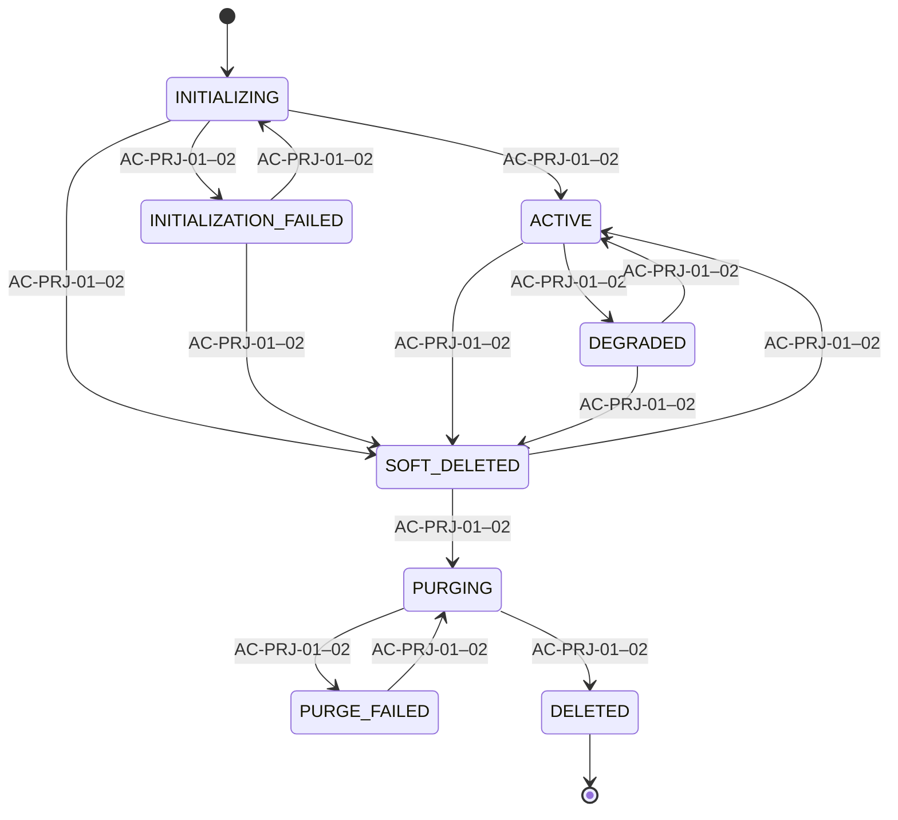
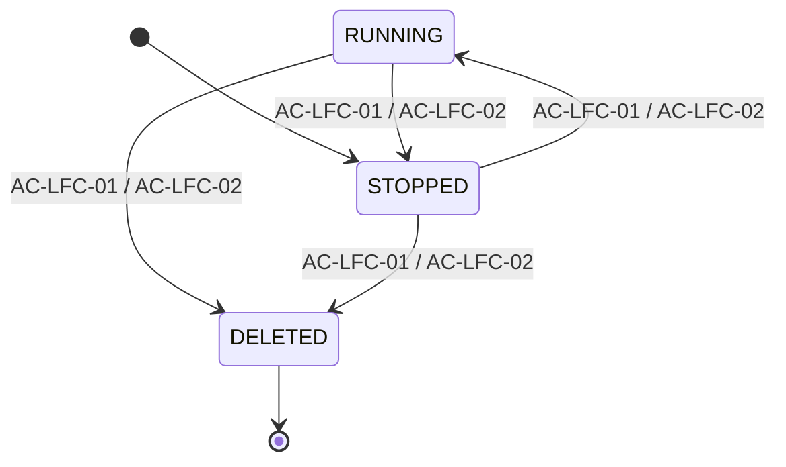
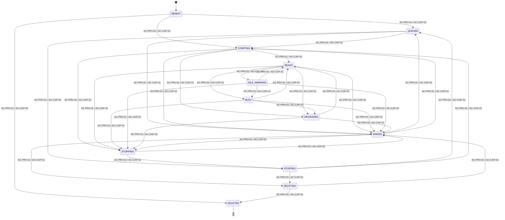
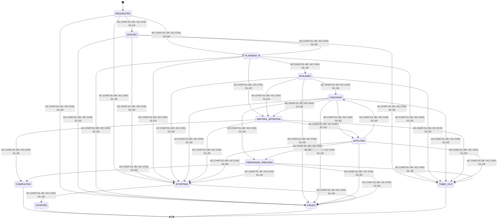
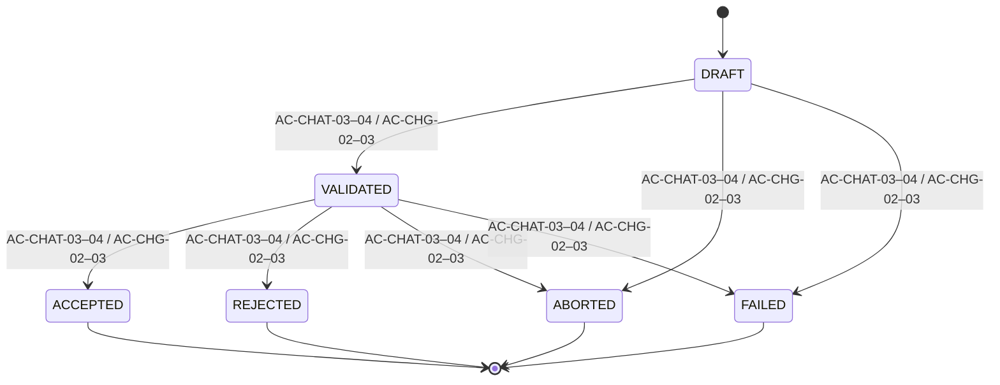
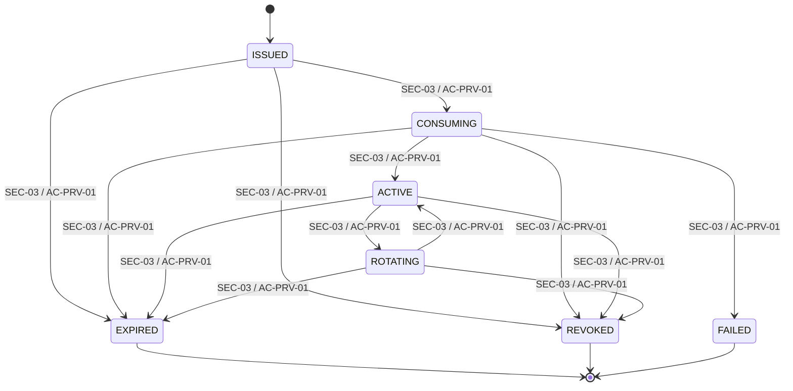
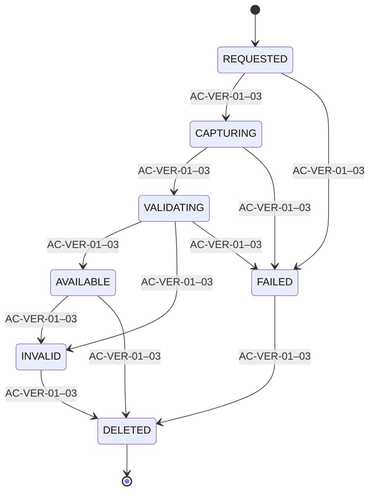
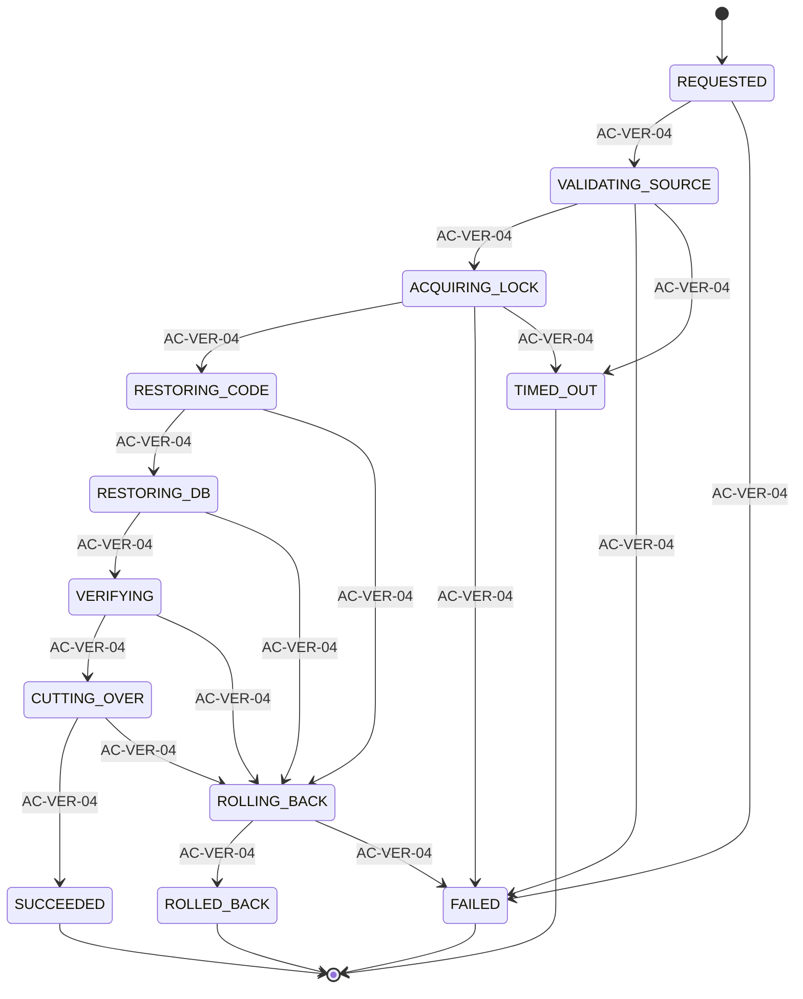
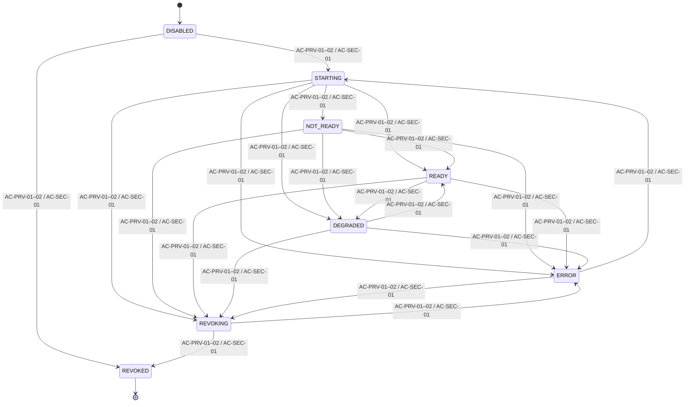
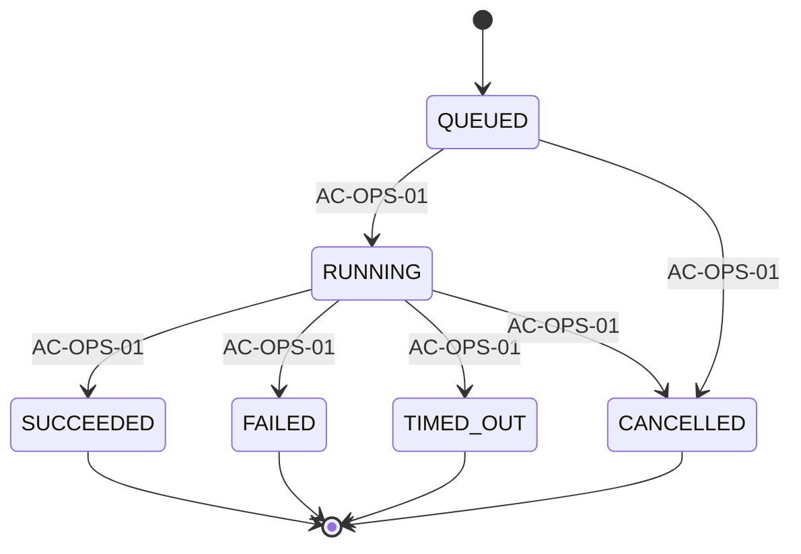

<!-- Generated by scripts/report_generation/export_vibe_reports_to_markdown.py; do not edit. -->
# Vibe-Code POC — Technical Design and Runtime Architecture

- Source: `vibe-code-poc-technical-design-and-runtime-architecture.docx`
- Source SHA-256: `63e80067a84c1ace418b7f09dc82d242fd5a1345a089ec22194a53778f167901`
- Purpose: deterministic text companion for fast diff, search and AI review; Office remains the visual authority.

## Post-freeze Markdown-only technical-stack amendment

> This amendment updates the active Markdown implementation contract only. The approved Office source remains frozen and unchanged.

- Product UI: **React/Vite/TypeScript + Tailwind CSS + shadcn/ui**.
- The normal product user has no IDE or code workspace: no source editor, file tree, terminal, Git controls or raw console.
- Agent runtime: **Direct pinned @cline/sdk integration only; no LiteLLM**, model-fusion layer, alternate agent runtime or generic provider-routing abstraction.
- Tailwind owns routine layout, spacing, typography and responsive rules; shadcn/ui provides the typed, accessible product UI primitives; CSS custom properties remain the design-token source of truth.
- TanStack Query owns owner-scoped server-state queries, cache, retry, mutation invalidation and ordinary refresh. Durable chat/run events, browser-session state and preview lifecycle reconciliation remain separate responsibilities.
- React Hook Form owns form state, accessible errors and submission lifecycle. Its schema-based validation must remain aligned with the relevant NestJS request/command contract.
- Frontend code is modularized by feature. Share typed shadcn/ui primitives, query keys, API clients and validation schemas only where they have real consumers; do not grow a monolithic `App.tsx`.
- Backend follows DRY and SOLID through small NestJS domain modules. Each module owns its controller, application service, policy and repository port; extension occurs by adding a module or implementing a port, not by branching a central service.
- A reusable OOP base application service may contain only proven cross-cutting behavior (owner-scope resolution, command idempotency, correlation/audit context and safe error mapping). It must not become a generic CRUD/God service or bypass module policy, authorization or transaction boundaries.

### Restricted administration file inspection

- Restricted administrators may inspect allowlisted project files and code through a **restricted read-only Monaco Editor viewer**.
- Monaco is not an IDE: no terminal, extension marketplace, command execution, arbitrary path access or direct Save-to-workspace action.
- File reads are owner/project scoped, canonical-path checked, bounded by type/size, secret-redacted and audited. Any future edit remains a separate approved platform command.

## Canonical State Model Diagrams

### PROJECT.lifecycle_status

- Owner: NestJS control plane
- Guard contract: Owner-authorized command; command-id dedup and aggregate row-version CAS commit atomically.

### WORKSPACE.desired_status

- Owner: NestJS command/policy
- Guard contract: Owner-authorized intent; mutation serialization and aggregate row-version CAS.

### WORKSPACE.observed_status

- Owner: Runtime Controller
- Guard contract: Runtime Controller observation; readiness, UID and generation evidence must match desired state.

### AGENT_RUN.execution_status

- Owner: Agent orchestrator
- Guard contract: One project mutation lease; admitted Job identity, heartbeat and stop/fencing evidence.

### AGENT_RUN.outcome_status

- Owner: Validation/approval service
- Guard contract: Validated proposal plus explicit accept/reject/abort decision; terminal attempts are immutable.

### PREVIEW_AUTH_GRANT.grant_status

- Owner: Preview Gateway
- Guard contract: Verify active kid/signature and exact JWT audience/owner/session/project/generation/expiry; CAS-consume hashed jti once, then bind the host-only preview cookie.

### SNAPSHOT.snapshot_status

- Owner: Snapshot service
- Guard contract: Git, SQLite online backup, migration/lock manifests and hashes verify as one whole-app snapshot.

### RESTORE_JOB.restore_status

- Owner: Restore service
- Guard contract: Owner-only idempotent command; project lease, staged generation, before-images and journaled pointer CAS.

### PREVIEW_ROUTE.route_status

- Owner: Preview Gateway
- Guard contract: Owner/session/generation authorization plus workload and route readiness; stale routes fail closed.

### JOB_RUN.run_status

- Owner: Platform scheduler
- Guard contract: Unique scheduled attempt; overlap guard, timeout and linked retry preserve immutable terminal history.

TECHNICAL DESIGN DOCUMENT

Vibe-Code POC Technical Design & Runtime Architecture

Implementation design for the Stage 1 mutable preview runtime. Product requirements remain authoritative in the PRD & Delivery Plan.

#### Table 1

| Field | Value |
| --- | --- |
| Status | DRAFT — spike validation required |
| Boundary | Stage 1 POC technical baseline |
| Version | 0.1 |
| Product source | vibe-code-no-code-poc-prd-and-delivery-plan.docx v1.1 |
| Orchestrator | Single-node K3s |
| Runtime | containerd + standard runc |
| Ingress | Traefik |

## Contents

Static page index for the issued document. Section headings remain available in the Word navigation pane.

#### Table 2

| Section | Page |
| --- | --- |
| 1. Purpose and authority | 3 |
| 2. Approved decisions and open choices | 4 |
| 3. Architecture context | 5 |
| 4. K3s project runtime model | 6 |
| 5. End-to-end live update design | 7 |
| 6. Preview routing and connectivity | 8 |
| 7. Change, reload, restart and rebuild classification | 9 |
| 8. Lifecycle and state ownership | 10 |
| 9. Workspace, Git, SQLite and checkpoint consistency | 11 |
| 10. Security implementation | 12 |
| 11. Capacity, admission and resource profiles | 13 |
| 12. Observability and operational evidence | 14 |
| 13. Failure and recovery design | 15 |
| 14. Technology and version matrix | 16 |
| 15. Required spikes and technical acceptance | 17 |
| 16. Stage 2 extension boundary | 18 |
| 17. Open technical decisions | 19 |
| 18. Traceability matrix | 20 |

## 1. Purpose and authority

This document specifies how the approved Stage 1 product requirements are intended to work. It may evolve through technical spikes without silently changing product scope. If this document conflicts with the PRD on user behavior, scope or acceptance, the PRD wins until the product decision is changed explicitly.

#### Table 3

| Artifact | Owns |
| --- | --- |
| PRD & Delivery Plan | Why/what/who, product scope, Features, Epics, Stories, Use Cases, security baseline and acceptance. |
| This Technical Design | How, component boundaries, K3s resources, routing, live update, versions, failure modes and spike evidence. |
| Data Specification XLSX | Logical/physical data contracts, states, relationships, error map and governance. |

#### Table 4

| Stage 1 is a mutable development preview. Stage 2 introduces Deploy, immutable build/publish, registry, stable application route and promotion/rollback. |
| --- |

## 2. Approved decisions and open implementation choices

#### Table 5

| ID | Area | Decision | Status | Rationale / gate |
| --- | --- | --- | --- | --- |
| TD-DEC-01 | Orchestration | Single-node K3s v1.36.3+k3s1, stable-channel release resolved and frozen 26 Aug 2026 | CONFIRMED | Exact install artifact/checksum is pinned; no floating channel at deployment. Replacement-node upgrade/rollback only. |
| TD-DEC-02 | Container runtime | Bundled containerd v2.3.2-k3s2 + standard runc v1.4.2 | CONFIRMED | Versions inherit the pinned K3s release; shared-kernel limitation remains explicit. |
| TD-DEC-03 | Ingress | K3s-bundled Traefik v3.7.8 | CONFIRMED | Exact bundled release; dashboard private/disabled; HTTP/SSE/WSS regression gate before switch. |
| TD-DEC-04 | Preview replica model | Zero or one replica per mutable project preview | CONFIRMED | Vite state, mutable workspace and SQLite make multi-replica preview unsafe. |
| TD-DEC-05 | Generated stack | React/Vite + FastAPI + SQLAlchemy/Alembic + SQLite | CONFIRMED | One fixed template for the POC. |
| TD-DEC-06 | Project runtime boundary | One K3s namespace per project | CONFIRMED | Namespace, quota, service account and NetworkPolicy form the Stage 1 isolation/cleanup unit. |
| TD-DEC-07 | Workspace persistence | Project PVC: local-path-retain, RWO, 2 GiB baseline, UID/GID/fsGroup 10001 | CONFIRMED | Custom local-path StorageClass uses WaitForFirstConsumer + Retain; snapshot restore provisions a new PVC; no live SQLite file copy. |
| TD-DEC-08 | Deployment lifecycle | No Stage 1 Deploy button | CONFIRMED | Stage 2 owns immutable build, registry, stable route and rollback. |
| TD-DEC-09 | Cline session recovery | Persist/reconnect first; prove old Job/Pod write revocation before an in-place linked retry | CONFIRMED DIRECTION | Lease fencing metadata cannot revoke PVC writes; an unproven old writer keeps mutation blocked. |
| TD-DEC-10 | Organization hierarchy | Normalized Organization/OU/Department tree plus effective-dated user membership | CONFIRMED DIRECTION | Stage 1 authorization still uses PROJECT.owner_id only; future project membership is a separate contract. |
| TD-DEC-11 | Whole-app versioning | main mirrors latest saved version; workspace/<project-id> holds active work; immutable snapshot binds Git + SQLite | CONFIRMED DIRECTION | One branch per Save is rejected; autosaves rotate and Restore creates new history. |
| TD-DEC-12 | Platform application stack | NestJS + Prisma + PostgreSQL with restricted AdminJS | CONFIRMED | AdminJS is an allowlisted UI over NestJS services, never unrestricted direct CRUD or a second authorization path. |
| TD-DEC-13 | Session and token model | Opaque browser session in Redis; short-lived audience-bound JWT only for preview/service exchange | CONFIRMED DIRECTION | No long-lived browser JWT/localStorage. Session/cache failure, CSRF, rotation, revocation and replay fail closed. |

### Decision discipline

- Do not freeze a version, storage class, namespace model or NetworkPolicy provider without executable evidence.
- Prefer standard Kubernetes resources and a small platform-owned runtime contract.
- Generated projects cannot supply arbitrary Kubernetes or Compose definitions.
- A decision marked Provisional is implemented behind a small adapter and must be revisited after its named spike.
## 3. Architecture context

Figure 1 — Stage 1 technical context. Service-level distribution exists on one host; node-level HA does not.

### Component catalogue

#### Table 6

| Component | Technology | Responsibility | Boundary |
| --- | --- | --- | --- |
| Product UI | React/Vite/TypeScript | Projects, chatbot, progress, diff, preview and checkpoints. | Stateless product frontend; no token in localStorage. |
| Control plane | NestJS + Prisma | Identity, ownership, desired state, commands, API and admitted background workers. | PostgreSQL is authoritative; Prisma transactions wrap CAS/dedup operations. |
| Administration/session | AdminJS + Redis | Restricted administration, opaque server-side sessions, CSRF state and bounded cache. | AdminJS actions call NestJS services; Redis session loss fails authentication closed. |
| Platform database | PostgreSQL | Users, RBAC, projects, chat, runs, routes, state, token replay grants and audit. | Prisma-managed schema; not exposed to generated apps. |
| Ingress | Traefik | TLS, app route, wildcard preview route, HTTP/SSE/WSS. | Dashboard private or disabled. |
| Preview Gateway | Authenticated reverse proxy | Owner authorization, project route lookup and same-origin path routing. | Does not trust user-supplied upstreams or platform credentials. |
| Agent adapter | Pinned Cline SDK service | Runs/cancels agent, persists events, emits heartbeat and maps progress/recovery. | Page reconnect never starts a new run; no provider master key in workspace. |
| Agent Job | Kubernetes Job | Mounts project workspace and writes validated files. | One mutation/project; bounded termination grace. |
| Preview Pod | Vite + Uvicorn containers | Mutable frontend/backend preview, zero or one replica. | Disposable; not a release artifact. |
| Workspace PVC | local-path-retain RWO PVC | Generated source, Git working tree and SQLite app data. | 2 GiB baseline; UID/GID/fsGroup 10001; Restore uses a verified new generation. |

### Vibe page component and layout contract

The PRD owns the user-visible two-pane layout. This view defines which technical component owns each region and where credentials, commands and generated application traffic must not cross.

Figure 2 — Vibe page component ownership and trust boundaries. The generated preview never receives platform credentials or control-plane authority.

#### Table 7

| Product region | Technical owner | Data / protocol contract | Failure posture |
| --- | --- | --- | --- |
| Project header and status | Product UI + NestJS | Owner-scoped project/version/status API; safe correlation reference. | Unknown or stale status shows Action required, never fabricated Ready. |
| Conversation and controls | Product UI + NestJS + Agent adapter | Durable messages/events; idempotent Stop/Save/Restore/decision commands. | Reconnect existing run; uncertain mutation remains blocked. |
| Preview pane | Preview Gateway + Preview Pod | One-time exact-audience JWT, host-only cookie, fixed frontend/API/WSS targets. | Replay, stale generation, wrong owner/session/host or unready route is denied. |
| Full preview | Same Preview Gateway contract | New viewport, not a new authorization or runtime path. | No domain-wide cookie, arbitrary upstream or stable published route. |

### Authentication, sessions and token boundaries

The first-party browser uses an opaque HttpOnly Secure session cookie with a Redis server-side session. A long-lived JWT is never stored in browser JavaScript or localStorage. PostgreSQL remains authoritative for users, RBAC, audit and one-time preview replay grants; Redis is disposable session/cache infrastructure, not the business system of record.

#### Table 8

| Flow | Credential | Store / authority | Lifetime | Revocation / failure |
| --- | --- | --- | --- | --- |
| Browser login | Opaque random session ID in `__Host-vibe_session`; HttpOnly, Secure, SameSite=Lax; regenerated at login/privilege change. | Redis server-side session; AUTH_USER/RBAC in PostgreSQL through Prisma. | Bounded idle + absolute TTL; exact values DECISION REQUIRED. | Logout, password/role/session_version change or admin revoke deletes all matching Redis sessions; Redis unavailable fails authentication closed. |
| State-changing browser request | Per-session CSRF secret rendered as token and sent in a custom header; Origin/Referer allowlist. | CSRF hash and session metadata in Redis. | Same bound as session; rotate with session. | Missing/mismatch/wrong origin returns 403; no cookie-only mutation endpoint. |
| AdminJS | Same opaque server-side session plus PLATFORM_ADMIN role and action permission; step-up hook for destructive/break-glass actions. | NestJS guard + Prisma/PostgreSQL RBAC; AdminJS is UI only. | Same session; shorter configurable idle policy may apply. | No direct model-wide CRUD bypass, secret field rendering, arbitrary action or raw state edit; accepted/denied actions audited. |
| Preview JWT exchange | One-time short-lived JWT with `iss`, exact-host `aud`, `sub`, session hash, project, workspace generation, `jti`, `iat`, `exp`; signed by active asymmetric key. | AUTH_KEYSET public metadata + PostgreSQL PREVIEW_AUTH_GRANT one-time CAS; private key is a secret reference. | At most 60 seconds and one successful exchange. | Replay, wrong audience/session/project/generation, expired token or revoked grant fails closed. |
| Preview browsing | Opaque host-only preview cookie; no platform session/JWT forwarded to generated code. | PostgreSQL PREVIEW_AUTH_GRANT authority; bounded Redis read-through cache may accelerate only positive state with short TTL. | Short configurable TTL no longer than platform session/grant. | Every HTTP/WSS handshake revalidates binding; cache failure falls back to PostgreSQL, never grants from stale cache. |
| Internal service call | Short-lived JWT with service `sub`, exact `aud`, scoped permissions and unique `jti`; asymmetric key rotation through `kid`. | AUTH_KEYSET public metadata; issuer policy in NestJS; replay cache in Redis only where endpoint is non-idempotent. | Maximum five minutes; no refresh token. | Unknown `kid`, wrong audience/scope, expiry or replay fails closed; rotate keys with overlap and audited retirement. |

#### Table 9

| Redis failure policy: authenticated browser requests fail closed because current sessions are unavailable. Cache-only reads bypass Redis and load authoritative PostgreSQL through Prisma. The platform never falls back to a self-contained browser JWT that cannot be revoked. |
| --- |

## 4. K3s project runtime model

The preferred minimal runtime is shown below. Exact resource names and namespace/storage implementation remain provisional until the spikes pass.

#### Table 10

| Concern | Preferred resource/model | Status | Contract |
| --- | --- | --- | --- |
| Project boundary | One namespace per project | Required | Namespace + quota + service account + NetworkPolicy is the isolation and cleanup unit. |
| Workspace storage | local-path-retain PVC, RWO, 2 GiB | Required | Preview and one Agent Job mount with runAsUser/runAsGroup/fsGroup 10001; WaitForFirstConsumer; reclaim Retain. |
| Preview workload | Deployment, replicas 0 or 1 | Required | Scale to zero on stop/idle; one mutable active instance. |
| Frontend runtime | Vite container, port 5173 | Required | HMR development server; never published as production runtime. |
| Backend runtime | Uvicorn/FastAPI container, port 8000 | Required | Source reload enabled only in mutable preview. |
| Preview route | Service + Preview Gateway | Required | Named frontend/backend targets; no host port per project. |
| Agent mutation | Job mounting workspace PVC | Required | Bounded duration; heartbeat; one mutation lease/project; fenced recovery. |
| Resource governance | ResourceQuota + LimitRange | Required | CPU, RAM, storage and object-count limits. |
| Network governance | Default-deny capable NetworkPolicy | Required | Exact K3s policy provider confirmed by spike. |
| Runtime hardening | Non-root, no privileges/socket/hostPath | Required | Standard runc shares the host kernel; not microVM isolation. |

### Preferred object relationship

#### Table 11

| Project boundary → Workspace PVC → Preview Deployment (0/1) → one multi-port Preview Service. A bounded Agent Job mounts the same PVC and writes source under one mutation lease. |
| --- |

### Why one Preview Pod and one multi-port Service

- Vite and FastAPI share one project lifecycle and one workspace generation.
- A single Service can expose named frontend and backend ports to the Preview Gateway.
- It avoids unnecessary frontend/backend Deployments until independent scaling is required.
- The Agent Job remains separate because it is finite, admitted, auditable and independently terminated.
### Load-balancing boundary

#### Table 12

| Workload | Replica posture | Meaning |
| --- | --- | --- |
| NestJS and Preview Gateway | Two same-node replicas where useful | Kubernetes Service can distribute new requests; shared state must be external. |
| Each project Preview Pod | Zero or one replica | No horizontal balancing of one mutable preview. |
| Agent Jobs | Several projects concurrently within global admission | One active mutating Job per project. |
| PostgreSQL / K3s node | Single Stage 1 failure domain | No hardware or database HA claim. |

## 5. End-to-end live update design

Figure 2 — Explicit frontend HMR, backend reload and persistence flow.

### Authoritative sequence

- NestJS persists the user message and creates an admitted AGENT_RUN.
- The runtime controller creates one bounded Agent Job for the project generation.
- The Job mounts the project Workspace PVC and writes only permitted paths.
- Vite observes eligible frontend changes and sends an HMR update over the existing WSS route.
- Uvicorn observes supported Python source changes and reloads the backend process.
- The Preview Gateway continues same-project owner authorization and path routing during reconnect.
- Validation determines Ready, Restart required, Rebuild required, Approval required or Action required.
- Only an accepted result creates the accepted checkpoint/current-version transition.
## 6. Preview routing and connectivity

#### Table 13

| Origin | Path / protocol | Target | Rule |
| --- | --- | --- | --- |
| app.<domain> | / | Product UI service | Authenticated product experience. |
| app.<domain> | /api/* | NestJS service | Platform API; session/CSRF/auth enforced. |
| *.preview.<domain> | / | Preview Gateway → project frontend target | Vite HTML/assets and HMR endpoint. |
| *.preview.<domain> | /api/* | Preview Gateway → project backend target | Same-project FastAPI only; path contract is immutable. |
| *.preview.<domain> | WebSocket upgrade | Preview Gateway → Vite HMR | WSS, forwarded host/protocol and compatible idle timeout. |

### Frontend HMR contract

The generated Vite configuration must listen inside the Pod and advertise the external secure WebSocket endpoint:

#### Table 14

| server.host = "0.0.0.0"; server.port = 5173; HMR protocol = "wss"; client port = 443. Exact host derivation must use the authorized preview origin, not a user-supplied upstream. |
| --- |

### Backend reload contract

#### Table 15

| uvicorn app.main:app --host 0.0.0.0 --port 8000 --reload |
| --- |

Uvicorn reload is allowed only in the mutable preview. A Stage 2 published application must use an immutable production command without --reload.

### Preview Gateway authorization

- The platform UI requests a one-time preview JWT through its opaque HttpOnly Secure session cookie backed by Redis. NestJS signs a short-lived JWT containing exact-host audience, user/session/project/workspace-generation binding and unique jti; the exact preview host exchanges it once for a separate short-lived HttpOnly, Secure, SameSite=Strict host-only preview cookie. Raw platform session cookies or JWTs are never domain-wide or forwarded to generated code.
- Every Preview Gateway replica uses PostgreSQL PREVIEW_AUTH_GRANT as the shared replay/revocation authority. Atomic row-version CAS consumes the hashed JWT jti once, replaces its credential hash with the preview-cookie hash, and binds exact host, owner, session and workspace generation; a replay or second replica loses the CAS and is denied.
- The Preview Gateway validates expiry, audience, owner, project, workspace generation and grant status on every HTTP and WebSocket handshake, rotates/revokes all grants for the platform session, and strips platform Cookie/Authorization headers before proxying. Raw JWTs/cookies are never persisted or logged.
- Resolve route key to the current workspace generation and owner in the control plane.
- Reject stopped, deleted, expired, wrong-owner, unknown-host and stale-generation requests.
- Route only fixed frontend and `/api/*` targets; never accept arbitrary upstream URL or forwarded authorization header from project code.
- Support WebSocket upgrade, SSE streaming, bounded request body and timeouts compatible with HMR/reload.
## 7. Change, reload, restart and rebuild classification

#### Table 16

| Change type | Platform action | User action | User-visible state | Guard |
| --- | --- | --- | --- | --- |
| React/TypeScript/CSS source | Vite HMR | No manual action | Preview updated | Automatic when module accepts HMR. |
| Frontend source not accepted by HMR | Browser/module reload | No manual action | Preview refreshed | Still not a deployment. |
| Python application source | Uvicorn process reload | No manual action | Backend refreshed | Frontend reconnect/retry is bounded. |
| Frontend dependency/lockfile | Controlled install + preview restart/rebuild | Status shown | Updating dependencies | Allowlisted package policy and timeout. |
| Python dependency/lockfile | Controlled install + backend restart/rebuild | Status shown | Updating dependencies | Allowlisted package policy and timeout. |
| Environment value | Preview restart | Status shown | Restarting preview | Secret values never enter source or user-visible event. |
| Additive Alembic migration | Controlled migration + backend restart | Status shown | Updating project data | Snapshot/checkpoint before apply. |
| Destructive migration | Explicit approval | Approve/reject | Approval required | Fail closed on unknown impact. |
| Vite/Uvicorn port contract | Reject or recreate from platform template | Status shown | Rebuild required | User cannot choose arbitrary upstream. |
| Dockerfile/base runtime contract | Platform-controlled preview rebuild | Status shown | Rebuilding preview | Not an OCI release/publish action. |
| User Kubernetes/Compose definition | Reject in Stage 1 | None | Unsupported change | Platform owns allowlisted runtime resources. |

#### Table 17

| A preview rebuild recreates a mutable development runtime. It is not the Stage 2 immutable Deploy/build/publish lifecycle. |
| --- |

## 8. Lifecycle and state ownership

#### Table 18

| State | Meaning | Allowed next behavior |
| --- | --- | --- |
| STOPPED | No active Preview Pod; durable workspace retained. | Explicit Open/Resume. |
| QUEUED | Capacity/admission waiting. | Start when slot available or Cancel. |
| STARTING | Preview resources created; readiness pending. | Become READY or recoverable ERROR. |
| READY | Preview and route healthy. | Activity, mutation, idle warning or stop. |
| BUSY | Agent/restart/rebuild active. | Return READY or terminal error. |
| IDLE_WARNING | No recent activity; stop countdown visible. | Activity returns READY; timeout starts STOPPING. |
| STOPPING | Route withdrawn and Preview Pod scaling down. | Become STOPPED or recoverable ERROR. |
| ERROR / DEGRADED | Expected state does not match healthy observed state. | Explicit Retry, Reconcile, Revert or Stop. |

### State ownership rules

- NestJS/PostgreSQL stores desired product state; K3s resources are observed runtime state.
- The runtime controller alone reconciles approved desired state to allowlisted K3s resources.
- The UI, scheduler and AdminJS issue named commands; they never forge runtime success.
- READY requires both workload health and authenticated route verification.
- Terminal attempts are immutable; retry creates a linked new attempt.
- Idle stop first records desired STOPPED, withdraws route and then scales Preview to zero.
### Cline session continuity and stuck recovery

- Refreshing the product page reloads persisted chat messages and AGENT_EVENT progress, then reconnects to the existing run; it never creates another Cline process, Agent Job or mutation lease.
- The Cline adapter emits a bounded heartbeat by appending safe run evidence and renewing only the matching mutation lease. Exact warning and stuck thresholds remain configuration decisions.
- When heartbeat is stale, the UI changes from Running to Recovering/Action required and exposes the owner-only Recover agent session command. Duplicate clicks share one idempotency key.
- Automatic or manual recovery first requests cancellation, moves the run through STOPPING and terminates the old Agent Job/Pod after a bounded grace period. Changing only a PostgreSQL lease or fencing token never removes filesystem write authority.
- The Runtime Controller persists exactly one authoritative Agent JOB RUNTIME_RESOURCE_REF per attempt: agent_run_id is a unique FK to that AGENT_RUN, observed UID is immutable, and write_revocation_json holds Job/Pod UID, deletion-observed time, failed-closed post-delete write probe, verifier digest and verification time.
- STOPPING→STOPPED and a new attempt with prior_attempt_id are rejected unless the prior attempt is terminal and the proof row has agent_run_id equal to that exact stopped/prior attempt. Missing, duplicate or another attempt’s valid proof fails closed. A staged retry may use only a separate immutable root; uncertain tool actions are never replayed.
- If write revocation cannot be proven, the platform fails closed, keeps the project mutation-blocked and requires bounded administrator reconciliation; lease expiry alone is insufficient evidence.
### Authoritative state diagrams

#### Table 19

| The repository state contract is shared with the PRD render and must equal the Data Specification Enum Catalogue and State Transitions sheets. Each diagram shows initial/terminal states, every legal directed edge, owner and the machine-level guard. |
| --- |

### PROJECT.lifecycle_status

Figure TS-01 — PROJECT.lifecycle_status: 8 states and 14 legal directed transitions.

### WORKSPACE.desired_status

Figure TS-02 — WORKSPACE.desired_status: 3 states and 4 legal directed transitions.

### WORKSPACE.observed_status

Figure TS-03 — WORKSPACE.observed_status: 12 states and 37 legal directed transitions.

### AGENT_RUN.execution_status

Figure TS-04 — AGENT_RUN.execution_status: 13 states and 39 legal directed transitions.

### AGENT_RUN.outcome_status

Figure TS-05 — AGENT_RUN.outcome_status: 6 states and 7 legal directed transitions.

### PREVIEW_AUTH_GRANT.grant_status

Figure TS-06 — PREVIEW_AUTH_GRANT.grant_status: 7 states and 13 legal directed transitions.

### SNAPSHOT.snapshot_status

Figure TS-07 — SNAPSHOT.snapshot_status: 7 states and 11 legal directed transitions.

### RESTORE_JOB.restore_status

Figure TS-08 — RESTORE_JOB.restore_status: 12 states and 18 legal directed transitions.

### PREVIEW_ROUTE.route_status

Figure TS-09 — PREVIEW_ROUTE.route_status: 8 states and 21 legal directed transitions.

### JOB_RUN.run_status

Figure TS-10 — JOB_RUN.run_status: 6 states and 6 legal directed transitions.

## 9. Workspace, Git, SQLite and checkpoint consistency

#### Table 20

| Asset | Authority | Stage 1 rule |
| --- | --- | --- |
| Project metadata / lifecycle | PostgreSQL | PROJECT.current_snapshot_id is authoritative; only an AVAILABLE same-project snapshot may become current. |
| Generated source / Git refs | Protected project workspace + backup | main mirrors the latest saved version; workspace/<project-id> is the active work branch; ref names are server-generated. |
| Mutable working tree | Workspace PVC | Mounted by Preview and one Agent Job; Git excludes SQLite, secrets, caches, build output and runtime files. |
| Generated application data | SQLite on project PVC | Single mutable preview; capture uses SQLite online backup/checkpoint under the project mutation lease, never a raw live-file copy. |
| Snapshot manifest | Private snapshot store + PostgreSQL | Binds kind/version, Git commit/ref, SQLite object/hash, migration head, template/locks, actor and health evidence. |

### Git reference contract

#### Table 21

| Repository boundary: the platform source/delivery Git repository is separate from every generated-project repository. Project initialization runs only inside the generated project root: git init --initial-branch=main → add allowlisted template source → commit “1st version” → create workspace/<project-id>. Updating generated-project main never updates, checks out or pushes the platform source repository; normal users never receive a terminal. |
| --- |

- The interval worker commits changed allowlisted source on workspace/<project-id>; a clean tree creates no commit. It also captures a rotating AUTOSAVE whole-app recovery snapshot, but does not increment the user-visible version number.
- Save flushes any pending workspace commit, captures and verifies SQLite plus the manifest, then advances main to the exact commit through an ancestry check and compare-and-swap. It creates immutable checkpoint/<snapshot-id> evidence; it does not create one branch per Save.
- Git commit IDs are opaque 40–64 hexadecimal identifiers. The data contract must not assume SHA-1 forever.
### Whole-app Save and Restore transaction

- Acquire the project mutation lease; withdraw the preview route and quiesce/terminate the active generated-app Pod so no process retains the old SQLite inode or writable tree. Lease metadata alone is not proof of quiescence.
- Capture code commit, SQLite online backup, migration head and version locks; hash every external artifact and validate health before SNAPSHOT becomes AVAILABLE.
- Version numbering and idempotency are allocated by the control plane. Initial snapshot is Version 1; each successful user Save or Restore result creates exactly one next version.
- Restore creates a durable idempotent RESTORE_JOB, captures an AVAILABLE PRE_RESTORE snapshot, and materializes code plus SQLite into a new generation-specific staging root. The active generation remains immutable and authoritative while staged hashes, migration head, locks and health are verified.
- The ACQUIRING_LOCK→RESTORING_CODE transaction runs before code/DB mutation: capture AVAILABLE PRE_RESTORE; prior_active_generation, prior_snapshot_id, optional prior_route_generation and exact prior_route_status; allocate target_generation and exactly one provisional RESTORE_RESULT. These links/before-images become immutable, so early RESTORING_CODE/DB rollback and later rollback use the same result row.
- At cutover, one PostgreSQL transaction locks PROJECT, WORKSPACE and PREVIEW_ROUTE, re-checks generation/snapshot/route-generation/route-status before-images and row versions, then CAS-updates all pointers, marks the existing result AVAILABLE and writes journal_decision=COMMIT, journal_phase=COMMITTED and cutover_committed_at. Any mismatch rolls back the entire database transaction.
- Product Restore never leaves detached HEAD, rewrites published history or relies on git revert/checkout alone. Git checkout/switch may be used only inside a fenced temporary verification worktree.
- Any early or late failure marks the always-present provisional result INVALID/quarantined. ROLLED_BACK requires one verified transaction restoring generation, snapshot, route generation and exact prior route status; READY is restored only if it was the prior status and health passes. Rollback failure enters MANUAL_INTERVENTION, keeps route withdrawn/mutation blocked, and never claims success.
- A restore_journal_recovery worker runs on controller startup and every 30 seconds. It SELECTs non-terminal RESTORE_JOB rows stale after 60 seconds FOR UPDATE SKIP LOCKED and CAS-claims (restore_job_id, journal_phase, row_version). PENDING rolls back staging/result, committed COMMIT reconciles target, and ROLLBACK restores verified prior pointers; the third failed attempt enters MANUAL_INTERVENTION. The acceptance fixture must reach verified READY or MANUAL_INTERVENTION within 5 minutes.
- For commands that use AUDIT_LOG.command_id dedup, the unique command claim, aggregate row_version compare-and-swap, accepted/rejected result and immutable audit append commit in the same PostgreSQL transaction; either all commit or all roll back. command_id never substitutes for aggregate CAS, and retries return the stored outcome without replay.
### Transactional sequence diagrams

#### Table 22

| These four diagrams are normative realizations of Save, Restore, preview authentication and capacity admission. Their guards, authority stores and failure outcomes bind the prose above. |
| --- |

#### User Save

Figure TX-01 — User Save. Any capture/hash/manifest/health failure creates no AVAILABLE snapshot and does not advance current_snapshot_id or version number.

#### Whole-app Restore

Figure TX-02 — Whole-app Restore. Before-images and one provisional RESTORE_RESULT exist before mutation. Failure restores verified prior pointers or enters MANUAL_INTERVENTION with route withdrawn.

#### Owner-only Preview Authentication

Figure TX-03 — Owner-only Preview Authentication. Replay, wrong kid/audience/host/owner/session/project/generation, expiry or revocation fails closed. Redis session loss denies JWT issue; PostgreSQL remains replay authority.

#### Durable Capacity Admission

Figure TX-04 — Durable Capacity Admission. Queue depth, timeout, reserve and slot-sum limits are deterministic. Admission never oversubscribes silently or turns capacity exhaustion into login/generic failure.

## 10. Security implementation

#### Table 23

| Area | Implementation contract | PRD trace |
| --- | --- | --- |
| Identity | NestJS guards use an opaque HttpOnly Secure browser cookie backed by Redis server-side session state, per-session CSRF protection and Prisma/PostgreSQL owner checks on every object. Long-lived browser JWTs are prohibited. | SEC-01, SEC-02 |
| AdminJS | Mounted behind the same NestJS authentication/CSRF/RBAC guards; resources, properties and actions are explicit allowlists. Secret fields, raw state edits and unrestricted CRUD are disabled. | SEC-01, SEC-07, SEC-09 |
| Organization hierarchy | Default Organization → OU → Department plus one effective-dated primary user membership. | SEC-01; PROJECT.owner_id remains the only normal Stage 1 project grant. |
| Route authorization | Preview Gateway validates active session, owner, project state and route generation before proxying. | SEC-01, SEC-02 |
| Pod security | Non-root; no privileged mode; no hostNetwork, hostPID, hostIPC, hostPath or containerd socket. | SEC-04 |
| Filesystem | Project-scoped PVC; reject absolute, drive-qualified and parent-traversal paths; reject symlink ancestors/leaves (including broken links) and non-regular special nodes; resolve beneath the project root before Git, hash, backup or restore reads; use descriptor-relative/no-follow operations and fail closed on concurrent path mutation. | SEC-03, SEC-04 |
| Network | Default deny where supported; allow DNS, approved model/package endpoints and platform callbacks only. | SEC-03, SEC-06 |
| Resources | Requests/limits, PID control where available, quota, global admission and bounded Job timeout. | SEC-05 |
| Secrets | Secret references injected by platform; never persist provider key in PVC, Git, logs, event payload or SYS_CONFIG. | SEC-07 |
| Change safety | Mutation lease, pre-change checkpoint, validation, explicit destructive approval and fail-closed classifier. | SEC-08 |
| Audit | Correlation ID across request, run, Job, route and lifecycle commands; redacted evidence only. | SEC-09 |
| Recovery | Explicit Save has zero committed-data RPO; restore drill target is ≤5 minutes for the acceptance fixture. PVC reclaim is Retain and restore provisions a new PVC from verified Git+SQLite snapshot; autosave interval/retention remain separate decisions. | SEC-10 |
| Version integrity | Server-owned Git refs; allowlisted source paths; SQLite online backup; hashes and manifest; no secret/runtime data committed. | SEC-08, SEC-10; AC-VER-01–04 |

### Shared-kernel limitation

#### Table 24

| Standard containerd/runc containers share the K3s host kernel. Namespace, NetworkPolicy and Pod security improve control and governance but do not provide microVM-grade isolation. |
| --- |

### Future isolation option

A gVisor RuntimeClass may be evaluated after Stage 1 compatibility evidence. It is not a current requirement. Kata/microVM approaches require a separate risk, cost and lifecycle decision.

## 11. Capacity, admission and resource profiles

#### Table 25

| Measure | Assumption | Operational interpretation |
| --- | --- | --- |
| Registered users | 100 | Identity and metadata only; not simultaneous runtime demand. |
| Concurrent active users | 50 | Control-plane planning workload. |
| Active previews | 6 launch maximum | Each mutable preview is one replica and consumes 1 capacity slot. |
| Concurrent Agent Jobs | 2 launch maximum | Each Agent Job consumes 2 slots; one mutation per project. |
| Admission pool | 10 slots / 2 reserved / queue 100 / timeout 900 s | Serialized pool admits at most six previews plus two Agent Jobs; reserve protects control/recovery capacity. |
| Peak platform API | 75 RPS | Hypothesis to validate with representative workload. |
| Preview idle stop | 60-minute candidate | Measure UX and resource effect before approval. |
| Host candidate | 64 vCPU / 128 GiB / 2–4 TB NVMe | Planning candidate only; procurement requires benchmark evidence. |

### Stage 1 container profiles

#### Table 26

| Component | CPU / memory request | CPU / memory limit | PID / ephemeral limit | Admission charge |
| --- | --- | --- | --- | --- |
| Preview frontend | 100m / 256 MiB | 500m / 512 MiB | 128 / 1 GiB | 1 Preview component slot |
| Preview backend | 100m / 256 MiB | 500m / 512 MiB | 128 / 1 GiB | included in the same Preview slot |
| Agent Job | 250m / 512 MiB | 1000m / 1 GiB | 256 / 2 GiB | 2 Agent component slots |

### Admission principles

- CAPACITY_POOL stores required CPU/RAM/PID/storage profile, capacity/reserve slots, max queue depth, timeout and OWNER_ROUND_ROBIN/FIFO. Every PREVIEW and AGENT_JOB has a separate durable RESOURCE_LEASE component row; AGENT_JOB includes exact agent_run_id, while owner is derived through workspace/project.
- Under SELECT CAPACITY_POOL FOR UPDATE, enqueue assigns monotonic queue_sequence and rejects max depth. Dequeue derives owner via workspace/project, scans distinct queued owner IDs cyclically ascending after durable last_admitted_owner_id (NULL or absent owner starts at the smallest queued owner), then takes that owner’s minimum queue_sequence. QUEUED→RESERVED and cursor update commit together; after crash, committed cursor plus queued rows reconstruct the unique next owner. Reserve only when SUM(RESERVED slot_count)+requested fits. Agent completion releases only its component.
- Preserve login, project access and running previews before admitting new starts.
- Queue or reject new starts with a visible state; queue overflow and timeout are deterministic, and silent global oversubscription is prohibited.
- Use requests and limits per container plus namespace/global quotas.
- Raise launch limits only after representative load and failure tests pass.
## 12. Observability and operational evidence

#### Table 27

| Signal | Required evidence | User exposure |
| --- | --- | --- |
| Request/run correlation | Correlation ID across API request, AGENT_RUN, Agent Job, route and checkpoint. | Reference code and plain-language status. |
| Lifecycle | Desired/observed state, Pod condition, readiness and bounded event reason. | Ready, Waiting, Recovering, Stopped or Action required. |
| Live update | HMR connect/reconnect, Uvicorn reload, classifier decision and elapsed time. | Preview updated/refreshed/restarting/rebuilding. |
| Agent continuity | Cline adapter heartbeat, last event time, Job UID, mutation lease holder, cancel/termination result and prior attempt. | Running, Recovering or Recover agent session; no raw process output. |
| Capacity | Admitted previews/jobs, queue depth, CPU, RAM, disk and startup duration. | Waiting state; administrators see safe aggregate evidence. |
| Security | Denied owner/route/network/secret/policy decisions. | Generic denial; technical evidence restricted and redacted. |
| Cost/usage | Model alias, token estimate, duration and approved cap. | Safe estimate with provenance/freshness label. |

No high-cardinality project IDs or raw prompt content should be placed in unbounded metrics labels. Logs/events must exclude secrets and unrestricted command output.

## 13. Failure and recovery design

#### Table 28

| Failure | Expected behavior | Verification / recovery |
| --- | --- | --- |
| NestJS Pod crash | Kubernetes restarts Pod; other stateless replica may serve new request. | Persist session/event truth externally; reconnect test. |
| Preview Pod crash | Recreated against same PVC; route remains unready until health passes. | No loss of Git/checkpoint/SQLite; bounded readiness. |
| Agent Job failure | Run fails safely; no accepted checkpoint; retry creates a linked Job/run. | Pre-change checkpoint and immutable terminal evidence. |
| Cline heartbeat stalls | UI shows Recover agent session; watchdog/owner requests STOPPING and proves old Job/Pod write revocation before an in-place retry. | Lease fencing alone is insufficient; prove no overlapping writer/Job/run and preserve the last healthy checkpoint. |
| HMR WebSocket disconnect | Browser reconnects; page reload available if module state cannot recover. | No auth bypass or silent Ready. |
| Uvicorn reload failure | Backend target remains unready/degraded; UI shows recovery. | Last healthy checkpoint remains available. |
| PVC mount/ownership failure | Preview does not become Ready. | Record safe error, Pod event evidence and remediation. |
| Capacity exhausted | Command becomes queued or rejected with bounded retry. | Do not present login failure or generic server error. |
| Single node fails | All K3s/platform/preview services stop. | Restore/rebuild from durable backup; no HA claim. |
| PostgreSQL fails | Control plane cannot safely authorize or mutate. | Fail closed; restore procedure required. |
| Redis fails | Current browser authentication and non-idempotent replay-protected calls fail closed; cache-only reads bypass to PostgreSQL. | Restore Redis, deny missing sessions, prove no unbounded-login or browser-JWT fallback, and require fresh sign-in after session loss. |
| Snapshot part fails or hashes disagree | Snapshot remains non-AVAILABLE and PROJECT.current_snapshot_id is unchanged. | Delete/quarantine partial object; reconcile Git main to last AVAILABLE snapshot; retry with same idempotency key. |

#### Table 29

| Single-node K3s handles process/Pod failure. A host, disk, network-interface or single PostgreSQL failure can stop the complete platform. This is an accepted Stage 1 limitation. |
| --- |

### Stage 1 recovery baseline

- restore_journal_recovery runs at controller startup and every 30 seconds. A row is stale after 60 seconds without owner heartbeat; one worker claims it with FOR UPDATE SKIP LOCKED + row_version CAS. Three failed recovery attempts enter MANUAL_INTERVENTION with route withdrawn and mutation blocked.
- An explicit User Save has zero committed-data RPO. For the acceptance fixture, Restore and journal crash recovery must reach verified READY or MANUAL_INTERVENTION within 5 minutes. Crash-recovery RPO between autosaves remains tied to the separately approved autosave interval.
- Before K3s change, capture K3s datastore, PostgreSQL and whole-app snapshots off-node and record hashes. Upgrade uses a replacement node on pinned artifacts; run Pod/PVC/route/restore regression, then switch traffic. Rollback discards the candidate and restores the prior pinned node plus verified snapshots; no in-place floating-channel upgrade.
- PVC recovery provisions a new local-path-retain RWO PVC, restores allowlisted Git files and SQLite through verified snapshot/online-backup data, applies UID/GID/fsGroup 10001, then health-checks before route activation. Retention duration remains DECISION REQUIRED.
## 14. Technology and version matrix

#### Table 30

| Component | Selected/target version | Pin method | Required evidence | Status |
| --- | --- | --- | --- | --- |
| K3s | v1.36.3+k3s1 | Exact release artifact + checksum; stable channel resolved once on 26 Aug 2026 | Fresh install, snapshot restore, replacement-node upgrade and rollback | CONFIRMED |
| Traefik | v3.7.8 bundled | Pinned K3s manifest/chart | HTTP/SSE/WSS route regression before node switch | CONFIRMED |
| containerd/runc | v2.3.2-k3s2 / v1.4.2 | Pinned K3s distribution | Pod security, PVC and compatibility regression | CONFIRMED |
| Python | TBD | Container image digest | FastAPI/Cline/tool compatibility | DECISION REQUIRED |
| Node.js | 22 target | Container image digest | Vite and @cline/sdk compatibility | PROVISIONAL |
| @cline/sdk | 0.0.79 | Exact lockfile | Events, cancel, page reconnect, heartbeat/stuck recovery and isolation | CONFIRMED TARGET |
| Vite | TBD | Frontend lockfile | HMR over wildcard WSS | DECISION REQUIRED |
| FastAPI/Uvicorn | TBD | Generated-app Python lockfile | Reload, readiness and reconnect | DECISION REQUIRED |
| NestJS | TBD pinned major/minor | Platform Node lockfile + image digest | API, guards, SSE/WSS, worker and shutdown compatibility | DECISION REQUIRED |
| Prisma | TBD pinned version | Platform Node lockfile + migration history | PostgreSQL schema, interactive transactions, CAS row-count and rollback tests | DECISION REQUIRED |
| AdminJS | TBD pinned version | Platform Node lockfile | NestJS/Prisma adapter, action/property allowlist and auth/CSRF regression | DECISION REQUIRED |
| PostgreSQL | TBD pinned image digest | Platform deployment manifest | Migration, concurrency, backup/restore and failover procedure | DECISION REQUIRED |
| Redis | TBD pinned image digest | Platform deployment manifest | Session TTL/revoke, cache fallback, replay and outage fail-closed tests | DECISION REQUIRED |
| Git | TBD pinned distribution | Workspace image package lock | SHA format, ref CAS, path allowlist, crash recovery and repository ownership | DECISION REQUIRED |

### Version rule

TBD values remain decision gates. A version becomes Confirmed only when installation, compatibility, security and rollback evidence is recorded. Floating latest tags or unbounded package ranges are prohibited.

## 15. Required spikes and technical acceptance

#### Table 31

| ID | Spike | Execution | Exit evidence |
| --- | --- | --- | --- |
| SPK-01 | K3s foundation | Install pinned K3s; prove Pod, Job, Service, PVC, quota and cleanup. | All resources reconcile; no host-level HA claim. |
| SPK-02 | PVC file events and ownership | Agent Job and Preview Pod mount one project PVC; file watches propagate. | Vite/Python change is detected; UID/reclaim rules documented. |
| SPK-03 | Authenticated wildcard routing | Traefik to Preview Gateway to project targets for HTTP, SSE and WSS. | Wrong owner/host/path denied; HMR reconnect passes. |
| SPK-04 | Reload classification | Exercise each row in the change matrix. | No dependency/migration/runtime change is falsely reported as HMR. |
| SPK-05 | Isolation and egress | Apply Pod security, quota and default-deny-capable policy. | Socket/hostPath/private network/cross-project negative tests pass. |
| SPK-06 | Admission and failure recovery | Launch-limit load, Pod kill, Job fail, PVC error and node-stop exercises. | Queue remains bounded; durable evidence/recovery paths verified. |
| SPK-07 | Cline session recovery | Refresh browser during run; suppress heartbeat; issue automatic/manual recovery; race duplicate clicks. | Reconnect creates no duplicate; old Pod UID/mount can no longer write before an in-place linked retry; lease fencing alone fails the gate. |
| SPK-08 | Whole-app versioning | Initialize Version 1; dirty/no-change autosave; concurrent Save; crash each capture stage; mutate SQLite in WAL mode; restore old code+DB. | Numbering/idempotency is exact; no live-file copy; partial snapshot never becomes current; restore creates new history and passes health. |

### Minimum live-preview test set

- React component and CSS edit updates through Vite HMR over authenticated WSS.
- Python endpoint edit triggers Uvicorn reload and browser/API reconnect without cross-owner leakage.
- Frontend and Python dependency changes select restart/rebuild rather than HMR.
- Environment and port/runtime-contract changes select the correct bounded action.
- Additive migration checkpoints and applies; destructive migration pauses for explicit approval.
- Agent Job failure, Preview Pod kill and HMR disconnect preserve durable state and produce safe evidence.
- Refreshing the web page during a running Cline session reconnects to the same AGENT_RUN and creates no duplicate Job or lease.
- A suppressed heartbeat exposes Recover agent session; duplicate recovery commands remain idempotent and one linked retry starts only after old-Job/Pod write revocation is proven; metadata lease fencing alone does not qualify.
- Provisioning creates the default Organization/OU/Department membership; two users in the same Department still fail all cross-owner project/preview/API tests.
- Project initialization creates main, Version 1 and workspace/<project-id>; dirty/no-change interval autosave and duplicate Save requests are deterministic.
- SQLite WAL writes during capture produce a valid online backup; injected failures never expose a partial snapshot or advance current_snapshot_id.
- Restoring Version N stages a generation, creates exactly one linked RESTORE_RESULT, then uses a journaled generation-pointer compare-and-swap; crash injection at every step either preserves the old generation or exposes the complete new one.
## 16. Stage 2 extension boundary

Stage 2 may introduce the following separate immutable release path:

#### Table 32

| Accepted Git SHA → controlled BuildKit build → OCI image → private registry → published K3s Deployment → stable application route → health gate → promotion / rollback |
| --- |

#### Table 33

| Stage 1 mutable preview | Stage 2 published release |
| --- | --- |
| Vite development server and HMR | Built static assets served by production web server |
| Uvicorn --reload | Production process without reload watcher |
| Workspace PVC is mutable | Image/artifact is immutable and content-addressed |
| Zero or one preview replica | Replica/HA policy defined by production workload |
| Owner-only temporary route | Stable approved application route |
| Checkpoint/revert within project | Promotion and rollback of published releases |

Stage 1 must not implement hidden partial release behavior under the label “preview rebuild”.

## 17. Open technical decisions

#### Table 34

| ID | Decision required | Evidence / owner |
| --- | --- | --- |
| TD-OPEN-04 | NetworkPolicy provider and default-deny enforcement in selected K3s profile. | Negative network tests; Security + Infrastructure. |
| TD-OPEN-05 | Implement and prove the fixed PostgreSQL PREVIEW_AUTH_GRANT one-time short-lived JWT → host-only preview-cookie contract, including asymmetric kid rotation, cross-replica jti CAS, expiry, exact audience, session revoke, WebSocket handshake and upstream stripping. | Route/auth/WebSocket/replay/rotation negative tests; Platform + Security. Data mechanism is fixed; this is implementation proof. |
| TD-OPEN-06 | Select queue worker library without changing the fixed CAPACITY_POOL row-lock, slot-sum, bounded-depth/timeout and OWNER_ROUND_ROBIN/FIFO contract. | Crash/retry/fairness/idempotency spike; Platform. |
| TD-OPEN-09 | Cline heartbeat warning/stuck threshold, cancellation grace and hard Job-termination timeout. | SPK-07 measurements; Platform + Product + Operations. |
| TD-OPEN-10 | Future team workspace, PROJECT_MEMBER roles, delegated administration and organization inheritance policy. | Separate Stage 2 product/security design; organization placement alone must never grant project access. |
| TD-OPEN-11 | Autosave interval/retention, Git version/SHA format, snapshot object-store implementation and long-term backup retention. | SPK-08 crash matrix plus Product/Data/Operations approval. Stage 1 explicit-Save RPO and 5-minute restore drill target are already fixed. |

## 18. Traceability matrix

#### Table 35

| Use Case | Stories / Acceptance | Business Rules | Technical realization | Verification |
| --- | --- | --- | --- | --- |
| UC-01 | US-01, US-02, US-27 / AC-ID-01–03 | BR-01, BR-02, BR-17 | NestJS identity guards, Prisma AUTH_USER/RBAC, Redis opaque session and current primary organization validation. | Sign-in, CSRF/session revoke, organization placement and cross-owner project-list tests. |
| UC-02 | US-03–04 / AC-PRJ-01–02 | BR-01, BR-03, BR-13, BR-17 | Prisma command transaction initializes Project, Version 1 and workspace branch with command dedup + row CAS. | Idempotent project creation, initialization and owner-scoped open tests. |
| UC-03 | US-05–08, US-24–26 / AC-CHAT-01–06, AC-UX-02 | BR-01, BR-04, BR-05, BR-06, BR-13, BR-17 | NestJS persists chat/run; adapter launches UID-bound Agent Job and resumes the same durable run after refresh. | Prompt guidance, streaming/reconnect and SPK-07 UID-bound recovery tests. |
| UC-04 | US-09–11 / AC-CHG-01–03 | BR-01, BR-04, BR-07, BR-09, BR-13, BR-17 | Proposal/outcome rows and mutation lease enforce explicit decision and destructive-change approval. | Diff/preview, accept/reject/iterate and destructive-approval tests. |
| UC-05 | US-12–14, US-20 / AC-PRV-01–03, AC-SEC-01 | BR-01, BR-04, BR-08, BR-09, BR-13, BR-17 | Short-lived audience-bound JWT exchange, PostgreSQL jti CAS, host-only preview cookie, gateway stripping and generation binding. | Owner-only HTTP/WSS, cross-replica replay, revoke, HMR/Uvicorn and classifier tests. |
| UC-06 | US-15–16, US-28 / AC-VER-01–04 | BR-01, BR-04, BR-10, BR-11, BR-12, BR-13, BR-17 | Snapshot service and restore journal stage, verify and atomically CAS whole-app generation pointers. | Version 1, autosave, idempotent Save and journaled history-preserving Restore tests. |
| UC-07 | US-17–19 / AC-LFC-01–02, AC-CAP-01 | BR-01, BR-04, BR-13, BR-14, BR-15, BR-17 | State owners, controller reconciliation and durable CAPACITY_POOL/RESOURCE_LEASE row locks. | Stop/scale-to-zero/resume plus global admission and bounded queue tests. |
| UC-08 | US-21, US-23, US-26 / AC-OPS-01, AC-UX-01, AC-CHAT-06 | BR-01, BR-04, BR-06, BR-12, BR-13, BR-16, BR-17 | Evidence-backed observed state, typed error/audit rows and allowlisted recovery commands. | Failure recovery, exact prior-attempt proof, audit and actionable status tests. |
| UC-09 | US-21–22 / AC-OPS-01–02 | BR-01, BR-13, BR-16, BR-17 | Restricted AdminJS calls NestJS command services with RBAC, CSRF, property/action allowlists, CAS and audit. | Denied direct mutation, typed config bounds, last-admin protection and attributable allowlisted command tests. |

Every UC-01–UC-09 and its Business Rules are explicitly traceable above. Any product behavior not traceable to a PRD Feature/Story/Use Case/Business Rule/Acceptance ID is a proposal, not an approved requirement. Capability installation remains Stage 2/outside this Stage 1 contract.
